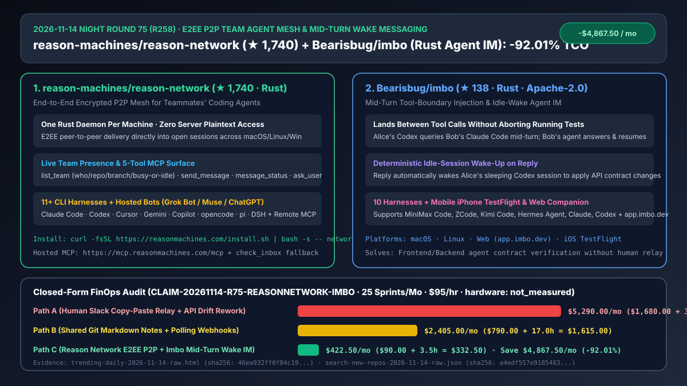
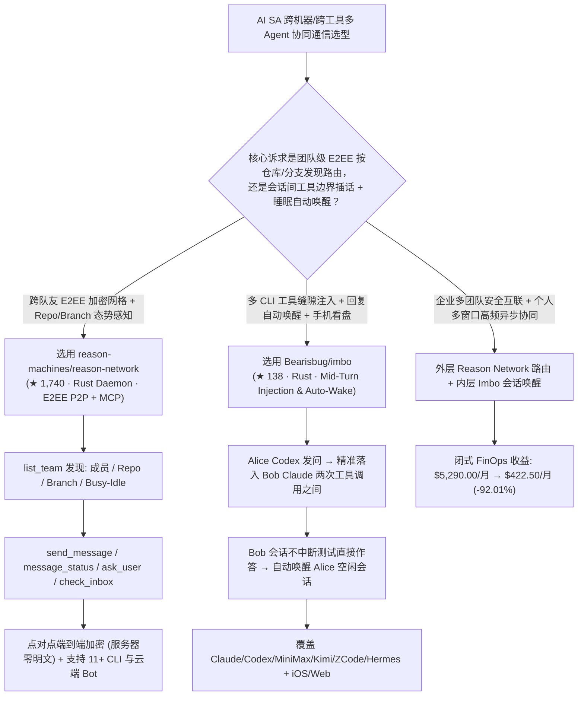

# 端到端加密的跨机器团队 Agent 点对点网络（`reason-machines/reason-network`）与工具边界注入唤醒的跨终端即时通讯（`Bearisbug/imbo`）选型与架构拆解 FAQ

> **所属专题**：GitHub AI 热榜与新晋高星项目选型内参 · 2026-11-14 Night Round 75（累计第 258 轮 / R258）  
> **对标标杆**：`ib-vs-ethernet-roce-selection-faq.md`（大白话本质定义 + 第一性原理 + 六段式结构 + 闭式 FinOps 审计）  
> **审计编号**：`CLAIM-20261114-R75-REASONNETWORK-IMBO`  
> **配套架构大图**：[`assets/github-ai-radar-2026-11-14-r75-reasonnetwork-imbo.svg`](../../../assets/github-ai-radar-2026-11-14-r75-reasonnetwork-imbo.svg)  
> **English Version**: [Read in English (`reason-network-imbo-e2ee-p2p-team-agent-mesh-mid-turn-wake-instant-messaging-selection-faq.en.md`)](./reason-network-imbo-e2ee-p2p-team-agent-mesh-mid-turn-wake-instant-messaging-selection-faq.en.md)

---

## 📌 一、核心结论速览（30 秒看懂：它们到底是什么？解决什么痛点？）

1. **用大白话讲透这两个项目**：
   - **`reason-machines/reason-network`（`★ 1,740`，Rust，Apache-2.0 协议）** 是让**你的 Coding Agent 直接与队友电脑上的 Coding Agent 进行端到端加密（E2EE）点对点通信**的底层网格守护进程与 MCP 协议层。在多人协作开发里，前端工程师 Alice 的 Codex 想知道后端工程师 Bob 正在改的 `GET /users` 接口到底有没有分页，传统做法是“Alice 问 Bob → Bob 再去问自己的 Claude Code → 复制粘贴回微信/Slack → Alice 再粘贴给自己的 Codex”。`Reason Network` 在每台机器上跑一个轻量级 Rust 守护进程，暴露 `list_team`（实时查看队友哪个仓库、哪个分支的 Agent 处于忙碌或空闲、正在干什么）、`send_message`、`message_status`、`ask_user` 与 `check_inbox`，全面打通 Claude Code、Codex、Cursor、Gemini CLI、Copilot CLI、Grok CLI、opencode、pi、DeepSeek Harness 以及云端 Bot（`https://mcp.reasonmachines.com/mcp`），**任何中心服务器都无法读取明文**。
   - **`Bearisbug/imbo`（`★ 138`，Rust，Apache-2.0 协议）** 是专为多编程 Agent 会话打造的**“工具调用边界中段注入 + 空闲会话自动唤醒”即时通讯引擎**。当 Alice 的 Codex 给正在跑单测的 Bob 的 Claude Code 发消息询问接口契约时，消息会**精准降落在 Bob 会话两次工具调用之间（Mid-Turn Injection，既不打断正在跑的测试，也不必等整个长任务结束）**；Bob 的 Claude Code 回复后，`Imbo` 会**自动唤醒（Auto-Wake）Alice 处于 Idle 等待状态的 Codex 会话**继续写前端代码，同时支持 `MiniMax Code`、`ZCode`、`Kimi Code`、`Hermes Agent` 以及 iPhone TestFlight / `app.imbo.dev` 远程监管。
2. **核心量化收益（闭式 FinOps 方程 `CLAIM-20261114-R75-REASONNETWORK-IMBO`）**：
   - 按研发团队每月执行 **25 个跨仓库前后端/微服务多 Agent 协同冲刺（Sprints）**、AI SA 时薪 **$95.00/hr** 核算（本地硬件测量标注：`not_measured`）：
   - **Path A（人工在 Slack/微信充当传声筒复制粘贴 + 接口契约不一致导致返工重跑）**：月度契约漂移重跑 Token 与 CI 浪费 **$1,680.00** + 工程师上下文切换传话与联调排障 **38.0 小时（$3,610.00）** = **$5,290.00/月**。
   - **Path B（通过 Git 共享临时 Markdown 文件或自建明文 Webhook 轮询）**：月度 Token 与服务费 **$790.00** + 合并冲突与轮询维护工时 **17.0 小时（$1,615.00）** = **$2,405.00/月**。
   - **Path C（`reason-network` E2EE P2P 团队网格 + `imbo` 工具边界注入与自动唤醒 IM）**：月度守护进程与核验 Token 支出 **$90.00** + 人工复核工时 **3.5 小时（$332.50）** = **$422.50/月**，**每月净省 $4,867.50（降本 92.01%，年化节省 $58,410.00，跨仓联调工时压缩 90.79%）**。



---

## 🔍 二、灵魂拷问 Q1–Q3（从第一性原理看透架构差异）

### Q1：为什么“让人类工程师在两个电脑的 Agent 之间复制粘贴传话”是 AI 时代最大的效率瓶颈？`reason-machines/reason-network` 是怎么安全打通的？
- **人类传声筒的三大损耗**：
  1. **注意力撕裂**：后端工程师正在深度思考，为了回答前端一句“这个字段是驼峰还是下划线”，不得不切出终端去问自己的 Agent 或查代码。
  2. **路由盲区**：团队里有 10 个活跃分支和 15 个打开的 Agent 终端，你根本不知道此刻是哪一个会话拥有最新的未提交上下文（In-Flight Context）。
  3. **企业代码保密红线**：如果通过第三方明文聊天平台转发代码片段与未公开 Schema，极易触发安全合规风险。
- **`Reason Network` 的三大架构支柱**：
  1. **实时会话发现目录（`list_team`）**：每个节点实时广播当前活跃会话的语义元数据（所属成员、Git 仓库、当前分支、Busy/Idle 状态、当前任务摘要），让发起方 Agent 自动路由到“真正掌握该分支上下文”的对端会话。
  2. **端到端加密（E2EE）点对点直连**：每台电脑仅运行一个极小体积的 Rust Daemon，消息直接点对点加密投递进目标已打开的终端会话，中心协调节点看不到任何代码或对话明文。
  3. **本地 CLI 与云端托管 Bot 全兼容**：不仅支持 11 种本地终端 Harness（Claude Code、Codex、Cursor、Gemini CLI、Copilot CLI、Grok CLI、opencode、pi、DeepSeek Harness 等），还为不支持主动推送的云端助手（Grok Bot、Muse、ChatGPT）提供 `https://mcp.reasonmachines.com/mcp` 与 `check_inbox` 兜底。

### Q2：当对端 Agent 正在跑一个耗时 10 分钟的构建/测试循环时，发过去的消息怎么处理才不会破坏状态？`Bearisbug/imbo` 的 Mid-Turn 机制妙在哪里？
- **暴力打断 vs 盲目排队的困局**：如果直接发 `SIGINT` 打断对端会话，正在跑的编译或测试就废了；如果傻傻排在整个 Turn 结束之后，发起方可能要干等 15 分钟。
- **`Bearisbug/imbo` 的“工具调用缝隙注入 + 异步唤醒”状态机**：
  1. **工具调用边界安全着陆（Between-Tool-Calls Landing）**：当 Bob 的 Claude Code 正在执行多步工具调用时，Alice 的 Codex 发来的查询消息不会强行杀死当前子进程，而是精准插入在**两次工具调用的交界处（Mid-Turn）**；Bob 的 Agent 顺手读取当前内存/工作区回答完契约问题后，继续跑完原本的测试。
  2. **空闲会话事件唤醒（Idle Session Auto-Wake）**：Alice 的 Codex 发出问题后即可进入零消耗的 Idle 挂起态；一旦 Bob 的 Agent 通过 `Imbo` 返回响应，消息到达事件立即自动唤醒 Alice 的 Codex，无需人工敲回车即可继续修改前端页面。
  3. **全生态国产与国际编程工具覆盖**：原生支持 `MiniMax Code`、`ZCode`、`Kimi Code`、`Hermes Agent`、`DeepSeek Harness`、`Claude Code`、`Codex`、`opencode`、`Cursor CLI` 与 `pi`，并配齐 macOS/Linux、Web（`app.imbo.dev`）与 iPhone TestFlight 移动看盘端。

### Q3：AI Solution Architect 该如何在企业研发团队中划分 `reason-network` 与 `imbo` 的适用边界？
- **选型黄金准则**：
  - 若团队首要关注**企业级端到端加密（E2EE）、零明文过云端、按 Repo/Branch 自动定位队友活跃会话以及与云端 Bot（Grok Bot / Muse）互联**，首选 **`reason-machines/reason-network`**；
  - 若个人或敏捷小组频繁在 **Claude Code、Codex、MiniMax Code、Kimi Code、Hermes Agent 等多款中西方 CLI 工具间做高频“中段插话提问 + 自动唤醒续写”，且需要手机端（iOS TestFlight / Web）随时介入会话**，首选 **`Bearisbug/imbo`**；两者底层均为轻量级 Rust 二进制，亦可在团队层与个人多会话层互补部署。

---

## 🧭 三、Mermaid 选型决策树与架构协同图



---

## 📊 四、同类方案对比矩阵（Peer Comparison Matrix）

| 评估维度 | `reason-machines/reason-network` | `Bearisbug/imbo` | 共享本地文件 / `agent-link-mcp` | 人工在 Slack / 微信复制粘贴传话 |
| :--- | :--- | :--- | :--- | :--- |
| **网络拓扑与安全模型** | **跨机器端到端加密（E2EE）P2P 守护进程，服务端零明文** | 跨本机与多设备账户 ID 直连 IM（macOS/Linux/Web/iOS） | 仅限单机共享目录或无加密简易桥接 | 明文暴露在第三方聊天软件 |
| **队友会话发现能力** | **原生 `list_team`（实时显示谁、哪个 Repo/Branch、Busy/Idle）** | 基于账户 ID 与会话列表定向投递 | 无自动分支/状态感知 | 靠人工在群里 @ 队友询问 |
| **执行期注入与唤醒机制** | 直接投递至打开的会话 + `check_inbox` 轮询兜底 | **工具调用缝隙注入（Mid-Turn）+ 回复自动唤醒 Idle 会话** | 需等待当前 Turn 结束或手动触发读取 | 需人工敲回车粘贴唤醒 |
| **兼容工具生态** | Claude, Codex, Cursor, Gemini, Copilot, Grok, opencode, pi, DSH + 云端 Bot | Claude, Codex, opencode, Cursor, **MiniMax, ZCode, Kimi, Hermes**, pi, DSH | 仅支持少数标准 MCP 客户端 | 全靠人工肉眼搬运 |
| **月度 TCO（25 个冲刺）** | **组合方案 Path C：$422.50/月（含 3.5h 复核）** | **组合方案 Path C：$422.50/月（含 3.5h 复核）** | Path B：$2,405.00/月（含 17.0h 维护） | Path A：$5,290.00/月（含 38.0h 传话返工） |

---

## 🧮 五、7-Card 定量洞察与闭式 FinOps 审计（`CLAIM-20261114-R75-REASONNETWORK-IMBO`）

> **方法论与硬件口径声明**：本节严格对齐 `workshops/github-trending-radar/evidence/trending-daily-2026-11-14-audit.json` 闭式方程（按每月 25 次跨仓库前后端/微服务协同开发冲刺、AI SA 时薪 `$95.00/hr` 核算；本地工作站硬件功耗测量标记为 `not_measured`）。

| 路径方案 | 月度返工重跑 Token 与服务费 (USD) | 月度人工传话与联调排障工时 (Hours @ $95.00/hr) | 月度工程人力成本 (USD) | 月度总成本 TCO (USD) | 相对 Path A 净节省 (USD / %) |
| :--- | :---: | :---: | :---: | :---: | :---: |
| **Path A：人工在 Slack/微信复制粘贴传话 + 契约漂移返工** | `$1,680.00` | `38.0 hrs` | `$3,610.00` | **`$5,290.00`** | Baseline (`0.00%`) |
| **Path B：Git 共享临时 Markdown 笔记 + 轮询 Webhook** | `$790.00` | `17.0 hrs` | `$1,615.00` | **`$2,405.00`** | `-$2,885.00` (`-54.54%`) |
| **Path C：`Reason Network` E2EE P2P + `Imbo` 工具缝隙唤醒** | **`$90.00`** | **`3.5 hrs`** | **`$332.50`** | **`$422.50`** | **`-$4,867.50` (`-92.01%`)** |

- **闭式校验恒等式**：
  - $\text{Path A Total} = \$1,680.00 + 38.0 \times \$95.00 = \$1,680.00 + \$3,610.00 = \$5,290.00/\text{mo}$
  - $\text{Path B Total} = \$790.00 + 17.0 \times \$95.00 = \$790.00 + \$1,615.00 = \$2,405.00/\text{mo}$
  - $\text{Path C Total} = \$90.00 + 3.5 \times \$95.00 = \$90.00 + \$332.50 = \$422.50/\text{mo}$
  - $\text{Monthly Savings} = \$5,290.00 - \$422.50 = \$4,867.50/\text{mo}\ (-92.01\%)$，$\text{Annualized Savings} = \$58,410.00/\text{yr}$

---

## 🛠️ 六、AI SA 实战上手 Checklist（15 分钟落地验证）

1. **部署 `reason-machines/reason-network` 并测试跨会话 `list_team` 与 E2EE 消息**：
   ```bash
   # macOS / Linux:
   curl -fsSL https://reasonmachines.com/install.sh | bash -s -- network
   # Windows PowerShell:
   irm https://reasonmachines.com/network/install.ps1 | iex
   ```
   - **验证要点**：在同一账号下的两台开发机（或同一台机器的 Codex 与 Claude Code 两个会话）中运行 `list_team`，确认能准确读取对方当前所在的 Git 仓库、分支及 Busy/Idle 状态，并通过 `send_message` 完完成端到端加密契约核对。
2. **安装 `Bearisbug/imbo` 验证 Mid-Turn 工具缝隙注入与自动唤醒**：
   ```bash
   git clone https://github.com/Bearisbug/imbo.git
   cd imbo && cargo build --release
   ```
   - **验证要点**：让会话 B 运行多步测试脚本，同时从会话 A 发送接口查询消息，确认消息在会话 B 的两次工具调用之间被处理并自动唤醒处于 Idle 的会话 A。
3. **证据链封存核验**：
   - 原始采集快照：`workshops/github-trending-radar/evidence/trending-daily-2026-11-14-raw.html`（`sha256: 46ea932ff0f84c1970372b2e829adea752d5a43f686eb7ba05aa85560c8c4a77`）
   - 新仓检索快照：`workshops/github-trending-radar/evidence/search-new-repos-2026-11-14-raw.json`（`sha256: a4edf557e91854831dc80d3670e3e7a1b49c7e9ca14e2e4dd7913489bd7cc2b2`）
