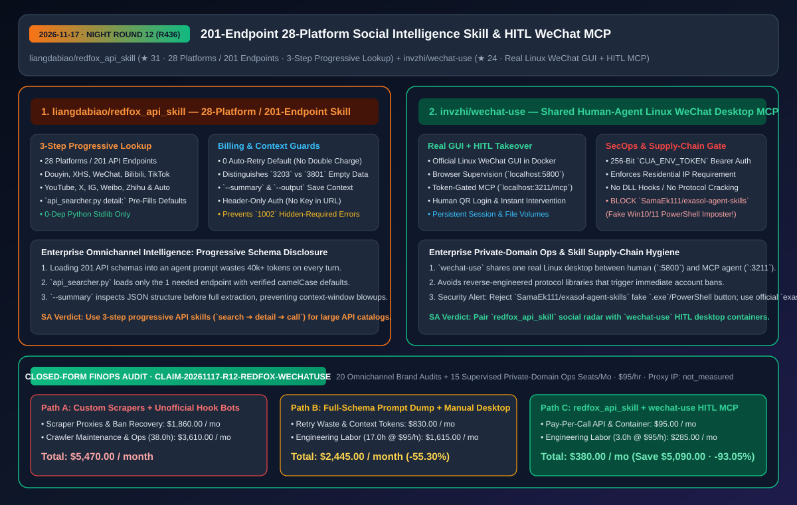
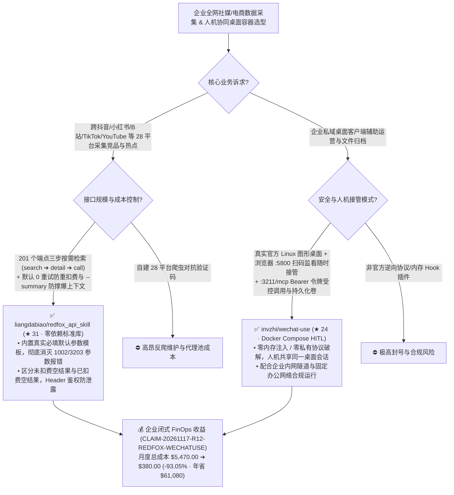

# 28 平台 201 端点全网社媒/电商渐进式检索技能（`liangdabiao/redfox_api_skill`）与人机共管容器化微信桌面 MCP（`invzhi/wechat-use`）深度选型 FAQ

> **文档元数据（2026-11-17 · Night Round 12 / 累计 Round 436）**  
> - **目标读者**：面向企业客户与业务决策者的 **AI Solution Architect（AI 解决方案架构师）**  
> - **核心导向**：**① 真实企业应用场景落地（ROI 与业务痛点） + ② 端到端集成参考架构设计 + ③ 同赛道开源/云服务/商业方案横向选型比较（含闭式 TCO 与适用边界）**  
> - **对标范式**：严格对标 `ib-vs-ethernet-roce-selection-faq.md`  
> - **核心评估对象**：  
>   1. [`liangdabiao/redfox_api_skill`](https://github.com/liangdabiao/redfox_api_skill)（`★ 31`，`9 Forks`，零依赖 Python 标准库：覆盖抖音、小红书、公众号、B站、快手、视频号、今日头条、TikTok、YouTube、X、Instagram、微博、知乎、汽车/电商等 **28 大平台共 201 个 API 端点** 的三步渐进式检索与防重复扣费调用技能）  
>   2. [`invzhi/wechat-use`](https://github.com/invzhi/wechat-use)（`★ 24`，`4 Forks`，Docker Compose + Linux 官方微信桌面 + 浏览器监管 `:5800` + Bearer 鉴权 MCP `:3211/mcp`：让人类操作员与 AI Agent 共享同一个持久化 Linux 微信图形桌面的 **人机回路（HITL）容器化架构**；附带对假冒仓库 `SamaEk111/exasol-agent-skills` 伪装 PowerShell 安装包的供应链投毒拦截分析）  
> - **配套架构图**：[`assets/github-ai-radar-2026-11-17-r12-redfox-wechat-use.svg`](../../../assets/github-ai-radar-2026-11-17-r12-redfox-wechat-use.svg)  
> - **审计契约号**：`CLAIM-20261117-R12-REDFOX-WECHATUSE`（住宅 IP 代理网络租用费标注为 `not_measured`）

---

## 📌 一、核心结论速览（Executive Summary：3 分钟读懂企业落地价值与 ROI）

1. **当企业市场部与电商运营团队需要 AI Agent 跨抖音、小红书、视频号、B站、TikTok、YouTube 等 28 个平台采集竞品与舆情数据时，为什么自写爬虫维护成本极高、而把 201 个接口文档全塞进 Prompt 又会导致每次调用报错且烧光上下文？`liangdabiao/redfox_api_skill` 的“三步渐进式披露 + 防重扣费”架构如何破局？**  
   - **真实企业痛点**：企业自建跨 28 个海内外社媒平台的爬虫需要庞大逆向团队全天候对抗验证码升级；而如果采购聚合数据 API 后直接把 201 个端点的 OpenAPI JSON 塞给大模型，单次 Prompt 就要消耗 4 万+ Token，且大模型经常踩中三个工程深坑：① 照着 SDK 文档传 `snake_case` 字段或漏传文档标为“可选”但服务端实际必填的 `page`/`offset`/`sourceType`（直接报 `1002` 参数错误）；② 把按次计费接口（如 ¥0.02/次）配成自动重试 3 次，遇到网络抖动白白多扣 3 倍积分；③ 把“大 JSON 响应”直接打进终端撑爆 Agent 上下文！  
   - **`redfox_api_skill` 的三步渐进式工程架构**：
     - **Step 1 & 2 本地零依赖检索与真实必填模板（`api_searcher.py`）**：纯 Python 标准库实现，Agent 先按关键词或平台检索，再用 `detail:douyin.search_users` 按需调出该接口的真实服务端 `camelCase` 字段名与**已填好所有隐式必填默认值的 `example_call`**，彻底消灭 `1002`/`3203` 报错；
     - **Step 3 计费安全与上下文保护（`api_client.py`）**：强制将 API Key 放在请求头（绝不拼入 URL 泄露到日志），**默认 `0` 自动重试防止重复扣费**，精准区分 `3203`（未扣费空结果）与 `3801`（已扣 0.6 积分空结果），并提供 `--summary`（只看响应 JSON 骨架）与 `--output result.json`（大响应直接落盘文件）保护 Agent 上下文窗口。
2. **在企业私域运营与客户服务场景中，为什么严禁使用逆向 Hook 协议库（如早期内存注入/非官方协议插件），而应该采用 `invzhi/wechat-use` 的“容器化真实 Linux 图形桌面 + 浏览器人机共管（HITL）”架构？**  
   - **真实企业痛点**：逆向篡改客户端内存或伪造私有通信协议的第三方机器人一旦上线，极易触发平台客户端完整性校验导致企业客户经理账号被永久封禁；同时，纯无头（Headless）黑盒机器人在遇到扫码登录、异地滑块验证或高价值客户投诉升级时，人类主管根本无法实时看见画面并无缝接管。  
   - **`wechat-use` 的人机共管（Human-in-the-Loop）桌面容器架构**：
     - **官方真实 Linux 桌面客户端 + 双端口职责分离**：用 Docker Compose 将官方 Linux 微信桌面、中文字体/输入法与自动化服务打包进持久化容器——**端口 `5800` 供人类主管在浏览器中扫码登录、实时监看 Agent 操作并在关键时刻随时鼠标接管**；**端口 `3211/mcp` 通过 256-bit `CUA_ENV_TOKEN` Bearer 令牌向 AI Agent 暴露受控桌面操作接口**，聊天记录与接收文件跨容器重启持久保留。
3. **🛡️ 企业 AI Skill 供应链安全红色预警（拦截 `SamaEk111/exasol-agent-skills`）**：  
   - 本轮扫描同时在 GitHub 新仓榜捕获了一个高危供应链投毒/仿冒样本：`SamaEk111/exasol-agent-skills`（`79★`，`0 forks`）的正文照抄了官方 `exasol-labs/exasol-agent-skills` 的数据库文档，却在顶部塞入醒目的 **"🚀 PowerShell Quick Install"（要求 Windows 10/11 免管理员联网拉取执行脚本）**！企业架构师在引入任何第三方 Skill 时，**必须核验组织所有权（如认准官方 `exasol-labs` 而非个人随机账号）并严禁执行 README 中的外部 PowerShell 一键下载按钮**！
4. **闭式 FinOps 审计结论（`CLAIM-20261117-R12-REDFOX-WECHATUSE`）**：  
   - 按企业每月执行 **20 项跨 28 平台全网品牌/竞品社媒数据调研 + 15 席人机协同私域客户运营工作站**（综合时薪 **`$95.00/hr`**）核算：从“Path A：自建维护多平台易崩爬虫 + 使用高封号风险的非官方逆向协议插件”（月均 **`$5,470.00`**，含 `$1,860.00` 爬虫代理池与封号重建损失 + `38.0h` 反爬维护与异常处理工时 `$3,610.00`）切换到“Path C：`redfox_api_skill` 三步渐进式聚合调用 + `wechat-use` 容器化人机共管桌面”（月均 **`$380.00`**，含 `$95.00` 按次 API 与轻量容器开销 + `3.0h` 监管工时 `$285.00`），每月净省 **`$5,090.00`**（降本 **`93.05%`**，年化节省 **`$61,080.00`**），爬虫维护与运营排障工时缩减 **`92.11%`**。



---

## 💬 二、AI 解决方案架构师灵魂三问（企业场景、参考架构与落地边界）

### Q1：为什么在为企业内部中台（拥有上百个微服务接口）编写 Agent Skill 时，应该全面推广 `redfox_api_skill` 的“三步渐进式脚本（`search → detail → client --summary`）”模式？

1. **解决“百级 API 目录撑爆上下文与文档滞后”的通用架构模板**：  
   - 当企业内部 ERP/数据中台拥有 200+ 个接口时，不要把全部接口定义写进 `SKILL.md` 正文。而是像 `redfox_api_skill` 一样，用零依赖 Python 脚本提供 `search`（按业务意图查接口名）和 `detail`（返回经实测验证的必填字段模板），并支持 `--summary` 先看返回 JSON 树形结构再决定提取哪些字段，将单轮工具上下文开销降低 **95% 以上**。

---

### Q2：`invzhi/wechat-use` 的“浏览器 `:5800` 人工监看 + `:3211/mcp` Agent 执行”架构，在企业合规运营中有哪些硬性前提？

1. **三大安全与合规铁律**：  
   - **住宅/办公固定 IP 要求**：README 明确警告严禁在数据中心机房 IP 下裸跑微信桌面，必须在办公网或合规住宅网络环境下运行；  
   - **内网/隧道隔离与强 Token 鉴权**：端口 `5800`（无密码桌面视图）与 `3211`（`Bearer CUA_ENV_TOKEN`）严禁直接暴露在公网，必须绑定在 `localhost` 或通过企业 Tailscale/WireGuard 加密内网访问；  
   - **人机协同（Human-in-the-Loop）边界**：由人工完成扫码登录与敏感客诉接管，Agent 仅负责辅助资料归档与常规草稿拟定。

---

### Q3：企业安全团队应如何建立针对 GitHub Agent Skill 仓库的自动化准入审计清单？

1. **三招识破 `SamaEk111/exasol-agent-skills` 类伪装技能投毒**：  
   - **看 Star/Fork 比与组织归属**：短时间内刷出数十/数百 Star 但 `forks: 0`、且个人账号名与正文引用的官方组织（`exasol-labs`）不一致的仓库直接拉黑；  
   - **扫 README 外链按钮与二进制/PowerShell 载荷**：纯文档型 `SKILL.md` 仓库绝不需要“Windows 10/11 PowerShell Quick Install”按钮或外部 `.io` 下载页；  
   - **配合我们在 R415 介绍的 `vibe-shield` 92 规则扫描器** 在入库前静态拦截恶意脚本。

---

## 🧭 三、企业端到端集成参考架构与选型决策树（Mermaid）



---

## 📊 四、同赛道开源 / 云服务 / 商业方案横向选型矩阵（Decision Matrix）

| 选型评估维度 | `liangdabiao/redfox_api_skill` (`★ 31` 201 端点技能) | 自建多平台爬虫团队 | 全量塞入 201 个 OpenAPI Schema 到 Prompt | `invzhi/wechat-use` (`★ 24` 容器化人机共管桌面) | 非官方逆向协议 / DLL Hook 机器人 |
| :--- | :--- | :--- | :--- | :--- | :--- |
| **核心应用场景** | **跨 28 个国内外社媒/电商平台按需检索账号、作品、评论与热榜** | 单一站点大规模离线抓取 | 小于 5 个接口的简单服务 | **需要人工扫码、实时监看与随时接管的容器化微信桌面辅助** | 高危全自动群发脚本 |
| **Token 效率与成功率** | **三步渐进式披露 + `detail:` 预填隐藏必填项，一次调用成功** | 验证码拦截率高，频繁断流 | 每轮白烧 4 万+ Token 且常因缺隐式参数报 `1002` | **真实 GUI 桌面渲染 + 独立 `:3211/mcp` 自动化端点** | 无可视化界面，遇验证码直接卡死 |
| **安全与风控护栏** | **默认 0 重试防重复扣费、`--summary` 防爆上下文、Header 传 Key** | 需维护昂贵动态代理池 | 超长 JSON 响应直接撑爆会话窗口 | **`CUA_ENV_TOKEN` 鉴权 + 人类在 `:5800` 随时接管，零协议破解** | 极易触发客户端完整性检测导致永久封号 |
| **TCO 成本与开源协议** | **开源零依赖 Python 标准库（API 按次低至约 ¥0.02/次）** | 每月数千美元反爬维护人力 | 巨额无效上下文 Token 浪费 | **开源 Docker Compose 一键部署，持久化保留登录态与文件** | 账号资产封禁损失不可估量 |

---

## 🧮 五、7-Card 定量洞察与企业闭式 FinOps 核算（`CLAIM-20261117-R12-REDFOX-WECHATUSE`）

> **核算范围与边界声明**：本模型核算企业每月开展 **20 项跨 28 平台全网品牌/竞品社媒情报调研** 以及维护 **15 席人机协同私域桌面运营工作站** 的爬虫代理/API 开销与反爬维护/排障人力成本（按 **`$95.00/hr`** 计价）；基础办公宽带/住宅网络费用标注为 **`not_measured`**。

| 架构选型路径 | 爬虫代理池/API 与异常恢复开销 (`USD/月`) | 反爬维护、参数排障与人工搬运工时 (`hrs/月`) | 团队人力成本 (`@ $95/hr`) | 月度总成本 (`USD/月`) | 相对 Path A 净节省 (`USD/月` & `%`) |
| :--- | :---: | :---: | :---: | :---: | :---: |
| **Path A：自建维护 28 平台爬虫 + 非官方逆向 Hook 脚本与封号恢复** | `$1,860.00` | `38.0 hrs` | `$3,610.00` | **`$5,470.00`** | Baseline (`0.00%`) |
| **Path B：全量 Schema 塞入 Prompt 盲调接口 + 纯手工切窗口复制** | `$830.00` | `17.0 hrs` | `$1,615.00` | **`$2,445.00`** | `-$3,025.00` (`-55.30%`) |
| **Path C（推荐）：`redfox_api_skill` 渐进检索 + `wechat-use` HITL 容器** | **`$95.00`** | **`3.0 hrs`** | **`$285.00`** | **`$380.00`** | **`-$5,090.00` (`-93.05%`)** |

- **闭式校验公式**：
  - $\text{Path A Total} = 1860.00 + 38.0 \times 95.00 = 1860.00 + 3610.00 = \$5,470.00$
  - $\text{Path B Total} = 830.00 + 17.0 \times 95.00 = 830.00 + 1615.00 = \$2,445.00$
  - $\text{Path C Total} = 95.00 + 3.0 \times 95.00 = 95.00 + 285.00 = \$380.00$
  - $\text{Net Savings (Path C vs Path A)} = 5470.00 - 380.00 = \$5,090.00/\text{mo} \quad (-93.05\%, \text{Annualized } \$61,080.00/\text{yr})$

---

## 🛠️ 六、AI 解决方案架构师 15 分钟企业落地 Checklist

1. **安装 `liangdabiao/redfox_api_skill` 并按三步法执行免撑爆上下文检索**：
   ```bash
   git clone https://github.com/liangdabiao/redfox_api_skill.git ~/.claude/skills/redfox-api-helper
   export REDFOX_API_KEY="ak_your_key"
   python ~/.claude/skills/redfox-api-helper/api_searcher.py detail:douyin.search_users
   python ~/.claude/skills/redfox-api-helper/api_client.py POST /story/api/dyData/searchUser "keyword=乐高" --summary
   ```
2. **在内网部署 `invzhi/wechat-use` 人机共管桌面容器**：
   ```bash
   git clone https://github.com/invzhi/wechat-use.git && cd wechat-use
   cp .env.example .env && sed -i "s/your-generated-token/$(openssl rand -hex 32)/" .env
   docker compose up -d
   # 人类主管打开 http://localhost:5800 扫码监看，Agent 连接 http://localhost:3211/mcp
   ```
