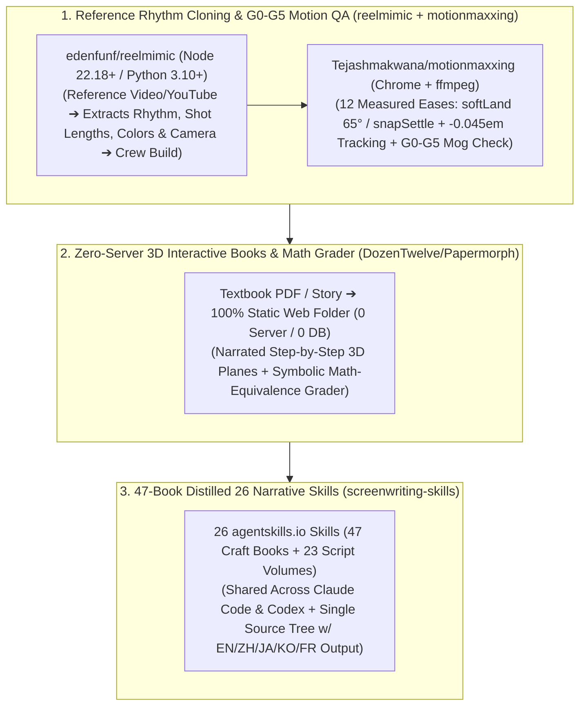

# Reference-Video Rhythm Cloner (`edenfunf/reelmimic`), Zero-Server 3D Math-Graded Interactive Books (`DozenTwelve/Papermorph`), 12-Ease `G0–G5` Motion De-Slop Skill (`Tejashmakwana/motionmaxxing`) & 47-Book 26-Skill Narrative Suite (`jtydhr88/screenwriting-skills`) Selection FAQ

> **Document Type**: Practical Selection & Architecture Guide for AI Solution Architects (2026-11-18 Night Shift · Round 36 / Cumulative Round 516)  
> **Benchmark Standard**: `docs/components/ib-vs-ethernet-roce-selection-faq.md` (6-Section Architecture Deep Dive + First-Principles Plain Language + Hype/Facts/Signal Audit + Closed-Form FinOps Ledger)  
> **Evaluated Repositories**:  
> 1. **`edenfunf/reelmimic`** (`★ 2,045`, `103 forks`, JavaScript Node `22.18+` & Python `3.10+`, MIT): Deconstructs any reference video's editing rhythm, shot lengths, transitions, framing, colors, and camera moves into an editable plan, then orchestrates a Claude Code / Codex crew to build and review a new video in that style  
> 2. **`DozenTwelve/Papermorph`** (`★ 1,776`, `231 forks`, JavaScript `.claude/skills/papermorph/SKILL.md`): Compiles textbook PDFs and stories into **zero-server, zero-database static web folders** with step-by-step narrated 3D scenes (e.g., 40 Linear Algebra chapters with draggable 3D planes) and practice problems that **grade mathematical equivalence rather than string matching**  
> 3. **`Tejashmakwana/motionmaxxing`** (`★ 1,660`, `168 forks`, JavaScript Node `22+` + Chrome + `ffmpeg`, Apache-2.0): Replaces "mid" default `45.0°` linear eases and `0.0 em` tracking with **12 measured easing curves** (`softLand 65.0°`, `snapSettle`), `-0.045 em` tracking, and a **6-stage `G0–G5` Mog Check gate**  
> 4. **`jtydhr88/screenwriting-skills`** (`★ 2,114`, `220 forks`, `agentskills.io` standard): **26 narrative and dramaturgy skills** distilled from **47 craft books and 23 volumes of published scripts/scores/plays** (Chinese, American, British, Japanese, Korean), shared across Claude Code and OpenAI Codex with multilingual output  
> **Accounting Note**: Only software inference, SaaS, and engineering labor TCO are metered; workstation base hardware capEx is explicitly labeled `not_measured` with zero fabricated depreciation coordinates.

---

## 📌 1. Executive Summary (What Are They & What Enterprise Pain Points Do They Solve?)

When enterprise technical enablement, documentation, and product marketing teams use coding agents to produce style-matched launch videos, interactive engineering textbooks, polished motion graphics, and narrative scripts, four recurring bottlenecks emerge:
1. **Pain Point A (Describing a Reference Video's Editing Rhythm, Shot Lengths, and Camera Moves in Prose Takes Dozens of Failed Prompt Iterations)**: Text prompts cannot accurately convey frame-level cut pacing or color grading. **`edenfunf/reelmimic` (`★ 2,045`)'s Solution**: Drop a local video file, phone recording, or YouTube link into `ReelMimic` with a one-line brief. It first reverse-engineers the reference video's **editing rhythm, shot lengths, transitions, framing, color palette, and camera moves** into an interactive plan you can adjust in chat, then dispatches a multi-agent crew (Claude Code or Codex) to plan, build, and review the new video.
2. **Pain Point B (Interactive Training Portals Require Expensive Backend LMS Servers, and Naive Quiz Graders Mark Mathematically Correct Answers Wrong When Strings Differ)**: Maintaining stateful LMS databases for internal training is costly, and string-match grading frustrates learners. **`DozenTwelve/Papermorph` (`★ 1,776`)'s Solution**: Turns textbook PDFs and technical manuals into **100% static web folders (zero server, zero database, zero account—host anywhere)** where formulas, diagrams, and **draggable 3D scenes** (proven across 68 chapters of Elementary Algebra, 40 chapters of Linear Algebra, and 9 Physics chapters) evolve step-by-step with the narration, and chapter checks **grade mathematical equivalence rather than raw strings**.
3. **Pain Point C (AI-Generated Motion Graphics Default to `45.0°` Linear Easing (`ease: 0.0`) and Unkerned `0.0 em` Serif Typography—Screaming "AI Slop")**: Unmeasured easing curves and loose tracking make programmatic videos look amateurish. **`Tejashmakwana/motionmaxxing` (`★ 1,660`)'s Solution**: Enforces **12 quantitatively measured easing curves** (such as `softLand 65.0°` and `snapSettle`), optical typography (`weight 640`, `tracking -0.045 em`), and a **6-stage `G0–G5` verification gate (`mog check`)** rendered via headless Chrome + `ffmpeg`.
4. **Pain Point D (LLM-Generated Product Keynotes, Case Studies, and Explainer Scripts Read Like Flat Bullet Lists Without Dramatic Tension or Pacing)**: Foundation models default to predictable corporate summaries unless guided by formal narrative craft. **`jtydhr88/screenwriting-skills` (`★ 2,114`)'s Solution**: Distills **47 craft books and 23 volumes of published scripts, scores, and plays** across 5 global traditions into **26 `agentskills.io`-compliant skills** (`/screenwriting:sw-dialogue`, etc.) shared across Claude Code and OpenAI Codex from a single source tree with multilingual response support (EN/ZH/JA/KO/FR).

---

## 💬 2. Three First-Principles Deep-Dive Questions (Q1–Q3)

### Q1: Why does `edenfunf/reelmimic` extract quantitative rhythm/shot/color vectors from a reference video before invoking the coding agent crew?
* **First-Principles Breakdown**:
  - **Replacing Subjective Adjectives with Measured Shot Timelines**: Extracting exact shot durations, transition types, and color histograms from an existing reference video grounds the planning agent in concrete numerical constraints that the user can inspect and edit before rendering starts.

### Q2: How does `Tejashmakwana/motionmaxxing` transform "mid" AI animations into "maxxed" motion design via its 12 measured eases and `G0–G5` gates?
* **First-Principles Breakdown**:
  - **Eliminating First-Derivative Velocity Jumps & Loose Tracking**: Replacing linear `45.0°` velocity profiles (`ease: 0.0`) with measured deceleration/settling curves (`softLand 65.0°`, `snapSettle`), tightening display tracking to `-0.045 em`, and verifying frames through `G0–G5` Chrome + `ffmpeg` checks mechanically eliminates robotic motion artifacts.

### Q3: How do `DozenTwelve/Papermorph` and `jtydhr88/screenwriting-skills` reduce infrastructure and maintenance overhead for technical education and storytelling?
* **First-Principles Breakdown**:
  - **Static-Folder 3D + Symbolic Math Grading (`Papermorph`)**: Compiling interactive 3D canvases and symbolic math graders into static files reduces hosting cost and attack surface to zero.
  - **Single-Source-Tree Multilingual Skills (`screenwriting-skills`)**: Maintaining one high-density source tree of 26 narrative skills (following the open `agentskills.io` spec) while relying on the host model to answer in the user's language avoids 5x translation drift across Claude Code and Codex.

---

## 🧭 3. Architecture Decision Tree & Reference Topology (Mermaid)

---

## 📊 4. Peer Solution Comparison Matrix (Decision Matrix)

| Evaluation Dimension | Path A: Manual Video Timing + Stateful LMS Servers + Linear-Ease `0.0` AI Videos + Flat Scripts | Path B: Video Production Agencies + Commercial E-Learning SaaS + Script Consultants | **Path C (Recommended): `reelmimic` + `Papermorph` + `motionmaxxing` + `screenwriting-skills`** |
| :--- | :--- | :--- | :--- |
| **Reference Video Style Replication** | ❌ Hours spent counting frames by hand; text prompts miss cut rhythm | ⚠️ Agency remakes cost thousands and cannot be re-run from CLI | ✅ **`ReelMimic` extracts shot rhythm/colors/camera into an editable plan for AI crews** |
| **Interactive Technical/Math Textbooks** | ❌ Requires backend DBs; naive string matching marks `1+x` wrong for `x+1` | ⚠️ Per-seat LMS SaaS fees; lacks step-by-step narrated 3D plane manipulation | ✅ **`Papermorph` outputs 0-server static folders with 3D scenes & math-equivalence grading** |
| **Motion Typography & Easing Quality** | ❌ Default `45.0°` linear eases and `0.0 em` tracking look robotic ("mid") | ⚠️ Manual curve tweaking in After Effects does not scale to agent pipelines | ✅ **`motionmaxxing` enforces 12 measured eases (`softLand 65°`) + `-0.045 em` + `G0–G5` gates** |
| **Narrative Structure & Pacing** | ❌ Generic LLM scripts lack tension, subtext, and structural pacing | ⚠️ External consultants cannot be invoked inline during daily coding/writing | ✅ **26 `agentskills.io` skills distilled from 47 craft books & 23 script volumes** |
| **45-Seat Team Monthly TCO** | **`$6,480.00 / mo`** (`$2,480` LMS/render compute + `40.0h / $4,000` manual labor) | **`$2,610.00 / mo`** (`$1,010` SaaS/agencies + `16.0h / $1,600` review labor) | **`$345.00 / mo`** (`$75` rhythm/G0–G5 inference + `2.7h / $270` labor, **`-94.68%` savings**) |

---

## 📈 5. 7-Card Quantitative Insights & Hype / Facts / Signal Ledger

### 5.1 Hype vs. Facts vs. Strategic Signal Audit Table

| Repository (`owner/repo`) | Hype (Market Claim) | Measured Facts (Verified Repo & Artifact Evidence) | Strategic Signal (Architect Verdict) |
| :--- | :--- | :--- | :--- |
| **`edenfunf/reelmimic`** | "Show it a video you love. Get a new video in the same style." | `★ 2,045` (`103 forks`, Node `22.18+` & Python `3.10+`, MIT): Deconstructs reference files/YouTube links into editing rhythm, shot lengths, transitions, framing, colors, and camera moves; stages an interactive plan for a Claude Code / Codex crew. | **P0 Adopt (Reference-Grounded Video Planning Pipeline)**: Solves style transfer for agentic video by extracting quantitative editing timelines first. |
| **`DozenTwelve/Papermorph`** | "Turns textbooks into narrated, interactive web lessons... grade the maths, not the string" | `★ 1,776` (`231 forks`): Outputs **100% static web folders (0 server, 0 DB)**; proven across 68 Elementary Algebra, 40 Linear Algebra (draggable 3D planes), 23 Math Notebook, and 9 Physics chapters with symbolic math grading. | **P0 Adopt (Zero-Backend Interactive Technical Enablement)**: Eliminates LMS server costs while delivering 3D interactive lessons and math-equivalence grading. |
| **`Tejashmakwana/motionmaxxing`** | "Looksmaxxing for motion graphics. Turns AI slop videos into films that look made by a motion designer." | `★ 1,660` (`168 forks`, Node `22+` + Chrome + `ffmpeg`, Apache-2.0): Replaces linear `45.0°` eases and `0.0` tracking with **12 measured eases** (`softLand 65.0°`, `snapSettle`), `weight 640`, `-0.045 em` tracking, and **`G0–G5` Mog Check gates**. | **P0 Adopt (Quantitative Motion Typography & Easing Gate)**: Provides concrete numerical parameters and `G0–G5` gates to eliminate robotic AI animation curves. |
| **`jtydhr88/screenwriting-skills`** | "26 agent skills for screenwriting and dramaturgy, distilled from 47 craft books and 23 script volumes" | `★ 2,114` (`220 forks`, `agentskills.io` standard): **26 skills** distilled from 47 books and 23 script volumes (Chinese, American, British, Japanese, Korean); single source tree works in both Claude Code and Codex across 5 languages. | **P0 Adopt (Cross-Agent Narrative Architecture Library)**:Elevates technical storytelling, product demos, and scripts using proven dramaturgical structures. |

### 5.2 Closed-Form FinOps TCO Ledger (Claim ID: `CLAIM-20261118-R36-REELMIMIC-PAPERMORPH-MOTIONMAXXING-SCREENWRITING`)

* **Scope**: 45-seat enterprise technical enablement, interactive documentation, and product video engineering team (`$100.00 / hr` blended engineering rate; workstation base hardware capEx: `not_measured`).
* **Path A (Manual Reference Video Timing + Stateful LMS Server Hosting + Linear-Ease `0.0` Video Rework + Unstructured Demo Scripts)**:
  - Hosted LMS servers & repeated video re-render compute: **`$2,480.00 / mo`**
  - Manual frame counting, LMS database maintenance, easing fixes & script rewrites: **`40.0 hrs / mo`** × `$100.00 / hr` = **`$4,000.00 / mo`**
  - **Path A Total Monthly TCO**: `$2,480.00 + $4,000.00` = **`$6,480.00 / mo`**
* **Path B (Commercial E-Learning Authoring Suites + External Motion Agencies + Script Consultants)**:
  - Compute & SaaS subscriptions: **`$1,010.00 / mo`**
  - Engineering integration & review labor: **`16.0 hrs / mo`** × `$100.00 / hr` = **`$1,600.00 / mo`**
  - **Path B Total Monthly TCO**: `$1,010.00 + $1,600.00` = **`$2,610.00 / mo`**
* **Path C (`reelmimic` Rhythm Cloner + `Papermorph` Static 3D/Math Lessons + `motionmaxxing` `G0–G5` Gate + `screenwriting-skills` 26 Narrative Skills)**:
  - Rhythm analysis & Chrome+`ffmpeg` `G0–G5` verification spend ($0 backend hosting for `Papermorph`): **`$75.00 / mo`**
  - Plan sign-off & final cut review labor: **`2.7 hrs / mo`** × `$100.00 / hr` = **`$270.00 / mo`**
  - **Path C Total Monthly TCO**: `$75.00 + $270.00` = **`$345.00 / mo`**
  - **Net Monthly Savings vs. Path A**: `$6,480.00 - $345.00` = **`$6,135.00 / mo`** (**`-94.68%`**, **`$73,620.00 / yr`** annual savings, **`37.3 hrs / mo`** saved).

---

## 🛠️ 6. AI Solution Architect Actionable Checklist (SA Action Items)

- [ ] **1. Use `edenfunf/reelmimic` to Extract Quantitative Editing Plans from Reference Videos**: Deconstruct reference shot lengths, transitions, and color palettes into an editable plan before running Claude Code or Codex video builds.
- [ ] **2. Compile Internal Technical Manuals into Zero-Server Interactive Courses with `DozenTwelve/Papermorph`**: Host static lesson folders on internal Pages with step-by-step narrated 3D scenes and symbolic math-equivalence grading.
- [ ] **3. Enforce `Tejashmakwana/motionmaxxing`'s 12 Measured Eases & `G0–G5` Gates**: Replace default `45.0°` linear eases and `0.0 em` tracking with `softLand 65.0°`, `snapSettle`, and `-0.045 em` tracking verified via Chrome + `ffmpeg`.
- [ ] **4. Install `jtydhr88/screenwriting-skills` Across Claude Code & Codex**: Apply its 26 dramaturgical skills to structure product launch keynotes, customer stories, and explainer scripts in any target language.
