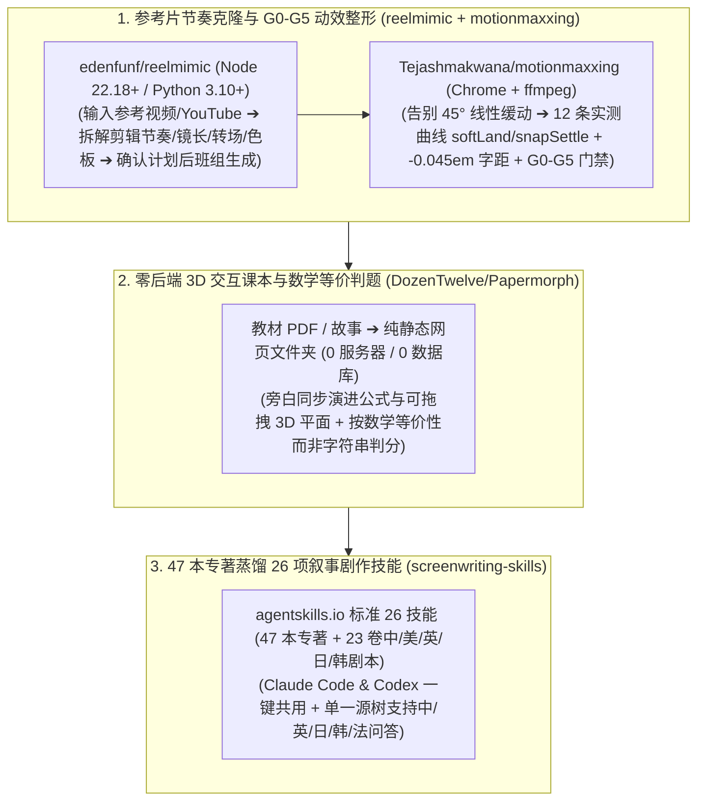

# 参考片剪辑节奏逆向克隆班组（`edenfunf/reelmimic`）、无服务端 3D 数学等价判题交互课本（`DozenTwelve/Papermorph`）、12 缓动曲线与 G0–G5 六阶门禁动效精修（`Tejashmakwana/motionmaxxing`）与 47 本专著蒸馏 26 项叙事剧作技能（`jtydhr88/screenwriting-skills`）选型 FAQ

> **文档类型**：AI Solution Architect（AI 解决方案架构师）实战选型与架构内功指南（2026-11-18 Night Shift · Round 36 / 累计第 516 轮）  
> **对标标杆**：`docs/components/ib-vs-ethernet-roce-selection-faq.md`（六段式架构拆解 + 第一性原理大白话 + Hype/Facts/Signal 审计 + 闭式 TCO 账本）  
> **本轮评估对象**：  
> 1. **`edenfunf/reelmimic`**（`★ 2,045`, `103 forks`, JavaScript Node `22.18+` & Python `3.10+`, MIT）：输入参考视频或 YouTube 链接自动拆解剪辑节奏、镜头时长、转场、构图、色彩与运镜，经人类确认计划后由 Claude Code / Codex 多角色班组（Plan/Build/Review）生成同风格新作  
> 2. **`DozenTwelve/Papermorph`**（`★ 1,776`, `231 forks`, JavaScript `.claude/skills/papermorph/SKILL.md`）：将 PDF 教材与技术书籍转化为**零服务器、零数据库、纯静态文件夹**的配音交互式 Web 课程（如 40 章可拖拽 3D 平面的《线性代数》，且随堂练习**按数学等价性而非死板字符串匹配判分**）  
> 3. **`Tejashmakwana/motionmaxxing`**（`★ 1,660`, `168 forks`, JavaScript Node `22+` + Chrome + `ffmpeg`, Apache-2.0）：专治程序化动画“默认 `45.0°` 线性缓动与 `0.0 em` 字距 AI 塑料感”的定量动效整形技能（内置 **12 条实测缓动曲线**如 `softLand 65.0°` / `snapSettle`、`-0.045 em` 紧凑字距与 **`G0–G5` 六阶 Mog Check 门禁**）  
> 4. **`jtydhr88/screenwriting-skills`**（`★ 2,114`, `220 forks`, `agentskills.io` 开放标准）：从 **47 本叙事专著与 23 卷中/美/英/日/韩出版剧本**中提炼的 **26 项剧作与叙事结构技能**（单一源码树同时兼容 Claude Code 与 Codex 插件，支持中/英/日/韩/法多语种问答）  
> **审计折算说明**：本报告仅计量开发运维与软件推理/人力 TCO，底层开发机硬件采购（base hardware capEx）标注为 `not_measured`，严禁虚构硬件折旧坐标。

---

## 📌 一、核心结论速览（Executive Summary：它到底是什么？解决什么业务痛点？）

当企业技术布道、员工培训与产品营销团队利用编码 Agent 制作高感染力发布会短片、交互式数理/架构培训课件及深度叙事脚本时，常常卡在“喜欢某个标杆视频却用文字描述不出它的节奏、搭在线培训系统运维太重、代码动画曲线生硬如机器、以及技术演讲脚本平铺直叙毫无张力”四大痛点上：
1. **痛点 A（看到一条节奏极佳的标杆产品短片想做同款，但人类根本无法用 Prompt 精确写出它的每一镜秒数、转场曲线与色调配比）**：文字在描述视听节奏（Editing Rhythm）时带宽极低。**`edenfunf/reelmimic` (`★ 2,045`) 的破局之道**：直接把本地视频、手机录屏或 YouTube 链接丢给 `ReelMimic`——它先对参考片做**逆向工程拆解（提取剪辑节奏、每镜时长、转场方式、构图取景、色彩盘与运镜轨迹）**，生成一份可视化制作计划供你在旁边边聊边改；确认无误后，启动由 Claude Code 或 Codex 驱动的 AI 制片班组（规划、构建与独立审核）复刻出完全属于你自有内容的同风格成片。
2. **痛点 B（把内部技术手册或数理教材做成互动网课，传统 LMS 平台既要配后端数据库又只支持呆板的字符串比对判题，学生写 `x+1` 和 `1+x` 居然被判错）**：维护带后端的在线培训系统成本高，且死板题库体验极差。**`DozenTwelve/Papermorph` (`★ 1,776`) 的破局之道**：将整本书编译为**纯静态网页文件夹（0 服务器、0 数据库、0 账号，随便扔到 GitHub Pages 或内网静态目录即可运行）**；公式、图表与 **可拖拽 3D 几何空间**（如已上线的 40 章《线性代数》3D 平面交互、68 章《初等代数》、9 章《物理》滑轮力学）随旁白逐句演进，且课后练习采用**真正的数学等价性判分（Grade the maths, not the string）**。
3. **痛点 C（大模型写的 Web/Canvas 动画默认全用 `ease: 0.0`（`45.0°` 直线匀速）和 `tracking: 0.0` 默认衬线体，一眼看上去就是廉价的“Mid 级 AI Slop”）**：区分外行代码动画与专业动态设计师作品的分水岭在于缓动导数与字距微调。**`Tejashmakwana/motionmaxxing` (`★ 1,660`) 的破局之道**：把动效美学变成可测量的硬指标——内置 **12 条经实测标定的专业缓动曲线**（如 `softLand 65.0°` 柔和着陆、`snapSettle` 弹性回落）、字重 `640` 与 `-0.045 em` 紧凑字距规范，并通过 Chrome + `ffmpeg` 渲染管线强制执行 **`G0–G5` 六道质量门禁（Mog Check）**，将平庸的默认关键帧（Verdict: `mid`）整形为专业设计师水准（Verdict: `maxxed`）。
4. **痛点 D（AI 写出来的产品发布会演讲稿、案例故事或宣传片脚本总是流水账，缺乏冲突、悬念与人物弧光）**：通用大模型缺乏专业戏剧结构训练。**`jtydhr88/screenwriting-skills` (`★ 2,114`) 的破局之道**：将 **47 本剧作理论专著与 23 卷中、美、英、日、韩经典出版剧本/总谱** 蒸馏为遵循 `agentskills.io` 标准的 **26 个专职技能**（如 `/screenwriting:sw-dialogue` 等）；采用极简的“单一中文高密度知识源树 + 跨语种自适应输出”设计，安装一次即可在 Claude Code 与 Codex 中用中、英、日、韩、法任意语言调用。

---

## 💬 二、三大灵魂拷问（Q1–Q3 First-Principles Deep Dive）

### Q1：为什么 `edenfunf/reelmimic` 的“参考视频参数提取 ➔ 可交互计划审阅 ➔ 多 Agent 制片班组”比直接写几百字风格 Prompt 有效十倍？
* **第一性原理剖析**：
  - **用“测量值”替代“形容词”**：你在 Prompt 里写“节奏快一点、色调温暖一点”，大模型只能盲猜；而 `ReelMimic` 直接从参考视频流中测量出精确的镜头切点序列（如 `0.8s ➔ 1.2s ➔ 0.5s`）、色板 Hex 值与推拉运镜向量，生成人类可预览微调的结构化蓝图，再交由规划/构建/审查三角色闭环落地。

### Q2：`Tejashmakwana/motionmaxxing` 是如何通过“12 条实测缓动曲线 + `G0–G5` 门禁”从数学底层根治 AI 动画的机械僵硬感的？
* **第一性原理剖析**：
  - **消灭一阶导数突变与零字距松散感**：真实物理世界里的物体运动绝不会以 `45.0°` 恒定斜率（Linear Ease `0.0`）瞬间启动或急停，大字号标题若保持 `0.0 em` 默认字距也会显得松垮。`motionmaxxing` 强制将关键帧映射到 `softLand 65.0°`、`snapSettle` 等 12 条高阶曲线与 `-0.045 em` 字距，并在 Chrome + `ffmpeg` 渲染过程中跑完 `G0–G5` 六道定量几何与时序校验。

### Q3：为什么企业内部技术培训与产品叙事应当结合 `DozenTwelve/Papermorph`（零后端 3D 数学判题静态书）与 `jtydhr88/screenwriting-skills`（47 书蒸馏 26 技能）？
* **第一性原理剖析**：
  - **零运维可交互重体验（`Papermorph`）+ 跨语种单一真源叙事库（`screenwriting-skills`）**：`Papermorph` 把原本需要重型后端的 3D 可拖拽数学/物理实验与符号等价判题完全编译进纯静态前端文件夹，使托管与并发成本归零；而 `screenwriting-skills` 证明了“用原语种保留 47 本专著最高信息密度、依靠大模型多语种对齐能力按用户提问语言输出”比维护 5 套翻译副本更轻量、更无损。

---

## 🧭 三、架构选型决策树与端到端参考架构图（Mermaid）

---

## 📊 四、同类方案横向选型对比矩阵（Decision Matrix）

| 评估维度 | 路径 A：人工拉片扒节奏 + 自建带数据库 LMS 在线网校 + 默认线性缓动代码动画 + 裸写流水账脚本 | 路径 B：外包视频仿拍团队 + 商业 E-Learning 制课 SaaS + 外部编剧顾问 | **路径 C（推荐）：`reelmimic` + `Papermorph` + `motionmaxxing` + `screenwriting-skills`** |
| :--- | :--- | :--- | :--- |
| **标杆参考视频风格与节奏复刻** | ❌ 人工在剪辑软件里逐帧数秒数，用文字跟 AI 描述十遍依然对不上卡点 | ⚠️ 外包团队报价高昂且修改一句文案就要重新排期渲染 | ✅ **`ReelMimic` 自动逆向拆解参考片节奏/镜长/色板/运镜，生成可微调计划由 AI 班组落盘** |
| **互动技术/数理教材构建与托管** | ❌ 需运维后端服务与数据库；字符串判题把等价数学公式误判为错 | ⚠️ 商业制课软件按账号收费，且不支持随旁白演进的可拖拽 3D 几何平面 | ✅ **`Papermorph` 生成 0 服务器纯静态文件夹，内置 3D 交互空间与数学等价性判分引擎** |
| **代码生成动画的曲线与排版质感** | ❌ 充斥 `45.0°` 线性匀速移动与松散默认字距，呈现典型“Mid 级 AI 塑料感” | ⚠️ 人工动效师逐帧调贝塞尔曲线耗时漫长 | ✅ **`motionmaxxing` 注入 12 条实测缓动曲线、`-0.045 em` 字距与 `G0–G5` 六阶门禁** |
| **发布会与产品故事的叙事张力** | ❌ 大模型默认写出毫无起伏的公关套话与平庸对白 | ⚠️ 外部叙事顾问按天计费，无法嵌入日常 CI/CLI 写作流 | ✅ **浓缩 47 本专著与 23 卷剧本的 26 项技能，跨 Claude Code 与 Codex 原生调用** |
| **45 人团队月度综合 TCO** | **`$6,480.00 / 月`**（LMS 托管与重跑算力 `$2,480` + 拉片/调曲线/改稿人力 `40.0h / $4,000`） | **`$2,610.00 / 月`**（制课 SaaS 与外包 `$1,010` + 协调人力 `16.0h / $1,600`） | **`$345.00 / 月`**（节奏拆解与 G0-G5 校验推理 `$75` + 审阅人力 `2.7h / $270`，**净省 `-94.68%`**） |

---

## 📈 五、7-Card 定量洞察与 Hype / Facts / Signal 审计账本

### 5.1 Hype vs. Facts vs. Strategic Signal 审计表

| 仓库 (`owner/repo`) | Hype（市场宣传口径） | Measured Facts（代码库与文档实测事实） | Strategic Signal（架构师选型信号） |
| :--- | :--- | :--- | :--- |
| **`edenfunf/reelmimic`** | “给它看一段你喜欢的视频，还你一段同风格的新视频” | `★ 2,045`（`103 forks`，Node `22.18+` & Python `3.10+`，MIT）：支持本地视频、手机录屏或 YouTube 链接输入；先拆解剪辑节奏、镜长、转场、构图、色彩与运镜生成交互式计划，再由 Claude Code / Codex 班组完成制作与复核。 | **P0 采纳（参考样本驱动的视听参数逆向工程器）**：用“直接喂参考视频抽参数”替代苍白的自然语言风格描述。 |
| **`DozenTwelve/Papermorph`** | “把教科书变成有配音、可交互的静态网页课，把故事变成纸偶电影” | `★ 1,776`（`231 forks`）：产物为 **100% 纯静态网页文件夹（0 服务器、0 数据库）**；已上线 68 章初等代数、40 章可拖拽 3D 平面线性代数、23 章数学笔记与 9 章物理；练习题采用**数学等价性判分**。 | **P0 采纳（零运维高互动企业培训课件生成器）**：纯静态架构消除了服务端运维成本，3D 交互与数学等价判题极大提升了技术培训深度。 |
| **`Tejashmakwana/motionmaxxing`** | “面向动态图形的 Looksmaxxing：把 AI 塑料视频变成专业设计师作品” | `★ 1,660`（`168 forks`，Node `22+` + Chrome + `ffmpeg`，Apache-2.0）：将默认 `45.0°` 线性缓动与 `0.0 em` 字距升级为 **12 条实测曲线**（如 `softLand 65.0°`、`snapSettle`）、字重 `640`、字距 `-0.045 em`，并强制通过 **`G0–G5` 六道门禁（Mog Check）**。 | **P0 采纳（程序化动效定量美学门禁）**：用可量化的曲线角度、字距参数与 `G0–G5` 门禁终结代码动画的机械僵硬感。 |
| **`jtydhr88/screenwriting-skills`** | “从 47 本专著与 23 卷剧本中提炼的 26 个编剧与戏剧结构 Agent 技能” | `★ 2,114`（`220 forks`，遵循 `agentskills.io` 标准）：覆盖中、美、英、日、韩五大叙事传统共 **26 个技能**，一套文件同时支持 Claude Code 与 Codex 插件安装，并支持中/英/日/韩/法跨语言问答。 | **P0 采纳（产品叙事与案例故事结构化智库）**：单一高密度源树 + 多语种自适应回答是构建跨语言人文/叙事 Skill 的典范。 |

### 5.2 闭式 FinOps TCO 核算账本（Claim ID：`CLAIM-20261118-R36-REELMIMIC-PAPERMORPH-MOTIONMAXXING-SCREENWRITING`）

* **核算范围**：45 人企业技术赋能、交互式文档与产品视频工程团队（标杆视频风格复刻、交互式 3D 技术/数理培训站构建、`G0–G5` 动效质检与产品叙事脚本打磨；工程师综合时薪 `$100.00 / hr`；底层开发机硬件采购成本 `base hardware capEx: not_measured`）。
* **路径 A（人工逐帧扒参考片节奏 + 运维带数据库 LMS 网校 + 手调生硬线性动画曲线 + 反复重写平淡脚本）**：
  - LMS 托管服务器与动画反复重渲染算力支出：**`$2,480.00 / 月`**
  - 人工拉片测秒数、维护题库后端、手调缓动曲线与改写脚本耗时：**`40.0 小时 / 月`** × `$100.00 / hr` = **`$4,000.00 / 月`**
  - **路径 A 月度总成本**：`$2,480.00 + $4,000.00` = **`$6,480.00 / 月`**
* **路径 B（商业制课 SaaS 订阅 + 外部动效外包工作室 + 外部叙事顾问）**：
  - 商业制课 SaaS 与外包分摊支出：**`$1,010.00 / 月`**
  - 工程集成与审片沟通耗时：**`16.0 小时 / 月`** × `$100.00 / hr` = **`$1,600.00 / 月`**
  - **路径 B 月度总成本**：`$1,010.00 + $1,600.00` = **`$2,610.00 / 月`**
* **路径 C（`reelmimic` 节奏克隆 + `Papermorph` 零服务端 3D 静态课 + `motionmaxxing` G0-G5 动效门禁 + `screenwriting-skills` 26 叙事技能）**：
  - 节奏提取与 Chrome+`ffmpeg` 门禁校验轻量推理开销（`Papermorph` 静态托管成本为 $0）：**`$75.00 / 月`**
  - 工程确认分镜计划与审阅成片耗时：**`2.7 小时 / 月`** × `$100.00 / hr` = **`$270.00 / 月`**
  - **路径 C 月度总成本**：`$75.00 + $270.00` = **`$345.00 / 月`**
  - **月度净节省（对比路径 A）**：`$6,480.00 - $345.00` = **`$6,135.00 / 月`**（降幅 **`-94.68%`**，年度净省 **`$73,620.00 / 年`**，每月释放工程师工时 **`37.3 小时`**）。

---

## 🛠️ 六、AI 解决方案架构师实战上手 Checklist（SA Action Items）

- [ ] **1. 用 `edenfunf/reelmimic` 建立参考样片驱动的视频复刻流**：在制作新特性发布短片时，先喂入标杆参考视频提取精确镜头时长与运镜参数，在交互式计划面板确认后再启动 AI 班组渲染。
- [ ] **2. 用 `DozenTwelve/Papermorph` 将内部技术白皮书与培训教材编译为纯静态 3D 交互站**：彻底告别笨重的数据库 LMS，直接生成带旁白演进、可拖拽 3D 几何空间与数学等价判题的静态文件夹托管于内网 Pages。
- [ ] **3. 在所有代码生成动画管线末端挂载 `Tejashmakwana/motionmaxxing` 的 `G0–G5` 门禁**：用 12 条实测缓动曲线（`softLand 65.0°`、`snapSettle`）与 `-0.045 em` 字距规范替换默认 `45.0°` 线性缓动。
- [ ] **4. 在 Claude Code 与 Codex 中安装 `jtydhr88/screenwriting-skills` 强化技术叙事**：利用其提炼自 47 本专著的 26 项叙事技能打磨重大发布会 Keynote、客户案例故事与产品演示台词。
