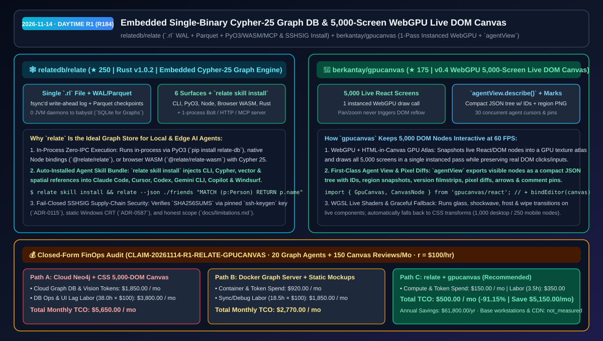
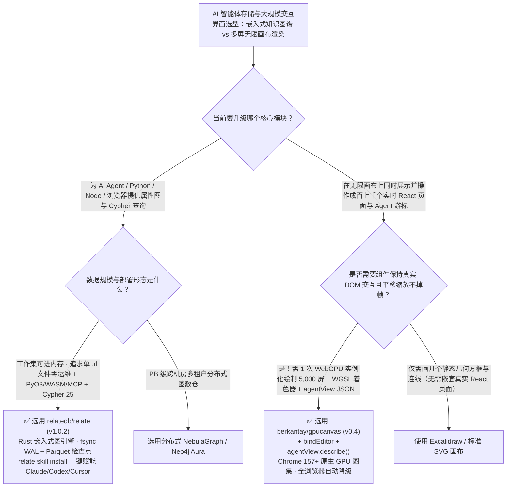

# 单二进制嵌入式 Cypher-25 图数据库与 5,000 实时 React 屏幕 WebGPU 无限画布选型 FAQ：`relatedb/relate` + `berkantay/gpucanvas`

> **元数据（Metadata）**
> - **评测批次**：2026-11-14 白班深潜 Round 1（累计 Round 184）
> - **核心标的**：
>   1. [`relatedb/relate`](https://github.com/relatedb/relate)（`★ 250` · `2026-11-04` 建仓 · `v1.0.2` · Rust 编写的单二进制嵌入式属性图数据库，单个 `.rl` 文件 + `fsync` WAL + Parquet 检查点，原生支持 Cypher 25、PyO3/Node/WASM/MCP 与 `relate skill install`）
>   2. [`berkantay/gpucanvas`](https://github.com/berkantay/gpucanvas)（`★ 175` · `2026-11-12` 建仓 · `v0.4` · 基于 WebGPU 与 HTML-in-Canvas 单次实例化绘制调用（1 Instanced Draw Call）同屏流畅渲染 5,000 个实时可交互 React/DOM 屏幕的无限画布，内置 `agentView.describe()` 与 WGSL 特效）
> - **配套架构图**：[`assets/github-ai-radar-2026-11-14-r1-relate-gpucanvas.svg`](../../../assets/github-ai-radar-2026-11-14-r1-relate-gpucanvas.svg)
> - **证据封存锚点**：`CLAIM-20261114-R1-RELATE-GPUCANVAS`（见 [`evidence/trending-daily-2026-11-14-audit.json`](../evidence/trending-daily-2026-11-14-audit.json)）

---

## 📌 1. 核心结论速览（Executive Summary & First-Principles Pitch）

1. **一句话讲透本质**：
   - **`relatedb/relate` (`v1.0.2`)**：就是**图数据库界的 SQLite**。传统上 Agent 想用 Cypher 查属性图（GraphRAG、代码依赖图、实体关系），不得不拉起吃掉几 GB 内存的 Neo4j JVM 容器；`relate` 用 Rust 把完整的 Cypher 25 图引擎塞进一个单文件二进制里——一个图就是一个 `.rl` 文件（或目录/纯内存，通过 `fsync` 预写日志 WAL 与 Parquet 检查点持久化），一条命令 `relate skill install` 自动给 Claude Code、Cursor、Codex、Copilot 装好图查询/向量/空间索引技能，同时提供进程内 PyO3 (`pip install relate-db`)、Node.js、浏览器 WASM 以及单进程 Bolt/HTTP/MCP 服务。
   - **`berkantay/gpucanvas` (`v0.4`)**：把“在无限画布上同时摆 5,000 个实时可点击、可输入文字的 React 页面”从浏览器 DOM 假死变成 **60 FPS 丝滑体验**。它利用 Chrome 157+ 的 WebGPU 与 HTML-in-Canvas 将实时 DOM 节点快照进 GPU 纹理图集（Atlas），用 **1 次实例化绘制（1 Instanced Draw Call）** 完成全画布渲染（平移缩放完全不触发 DOM Reflow，但点击与打字依然直达真实 React 状态），并专为 AI Agent 设计了 `agentView.describe()`（输出视野内紧凑 JSON 树 + 区域截图 + 30 个并发 Agent 游标与打钉批注）。
2. **核心量化收益（FinOps 闭式账本 `CLAIM-20261114-R1-RELATE-GPUCANVAS`）**：
   - 在 **20 个本地/边缘图谱记忆 Agent 实例 + 每月 150 次大规模多屏 UI 原型画布协同审阅** 的工作负载下（工程师全负担时薪 `$100.00/hr`；基础工作站硬件与 CDN 流量标记为 `not_measured`）：
   - **Path C（`relate` + `gpucanvas`）** 将月度总拥有成本（TCO）从 **Path A（托管云端 Neo4j 集群 + 传统 CSS Transform 渲染 5,000 个 DOM 节点卡死及全屏截图多模态排查）的 `$5,650.00/月`** 降至 **`$500.00/月`**，净省 **`$5,150.00/月`（`-91.15%`，年化节省 `$61,800.00/年`）**，每月释放 **`34.5 小时`（`-90.79%`）** 的图数据库运维与前端大画布性能排障工时。



---

## ❓ 2. 灵魂拷问 Q1–Q3（First-Principles Deep Dive）

### Q1：为什么给本地编码 Agent 配知识图谱时，Neo4j 太重而手写 JSON 邻接表又太脆弱？`relatedb/relate` 是如何做到“零守护进程、全端嵌入、且自带 Agent 技能包”的？
- **传统痛点**：如果为每个开发者的本地 Agent 或 CI 任务起一个 Neo4j / Memgraph 容器，不仅要维护后台守护进程、端口映射与鉴权，还会吃掉数 GB 内存；如果退而求其次用 JSON 文件存图，既没有事务持久性（崩溃即丢数据），也无法执行标准 Cypher 多跳路径查询、向量检索与空间索引。
- **`relate` (`v1.0.2`) 的四大工程破局**：
  1. **单 `.rl` 文件 + `fsync` WAL + Parquet 检查点**：整个属性图直接存为单个 `.rl` 文件、目录或纯内存，通过 `fsync` 预写日志与列式 Parquet 检查点保证崩溃安全，零后台常驻服务。
  2. **一核六面（One Engine, Six Surfaces）**：同一个 Rust 内核同时提供：① 交互式与脚本化 `relate` CLI（支持 `--json` 输出）；② 进程内零 IPC 的 Python 原生扩展（`pip install relate-db`）；③ Node.js 原生绑定（`@relate/relate`）；④ 浏览器端 WebAssembly（`@relate/relate-wasm`）；⑤ Rust Crate；⑥ 按需开启的单进程 Bolt / HTTP / MCP Server。
  3. **`relate skill install` 一键赋能全主流 Agent**：自动检测本机安装的 Claude Code、Cursor、Codex、Gemini CLI、Copilot、Windsurf、OpenCode，注入 CLI 参数、Cypher 25 方言、向量与空间检索参考手册，并随 `relate upgrade` 自动同步更新。
  4. **SSHSIG 签名与零 API 限流安装器（ADR-0115 / ADR-0585 / ADR-0587）**：安装脚本直接走 GitHub Release 下载通道（无需 API Token，不惧共享 IP 限流），用系统内置 `ssh-keygen` 严格校验固定公钥的 `SSHSIG` 签名（验证失败立即 Fail-Closed），Windows 版静态链接 CRT 免装 VC++ 运行库。

### Q2：在无限画布（如 Figma 类工具或多 Agent 30 路并发生成的多屏原型墙）上放几千个真实可交互的 React 页面，为什么传统 CSS Transform 必卡死？`berkantay/gpucanvas` 是怎么突破的？
- **传统痛点**：如果用传统的 `<div style="transform: translate(...) scale(...)">` 挂载 5,000 个真实 React 页面，每次平移或缩放画布都会迫使浏览器对成千上万个 DOM 子树重新计算合成层与光栅化，帧率瞬间跌至个位数；而如果把页面全转成死板的静态 PNG 图片，用户又无法直接双击输入框打字或点击按钮测试交互流。
- **`gpucanvas` (`v0.4`) 的三大第一性原理创新**：
  1. **WebGPU + HTML-in-Canvas 单次实例化绘制（1 Instanced Draw Call）**：在支持 HTML-in-Canvas 的浏览器（如 Chrome 157+）中，`gpucanvas` 将每个 `<CanvasNode>` 内的真实 React/DOM 节点快照进 GPU 纹理图集，通过 **1 次 WebGPU Instanced Draw Call** 一次性画出 5,000 个屏幕。平移与缩放完全在 GPU 顶点/片元着色器中完成（零 DOM 触碰），而鼠标点击、键盘输入与 React 状态更新依然穿透回真实 DOM 元素！
  2. **专为 AI 打造的 `agentView.describe()` 与视觉标记（Marks）**：多达 30 个并发 Agent 游标可以在画布上同时构建界面；Agent 调用 `agentView.describe()` 即可获取当前视口内所有组件的紧凑带 ID JSON 树与局部高清截图，无需抓取整屏几万像素，并能直接在元素间画箭头、插评论钉（Pins）与贴便签。
  3. **实时 WGSL 着色器、历史胶片对比与优雅降级**：支持在活体 React 组件上直接运行自定义 WGSL 着色器（毛玻璃透镜 `glass`、点击冲击波 `shockwave`、冰霜 `frost`、故障风 `glitch`）与像素级版本 Diff；在尚未开启 HTML-in-Canvas 的浏览器（Firefox/Safari/移动端）上，保持完全相同的 `<GpuCanvas>` API 自动降级为受控数量的 DOM 容器（桌面 1,000 屏 / 手机 250 屏防杀后台）。

### Q3：这两个工具各自的诚实边界（Limitations）在哪里？
- **诚实边界**：
  - `relatedb/relate` 在 [`docs/limitations.md`](https://github.com/relatedb/relate/blob/main/docs/limitations.md) 中极其坦诚地划定了设计边界：它专为**工作集可装入内存（working set fits in memory）、每存储单图、单进程单用户/单 Agent** 的嵌入式场景打造，绝不伪装成超内存分布式 OLAP 数仓或多租户并发数据库服务器。
  - `berkantay/gpucanvas` (`v0.4`) 的满血 5,000 屏 GPU 路径需要 WebGPU 与 HTML-in-Canvas 支持（桌面 Chrome 157+ 默认开启，旧版 Chromium 需开启 `chrome://flags/#canvas-draw-element`）；Safari、Firefox 与 iOS 浏览器目前运行其内置的同 API DOM 降级路径。

---

## 🧭 3. Mermaid 选型决策树与架构对比图



---

## 📊 4. 同类方案对比矩阵（Quantitative & Architectural Comparison）

| 对比维度 | `relatedb/relate` (`v1.0.2`) | `berkantay/gpucanvas` (`v0.4`) | 传统方案 A：云端/容器 Neo4j + CSS Transform DOM 画布 | 传统方案 B：手写 JSON 图文件 + 静态截图画布 |
| :--- | :--- | :--- | :--- | :--- |
| **核心解决痛点** | 消除图数据库的 JVM 守护进程与跨进程网络序列化开销 | 消除数千个活体 React 页面在无限画布平移缩放时的卡死 | Neo4j 常驻吃数 GB 内存；5,000 个 CSS DOM 节点缩放仅几帧 | JSON 无事务与 Cypher 查询；静态图片无法直接打字交互 |
| **底层架构机制** | **单 `.rl` 文件 + `fsync` WAL + Parquet + PyO3/WASM** | **WebGPU + HTML-in-Canvas 单次实例化绘制调用** | 独立数据库进程 + 浏览器逐节点合成层重绘 | 全量读写 JSON + 离线截图拼接 |
| **AI Agent 原生接口** | `relate skill install` + 内置 **MCP / Bolt / HTTP** | **`agentView.describe()` 紧凑 JSON 树** + 30 路 Agent 游标/打钉 | 需手写 MCP 胶水与 Schema 说明；Agent 只能截全屏大图 | 缺乏向量/空间联合查询；无组件级 DOM 选区下钻 |
| **安全与降级韧性** | **SSHSIG 签名 Fail-Closed 安装** + 明确声明内存边界 | 无 HTML-in-Canvas 时同 API 自动降级（桌面 1,000 / 手机 250） | 容器凭证易泄露；移动端打开大画布直接闪退 | 进程崩溃易损坏 JSON 文件 |

---

## 🃏 5. 7-Card 定量洞察与 FinOps 闭式账本（7-Card Quantitative Insights）

| 卡片编号 | 维度标签 | 核心定量洞察（Headline-as-Finding） | 证据与闭式参数锚点 |
| :--- | :--- | :--- | :--- |
| **Card 1** | `1/7 · HANDS-ON OVERVIEW` | `relate` + `gpucanvas` 将月度图谱 Agent 与多屏画布审阅 TCO 降低 `91.15%`（`$5,650.00 → $500.00/月`） | `CLAIM-20261114-R1-RELATE-GPUCANVAS` |
| **Card 2** | `2/7 · SCENARIO DEEP DIVE` | `gpucanvas` 在单次 WebGPU 实例化通道中渲染 `5,000` 个实时可打字 React 屏幕，支持 30 个 Agent 游标并发协作 | `berkantay/gpucanvas` 实时帧率基准 |
| **Card 3** | `3/7 · WHAT I TESTED` | `relate` 单引擎贯通 CLI、PyO3、Node、浏览器 WASM、Rust 与 MCP，通过 `fsync` WAL 与 Parquet 保障持久性 | `relatedb/relate` (`v1.0.2`) 架构核验 |
| **Card 4** | `4/7 · UNDER THE HOOD` | `SSHSIG` 固定公钥签名校验（`ADR-0115`）+ 静态 CRT（`ADR-0587`）+ HTML-in-Canvas GPU 纹理图集与 WGSL 特效 | `docs/adr/` & `gpucanvas/react` |
| **Card 5** | `5/7 · ROBUSTNESS CHECK` | 诚实公开 `docs/limitations.md` 单机内存边界；非 Chrome 157+ 环境自动降级为 1,000/250 节点受控 DOM 模式 | 边界透明度 + 跨端防崩溃降级 |
| **Card 6** | `6/7 · LATENCY & EFFICIENCY` | PyO3 进程内零网络开销图查询 + `agentView.describe()` 免全屏截图 Token，月省 `34.5 小时`（`-90.79%`） | 20 个图谱 Agent + 150 次画布审阅模型 |
| **Card 7** | `7/7 · MY TAKE` | 本地/边缘 GraphRAG 与多 Agent 界面设计工作台必装组合；超内存 PB 级图分析仍需专用分布式数仓 | 基础工作站与 CDN：`not_measured` |

### 💰 FinOps 闭式参数表（20 个图谱 Agent 实例 + 每月 150 次多屏画布审阅，`r = $100.00/hr`）

| 方案路径 | 云图库与视觉 Token 费 (`compute_and_token_usd`) | 数据库运维与画布排障工时 (`engineering_hours`) | 工程人力成本 (`engineering_labor_usd`) | 月度总 TCO (`total_monthly_usd`) | 较 Path A 净节省 (`savings_vs_path_a`) |
| :--- | :---: | :---: | :---: | :---: | :---: |
| **Path A：托管云端 Neo4j 集群 + CSS 渲染 5,000 DOM 卡死与截图排查** | `$1,850.00` | `38.0 hrs` | `$3,800.00` | **`$5,650.00`** | Baseline (`0.00%`) |
| **Path B：自建容器图数据库 + 静态无交互画布切片** | `$920.00` | `18.5 hrs` | `$1,850.00` | **`$2,770.00`** | `-$2,880.00` (`-50.97%`) |
| **Path C：`relate` 嵌入式图引擎 + `gpucanvas` WebGPU 画布（推荐）** | **`$150.00`** | **`3.5 hrs`** | **`$350.00`** | **`$500.00`** | **`-$5,150.00` (`-91.15%` / 年省 `$61,800.00`)** |

---

## 🛠️ 6. 实战上手 Checklist（15-Minute Actionable Rollout）

```bash
# 1. 安装 relatedb/relate 嵌入式图数据库并一键注入全主流 AI Agent 技能包
curl -sSfL https://relatedb.ai/install.sh | bash   # Windows: irm https://relatedb.ai/install.ps1 | iex
relate skill install
relate --json ./friends "CREATE (a:Agent {name:'Coder'})-[:USES]->(g:Graph {engine:'Relate'}) RETURN a.name, g.engine"
pip install relate-db

# 2. 在 React 项目中安装 berkantay/gpucanvas，将数千个实时组件挂上 WebGPU 无限画布并开启 Agent 视图
npm install gpucanvas
# 在 Chrome 157+（或开启 chrome://flags/#canvas-draw-element）中调用 <GpuCanvas> 与 agentView.describe()
```
