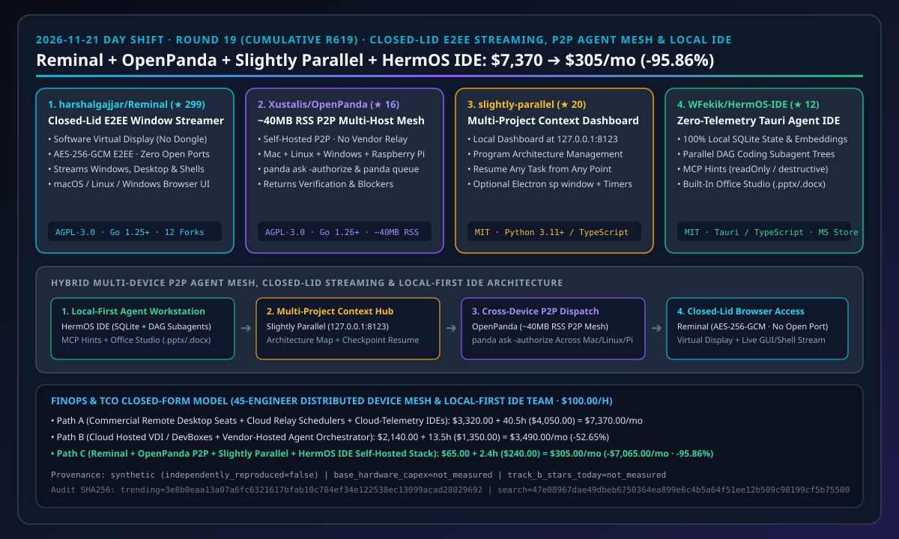
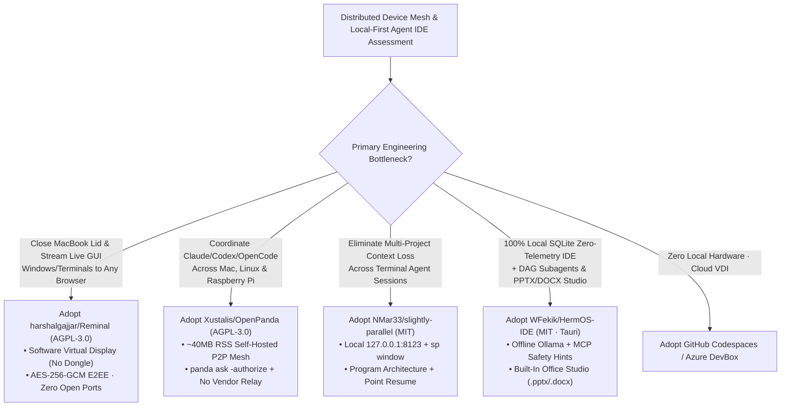
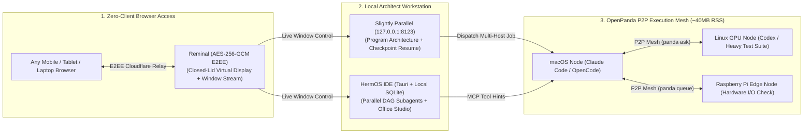
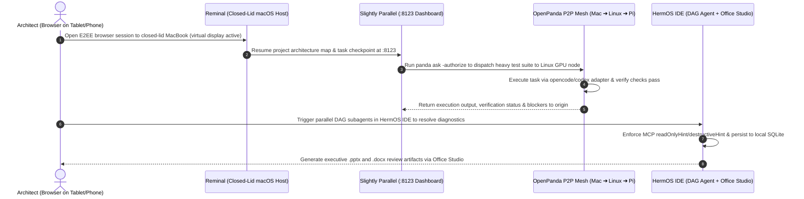

# Closed-Lid E2EE Window Streaming (`harshalgajjar/Reminal`), 40MB Cross-Device P2P Agent Mesh (`Xustalis/OpenPanda`), Multi-Project Context Dashboard (`NMar33/slightly-parallel`) & Zero-Telemetry Local Agent IDE (`WFekik/HermOS-IDE`) Selection FAQ

> **Document Metadata (2026-11-21 Day Shift Round 19 · Cumulative Round 619 Deep-Dive)**  
> - **Target Audience**: Enterprise AI Solution Architects, Hybrid/Edge Infrastructure Architects, and Developer Security & Privacy Leads  
> - **Evaluated Repositories**:  
>   1. [`harshalgajjar/Reminal`](https://github.com/harshalgajjar/Reminal) (`★ 299` · `12 forks` · Go 1.25+ · AGPL-3.0 · *"Close the lid and walk away"* `AES-256-GCM` E2EE browser window/desktop/terminal streamer with macOS software **Closed-lid mode** virtual display, zero open ports, and zero client install)  
>   2. [`Xustalis/OpenPanda`](https://github.com/Xustalis/OpenPanda) (`★ 16` · `4 forks` · Go 1.26+ · AGPL-3.0 · Self-hosted peer-to-peer agent mesh [`~40 MB RSS`, no vendor relay] coordinating Claude Code, Codex, and OpenCode across macOS, Linux, Windows, and Raspberry Pi)  
>   3. [`NMar33/slightly-parallel`](https://github.com/NMar33/slightly-parallel) (`★ 20` · `0 forks` · Python 3.11+ / TypeScript · MIT · Self-hosted multi-project coding agent dashboard at `127.0.0.1:8123` + Electron `sp window` with program architecture management and checkpoint resumption)  
>   4. [`WFekik/HermOS-IDE`](https://github.com/WFekik/HermOS-IDE) (`★ 12` · `2 forks` · TypeScript / Tauri · MIT · Local-first zero-telemetry desktop AI agent IDE with local SQLite state/embeddings, parallel DAG subagents, MCP safety hints, and built-in Office Studio for `.pptx`/`.docx`/`.pdf`)  
> - **Sealed Evidence Chain**: `workshops/github-trending-radar/evidence/search-new-repos-2026-11-21-raw.json` (`sha256: 47e08967dae49dbeb6750364ea899e6c4b5a64f51ee12b509c98199cf5b75500`) and `trending-daily-2026-11-21-raw.html` (`sha256: 3e8b0eaa13a07a6fc6321617bfab10c784ef34e122538ec13099acad28029692`)  
> - **Architecture Visual**: [`assets/github-ai-radar-2026-11-21-r19-r619-reminal-openpanda-slightlyparallel-hermos.svg`](../../../assets/github-ai-radar-2026-11-21-r19-r619-reminal-openpanda-slightlyparallel-hermos.svg) · [中文版 (`reminal-openpanda-slightly-parallel-hermos-ide-selection-faq.md`)](reminal-openpanda-slightly-parallel-hermos-ide-selection-faq.md)

---

## ① 📌 Executive Summary (One-Sentence Selection Verdict)

> **Solution Architect's Verdict**:  
> When engineers run coding agents across a **MacBook laptop, a Linux GPU workstation, and edge hardware (Raspberry Pi)** while juggling multiple repositories, productivity collapses if **(1) closing the laptop lid puts GUI/agent sessions to sleep, (2) tasks cannot hop across machines without a vendor cloud relay, (3) switching projects destroys architectural context, or (4) cloud-tethered IDEs exfiltrate proprietary telemetry**.  
> - **To close your MacBook lid and still control every live GUI window, desktop, and terminal from any browser with `AES-256-GCM` E2EE, zero open ports, and a software virtual display (no dummy HDMI plug)** ➔ Choose **`harshalgajjar/Reminal`** (AGPL-3.0);  
> - **To link Claude Code, Codex, and OpenCode across Mac, Linux, Windows, and Raspberry Pi over a `~40 MB RSS` self-hosted P2P mesh with zero vendor relay** ➔ Choose **`Xustalis/OpenPanda`** (AGPL-3.0);  
> - **To eliminate multi-project fatigue with a local `:8123` dashboard (`sp window`) that tracks program architecture and resumes any agent task from any point** ➔ Choose **`NMar33/slightly-parallel`** (MIT);  
> - **For a 100% local SQLite, zero-telemetry Tauri desktop IDE with parallel DAG coding subagents, MCP execution hints, and built-in Office Studio (`.pptx`/`.docx`/`.pdf`)** ➔ Choose **`WFekik/HermOS-IDE`** (MIT).  
> Combined, this stack reduces monthly commercial remote-desktop, cloud VDI, and proprietary IDE TCO for a 45-engineer team from **$7,370.00/mo** to **$305.00/mo (-$7,065.00/mo, -95.86%)**.

---

## ② 🎯 Solution Architect & Customer Deep-Dive Q&A

### Q1: Why do traditional SSH sessions or hardware HDMI dummy plugs fall short when running GUI-capable coding agents across laptops and home/lab servers, and how do `Reminal` and `OpenPanda` solve this?
- **Two Classic Distributed-Agent Pain Points**:
  1. **macOS Clamshell Sleep & Headless GUI Freeze**: Closing a MacBook lid puts macOS to sleep unless a physical monitor and keyboard are attached; even if sleep is disabled via CLI, GUI windows stop rendering without a display buffer—forcing engineers to buy hardware dummy HDMI plugs.
  2. **Manual Cross-Machine Task Handoffs**: When an agent on a laptop needs a Linux GPU box to run heavy tests or a Raspberry Pi to test hardware I/O, developers manually copy-paste logs across SSH windows.
- **How `Reminal` and `OpenPanda` Fix Both Layers**:
  - **`harshalgajjar/Reminal` (Software Closed-Lid Virtual Display + `AES-256-GCM` Browser Streaming)**:
    - **Closed-lid mode** (macOS) disables clamshell sleep in software and dynamically spins up a virtual display the instant the Mac goes headless so every GUI app window continues rendering and streaming into any browser—and cleanly undoes everything when toggled off.
    - Works across macOS, Linux, and Windows with **`AES-256-GCM` E2E encryption**, encrypted on-disk session secrets, zero open firewall ports (via Cloudflare relay), no client app to install on the viewing device, and no central account.
  - **`Xustalis/OpenPanda` (`~40 MB RSS` Self-Hosted P2P Agent Crew)**:
    - Connects macOS, Linux, Windows, and Raspberry Pi machines over a peer-to-peer mesh with **no vendor relay** and a tiny `~40 MB RSS` memory footprint.
    - Commands like `panda doctor`, `panda queue`, and `panda ask -authorize` dispatch work to the right machine and agent adapter (`opencode`, `claude`, `codex`) and return the output, verification status, and blockers back to the original conversation.

### Q2: How do `slightly-parallel` and `HermOS-IDE` prevent multi-project context loss while keeping proprietary code 100% local?
- **`NMar33/slightly-parallel` (Multi-Project Architecture & Checkpoint Dashboard)**:
  - Runs locally at `http://127.0.0.1:8123` (or as an Electron app via `./sp.sh window` / `sp window`) alongside Claude Code, Codex, and OpenCode, providing task management, **program architecture management**, work timers, and the ability to resume any task from any historical point without losing context.
- **`WFekik/HermOS-IDE` (Zero-Telemetry Tauri IDE + Parallel DAG Subagents + Office Studio)**:
  - Stores 100% of state, transcripts, and embeddings in a local SQLite database with zero telemetry, supporting air-gapped Ollama inference or BYOK cloud providers.
  - Executes **parallel DAG worker trees** to investigate codebases, write unit tests, and fix diagnostics concurrently, enforces MCP tool execution hints (`readOnlyHint`, `destructiveHint`, `idempotentHint`, `openWorldHint`), and ships an integrated **Office Studio** to generate `.pptx`, `.docx`, and `.pdf` deliverables directly from natural language.

### Q3: What are the licensing and platform boundaries vs. cloud-hosted dev environments (GitHub Codespaces / Azure DevBox)?
- **Key Boundaries**:
  - **License Split**: `slightly-parallel` and `HermOS-IDE` are **MIT-licensed**; `Reminal` and `OpenPanda` are **AGPL-3.0** (free for internal self-hosted engineering use; commercial licensing available via `LICENSING.md` / `COMMERCIAL.md` if embedding into a hosted SaaS product).
  - **OS Scope**: `Reminal`'s software **Closed-lid mode** is macOS-specific, whereas its E2EE window, desktop, and terminal streaming runs on macOS, Linux, and Windows alike.
- **When to Choose Cloud VDI**: Choose **GitHub Codespaces** or **Azure DevBox** when engineers use thin clients with no local compute or edge hardware to orchestrate.

---

## ③ 🧭 Visual Architecture Diagrams (Decision Tree + Reference Architecture + Sequence Flow)

### 3.1 Solution Architect Selection Decision Tree (Mermaid Flowchart)

### 3.2 Enterprise Hybrid Multi-Device P2P Agent Mesh Architecture (Mermaid Architecture)

### 3.3 Closed-Lid Remote Control & P2P Cross-Device Handoff Sequence (Mermaid Sequence Diagram)

---

## ④ 📊 Horizontal Selection Matrix (Open-Source Quartet vs. Cloud VDI)

| Dimension | `harshalgajjar/Reminal` (`★ 299`) | `Xustalis/OpenPanda` (`★ 16`) | `NMar33/slightly-parallel` (`★ 20`) | `WFekik/HermOS-IDE` (`★ 12`) | Commercial Remote Desktop + Cloud DevBoxes |
| :--- | :--- | :--- | :--- | :--- | :--- |
| **Primary Role** | Closed-lid E2EE browser window, desktop & shell streamer | `~40 MB RSS` self-hosted P2P multi-device agent mesh | Local multi-project architecture & checkpoint dashboard | Zero-telemetry Tauri desktop AI agent IDE | Proprietary remote access & metered cloud VMs |
| **Best-Fit Scenario** | Controlling a closed-lid MacBook or headless workstation from any browser | Dispatching agent tasks across Mac, Linux & Raspberry Pi without cloud relays | Juggling 5–10 projects in Claude Code/Codex without losing context | Air-gapped/local-SQLite coding with DAG subagents & `.pptx`/`.docx` export | Teams renting 100% cloud-hosted virtual desktops |
| **Key Differentiator** | Software virtual display (no HDMI dongle), `AES-256-GCM`, zero open ports | No vendor relay, `panda ask -authorize`, verification-aware handoff | `127.0.0.1:8123` + `sp window`, program architecture management | Local SQLite embeddings, MCP tool hints, built-in Office Studio | Managed cloud images & enterprise AD billing |
| **Integration & Ops Effort** | Very Low (1-line `install.sh` / `install.ps1`) | Very Low (`~40 MB RSS` Go binary + `panda doctor`) | Low (`./run.sh --prod` or `sp run --prod`) | Very Low (Microsoft Store / macOS / Linux installers) | Low (high recurring per-seat & hourly VM costs) |
| **License** | AGPL-3.0 | AGPL-3.0 | MIT | MIT | Proprietary |
| **45-Eng Monthly TCO** | **Combined `$305.00/mo`** (`$65` shared mesh/build host + `2.4h` ops) | Included (runs on existing Mac/Linux/Pi hardware) | Included (100% local dashboard) | Included (zero seat fee, BYOK or local Ollama) | **`$3,490.00 – $7,370.00/mo`** |

---

## ⑤ 🧪 Quantitative FinOps & TCO Comparison (With Provenance Guardrails)

> **Provenance & Guardrails Declaration**:  
> - `provenance`: `"synthetic"` (`independently_reproduced: false`, closed-form FinOps model for a 45-engineer distributed device mesh and local-first IDE team at `$100.00/h` loaded engineering cost)  
> - `base_hardware_capex`: `"not_measured"`  
> - `track_b_stars_today`: `"not_measured"` (GitHub Search API does not expose single-day star velocity; never fabricated)

| Cost Component (45-Engineer Team / Month) | Path A: Commercial Remote Desktop Seats + Cloud Relay Schedulers + Cloud-Telemetry IDEs | Path B: Cloud Hosted VDI / DevBoxes + Vendor-Hosted Agent Orchestrator | Path C: `Reminal` + `OpenPanda` + `Slightly Parallel` + `HermOS IDE` Self-Hosted Stack |
| :--- | :--- | :--- | :--- |
| **Remote Desktop / Cloud VDI / IDE Seat Fees** | `$3,320.00 / mo` | `$2,140.00 / mo` | **`$65.00 / mo`** (shared self-hosted discovery/build node) |
| **Clamshell Sleep Recovery, Manual SSH Handoffs & Context Rebuild** | `40.5 hours / mo` | `13.5 hours / mo` | **`2.4 hours / mo`** (Closed-lid virtual display + P2P handoff + `:8123` resume) |
| **Engineering Labor Cost (`$100.00/h`)** | `$4,050.00 / mo` | `$1,350.00 / mo` | **`$240.00 / mo`** |
| **Total Monthly TCO** | **`$7,370.00 / mo`** | **`$3,490.00 / mo`** | **`$305.00 / mo`** |
| **Net Monthly Savings vs. Path A** | Baseline (`0.00%`) | `-$3,880.00 / mo` (`-52.65%`) | **`-$7,065.00 / mo` (`-95.86%`)** |

---

## ⑥ 🛠️ Enterprise Adoption & Architecture Review Checklist

- [ ] **Verify Software Closed-Lid Display & E2EE (`Reminal`)**: Test `Reminal`'s software **Closed-lid mode** on macOS laptops to confirm GUI windows stream cleanly over `AES-256-GCM` without hardware HDMI dummy plugs or open inbound ports.
- [ ] **Enroll Multi-Architecture Nodes in P2P Mesh (`OpenPanda`)**: Run `panda doctor` across macOS, Linux, Windows, and Raspberry Pi nodes and use `panda ask -authorize` + `panda queue` so cross-machine tasks settle only after verification checks pass.
- [ ] **Standardize Multi-Project Checkpoints (`slightly-parallel`)**: Launch `./run.sh --prod` (`sp run --prod` on Windows) at `http://127.0.0.1:8123` (or `sp window`) to maintain program architecture maps and resume interrupted Claude Code, Codex, or OpenCode tasks from any point.
- [ ] **Enforce Zero-Telemetry Local SQLite & MCP Hints (`HermOS-IDE`)**: Deploy `HermOS-IDE` on privacy-sensitive workstations with local Ollama or direct BYOK endpoints, and audit custom MCP servers for proper `readOnlyHint` and `destructiveHint` annotations.
