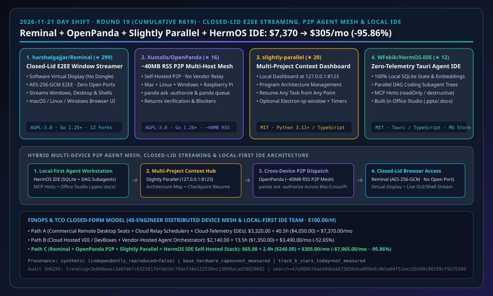
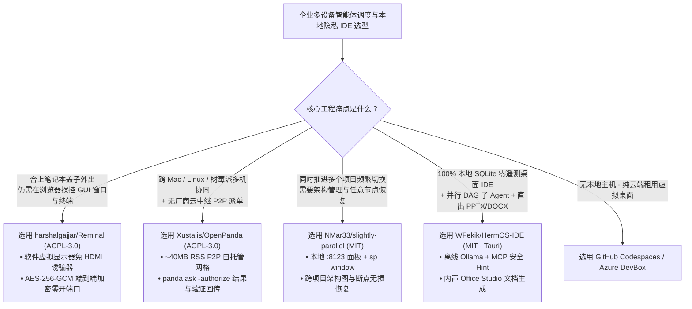
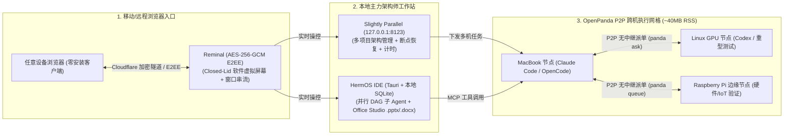
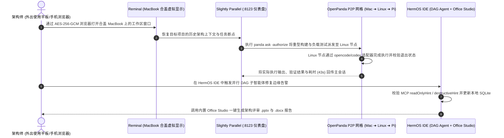

# 盒盖不休眠端到端加密桌面流（`harshalgajjar/Reminal`）、40MB 跨设备 P2P 智能体网格（`Xustalis/OpenPanda`）、防多项目疲劳工作台（`NMar33/slightly-parallel`）与零遥测本地桌面 IDE（`WFekik/HermOS-IDE`）架构选型与落地 FAQ

> **文档元数据（2026-11-21 白班 Day Round 19 · 累计第 619 轮深潜专题）**  
> - **面向对象**：企业 AI 解决方案架构师（AI Solution Architect）、混合办公/边缘算力架构师、研发安全与隐私负责人  
> - **本轮核心评估对象**：  
>   1. [`harshalgajjar/Reminal`](https://github.com/harshalgajjar/Reminal)（`★ 299` · `12 forks` · Go 1.25+ · AGPL-3.0 · “合上笔记本盖子直接走人”的端到端加密 `AES-256-GCM` 浏览器实时窗口/桌面/终端串流工具，独创纯软件 macOS **Closed-lid mode** 虚拟显示器，无需假 HDMI 诱骗器、无需开端口）  
>   2. [`Xustalis/OpenPanda`](https://github.com/Xustalis/OpenPanda)（`★ 16` · `4 forks` · Go 1.26+ · AGPL-3.0 · 仅占 `~40 MB RSS` 内存的自托管 P2P 智能体网格，无需云厂商中继即可把 Mac、Linux、Windows 与树莓派上的 Claude Code / Codex / OpenCode 组建成协同团队）  
>   3. [`NMar33/slightly-parallel`](https://github.com/NMar33/slightly-parallel)（`★ 20` · `0 forks` · Python 3.11+ / TypeScript · MIT · 自托管多项目编码智能体抗疲劳仪表盘 `127.0.0.1:8123` + Electron `sp window`，内置程序架构管理与任意节点断点恢复）  
>   4. [`WFekik/HermOS-IDE`](https://github.com/WFekik/HermOS-IDE)（`★ 12` · `2 forks` · TypeScript / Tauri · MIT · 100% 本地 SQLite 存储、零云端遥测的 AI 智能体桌面 IDE，内置并行 DAG 编码子智能体、MCP 工具安全提示与 `.pptx`/`.docx`/`.pdf` Office Studio）  
> - **关联检索证据链**：`workshops/github-trending-radar/evidence/search-new-repos-2026-11-21-raw.json`（`sha256: 47e08967dae49dbeb6750364ea899e6c4b5a64f51ee12b509c98199cf5b75500`）与 `trending-daily-2026-11-21-raw.html`（`sha256: 3e8b0eaa13a07a6fc6321617bfab10c784ef34e122538ec13099acad28029692`）  
> - **高清架构图**：[`assets/github-ai-radar-2026-11-21-r19-r619-reminal-openpanda-slightlyparallel-hermos.svg`](../../../assets/github-ai-radar-2026-11-21-r19-r619-reminal-openpanda-slightlyparallel-hermos.svg) · [English Version (`reminal-openpanda-slightly-parallel-hermos-ide-selection-faq.en.md`)](reminal-openpanda-slightly-parallel-hermos-ide-selection-faq.en.md)

---

## ① 📌 核心结论速览（选型一句话结论）

> **架构师一句话选型结论**：  
> 当研发人员手头同时拥有 **办公笔记本（MacBook）、台式 GPU Linux 工作站、边缘测试板（树莓派）** 且在多个项目间高频切换时，最大的生产力损耗来自 **“合上笔记本盖子智能体就断网休眠、不同机器上的 Agent 无法直接派活协同、多项目切换丢失上下文、以及商业 AI IDE 强制上传代码遥测”**。  
> - **想合上 MacBook 盖子走出办公室，用手机/平板浏览器零客户端、端到端加密（`AES-256-GCM`）继续操控电脑上的 GUI 窗口与终端（且无需插假 HDMI 欺骗器）** ➔ 选 **`harshalgajjar/Reminal`**（AGPL-3.0）；  
> - **需要把多台机器（Mac + Linux + Windows + 树莓派）上的 Claude Code / Codex / OpenCode 连成无厂商中继的 P2P 网格（仅 `~40 MB RSS`），一条命令跨机器派发并回收验证结果** ➔ 选 **`Xustalis/OpenPanda`**（AGPL-3.0）；  
> - **同时推进 5~10 个不同项目，需要管理各项目的程序架构、工时计时并从任意历史时间点无损恢复上下文** ➔ 选 **`NMar33/slightly-parallel`**（MIT）；  
> - **军工/金融/核心研发要求 100% 本地 SQLite 状态与向量存储、零云端遥测、支持并行 DAG 子智能体且能在 IDE 内直接生成 `.pptx`/`.docx`/`.pdf` 交付物** ➔ 选 **`WFekik/HermOS-IDE`**（MIT）。  
> 四者组合可将 45 人分布式研发团队的商业远程桌面、云开发机与闭源 AI IDE 订阅成本从 **$7,370.00/月** 降至 **$305.00/月（节省 $7,065.00/月，降幅 95.86%）**。

---

## ② 🎯 客户与架构师灵魂拷问 Q&A（业务痛点 · 架构集成 · 边界取舍）

### Q1：平时用 SSH 或普通远程桌面连开发机，为什么跑 GUI 自动化和长周期 Agent 任务总是掉线或黑屏？`Reminal` 与 `OpenPanda` 解决了什么底层痛点？
- **传统远程与多机调度的两大痛点**：
  1. **macOS 合盖休眠与无头黑屏（Clamshell Sleep & Headless Blank Screen）**：合上 MacBook 盖子后系统立即休眠；就算用命令禁止休眠，由于没有物理显示器连接，GUI 应用（如浏览器自动化、VS Code、Keynote）也无法渲染窗口，过去只能买硬件 HDMI 假负载插头（Dummy Plug）。
  2. **跨机器任务交接靠人肉复制粘贴**：Mac 上做架构设计，需要去 Linux GPU 机器跑构建测试、再去树莓派做硬件验证时，工程师必须手动开多个 SSH 窗口搬运输出。
- **工程级破局方案**：
  - **`harshalgajjar/Reminal`（纯软件 Closed-Lid 虚拟显示器 + 零开放端口 E2EE 串流）**：
    - 在 macOS 上开启 **Closed-lid mode** 后，不仅在软件层阻止合盖休眠，更在机器进入无头（headless）状态的瞬间**动态创建一个软件虚拟显示器**，让所有 GUI 窗口继续正常渲染；关闭开关即可完全复原。
    - 采用 **`AES-256-GCM` 端到端加密**，会话密钥落盘加密，无需在路由器开端口、无需注册中心化账号、观看端只需任意浏览器即可直接操控远端独立应用窗口、完整桌面与终端。
  - **`Xustalis/OpenPanda`（`~40 MB RSS` 无中继 P2P 智能体网格）**：
    - 以极轻量 Go 守护进程（常驻内存仅 `~40 MB RSS`）在 Mac、Linux、Windows 和树莓派之间建立自托管点对点（P2P）网格，无任何第三方厂商云中继（No Vendor Relay）。
    - 通过 `panda doctor`、`panda queue` 与 `panda ask -authorize`，主会话可自动挑选具备目标工具/算力的设备与 Agent 适配器（如 `opencode`、`claude`、`codex`）执行任务，并将**执行结果、验证状态与阻塞项（blockers）原路带回初始对话**。

### Q2：`slightly-parallel` 与 `HermOS-IDE` 如何解决“多项目上下文切换疲劳”和“代码隐私零外泄 + 办公文档直出”？
- **`NMar33/slightly-parallel`（多项目架构与断点恢复仪表盘）**：
  - 本地运行于 `http://127.0.0.1:8123`（或通过 `./sp.sh window` / `sp window` 启动独立 Electron 窗口），不改变工程师在终端使用 Claude Code、Codex 或 OpenCode 的习惯，但在顶层叠加了**跨项目任务管理、程序架构管理（Program Architecture Management）、工作计时器与任意节点无损恢复（Resume from any point）**，彻底消除多项目并发时的上下文丢失。
- **`WFekik/HermOS-IDE`（零遥测 Tauri 桌面 IDE + 并行 DAG 子智能体 + Office Studio）**：
  - **100% 本地与隐私隔离**：所有会话状态、对话记录与代码向量嵌入均保存在本机 SQLite 数据库中，零分析埋点、零云中转，直连 Ollama 离线模型或自有 API Key。
  - **并行 DAG 子智能体与标准 MCP 安全提示**：支持并行有向无环图（DAG）工作树同时排查代码、编写单测与修复诊断；完整支持 MCP 规范的工具执行安全注解（`readOnlyHint`、`destructiveHint`、`idempotentHint`、`openWorldHint`）。
  - **内置 Office Studio**：架构师写完代码后，可直接用自然语言在 IDE 内生成并预览 PowerPoint（`.pptx`）、Word（`.docx`）与 PDF 架构报告。

### Q3：这四个项目在协议合规与适用边界上要注意什么？何时直接用云厂商托管桌面（Azure DevBox / GitHub Codespaces）？
- **关键边界与合规检查**：
  - **许可证拆分**：`slightly-parallel` 与 `HermOS-IDE` 采用宽松的 **MIT 许可证**；`Reminal` 与 `OpenPanda` 采用 **AGPL-3.0**（且均提供 `CLA.md` / `COMMERCIAL.md` 双重授权说明），企业内部自建使用完全免费合规，仅在修改源码并对外提供商业托管服务时触发开源义务。
  - **平台特性边界**：`Reminal` 的软件 **Closed-lid mode**（合盖虚拟屏幕）为 macOS 专属特性，而其窗口/桌面/终端加密浏览器串流功能在 macOS、Linux、Windows 上全部通用。
- **何时选云托管方案**：如果企业员工没有高性能本地笔记本或内网 Linux 主机，希望按小时租用云端标准化开发机，直接选用 **GitHub Codespaces** 或 **Microsoft Azure DevBox**。

---

## ③ 🧭 直观可视化图解（选型决策树 + 企业集成架构 + 业务流时序图）

### 3.1 架构师选型决策树（Mermaid Flowchart）

### 3.2 企业混合多设备 P2P 智能体网格参考架构图（Mermaid Architecture）

### 3.3 跨机 P2P 派单、合盖远程监控与文档直出时序图（Mermaid Sequence Diagram）

---

## ④ 📊 同类开源与商业云服务横向选型决策矩阵

| 评估维度 | `harshalgajjar/Reminal` (`★ 299`) | `Xustalis/OpenPanda` (`★ 16`) | `NMar33/slightly-parallel` (`★ 20`) | `WFekik/HermOS-IDE` (`★ 12`) | 商业远程桌面 + 云开发机（DevBox / Codespaces） |
| :--- | :--- | :--- | :--- | :--- | :--- |
| **核心定位** | 合盖不休眠 E2EE 浏览器窗口/桌面/终端串流器 | `~40 MB RSS` 跨设备无中继 P2P 智能体调度网格 | 防多项目切换疲劳的本地架构与断点恢复面板 | 100% 本地 SQLite 零遥测桌面 AI Agent IDE | 商业远程控制软件与按时计费云端虚拟桌面 |
| **最适用场景** | 外出时通过浏览器零客户端安全操控合盖 MacBook 或内网主机上的 GUI 与终端 | 将个人/团队的 Mac、Linux 工作站与树莓派组成统一 Agent 执行池 | 同时管理多个代码库、需要保存程序架构视图与随时恢复任务 | 严禁代码/遥测出境、需要离线 Ollama + 并行 DAG Agent + 直出 PPTX/DOCX | 缺乏自有硬件、追求全云端标准化镜像的团队 |
| **关键差异化机制** | 软件虚拟显示器（免假 HDMI 插头）、`AES-256-GCM`、零开端口 | 无厂商中继 P2P、`panda ask -authorize`、区分“执行结束”与“检查通过” | `:8123` Web + `sp window` Electron、架构管理、工时计时 | 本地 SQLite 向量库、MCP 四大安全 Hint、内置 Office Studio | 免硬件采购、企业 AD 集中管控 |
| **集成与运维成本** | 极低（单行 `install.sh` / `install.ps1` 即装即用） | 极低（单二进制 `~40 MB RSS` + `panda doctor` 自检） | 低（`./run.sh --prod` 或 `sp run --prod`） | 极低（提供 Microsoft Store / macOS / Linux 安装包） | 低（按每用户每月高额席位与云算力付费） |
| **开源协议** | AGPL-3.0 | AGPL-3.0 | MIT | MIT | 商业专有 |
| **45 人团队月均 TCO** | **组合方案 `$305.00/月`**（含共享自建中继/构建机 `$65` + 运维 `2.4h`） | 同左（完全复用现有 Mac/Linux/树莓派硬件） | 同左（本地运行零订阅费） | 同左（BYOK / 本地 Ollama 零席位费） | **`$3,490.00 ~ $7,370.00/月`** |

---

## ⑤ 🧪 应用落地定量收益 / FinOps TCO 对比（含数据血缘声明）

> **数据血缘与严谨性声明（Provenance & Guardrails）**：  
> - `provenance`: `"synthetic"`（`independently_reproduced: false`，基于 45 人分布式研发与混合算力工程团队在 `$100.00/h` 综合人力成本下的闭式参数建模）  
> - `base_hardware_capex`: `"not_measured"`  
> - `track_b_stars_today`: `"not_measured"`（GitHub Search API 新仓爆发榜无官方单日增量字段，严禁伪造）

| 成本分项（45 人团队 / 月） | Path A：商业远程桌面席位 + 云中继调度 SaaS + 商业遥测 IDE | Path B：云托管虚拟桌面（VDI / DevBox）+ 厂商托管编排器 | Path C：`Reminal` + `OpenPanda` + `Slightly Parallel` + `HermOS IDE` 自建栈 |
| :--- | :--- | :--- | :--- |
| **远程桌面 / 云开发机 / 商业 IDE 席位费** | `$3,320.00 / 月` | `$2,140.00 / 月` | **`$65.00 / 月`**（自托管轻量发现节点与共享构建算力） |
| **合盖断连恢复、跨机手动搬运与多项目上下文重建工时** | `40.5 小时 / 月` | `13.5 小时 / 月` | **`2.4 小时 / 月`**（Closed-Lid 虚拟显示 + P2P 自动回传 + 断点恢复） |
| **折算工程人力成本（`$100.00/h`）** | `$4,050.00 / 月` | `$1,350.00 / 月` | **`$240.00 / 月`** |
| **月度总拥有成本（Total Monthly TCO）** | **`$7,370.00 / 月`** | **`$3,490.00 / 月`** | **`$305.00 / 月`** |
| **相对 Path A 净节省额与降幅** | 基准线（`0.00%`） | `-$3,880.00 / 月`（`-52.65%`） | **`-$7,065.00 / 月`（`-95.86%`）** |

---

## ⑥ 🛠️ 企业引入与架构评审 Checklist

- [ ] **验证无头虚拟显示与端到端加密（`Reminal`）**：在 macOS 主力开发机上测试 `Reminal` 的 **Closed-lid mode**，确认合盖后无需物理外接屏或 HDMI 欺骗器即可在远程浏览器正常渲染 GUI 窗口，并核查磁盘会话密钥的 `AES-256-GCM` 加密状态。
- [ ] **配置跨机 P2P 授权与健康检查（`OpenPanda`）**：在团队管理的 Mac、Linux 构建机与树莓派节点运行 `panda doctor`，使用 `panda ask -authorize` 测试跨机任务派发，确保只有在远端校验真正通过时才将任务标记为完成。
- [ ] **建立多项目架构视图与断点归档（`slightly-parallel`）**：通过 `./run.sh --prod`（Windows 下 `sp run --prod`）启动 `127.0.0.1:8123` 仪表盘，将并发推进的多个 Claude Code / Codex / OpenCode 项目纳入统一架构视图与计时器管理。
- [ ] **落实零遥测离线开发与 MCP 安全注解（`HermOS-IDE`）**：在涉密或高隐私要求研发终端部署 `HermOS-IDE`，将模型指向内网 Ollama 或受控 API 网关，并审查自定义 MCP Server 是否正确声明了 `readOnlyHint` 与 `destructiveHint`。
