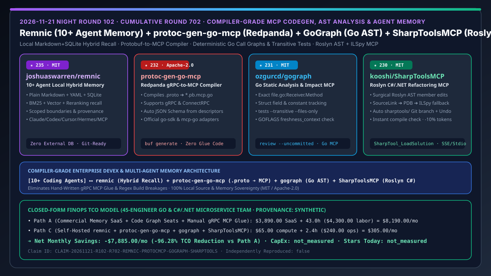
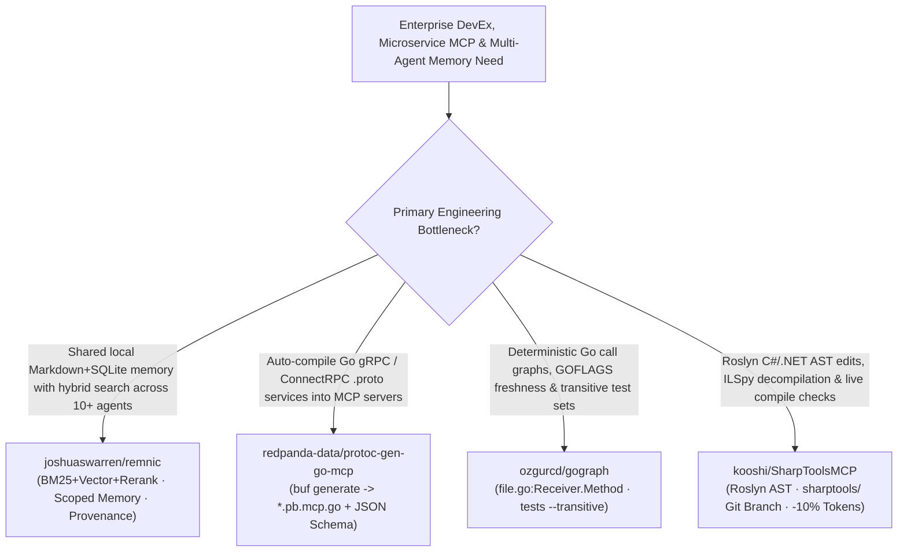
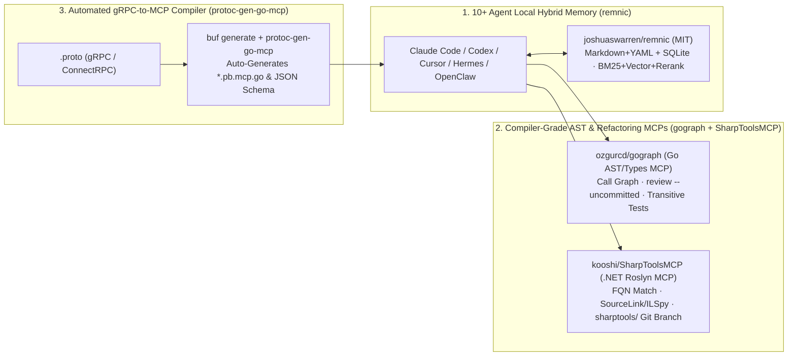
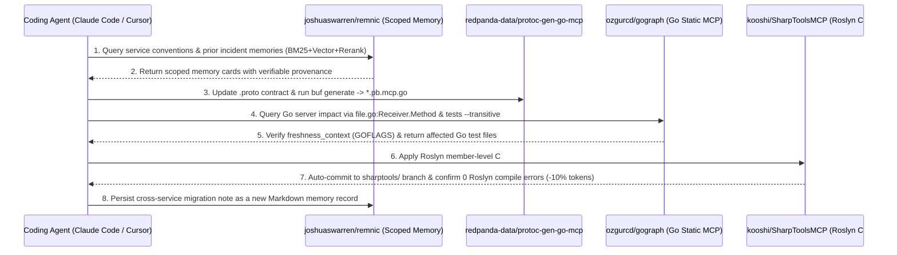

# Multi-Agent Local Hybrid Memory (`joshuaswarren/remnic`), Redpanda Protobuf-to-MCP Compiler (`redpanda-data/protoc-gen-go-mcp`), Go Deterministic Static Analysis MCP (`ozgurcd/gograph`) & Roslyn C#/.NET Refactoring MCP (`kooshi/SharpToolsMCP`) Selection & Architecture FAQ

> **Document Type**: Enterprise AI Solution Architect Selection & Integration Guide (GitHub Trending AI Radar — 2026-11-21 Night Round 102 / Cumulative Round 702)
> **Covered Repositories**: [`joshuaswarren/remnic`](https://github.com/joshuaswarren/remnic) (`★ 235`, `29 forks`, `MIT` — local-first Markdown + SQLite hybrid memory store shared across 10+ coding agents with provenance & evals) · [`redpanda-data/protoc-gen-go-mcp`](https://github.com/redpanda-data/protoc-gen-go-mcp) (`★ 232`, `39 forks`, `Apache-2.0` — official Redpanda Protocol Buffers compiler plugin turning any gRPC or ConnectRPC service into an MCP server) · [`ozgurcd/gograph`](https://github.com/ozgurcd/gograph) (`★ 231`, `16 forks`, `MIT` — local-only Go static analysis engine & MCP server with deterministic call graphs, `GOFLAGS` freshness checks & transitive test selection) · [`kooshi/SharpToolsMCP`](https://github.com/kooshi/SharpToolsMCP) (`★ 230`, `37 forks`, `MIT` — Roslyn-powered C#/.NET analysis & surgical modification MCP server with SourceLink/ILSpy decompilation & automated `sharptools/` Git branches)
> **Core Scenario**: How enterprise engineering and platform architects eliminate **fragmented agent memory across 10+ coding harnesses**, **hand-written MCP wrapper boilerplate across dozens of Go gRPC/ConnectRPC microservices**, and **fragile text-regex edits in large Go and C#/.NET codebases** by combining compiler-grade AST/Protobuf MCP tooling with a local-first hybrid memory store.

---

## 1. 📌 Executive Summary (One-Line Selection Verdict)

1. **Need one local, Git-versionable memory store with hybrid search (`BM25 + vector + reranking`), scoped boundaries, and per-result provenance shared across 10+ coding agents** ➔ Choose **[`joshuaswarren/remnic`](https://github.com/joshuaswarren/remnic) (`★ 235`, `MIT`)**.
   - **Plain-English Mechanism**: Stores every memory as a plain Markdown file with YAML frontmatter on disk backed by rebuildable local JSON and SQLite indexes (zero external database services required). **OpenClaw, Claude Code, Codex CLI, Cursor, ChatGPT developer mode, Hermes, Replit, Pi, omp, Factory Droid, and any MCP/HTTP client** read and write the same store with graph recall, memory-worth scoring, and verifiable provenance.
2. **Need to turn existing Go `gRPC` or `ConnectRPC` `.proto` services into production MCP servers automatically without writing or maintaining glue code** ➔ Choose **[`redpanda-data/protoc-gen-go-mcp`](https://github.com/redpanda-data/protoc-gen-go-mcp) (`★ 232`, `39 forks`, `Apache-2.0`)**.
   - **Plain-English Mechanism**: Built by **Redpanda Data**, this `protoc` / `buf generate` plugin emits `*.pb.mcp.go` handlers and auto-generates JSON Schema tool inputs directly from protobuf method input descriptors. It programs against a library-agnostic `runtime.MCPServer` interface so teams can pick the official `modelcontextprotocol/go-sdk` or `mark3labs/mcp-go` at server startup without regenerating code.
3. **Need deterministic structural awareness (call graphs, struct field mutations, `GOFLAGS` freshness validation, and transitive test impact) for AI agents working in Go repositories** ➔ Choose **[`ozgurcd/gograph`](https://github.com/ozgurcd/gograph) (`★ 231`, `MIT`)**.
   - **Plain-English Mechanism**: A local-only Go static analysis engine with a built-in MCP server. It enforces unambiguous file-qualified selectors (`path/to/file.go:Receiver.Method`), tracks type-resolved package constants and struct field mutations, verifies `freshness_context` against `GOFLAGS`/build tags, audits uncommitted changes via `review --uncommitted`, and computes the exact affected test files via `tests --transitive --files-only`.
4. **Need Roslyn compiler-grade C#/.NET code navigation, ILSpy decompilation fallback, surgical member modifications, and instant in-tool compilation diagnostics via MCP** ➔ Choose **[`kooshi/SharpToolsMCP`](https://github.com/kooshi/SharpToolsMCP) (`★ 230`, `37 forks`, `MIT`)**.
   - **Plain-English Mechanism**: Turns the .NET Compiler Platform (Roslyn) into an AI-native IDE over MCP (Stdio & SSE). `SharpTool_LoadSolution` maps `.sln` namespaces and types, resolves external dependencies through **Local Files ➔ SourceLink ➔ Embedded PDBs ➔ ILSpy Decompilation**, performs surgical member-level edits on dedicated timestamped `sharptools/` Git branches with one-step `Undo`, strips indentation to save **~10% tokens**, and returns immediate Roslyn compilation errors and cyclomatic/cognitive complexity warnings.

---

## 2. 🎯 Architect & Customer Deep-Dive Q&A

### Q1: Why do text-based `grep`/regex edits and hand-written MCP wrappers fail at enterprise scale for Go and C#/.NET microservice teams?

- **Three Structural Bottlenecks & Compiler-Backed Solutions**:
  1. **Schema Drift Across Dozens of gRPC Services ➔ `redpanda-data/protoc-gen-go-mcp`**: Hand-writing MCP tool schemas for 50+ gRPC/ConnectRPC microservices guarantees schema drift whenever a `.proto` message changes. Generating `*.pb.mcp.go` in CI via `buf generate` keeps `.proto` as the single source of truth.
  2. **Broken Builds from Naive Text Edits in Go & C# ➔ `ozgurcd/gograph` + `kooshi/SharpToolsMCP`**: Text-based search misses interface implementations, cross-package constants, and NuGet binary types. `gograph` provides exact Go call graphs and `tests --transitive` impact sets; `SharpToolsMCP` uses Roslyn ASTs to modify C# members cleanly, decompiles external DLLs via ILSpy when needed, and validates compilation inside the tool call.
  3. **Context Amnesia Across Multiple Coding Harnesses ➔ `joshuaswarren/remnic`**: Engineers switching between Claude Code, Cursor, Codex CLI, and OpenClaw lose architectural decisions. `remnic` persists scoped Markdown+SQLite memories locally with hybrid `BM25 + vector + reranking` retrieval and provenance receipts.
- **When to Choose Managed Cloud Services (Path B)**:
  - If your team uses a single commercial IDE (e.g., GitHub Copilot Enterprise inside Visual Studio) and does not expose internal gRPC services as MCP servers, **GitHub Copilot Workspace Indexing + Azure DevOps** requires zero local setup.

### Q2: How do we wire an end-to-end enterprise engineering architecture with these four projects?

1. **Cross-Agent Scoped Memory & Provenance Layer (`joshuaswarren/remnic`)**:
   - Connect Claude Code, Codex CLI, Cursor, Hermes, and OpenClaw to the local `remnic` MCP/HTTP server so architectural rules and postmortem lessons are stored as Git-tracked Markdown + YAML files with hybrid search recall.
2. **Compiler-Grade Go & C#/.NET Code Intelligence Layer (`ozgurcd/gograph` + `kooshi/SharpToolsMCP`)**:
   - Attach `gograph` MCP to Go repositories for `file.go:Receiver.Method` call-graph lookups, `review --uncommitted` pre-commit risk checks, and `tests --transitive --files-only` targeted test runs;
   - Attach `SharpToolsMCP` to C#/.NET solutions (`SharpTool_LoadSolution`) for Roslyn FQN navigation, SourceLink/ILSpy external symbol resolution, and isolated `sharptools/` branch edits with live compilation feedback.
3. **Automated Protobuf-to-MCP Pipeline (`redpanda-data/protoc-gen-go-mcp`)**:
   - Add `protoc-gen-go-mcp` to `buf.gen.yaml` so every gRPC/ConnectRPC service automatically compiles into a typed MCP server (`*.pb.mcp.go`).

### Q3: What are the boundaries and trade-offs of this stack?

- **Key Strengths**:
  - **Compiler-Enforced Determinism**: Uses `protoc`/`buf`, Go's type checker, and .NET's Roslyn compiler rather than probabilistic LLM text guessing.
  - **100% Permissive Open Source (`MIT` & `Apache-2.0`)**: Zero licensing friction for proprietary enterprise repositories.
- **When NOT to Use / Operational Caveats**:
  - Loading massive monolithic C# `.sln` files in `SharpToolsMCP` incurs initial Roslyn workspace warm-up RAM and time; use Solution Filters (`.slnf`) to scope large enterprise monorepos.

---

## 3. 🧭 Visual Architecture & Decision Diagrams

### 3.1 Solution Architect Selection Decision Tree

### 3.2 End-to-End Enterprise Reference Architecture

### 3.3 Cross-Language Refactoring, Protobuf MCP Generation & Memory Persistence Sequence

---

## 4. 📊 Peer Open-Source vs Commercial Cloud Selection Matrix

| Dimension | `joshuaswarren/remnic` (`★ 235`) | `redpanda-data/protoc-gen-go-mcp` (`★ 232`) | `ozgurcd/gograph` (`★ 231`) | `kooshi/SharpToolsMCP` (`★ 230`) | Commercial Memory Cloud + Code Graph SaaS (Path A) | Cloud IDE Native Indexing (Path B) |
| :--- | :--- | :--- | :--- | :--- | :--- | :--- |
| **Core Capability** | 10+ agent local Markdown+SQLite hybrid memory | Official Redpanda Protobuf-to-MCP compiler plugin | Go deterministic call graph, `GOFLAGS` freshness & transitive tests | Roslyn C# AST refactoring, ILSpy decompiler & Git branch MCP | Hosted vector memory API + commercial code graph + manual MCP glue | GitHub Copilot Remote Index / Visual Studio |
| **Determinism & Accuracy** | **BM25+Vector+Rerank + per-result provenance** | **Compiler-generated JSON Schema from `.proto`** | **Exact `file.go:Receiver.Method` & constant/field tracking** | **In-tool Roslyn compile check + SourceLink/PDB/ILSpy fallback** | Hand-written MCP wrappers drift from `.proto` contracts | Locked to a single IDE; no custom gRPC MCP generation |
| **Data Sovereignty** | Local Markdown + YAML + SQLite on disk | Local `buf generate` pure Go codegen | 100% local static index; never prints env secrets | Local `.sln` workspace + local `sharptools/` Git branches | Source code & agent memories uploaded to third-party SaaS | Hosted in cloud vendor tenant |
| **License** | `MIT` | `Apache-2.0` | `MIT` | `MIT` | Proprietary SaaS | Proprietary Cloud PaaS |
| **Monthly TCO (45-Eng Team)** | **`$305.00/mo` combined** (`$65.00` CI cache + `2.4h` ops) | Included in `$305.00/mo` stack | Included in `$305.00/mo` stack | Included in `$305.00/mo` stack (~10% token savings) | **`$8,190.00/mo`** (`$3,890.00` SaaS + `43.0h` manual glue) | `~$2,550.00/mo` (enterprise seat add-ons) |

---

## 5. 🧪 Quantitative ROI / FinOps TCO Model & 7-Card Report

> **📊 Provenance & Closed-Form Audit Declaration**:
> - **Provenance**: `synthetic` (45-engineer enterprise Go & C#/.NET microservice organization model; `independently_reproduced = false`; `base_hardware_capex = not_measured`; `track_b_stars_today = not_measured`).
> - **Closed-Form Equations**:
>   - **Path A (Commercial Hosted Agent Memory SaaS + Commercial Multi-Language Code Graph Seats + Manual gRPC-to-MCP Wrapper Maintenance & Broken-Build Triage)**: Monthly SaaS & token overhead **`$3,890.00`** + engineering maintenance labor **`43.0h × $100.00/h = $4,300.00`** = **`$8,190.00/mo`**.
>   - **Path C (Self-Hosted `joshuaswarren/remnic` + `redpanda-data/protoc-gen-go-mcp` + `ozgurcd/gograph` + `kooshi/SharpToolsMCP`)**: Shared CI build cache & local storage **`$65.00`** + plugin & rule maintenance **`2.4h × $100.00/h = $240.00`** = **`$305.00/mo`**.
>   - **Net Savings vs Path A**: **`-$7,885.00/mo`** (**`96.28%`** cost reduction).

| Architecture Option | API / SaaS / Compute | Engineering Ops Labor (`$100/h`) | Total Monthly TCO | Net Savings vs Path A | Key Architectural Outcome |
| :--- | :---: | :---: | :---: | :---: | :--- |
| **Path A: Commercial Memory SaaS + Manual gRPC MCP Glue** | `$3,890.00` | `43.0h` (`$4,300.00`) | **`$8,190.00`** | Baseline | Frequent `.proto` schema drift; source code leaves premises |
| **Path B: Single Cloud IDE Index + Manual Wrappers** | `$1,350.00` | `12.0h` (`$1,200.00`) | **`$2,550.00`** | `-$5,640.00` (`-68.86%`) | Locked to one IDE; no automated `.proto` MCP codegen |
| **Path C: `remnic` + `protoc-gen-go-mcp` + `gograph` + `SharpTools`** | **`$65.00`** | **`2.4h` (`$240.00`)** | **`$305.00`** | **`-$7,885.00` (`-96.28%`)** | **Zero-handwritten gRPC MCP + Go/Roslyn AST accuracy + 10+ agent memory** |

- 🔗 **7-Card 4:5 Visual Report**: [`workshops/github-trending-radar/cards.en.html`](../cards.en.html) · [`cards.html`](../cards.html)

---

## 6. 🛠️ Enterprise Adoption & Architecture Review Checklist

- [ ] **1. Unify Multi-Agent Memory with `joshuaswarren/remnic`**: Configure Claude Code, Codex CLI, Cursor, Hermes, and OpenClaw to use the local `remnic` MCP/HTTP store with scoped boundaries and provenance tracking over Git-backed Markdown files.
- [ ] **2. Automate gRPC/ConnectRPC MCP Generation with `redpanda-data/protoc-gen-go-mcp`**: Add `protoc-gen-go-mcp` to `buf.gen.yaml` so `buf generate` compiles `.proto` services directly into `*.pb.mcp.go` servers with typed JSON Schemas.
- [ ] **3. Enforce Go Structural Impact Checks with `ozgurcd/gograph`**: Require coding agents on Go services to query `path/to/file.go:Receiver.Method`, verify `freshness_context` (`GOFLAGS`), and run `review --uncommitted` plus `tests --transitive --files-only`.
- [ ] **4. Enable Roslyn-Backed C# Refactoring with `kooshi/SharpToolsMCP`**: Load C# solutions via `SharpTool_LoadSolution` (using `.slnf` filters for huge monorepos), leverage SourceLink/PDB/ILSpy decompilation for external packages, and keep automated `sharptools/` branch commits enabled.
