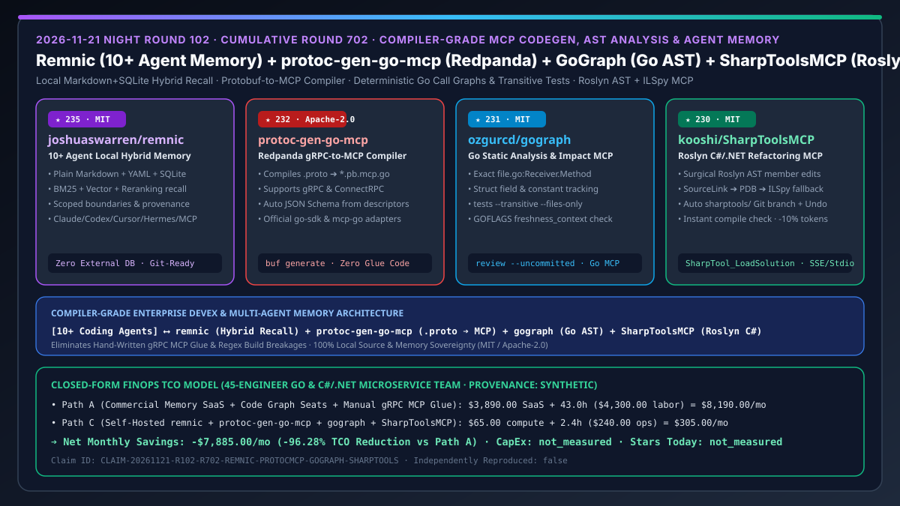
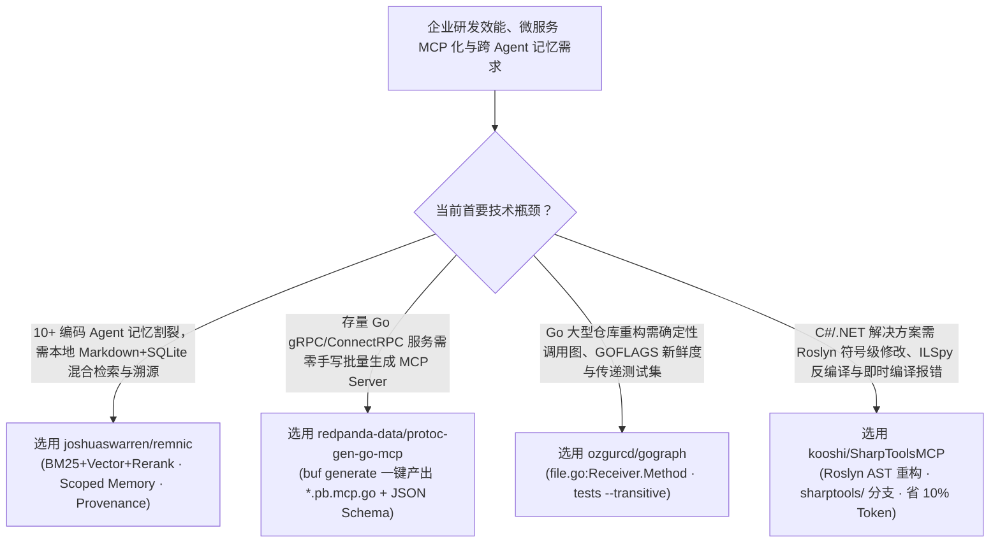
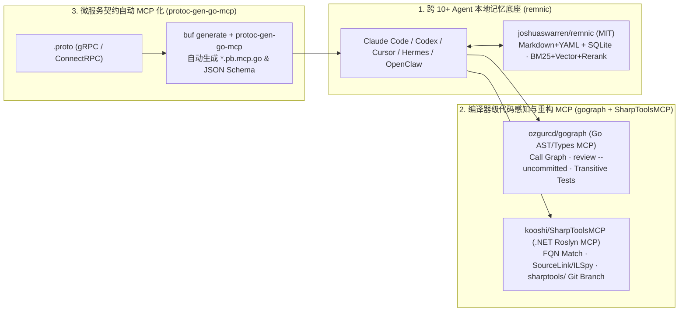
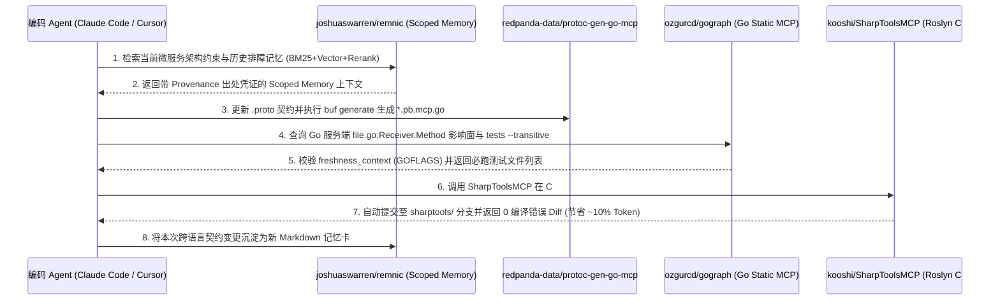

# 跨 10+ Agent 本地混合检索记忆库（`joshuaswarren/remnic`）、Redpanda 官方 gRPC/ConnectRPC 转 MCP 编译器插件（`redpanda-data/protoc-gen-go-mcp`）、Go 确定性调用图与影响面分析 MCP（`ozgurcd/gograph`）与 Roslyn 驱动 C#/.NET 精准重构 MCP（`kooshi/SharpToolsMCP`）选型与集成架构 FAQ

> **文档类型**：企业 AI 解决方案架构师（AI Solution Architect）选型决策指南（GitHub Trending AI 雷达 2026-11-21 Night Round 102 / 累计第 702 轮）
> **覆盖项目**：[`joshuaswarren/remnic`](https://github.com/joshuaswarren/remnic)（`★ 235`、`29 forks`、`MIT`，跨 OpenClaw/Claude Code/Codex/Cursor/Hermes 等 10+ 工具共享的 Markdown+SQLite 本地混合检索与溯源记忆库）· [`redpanda-data/protoc-gen-go-mcp`](https://github.com/redpanda-data/protoc-gen-go-mcp)（`★ 232`、`39 forks`、`Apache-2.0`，Redpanda 官方出品、通过 `buf generate` 将任意 gRPC/ConnectRPC 服务一键生成 `*.pb.mcp.go` MCP Server 的编译器插件）· [`ozgurcd/gograph`](https://github.com/ozgurcd/gograph)（`★ 231`、`16 forks`、`MIT`，内置 MCP 的 Go 本地静态分析、调用图、传递测试集 `tests --transitive` 与未提交变更影响面引擎）· [`kooshi/SharpToolsMCP`](https://github.com/kooshi/SharpToolsMCP)（`★ 230`、`37 forks`、`MIT`，基于 Roslyn 编译器与 ILSpy 反编译回退的 C#/.NET 符号级重构、自动 `sharptools/` 分支提交与实时编译校验 MCP）
> **核心场景**：当企业研发与平台架构团队面临**多编码 Agent 之间记忆割裂且缺乏检索质量评测与出处溯源**、**存量数百个 Go gRPC/ConnectRPC 微服务手写 MCP 胶水代码成本极高**，以及**AI 编码 Agent 在修改大型 Go 与 C#/.NET 代码库时仅靠正则文本替换频繁引发跨包调用断裂与编译报错**时，如何用这四个开源项目构建“跨 Agent 统一记忆 + Protobuf 零手写 MCP 生成 + Go/C# 编译器级 AST 静态感知与精准重构”研发底座？

---

## 一、📌 核心结论速览（选型一句话结论）

1. **想让 OpenClaw、Claude Code、Codex CLI、Cursor、Hermes 等 10+ 款 Agent 共享同一份本地可 Git 版本控制、带混合检索（BM25+向量+重排）与证据溯源的长期记忆** ➔ 选 **[`joshuaswarren/remnic`](https://github.com/joshuaswarren/remnic)（`★ 235`，`MIT`）**。
   - **通俗原理**：每条记忆都是本地磁盘上带 YAML Frontmatter 的纯 Markdown 文件，辅以可随时重建的本地 JSON 与 SQLite 索引（零外部数据库依赖）。内置 `BM25 + 向量 + Reranking` 混合检索、图谱召回（Graph Recall）、记忆价值打分（Memory-Worth Scoring）、作用域边界隔离（Scoped Memory）与逐条结果溯源（Provenance），通过标准 MCP 或 HTTP 接口供所有 Agent 读写。
2. **想把企业现有的 Go `gRPC` 或 `ConnectRPC` 微服务接口零手写代码批量转换成标准 MCP Server** ➔ 选 **[`redpanda-data/protoc-gen-go-mcp`](https://github.com/redpanda-data/protoc-gen-go-mcp)（`★ 232`，`39 forks`，`Apache-2.0`）**。
   - **通俗原理**：由流数据巨头 **Redpanda Data** 官方开源的 Protocol Buffers 编译器插件。只需在 `buf.gen.yaml` 中加入一行插件声明并执行 `buf generate`，即可从 `.proto` 服务定义自动生成 `*.pb.mcp.go` 处理器与方法入参 JSON Schema；通过 `runtime.MCPServer` 抽象层同时兼容官方 `modelcontextprotocol/go-sdk` 与社区 `mark3labs/mcp-go`，无需重新生成代码即可切换底层 SDK。
3. **想让 AI 编码 Agent 在大型 Go 仓库中拥有确定性的调用图、跨包常量/结构体字段变更追踪与受影响测试集（`tests --transitive`）感知** ➔ 选 **[`ozgurcd/gograph`](https://github.com/ozgurcd/gograph)（`★ 231`，`MIT`）**。
   - **通俗原理**：告别高消耗且容易漏检的全文 `grep`。`gograph` 是带内置 MCP Server 的本地 Go 静态分析引擎，采用严格无歧义的文件限定选择器（如 `path/to/file.go:Receiver.Method`），精准识别结构体字段赋值、跨包常量引用与 `net/http` 路由注册，提供 `review --uncommitted` 未提交代码风险评估、`tests --transitive --files-only` 传递关联测试筛选以及含 `GOFLAGS`/编译标签的 `freshness_context` 索引新鲜度校验。
4. **想让 AI 编码 Agent 像资深人类架构师使用 Visual Studio / Rider 一样，基于 .NET Roslyn 编译器与 ILSpy 反编译对 C# 解决方案执行符号级精准修改与即时编译验证** ➔ 选 **[`kooshi/SharpToolsMCP`](https://github.com/kooshi/SharpToolsMCP)（`★ 230`，`37 forks`，`MIT`）**。
   - **通俗原理**：基于 .NET Compiler Platform (Roslyn) 打造的 C# 专属 AI IDE MCP Server（支持 Stdio 与 SSE）。通过 `SharpTool_LoadSolution` 加载 `.sln` 后，不仅支持完全限定名（FQN）模糊匹配、调用图分析、SourceLink/PDB/ILSpy 四级外部库源码反编译穿透，还能按成员粒度执行添加/覆盖/重命名，自动创建带时间戳的 `sharptools/` Git 分支逐次提交（支持一键 `Undo`），每次修改后立即在工具内返回 Roslyn 编译报错与圈复杂度/认知复杂度告警，并通过剔除返回代码缩进节省约 **10% Token**。

---

## 二、🎯 客户与架构师灵魂拷问 Q&A（深度架构拆解）

### Q1：在企业研发效能平台中，为什么普通文本搜索（`ripgrep`）和手写 MCP 包装器撑不起大型 Go / C# 微服务与多 Agent 协同？

- **三大工程瓶颈与架构解方**：
  1. **手写百个微服务 MCP Server 的维护灾难 ➔ `redpanda-data/protoc-gen-go-mcp`**：如果企业有 80 个 Go gRPC/ConnectRPC 服务，手写并维护 80 套 MCP Tool JSON Schema 会在 `.proto` 每次变更时彻底失步。将 `protoc-gen-go-mcp` 嵌入 CI 的 `buf generate` 流水线，`.proto` 即唯一事实源（Single Source of Truth）。
  2. **正则替换破坏 Go / C# 强类型契约 ➔ `ozgurcd/gograph` + `kooshi/SharpToolsMCP`**：大模型直接改文本经常漏掉接口实现类、写坏大括号或不知道该跑哪些单元测试。`gograph` 用 `file.go:Receiver.Method` 精确计算 Go 调用链与 `tests --transitive` 最小必跑测试集；`SharpToolsMCP` 用 Roslyn AST 直接替换 C# 方法体、穿透 ILSpy 查看第三方 DLL 实现，并在每次改动后即时返回 Roslyn 编译器诊断结果。
  3. **多 Agent 切换导致上下文失忆与隐私越界 ➔ `joshuaswarren/remnic`**：架构师早上用 Claude Code 梳理完架构约束，下午切到 Cursor 或 OpenClaw 写代码时又要重新交代一遍。`remnic` 用本地 YAML+Markdown 与混合检索（BM25+向量+重排）把记忆统一收口，并通过 `scoped memory` 边界防止跨项目污染。
- **何时直接用云厂商托管方案（Path B）？**
  - 若团队全员仅使用单一商业 IDE（如 GitHub Copilot Enterprise + Visual Studio），且后端无自研 Protobuf/gRPC 转 MCP 需求，直接启用 **GitHub Copilot Workspace Indexing + Azure DevOps** 即可获得免运维体验。

### Q2：典型企业级“Protobuf 自动生成 MCP + Go/C# 编译器级 AST 导航 + 跨 Agent 溯源记忆”生产架构怎么搭？

1. **跨 Agent 统一记忆与上下文治理层（`joshuaswarren/remnic`）**：
   - 研发机本地运行 `remnic` MCP/HTTP 服务，统一挂载至 Claude Code、Codex CLI、Cursor、Hermes 与 OpenClaw；
   - 架构决策、代码规范与排障经验以 Markdown+YAML 落盘并纳入 Git 管理，检索时通过 `BM25 + Vector + Reranking` 返回带 `provenance`（出处凭证）的精准记忆卡片。
2. **Go 与 C#/.NET 编译器级静态分析与重构层（`ozgurcd/gograph` + `kooshi/SharpToolsMCP`）**：
   - Go 微服务仓库挂载 `gograph` MCP：编码 Agent 修改代码前先查 `file.go:Receiver.Method` 调用图与字段变更，提交前运行 `review --uncommitted` 与 `tests --transitive --files-only`；
   - C#/.NET 解决方案挂载 `SharpToolsMCP`：通过 `SharpTool_LoadSolution` 建立 Roslyn 符号图，外部 NuGet 包自动经 SourceLink / PDB / ILSpy 反编译定位源码，所有重构自动写入独立 `sharptools/` 分支并执行即时 Roslyn 编译校验。
3. **企业 gRPC / ConnectRPC 微服务自动 MCP 化流水线（`redpanda-data/protoc-gen-go-mcp`）**：
   - 在微服务 `buf.gen.yaml` 中集成 `protoc-gen-go-mcp`，每次合并 `.proto` 自动生成 `*.pb.mcp.go` 与 JSON Schema，无缝挂载至企业内部 MCP 网关。

### Q3：这套组合的适用边界是什么？哪些场景需要注意？

- **核心优势**：
  - **100% 确定性编译器契约**：Protobuf 编译器（`protoc`/`buf`）、Go 类型检查器（`gograph`）与 .NET Roslyn 编译器（`SharpToolsMCP`）彻底消除了大模型手写 Schema 和文本拼接的随机幻觉。
  - **全部采用 `MIT` / `Apache-2.0` 宽松开源协议**：四个项目均可免费用于商业闭源工程研发。
- **注意事项与边界**：
  - `SharpToolsMCP` 加载超大型 `.sln`（数百个 C# 子项目）首次构建 Roslyn Workspace 需要数秒至数十秒预热内存；建议按业务域拆分 `.slnf`（Solution Filter）加载。

---

## 三、🧭 直观可视化图解（Mermaid 决策树 + 集成架构 + 时序图）

### 3.1 架构师选型决策树

### 3.2 企业端到端生产集成参考架构图

### 3.3 跨语言重构、微服务契约生成与记忆沉淀全链路时序图

---

## 四、📊 同类开源与商业云服务横向选型决策矩阵

| 对比维度 | `joshuaswarren/remnic` (`★ 235`) | `redpanda-data/protoc-gen-go-mcp` (`★ 232`) | `ozgurcd/gograph` (`★ 231`) | `kooshi/SharpToolsMCP` (`★ 230`) | 商业云端记忆 + 商业代码图谱 SaaS (Path A) | 云原生托管 IDE 索引 (Path B) |
| :--- | :--- | :--- | :--- | :--- | :--- | :--- |
| **核心能力定位** | 跨 10+ Agent 本地 Markdown+SQLite 混合检索记忆 | Redpanda 官方 Protobuf 转 gRPC/ConnectRPC MCP 插件 | Go 确定性调用图、`GOFLAGS` 新鲜度与传递测试集 MCP | .NET Roslyn 符号重构、ILSpy 反编译与 Git 分支 MCP | 托管向量记忆 API + 商业多语言代码索引 + 手写 MCP | GitHub Copilot Remote Index / Visual Studio |
| **准确性与防幻觉机制** | **BM25+Vector+Rerank + Provenance 出处检验** | **编译器直接从 `.proto` 生成强类型 JSON Schema** | **精确到 `file.go:Receiver.Method` 与跨包常量/字段** | **Roslyn 实时编译校验 + SourceLink/PDB/ILSpy 穿透** | 易受索引延迟影响；手写 MCP Schema 易漂移 | 仅限特定 IDE 内部使用，不支持跨工具 MCP |
| **数据主权与落盘格式** | 本地纯 Markdown + YAML + SQLite（零外部 DB） | 本地 `buf generate` 生成纯 Go 源码 | 本地静态构建图谱，绝不泄露环境变量值 | 本地加载 `.sln` 并自动创建 `sharptools/` 分支 | 源码与对话记忆需上传第三方 SaaS 云端 | 托管于云厂商租户 |
| **开源协议** | `MIT` | `Apache-2.0` | `MIT` | `MIT` | 闭源商业 SaaS | 闭源云服务 |
| **月度 TCO（45 人团队）** | **组合仅 `$305.00/月`**（含 CI 缓存算力与 2.4h 运维） | 同左（编译期插件零运行时税） | 同左（本地静态分析零 API 费） | 同左（节省 ~10% Token 且零订阅费） | **`$8,190.00/月`**（`$3,890.00` 订阅 + `43.0h` 手写维护） | 约 `$2,550.00/月`（企业席位加购包） |

---

## 五、🧪 应用落地定量收益/TCO 对比与 7-Card 报告

> **📊 数据来源与闭式核算声明（Provenance & Closed-Form Schema）**：
> - **provenance**: `synthetic`（基于 45 人 Go / C#/.NET 混合微服务研发团队工作负载模型：`independently_reproduced = false`；硬件采购基线 `base_hardware_capex = not_measured`；Track B 单日增量 `track_b_stars_today = not_measured`）。
> - **核算公式**：
>   - **Path A（商业托管 Agent Memory SaaS + 商业企业级代码图谱索引席位 + 人工手写维护数十个 gRPC 微服务 MCP 胶水层与 C#/Go 编译修复）**：月度 SaaS 与 Token 消耗 **`$3,890.00`** + 工程师手写适配与排障 **`43.0h × $100.00/h = $4,300.00`** = **`$8,190.00/月`**。
>   - **Path C（自建 `joshuaswarren/remnic` + `redpanda-data/protoc-gen-go-mcp` + `ozgurcd/gograph` + `kooshi/SharpToolsMCP` 开源组合）**：CI 构建缓存与共享存储 **`$65.00`** + 插件升级与规则维护 **`2.4h × $100.00/h = $240.00`** = **`$305.00/月`**。
>   - **净节省（Net Savings vs Path A）**：**`-$7,885.00/月`**（成本降低 **`96.28%`**）。

| 评估方案 | API / SaaS / 算力成本 | 工程维护人工（`$100/h`） | 月度总 TCO | 相对 Path A 净节省 | 关键架构交付指标 |
| :--- | :---: | :---: | :---: | :---: | :--- |
| **Path A：商业记忆云 + 商业代码索引 + 手写 gRPC MCP** | `$3,890.00` | `43.0h` (`$4,300.00`) | **`$8,190.00`** | Baseline | `.proto` 变更导致手写 MCP 频繁失效；源码上传外部云 |
| **Path B：单一商业 IDE 托管索引 + 人工维护 MCP** | `$1,350.00` | `12.0h` (`$1,200.00`) | **`$2,550.00`** | `-$5,640.00` (`-68.86%`) | 绑定单一 IDE，缺乏跨 10+ Agent 共享记忆与 Protobuf 生成 |
| **Path C：`remnic` + `protoc-gen-go-mcp` + `gograph` + `SharpTools`** | **`$65.00`** | **`2.4h` (`$240.00`)** | **`$305.00`** | **`-$7,885.00` (`-96.28%`)** | **零手写 gRPC MCP + Go/C# 编译器级重构 + 10+ Agent 记忆互通** |

- 🔗 **关联 7-Card 4:5 视觉评测报告**：[`workshops/github-trending-radar/cards.html`](../cards.html) · [`cards.en.html`](../cards.en.html)

---

## 六、🛠️ 企业引入与架构评审 Checklist

- [ ] **1. 部署 `joshuaswarren/remnic` 打通多 Agent 本地记忆**：在研发终端配置 `remnic` MCP Server，将 Claude Code、Codex CLI、Cursor、Hermes 与 OpenClaw 指向同一本地 Markdown+SQLite 记忆目录，并开启 `scoped memory` 边界与 `provenance` 溯源校验。
- [ ] **2. 在 Go 微服务 CI 中集成 `redpanda-data/protoc-gen-go-mcp`**：在 `buf.gen.yaml` 中添加 `protoc-gen-go-mcp` 插件，自动从 `.proto` 生成 `*.pb.mcp.go` 与方法入参 JSON Schema，并通过 `runtime.MCPServer` 适配器接入企业 MCP 宿主。
- [ ] **3. 为 Go 核心仓库启用 `ozgurcd/gograph` 静态分析 MCP**：配置编码 Agent 使用 `path/to/file.go:Receiver.Method` 限定符查询调用图与字段修改，并在 PR 提交前强制运行 `review --uncommitted` 与 `tests --transitive --files-only`。
- [ ] **4. 为 C#/.NET 解决方案挂载 `kooshi/SharpToolsMCP`**：使用 `SharpTool_LoadSolution` 加载 `.sln`（大型仓库建议使用 `.slnf` 过滤），启用自动 `sharptools/` 时间戳分支保护、SourceLink/ILSpy 源码穿透与每次修改后的 Roslyn 即时编译诊断。
