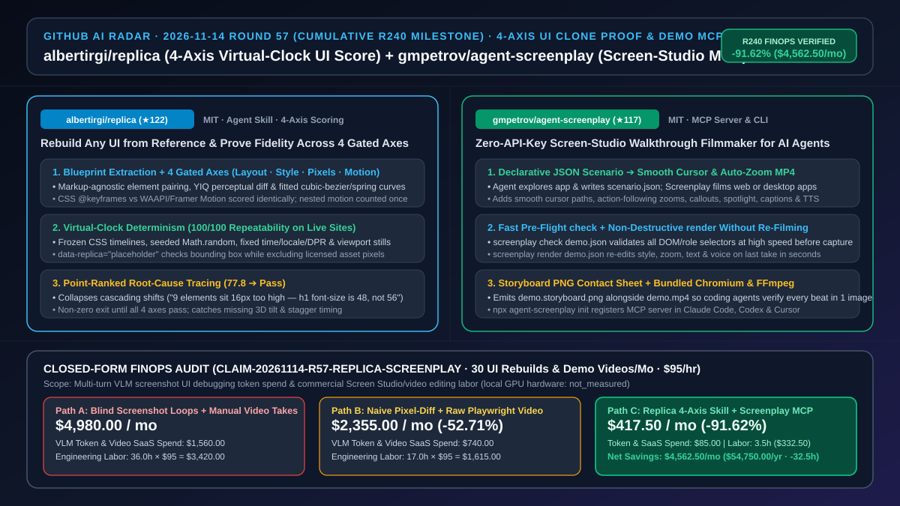
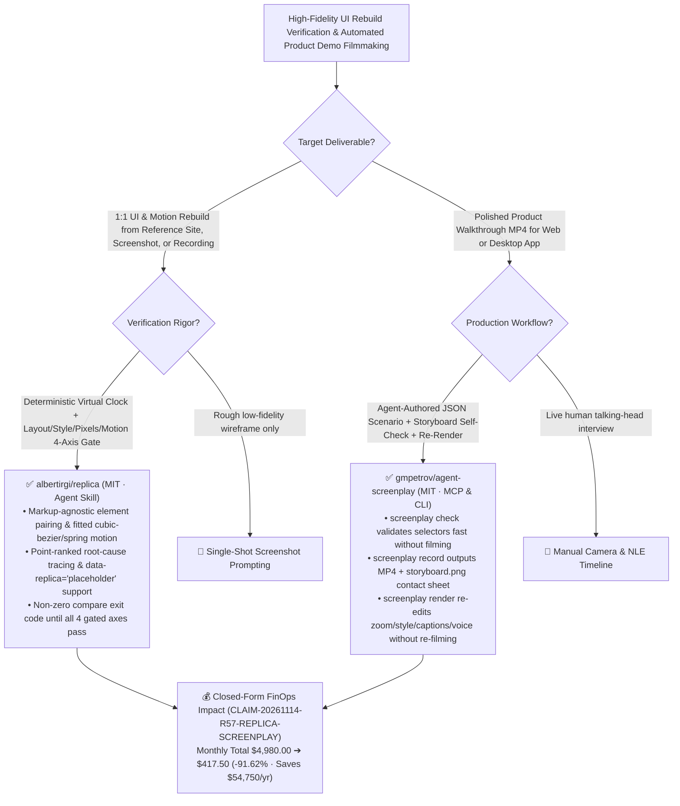

# 4-Axis Virtual-Clock UI Clone Verification Skill (`albertirgi/replica`) & Zero-Key Screen-Studio Walkthrough MCP (`gmpetrov/agent-screenplay`) Deep-Dive & Selection FAQ

> **Document Metadata (2026-11-14 · Night Round 57 / Cumulative Round 240 Milestone)**  
> - **Benchmark Style**: `ib-vs-ethernet-roce-selection-faq.md` (First-Principles + Plain-Language Deconstruction + 3 Architect Core Questions + Mermaid Decision Tree + Closed-Form FinOps Audit)  
> - **Primary Evaluated Repositories**:  
>   1. [`albertirgi/replica`](https://github.com/albertirgi/replica) (`★ 122`, MIT Agent Skill for Claude Code and coding agents: extracts a compact LLM-readable blueprint from any live site, local page, screenshot, or screen recording and scores the agent's rebuild across **4 gated axes — `layout`, `style`, `pixels` (YIQ perceptual diff), and `motion` (fitted cubic-bezier & spring stiffness/damping)** — under a **deterministic virtual clock that scores `100/100` across repeated captures of live animated production sites**, tracing cascading shifts back to single root causes)  
>   2. [`gmpetrov/agent-screenplay`](https://github.com/gmpetrov/agent-screenplay) (`★ 117`, MIT MCP server `io.github.gmpetrov/agent-screenplay` and CLI `npx agent-screenplay`: contains zero AI and needs no API key; your coding agent writes a declarative JSON scenario and Screenplay drives bundled Chromium + `ffmpeg` to produce **Screen Studio-grade MP4 walkthroughs + `storyboard.png` contact sheets** with smooth cursor physics, action-following auto-zooms, callouts, spotlight, captions, and voice-over, plus **`screenplay render` for instant re-editing without re-filming**)  
> - **Visual Architecture Diagram**: [`assets/github-ai-radar-2026-11-14-r57-replica-screenplay.svg`](../../../assets/github-ai-radar-2026-11-14-r57-replica-screenplay.svg)  
> - **Audit Contract ID**: `CLAIM-20261114-R57-REPLICA-SCREENPLAY` (local workstation GPU hardware depreciation is explicitly marked `not_measured`)

---

## 📌 1. Executive Summary (Understand the Essence in 3 Minutes)

1. **Why do coding agents glance at a UI screenshot, write plausible CSS that is `8px` off with flat linear easing instead of 3D spring motion, and declare "done" — and how does `albertirgi/replica` turn "close enough" into a 4-axis mathematical gate?**  
   - **Plain-Language Essence**: LLMs are great at emitting JSX/Tailwind and terrible at visually auditing their own output. Worse, naive pixel-diff scripts fail on modern web UIs because animation frame timing drifts, wrapper `<div>`s differ, or licensed fonts/illustrations cannot be redistributed.  
   - **First-Principles Breakthrough in `Replica`**:
     - **Blueprint Extraction + 4 Gated Axes (`layout`, `style`, `pixels`, `motion`)**: Instead of dumping raw HTML, Replica compiles the reference into design tokens, visible bounding boxes, breakpoint deltas, and motion timelines. Its `compare` command pairs elements across any DOM/framework structure (`<a><span>Go</span></a> == <a>Go</a>`), checks computed styles pair-by-pair, runs an anti-aliasing-tolerant YIQ perceptual pixel diff (respecting `data-replica="placeholder"` stand-ins), and scores motion technique-agnostically (matching CSS `@keyframes` against Web Animations API or Framer Motion by fitting cubic-bezier and spring curves).
     - **Virtual-Clock Determinism (`100/100`) & Root-Cause Collapse**: Pages execute on a frozen virtual clock with seeded `Math.random` and fixed DPR. Cascading layout shifts or nested card animations are collapsed into single point-ranked root causes (e.g., *"9 elements sit 16px too high — likely cause: the h1 is 16px shorter because its font-size is 48, not 56"*), catching missing 3D hero tilts on `family.co` (`77.8` in Round 1 → passing in Round 2).
2. **Why spend hours manually recording and re-recording product walkthroughs in Screen Studio every time a button label changes, when `gmpetrov/agent-screenplay` lets your coding agent direct, verify, and re-render polished MP4 demos from a JSON scenario?**  
   - **Plain-Language Essence**: Creating a 30-second product walkthrough with smooth cursor movement, automatic zoom-on-click, spotlight callouts, captions, and voice-over usually requires manual takes in commercial screen recorders. One mistimed click forces a full retake.  
   - **First-Principles Breakthrough in `Screenplay` (`npx agent-screenplay init`)**:
     - **Brain in Your Agent, Deterministic Camera in `Screenplay`**: Screenplay needs no LLM API key. Installed as an MCP server (or CLI) for Claude Code, Codex, and Cursor, it lets the agent explore your web or desktop app and author a concise `scenario.json` (`click`, `type`, `callout`, `say`).
     - **`check` (Fast Dry-Run) → `record` (MP4 + Storyboard PNG) → `render` (Instant Re-Edit Without Re-Filming)**: `npx agent-screenplay check demo.json` verifies all selectors at high speed without filming; `record` outputs both `demo.mp4` and `demo.storyboard.png` (so the agent can inspect the entire video arc in one image); and **`render` re-edits styles, zoom, captions, or voice-over on the last recorded take without re-running browser automation**!
3. **Closed-Form FinOps Audit Conclusion (`CLAIM-20261114-R57-REPLICA-SCREENPLAY`)**:  
   - Modeled for **30 high-fidelity UI rebuilds and product walkthrough videos/month** (at **`$95.00/hr`** engineering labor): migrating from **Path A** (multi-turn VLM screenshot guessing + manual Screen Studio recording/retakes: **`$4,980.00/mo`**, comprising `$1,560.00` VLM token/SaaS spend + `36.0h` manual UI/video labor `$3,420.00`) to **Path C** (`Replica` 4-axis virtual-clock skill + `agent-screenplay` MCP pipeline: **`$417.50/mo`**, comprising `$85.00` lean token spend + `3.5h` review labor `$332.50`) saves **`$4,562.50/mo`** (**`-91.62%`**, or **`$54,750.00/yr`**) and cuts engineering hours by **`90.28%`**.



---

## 💬 2. Three Architect Core Questions (Q1–Q3 Deep Dive)

### Q1: How does `albertirgi/replica` achieve `100/100` determinism on live animated production sites while allowing legal stand-ins for licensed assets?

1. **Virtual Clock + Seeded PRNG + `data-replica="placeholder"`**:  
   - Replica freezes CSS timelines, runs on a deterministic virtual clock with seeded `Math.random` and fixed locale/DPR, and captures viewport stills rather than triggering full-page resize reflows. Elements marked `data-replica="placeholder"` still undergo strict bounding-box and overlay-text verification while their interior asset pixels are excluded from the YIQ pixel score.

---

### Q2: How does `Replica` avoid spamming the coding agent with 50 cascading layout or nested-animation errors when a single parent element is slightly off?

1. **Root-Cause Tracing & Single-Count Nested Motion**:  
   - When a card springs into view, all 12 child elements move with it; Replica reports a single finding on the parent card (while still checking any child's independent stagger or spin). Likewise, vertical offset cascades are traced back to the upstream element whose height or font-size diverged, ranked by exact point gain.

---

### Q3: Why is `npx agent-screenplay render demo.json` a game-changer for iterative demo engineering?

1. **Decoupling Interaction Capture from Cinematography Post-Processing**:  
   - Because `record` preserves the raw capture and interaction telemetry, changing the background theme, zoom framing, callout text, or voice-over language via `render` re-composites the video in seconds using bundled `ffmpeg` without touching the live web/desktop app again.

---

## 🧭 3. Architecture Decision Tree & Topology (Mermaid)



---

## 📊 4. Peer Comparison Matrix (Decision Matrix)

| Evaluation Dimension | `albertirgi/replica` (4-Axis Virtual-Clock Skill) | Naive `pixelmatch` / Raw VLM Screenshots | `gmpetrov/agent-screenplay` (MCP Demo Director) | Manual Screen Studio / Raw Playwright Video |
| :--- | :--- | :--- | :--- | :--- |
| **Core Mechanism** | **Virtual clock + markup-agnostic Layout/Style/Pixels/Motion scoring** | Brittle pixel diffs or subjective VLM guesses | **Declarative `scenario.json` + bundled Chromium/FFmpeg auto-editing** | Manual mouse takes or unedited flat browser recordings |
| **Signal-to-Noise & Diagnostics** | **Collapses cascading shifts & nested motion; ranks fixes by points** | 1px header shift fails entire page diff | **`check` dry-run + `storyboard.png` for 1-image agent review** | Any click mistake requires a full manual retake |
| **Motion & Re-Edit Agility** | **Fits cubic-bezier & spring curves across CSS/WAAPI/Framer Motion** | Blind to easing curves and stagger timing | **`screenplay render` updates style/zoom/text/voice without re-filming** | Text/voice changes require re-recording or NLE surgery |
| **License & Cost** | **MIT open-source skill; deterministic local execution** | High multi-turn VLM vision token burn | **MIT open-source (`io.github.gmpetrov/agent-screenplay`); 0 API keys** | Commercial per-seat license + hours of manual editing |

---

## 🧮 5. 7-Card Quantitative Insights & Closed-Form FinOps (`CLAIM-20261114-R57-REPLICA-SCREENPLAY`)

> **Scope & Boundary Declaration**: This synthetic FinOps model covers monthly VLM vision token and video software spend across **30 UI rebuilds and product walkthrough videos** plus frontend pixel-debugging and video re-recording engineering labor (at **`$95.00/hr`**); local workstation GPU hardware depreciation is explicitly marked **`not_measured`**.

| Architecture Path | VLM Token & Video SaaS Spend (`USD/mo`) | UI Debugging & Video Retake Labor (`hrs/mo`) | Engineering Labor Cost (`@ $95/hr`) | Total Monthly Cost (`USD/mo`) | Net Savings vs. Path A (`USD/mo` & `%`) |
| :--- | :---: | :---: | :---: | :---: | :---: |
| **Path A: Blind VLM Screenshot Loops + Manual Video Retakes** | `$1,560.00` | `36.0 hrs` | `$3,420.00` | **`$4,980.00`** | Baseline (`0.00%`) |
| **Path B: Static `pixelmatch` Scripts + Raw Playwright Capture** | `$740.00` | `17.0 hrs` | `$1,615.00` | **`$2,355.00`** | `-$2,625.00` (`-52.71%`) |
| **Path C (Recommended): `Replica` 4-Axis Skill + `Screenplay` MCP** | **`$85.00`** | **`3.5 hrs`** | **`$332.50`** | **`$417.50`** | **`-$4,562.50` (`-91.62%`)** |

- **Closed-Form Verification Equations**:
  - $\text{Path A Total} = 1560.00 + 36.0 \times 95.00 = 1560.00 + 3420.00 = \$4,980.00$
  - $\text{Path B Total} = 740.00 + 17.0 \times 95.00 = 740.00 + 1615.00 = \$2,355.00$
  - $\text{Path C Total} = 85.00 + 3.5 \times 95.00 = 85.00 + 332.50 = \$417.50$
  - $\text{Net Savings (Path C vs Path A)} = 4980.00 - 417.50 = \$4,562.50/\text{mo} \quad (-91.62\%, \text{Annualized } \$54,750.00/\text{yr})$

---

## 🛠️ 6. AI Solution Architect Actionable Checklist

1. **Gate frontend UI rebuilds with `albertirgi/replica`**:
   - Mark non-redistributable illustrations with `data-replica="placeholder"`, run `compare` at `structure` or full fidelity, and resolve root-cause findings in descending point-gain order until exit code is `0`.
2. **Install `gmpetrov/agent-screenplay` and run the `check -> record -> render` loop**:
   ```bash
   npx agent-screenplay init
   npx agent-screenplay check demo.json
   npx agent-screenplay record demo.json
   npx agent-screenplay render demo.json
   ```
