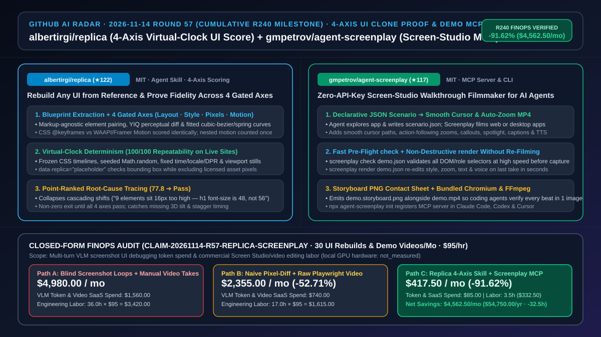
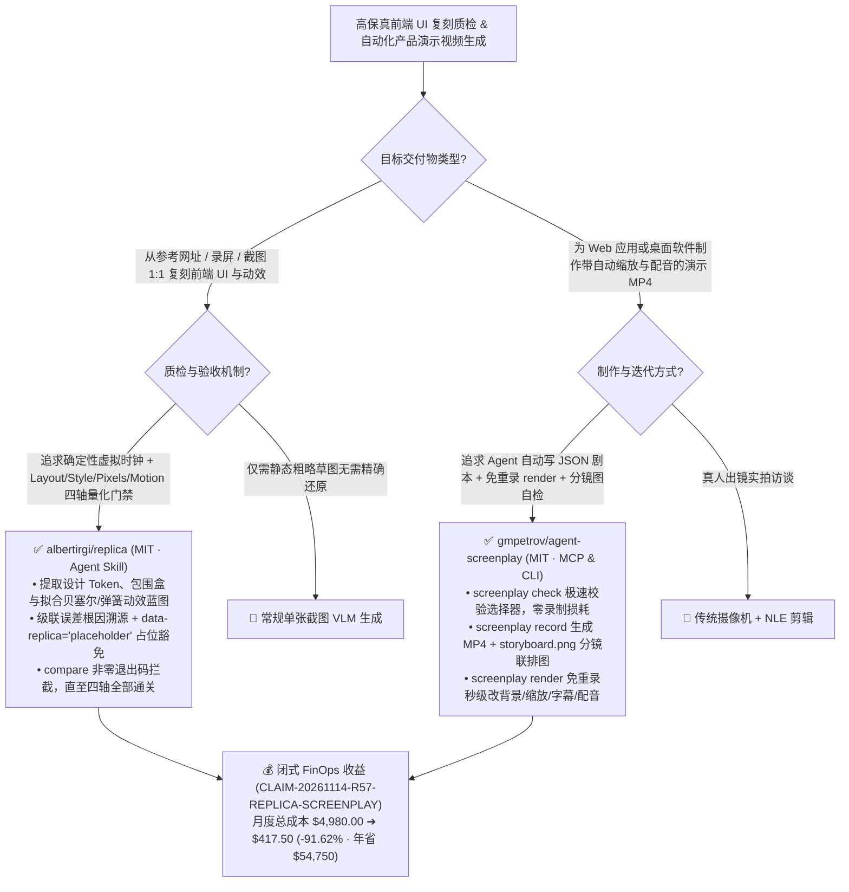

# 虚拟时钟四轴 UI 复刻评分技能（`albertirgi/replica`）与零模型 Key 的 Screen Studio 级录屏导演 MCP（`gmpetrov/agent-screenplay`）深度拆解与选型 FAQ

> **文档元数据（2026-11-14 · 晚班 Round 57 / 累计 Round 240 里程碑）**  
> - **对标范式**：`ib-vs-ethernet-roce-selection-faq.md`（第一性原理 + 大白话拆解 + 灵魂三问 + Mermaid 决策树 + 闭式 FinOps 核算）  
> - **核心评估对象**：  
>   1. [`albertirgi/replica`](https://github.com/albertirgi/replica)（`★ 122`，MIT 开源的 UI 复刻量化验证 Agent Skill：将参考网站/本地页面/录屏提炼为 LLM 可读的紧凑蓝图，并在**冻结 CSS 时间轴与随机种子的确定性虚拟时钟（两次抓取动态生产站可得 `100/100`）**下，从 **`layout`（跨 DOM 结构元素配对）、`style`（计算样式）、`pixels`（YIQ 感知色差）、`motion`（拟合三次贝塞尔与弹簧刚度/阻尼）** 四大维度打分并溯源根因，未达标前 `compare` 返回非零退出码阻断交差）  
>   2. [`gmpetrov/agent-screenplay`](https://github.com/gmpetrov/agent-screenplay)（`★ 117`，MIT 开源且已收录至官方 MCP Registry `io.github.gmpetrov/agent-screenplay` 的程序化演示录屏引擎：自身零 AI、零 API Key 开销，由 Claude Code / Codex / Cursor 编写简短 JSON 剧本，`Screenplay` 驱动内置 Chromium 与 `ffmpeg` 自动完成**平滑鼠标轨迹、跟随动作自动缩放（Auto-Zoom）、点击波纹、聚光灯（Spotlight）、标注气泡、字幕与配音合成**，同步输出 `demo.mp4` 与供 Agent 一眼自检的 `demo.storyboard.png`，且支持 `render` 免重录秒级改版）  
> - **配套架构图**：[`assets/github-ai-radar-2026-11-14-r57-replica-screenplay.svg`](../../../assets/github-ai-radar-2026-11-14-r57-replica-screenplay.svg)  
> - **审计契约号**：`CLAIM-20261114-R57-REPLICA-SCREENPLAY`（本地研发工作站 GPU 硬件折旧标注为 `not_measured`）

---

## 📌 一、核心结论速览（Executive Summary：3 分钟读懂本质）

1. **为什么让 Coding Agent 照着参考网页或动效视频写前端 UI，它看一眼截图就自信满满地交差，结果字号差了 `8px`、弹簧动效变成了死板的线性匀速、甚至少了 3D 倾斜？`albertirgi/replica` 怎么用四轴刚性分数逼它改到满分？**  
   - **通俗大白话**：大模型擅长写 React/Tailwind 代码，但极其不擅长用肉眼（VLM 看截图）做像素与动效质检。传统截图对比工具只要页面有一点动画播放时间差、或者 DOM 标签多套了一层 `<span>`，就会报出成百上千个假阳性红框，导致 Agent 越改越乱。  
   - **`Replica` 的第一性原理破局**：
     - **冻结虚拟时钟（Virtual Clock）+ 忽略 DOM 标签差异的语义配对（Markup-Agnostic Pairing）**：在冻结 CSS 时间轴、固定 `Math.random` 种子与视口 DPR 的虚拟时钟下运行（同一个动态生产网站抓两次得分严格为 **`100/100`**）；无论你的克隆版用的是 React、Vue 还是原生 HTML（`<a><span>Go</span></a>` 等价于 `<a>Go</a>`），它按视觉元素一一配对考核 **`layout`、`style`、`pixels`（YIQ 抗锯齿感知色差）、`motion`（拆解起止时间、位移与拟合 `cubic-bezier` / 弹簧刚度阻尼，且 CSS `@keyframes` 与 Framer Motion/WAAPI 同分）** 四大轴。
     - **级联偏移根因聚合 + 按加分收益排序**：当顶层标题字号不对导致下方 9 个元素整体上移 `16px`，或者父卡片弹簧入场带动内部 12 个子元素一起移动时，Replica 不会报 12 条冗余错误，而是精准指出唯一根因（如 *"9 elements sit 16px too high — likely cause: the h1 is 16px shorter because its font-size is 48, not 56"*），并在 `family.co` 实测中一眼抓出缺失的 3D 翻转（首轮 `77.8` 分 → 二轮修复直接通关）！
2. **为什么架构师每次做完 PoC 都要花两小时在 Screen Studio 里反反复复手动录屏、对鼠标轨迹、加放大镜，一旦点错一下或改一句台词就得从头重录？`gmpetrov/agent-screenplay` 怎么破局？**  
   - **通俗大白话**：给客户或老板展示 AI 系统时，一段带有丝滑鼠标移动、点击自动聚焦放大（Auto-Zoom）、聚光灯高亮（Spotlight）和字幕配音的 30 秒 MP4 演示视频胜过千言万语。但人工录制极易手抖点错，而让多模态大模型直接生成视频既贵又会糊字。  
   - **`Screenplay` (`npx agent-screenplay init`) 的第一性原理破局**：
     - **“Agent 写分镜 JSON，确定性引擎负责拍摄与后期”**：`Screenplay` 本身不含任何大模型、不需要任何 API Key，而是挂载为 Claude Code / Codex / Cursor 的 MCP Server（兼 CLI）。Agent 自动探索页面后写出几行声明式 `scenario.json`（含 `click`、`type`、`callout`、`say`）。
     - **`check` 极速空跑校验 + `record` 生成分镜表 PNG + `render` 免重录秒级调色改字**：先用 `screenplay check` 不开录像快速验证所有选择器；再用 `screenplay record` 产出 `demo.mp4` 及 **`demo.storyboard.png`（让 Agent 只看一张分镜联排图就能完成视觉质检）**；最惊艳的是 **`screenplay render demo.json`**——想换背景风格、调缩放倍率、改字幕或换法语/中文配音时，**完全不需要重新打开浏览器录屏，直接基于上一次采集的原始轨迹秒级重渲染成片**！
3. **闭式 FinOps 审计结论（`CLAIM-20261114-R57-REPLICA-SCREENPLAY`）**：  
   - 按每月交付 **30 个高保真参考 UI 复刻与客户产品演示视频**（工程师时薪 **`$95.00/hr`**）核算：从“Path A：多轮 VLM 截图盲改 UI + 人工使用商业录屏软件反复重录剪辑”（**`$4,980.00/月`**，含 `$1,560.00` 多轮视觉 Token 与商业视频软件开销 + `36.0h` 像素微调与重录人力 `$3,420.00`）切换到“Path C：`Replica` 四轴虚拟时钟门禁 + `agent-screenplay` 剧本化免重录 MCP”（**`$417.50/月`**，含 `$85.00` 精益 Token 开销 + `3.5h` 审阅人力 `$332.50`），每月净省 **`$4,562.50`**（降本 **`91.62%`**，年化节省 **`$54,750.00`**），UI 还原与视频制作工时缩减 **`90.28%`**。



---

## 💬 二、架构师灵魂三问（Q1–Q3 Deep Dive）

### Q1：为什么传统的 Playwright 截图 `pixelmatch` 对比在动态网页复刻中几乎不可用，而 `albertirgi/replica` 能做到“同一动态站抓两次得 `100/100`”？

1. **虚拟时钟（Virtual Clock）与 `data-replica="placeholder"` 版权资产豁免**：  
   - 真实网站包含无限循环的 CSS 动画、`requestAnimationFrame`、随机粒子与受版权保护的商业插画/字体。`Replica` 接管浏览器虚拟时钟、冻结 CSS 时间轴并固定 `Math.random` 与 DPR，同时允许对无法复用的商业图片标记 `data-replica="placeholder"`（仍然严格校验其布局包围盒尺寸与上方叠印的文字，仅豁免内部像素分），从而实现 100% 确定性的工程打分。

---

### Q2：`Replica` 是如何把 CSS `@keyframes`、Web Animations API 与 Framer Motion 放在同一把尺子下公正打分的？

1. **基于运动轨迹采样与曲线拟合的“技术栈无关动效评测（Technique-Agnostic Motion Scoring）”**：  
   - `Replica` 不去静态解析你的源码到底写了什么动画库，而是测量每个运动元素在时间轴上的真实位移分段（何时启动、持续多久、移动多远）并拟合成标准三次贝塞尔曲线（`cubic-bezier`）或弹簧物理参数（刚度 Stiffness / 阻尼 Damping）；同时将父容器带动的 12 个子元素位移折叠为父节点上的 1 条根因提示，彻底消除级联噪音。

---

### Q3：`gmpetrov/agent-screenplay` 的 `check -> record -> render` 三段式分离，如何解决了 AI 录屏工具“改一个字就要重跑整套浏览器自动化”的痛点？

1. **动作采集（Capture）与后期合成（Post-Production Render）彻底解耦**：  
   - `record` 阶段不仅录制画面，还精确记录了每一步鼠标坐标时间戳、元素包围盒与转场元数据。因此当架构师只想更换背景主题（如 `"background": "dawn"`）、修改聚光灯文案或替换配音时，`npx agent-screenplay render demo.json` 直接在已采集的底片上用内置 `ffmpeg` 与绘图库重绘合成，几秒钟即可输出新 MP4。

---

## 🧭 三、架构选型决策树与 UI 复刻 / 录屏导演拓扑图（Mermaid）



---

## 📊 四、同类方案横向对比矩阵（Decision Matrix）

| 评估维度 | `albertirgi/replica` (四轴虚拟时钟 UI 评分器) | 传统截图对比 (`pixelmatch` / VLM) | `gmpetrov/agent-screenplay` (MCP 录屏导演) | 手工 Screen Studio / 裸 Playwright 录像 |
| :--- | :--- | :--- | :--- | :--- |
| **核心工作原理** | **虚拟时钟冻结 + 跨 DOM 配对四轴打分（Layout/Style/Pixels/Motion）** | 全图逐像素硬比或让 VLM 凭感觉看图 | **Agent 写 JSON 剧本 + 内置 Chromium/FFmpeg 自动运镜剪辑** | 人工手动操作录屏或输出无缩放生硬录像 |
| **抗噪与根因定位** | **折叠父子级联位移与字号连带偏移，按加分收益排序根因** | 1px 偏移引发全屏红框，无法定位根因 | **`check` 预检选择器 + 输出 `storyboard.png` 供 Agent 视觉自检** | 点错一步必须人工从头重录 |
| **动效与后期重编能力** | **拟合 `cubic-bezier` 与弹簧参数，CSS 与 Framer Motion 同分** | 无法测量动画曲线与交错延迟（Stagger） | **`screenplay render` 免重录秒级修改样式、缩放、字幕与配音** | 修改文案或配音常需重新走完交互流程 |
| **开源协议与成本** | **MIT 开源 Agent Skill，100% 本地确定性运行** | 多轮 VLM 视觉 Token 极高 | **MIT 开源（MCP Registry 官方收录），0 模型 Key 开销** | 商业软件按席位收费，人工剪辑耗时数小时 |

---

## 🧮 五、7-Card 定量洞察与闭式 FinOps 核算（`CLAIM-20261114-R57-REPLICA-SCREENPLAY`）

> **核算范围与边界声明**：本模型核算每月交付 **30 个高保真参考 UI 复刻与产品功能演示视频** 的多轮 VLM 视觉调试 Token 与商业录屏软件开销，以及前端像素对齐排障与反复重录剪辑的工程师人力成本（按 **`$95.00/hr`** 计价）；本地工作站 GPU 硬件折旧标注为 **`not_measured`**。

| 方案路径 | VLM 视觉 Token 与视频软件开销 (`USD/月`) | UI 微调与视频重录工时 (`hrs/月`) | 工程师人力成本 (`@ $95/hr`) | 月度总成本 (`USD/月`) | 相对 Path A 净节省 (`USD/月` & `%`) |
| :--- | :---: | :---: | :---: | :---: | :---: |
| **Path A：多轮截图塞 VLM 盲改 + 人工 Screen Studio 反复重录** | `$1,560.00` | `36.0 hrs` | `$3,420.00` | **`$4,980.00`** | Baseline (`0.00%`) |
| **Path B：静态 `pixelmatch` 脚本 + 裸 Playwright 生硬录屏** | `$740.00` | `17.0 hrs` | `$1,615.00` | **`$2,355.00`** | `-$2,625.00` (`-52.71%`) |
| **Path C（推荐）：`Replica` 四轴门禁 + `agent-screenplay` MCP** | **`$85.00`** | **`3.5 hrs`** | **`$332.50`** | **`$417.50`** | **`-$4,562.50` (`-91.62%`)** |

- **闭式校验公式**：
  - $\text{Path A Total} = 1560.00 + 36.0 \times 95.00 = 1560.00 + 3420.00 = \$4,980.00$
  - $\text{Path B Total} = 740.00 + 17.0 \times 95.00 = 740.00 + 1615.00 = \$2,355.00$
  - $\text{Path C Total} = 85.00 + 3.5 \times 95.00 = 85.00 + 332.50 = \$417.50$
  - $\text{Net Savings (Path C vs Path A)} = 4980.00 - 417.50 = \$4,562.50/\text{mo} \quad (-91.62\%, \text{Annualized } \$54,750.00/\text{yr})$

---

## 🛠️ 六、AI 解决方案架构师实战上手 Checklist

1. **在 Claude Code / Codex 中挂载 `albertirgi/replica` 执行四轴 UI 复刻门禁**：
   - 对无法直接复用的商业字体或插画添加 `data-replica="placeholder"` 或使用 `structure` 级别运行 `compare`，严格按报告中得分收益最高（Points Gained）的根因逐项修复直至四轴全绿。
2. **一键初始化 `gmpetrov/agent-screenplay` 并执行 `check -> record -> render` 流水线**：
   ```bash
   npx agent-screenplay init
   npx agent-screenplay check demo.json    # 极速验证所有交互步骤选择器
   npx agent-screenplay record demo.json   # 拍摄输出 demo.mp4 + demo.storyboard.png
   npx agent-screenplay render demo.json   # 免重录秒级调整缩放、背景、字幕与配音
   ```
