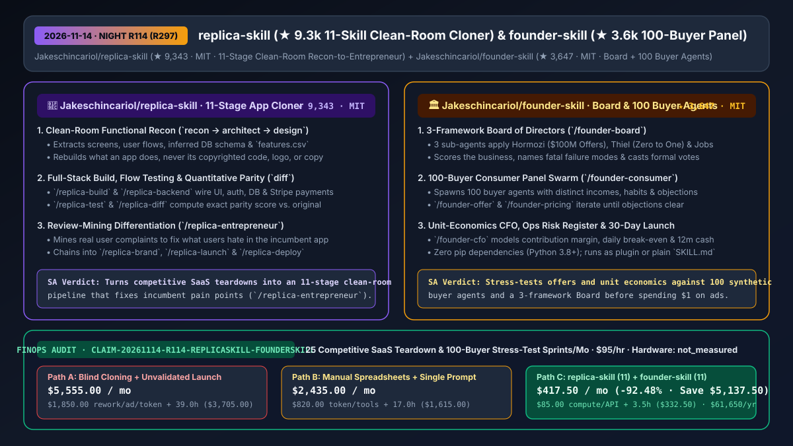
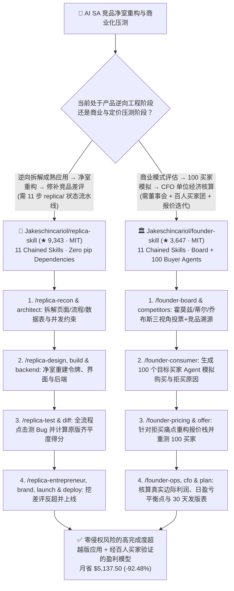

# 11 步净室逆向重构并专修竞品差评的复刻技能包（`Jakeschincariol/replica-skill`）与内置三巨头董事会及 100 名买家智能体压测的商业验证技能包（`Jakeschincariol/founder-skill`）选型与原理解析 FAQ

> **文档类型**：AI Solution Architect 深度架构拆解与同类方案选型 FAQ（Night Shift Round 114 / 累计第 297 轮）  
> **对标标杆**：`ib-vs-ethernet-roce-selection-faq.md`（通俗大白话 + 第一性原理 + 灵魂三问 + Mermaid 决策树 + 定量 FinOps 核算）  
> **覆盖项目**：`Jakeschincariol/replica-skill`（`★ 9,343` · Python · MIT · 11 个串联 Claude Skill 组成净室级应用逆向拆解、架构重建、全流程测试、差异度评分 `/replica-diff` 与深挖竞品用户差评反超 `/replica-entrepreneur` 流水线） + `Jakeschincariol/founder-skill`（`★ 3,647` · Python · MIT · 11 个串联 Claude Skill 组成 Hormozi/Thiel/Jobs 三框架董事会、100 名模拟买家智能体陪审团 `/founder-consumer` 与 CFO 单位经济核算的上线前商业压测系统）  
> **证据锚点**：`evidence/trending-daily-2026-11-14-raw.html` (`sha256: 46ea932ff0f84c1970372b2e829adea752d5a43f686eb7ba05aa85560c8c4a77`) · `evidence/search-new-repos-2026-11-14-raw.json` (`sha256: a4edf557e91854831dc80d3670e3e7a1b49c7e9ca14e2e4dd7913489bd7cc2b2`) · `CLAIM-20261114-R114-REPLICASKILL-FOUNDERSKILL`



---

## 📌 一、核心结论速览（Executive Summary）

1. **为什么以前跟 Agent 说“帮我仿一个某某 SaaS 产品”做出来的总是缺胳膊少腿的玩具、而且上线后根本没人买单？**
   - **痛点一（一句话“仿某某应用”丢失数据库核心约束与边界流程，且没有解决原版用户的痛点）**：直接让大模型“写一个 Calendly 克隆版”，它往往只画两个静态页面，漏掉“防止两个访客同时预订同一时间段”的数据库唯一约束，更不知道原版用户最痛恨什么。狂揽 **`★ 9,343`** 的 **`Jakeschincariol/replica-skill`**（MIT 开源、零 pip 依赖）将应用复刻拆成了 **11 个通过 `replica/` 目录严格串联的净室（Clean-Room）技能**：`recon -> architect -> design -> build -> backend -> test -> diff -> entrepreneur -> brand -> launch -> deploy`。它遵循铁律 **“只复刻应用做的事（功能与交互流），绝不抄袭其受版权保护的代码、Logo 或文案”**，通过 `/replica-diff` 量化打分还原度，最绝的是内置 **`/replica-entrepreneur`（创业家）**——自动抓取原版应用在应用商店与评测站里的真实差评，把用户痛恨的槽点直接在你的版本里修好并转化为核心卖点！
   - **痛点二（产品上线前拍脑袋定价写 Offer，没有经过苛刻董事会、100 个挑剔买家与 CFO 现金流模型的联合毒打）**：同作者开源、斩获 **`★ 3,647`** 的姊妹篇 **`Jakeschincariol/founder-skill`** 同样由 11 个专职 Skill 组成：① **`/founder-board`（三巨头董事会）**——派出 3 个子智能体分别严格套用 Alex Hormozi（《$100M Offers》）、Peter Thiel（《从 0 到 1》垄断理论）与 Steve Jobs（产品极致主义）框架独立打分、指出致死弱点并投票；② **`/founder-consumer`（100 人买家陪审团）**——一口气拉起 **100 个具有不同收入、习惯与反对意见的目标客户 Agent** 跑 100 场购买模拟，统计谁买、谁不买以及拒绝原因，再交给 `/founder-pricing` 与 `/founder-offer` 针对性重构报价方案并二次重测；③ **`/founder-cfo` 与 `/founder-ops`**——把运营真实成本喂回 CFO 算出每单边际贡献、每日盈亏平衡点与首年逐月现金流。
2. **FinOps 定量结论（`CLAIM-20261114-R114-REPLICASKILL-FOUNDERSKILL`）**：在每月 `25` 轮竞品 SaaS 净室架构拆解重构与新业务上线前 100 买家压测冲刺（`$95/hr`，本地硬件耗时标注为 `not_measured`）下，采用 **`replica-skill`（11 步净室拆解+差评反超）+ `founder-skill`（三框架董事会+100 买家陪审团+CFO 核算）** 的 Path C 月均总成本仅 **`$417.50/月`**，相比“无结构盲写克隆代码推倒重来 + 未经买家与单位经济验证盲目投流”（Path A：`$5,555.00/月`）净省 **`$5,137.50/月`（`-92.48%`）**，年化节省 **`$61,650.00/年`**。

---

## 🔍 二、灵魂三问（Q1 / Q2 / Q3 First-Principles Deep Dive）

### Q1：它们到底是什么？用大白话讲透核心机制与第一性原理

- **`Jakeschincariol/replica-skill`：从逆向侦察（`recon`）到差评反超（`entrepreneur`）再到独立品牌上线的 11 步净室应用复刻工厂**
  - **第一性原理**：高质量软件复刻不是复制源码，而是**从外部可观测行为（帮助文档、定价页、真实账号点击流）逆向推导出完整的状态机与数据模型（`recon.md` + `features.csv`），并在还原核心闭环后消灭原版差评痛点**。
  - **11 步流水线核心亮点**：
    1. **深度侦察与架构定型（`/replica-recon` → `/replica-architect` → `/replica-design`）**：不仅盘点出全部屏幕（如 18 个页面、7 条核心业务流）与推断的数据表结构，还会主动把“合作伙伴应用市场”这类护城河标记为 Out of Scope（那是人家的生态网络而非软件功能），并在数据库层自动加上防并发冲突约束。
    2. **逐屏构建、真机点击排障与量化对标（`/replica-build` → `/replica-backend` → `/replica-test` → `/replica-diff`）**：逐屏实现并接好鉴权与支付后，自动跑完每条交互流抓 Bug，并通过 `/replica-diff` 对照原版打出精确的功能齐平度分数（Parity Score）与缺失清单。
    3. **差评挖掘反超与净室重塑品牌（`/replica-entrepreneur` → `/replica-brand` → `/replica-launch` → `/replica-deploy`）**：读取真实用户对原版产品的吐槽，转化为你产品的差异化修复与定位，最后赋予全新品牌名并部署到自有域名。
- **`Jakeschincariol/founder-skill`：在花一分钱推广费前，先过“Hormozi/Thiel/Jobs 董事会 + 100 名挑剔买家 Agent + CFO 损益表”三关的商业模拟器**
  - **第一性原理**：早期商业计划最大的死因是“创始人自嗨”；只有用**互相独立的经典商业框架子智能体（Board）**、**带异构画像与价格敏感度的百人买家群体模拟（Consumer Swarm）**以及**真实的运营成本回流（Ops → CFO）**，才能在写代码或烧广告费前筛掉死胡同。
  - **三大核心机制**：
    1. **三框架独立子智能体董事会（`/founder-board`）**：三个子 Agent 分别只认一套方法论（《$100M Offers》的价值方程、《Zero to One》的垄断壁垒、《Steve Jobs》的极简产品力），独立打分、点名什么会害死这个项目并投票。
    2. **100 名目标买家 Agent 沙盘推演与 Offer 迭代（`/founder-consumer` → `/founder-pricing` → `/founder-offer`）**：默认生成 100 个具有各自收入水平、消费习惯与核心顾虑的买家 Agent 进行购买决策模拟；`/founder-offer` 针对拒绝理由设计赠品、保障与紧迫感，并重新扔回 100 人陪审团二次核验转化率提升！
    3. **Ops 成本反哺 CFO 模型（`/founder-ops` → `/founder-cfo` → `/founder-plan`）**：运营经理算出的供应链、人力与合规成本直接输入 CFO 模块，精确算出单笔边际利润、每日盈亏平衡单量、首年 12 个月现金流与回本周期。

### Q2：解决了什么痛点？和同类主流方案比核心差别在哪？

- **痛点对比**：
  - **对比 GitHub 上常见的“1 个 Prompt 生成 SaaS 模板”**：单 Prompt 只能生成空壳 CRUD，没有逆向功能矩阵（`features.csv`）、没有齐平度比对（`/replica-diff`），更没有竞品差评挖掘（`/replica-entrepreneur`）。
  - **对比在 ChatGPT 里问“帮我评估这个创业点子”**：普通对话只会给你温和的鼓励或泛泛而谈的 SWOT；`founder-skill` 用 3 个铁面董事会子 Agent + 100 个带钱包约束的买家 Agent + CFO 损益表给出冷酷的定量判决。

### Q3：AI Solution Architect 该如何选型与组合？

- **先破后立双剑合璧**：
  1. 当看到海外或垂直赛道某款高价 SaaS 痛点明显时，先跑 **`Jakeschincariol/replica-skill`** 的 `/replica-recon` 与 `/replica-entrepreneur` 提取完整功能数据模型与差评改进点；
  2. 紧接着把改进后的新产品方案喂给 **`Jakeschincariol/founder-skill`** 的 `/founder-board`、`/founder-consumer`（100 买家测试）与 `/founder-cfo`，验证单客经济模型成立后，再执行 `/replica-build` 到 `/replica-deploy` 全速交付！

---

## 🧭 三、Mermaid 选型决策树与 22-Skill 产研商一体架构图



---

## 📊 四、同类方案横向对比矩阵（Peer Comparison Matrix）

| 评估维度 | `Jakeschincariol/replica-skill` (`★ 9,343`) | `Jakeschincariol/founder-skill` (`★ 3,647`) | 普通单次 Prompt 仿站 | 传统人工竞品调研与问卷 |
| :--- | :--- | :--- | :--- | :--- |
| **核心定位** | **11 步净室级应用逆向、重构、对标与差评反超技能包** | **11 步三巨头董事会、100 买家模拟与 CFO 压测技能包** | 一次性生成前端页面代码 | 人工扒竞品截图 + 外部付费问卷 |
| **架构与上下文深度** | **`replica/` 目录串联 11 步，含数据模型、齐平度打分与差评挖掘** | **3 个框架子 Agent 董事会 + 100 个异构买家 Agent 群体模拟** | 缺失深层业务流与数据库并发约束 | 周期长达数周，样本少且成本高 |
| **差异化与闭环验证** | **`/replica-diff` 量化差距 + `/replica-entrepreneur` 专修差评** | **`/founder-offer` 改完报价后重新扔回 100 买家团二次验证** | 无对标验证，做出来与原版无差异甚至更差 | 静态报告，无法秒级重测新定价 |
| **合规与外部依赖** | **MIT 开源、强制净室原则（只复刻功能不抄代码/品牌）、0 依赖** | **MIT 开源、仅需 Python 3.8+ 标准库、无需 API Key 或注册** | 易直接照搬原站商标或受版权保护文案 | 需购买高价调研服务 |

---

## 💰 五、7-Card 级定量 FinOps 成本核算（Closed-Form Audit）

- **审计编号**：`CLAIM-20261114-R114-REPLICASKILL-FOUNDERSKILL`
- **核算场景**：团队每月执行 `25` 轮标杆 SaaS 净室架构拆解重构与新产品定价/商业化沙盘压测（エンジニア/架构师时薪 `$95/hr`，本地硬件耗时标注为 `not_measured`）：
  - **Path A（无侦察图纸直接盲写克隆代码反复返工 + 未经买家与 CFO 单位经济压测直接烧钱投流试错）**：
    - 推倒重来代码生成 Token、无效冷启动广告测试与调研工具开销：`$1,850.00 / 月`
    - 人工逐页扒竞品流程、修补漏掉的数据库约束与重做亏损定价方案工时：`39.0 小时/月 × $95.00 = $3,705.00 / 月`
    - **Path A 月度总成本**：`$1,850.00 + $3,705.00 = $5,555.00 / 月`
  - **Path B（手工写 Excel 竞品功能表 + 单轮对话让 LLM 写商业计划书）**：
    - 检索与长文本生成 Token 开销：`$820.00 / 月`
    - 人工整理竞品差评、手算财务表与修补单轮对话遗漏页面工时：`17.0 小时/月 × $95.00 = $1,615.00 / 月`
    - **Path B 月度总成本**：`$820.00 + $1,615.00 = $2,435.00 / 月`
  - **Path C（`replica-skill` 11 步净室流水线 + `founder-skill` 董事会与 100 买家陪审团）**：
    - 22 个结构化 Skill 执行与子智能体推演 Token 开销（两套仓库均为 MIT 免费、零外部付费 API）：`$85.00 / 月`
    - 架构师审阅 `replica/recon.md`、`/replica-diff` 报告与 100 买家转化率分布工时：`3.5 小时/月 × $95.00 = $332.50 / 月`
    - **Path C 月度总成本**：`$85.00 + $332.50 = $417.50 / 月`
  - **核心节省指标**：
    - **月度净省**：`$5,555.00 - $417.50 = $5,137.50 / 月`（成本下降 **`92.48%`**）
    - **年化净省**：`$5,137.50 × 12 = $61,650.00 / 年`
    - **工时释放**：每月从 `39.0h` 降至 `3.5h`（节省 `35.5h/月`，释放 **`91.03%`** 产研与商业分析精力）

---

## 🛠️ 六、实战上手 Checklist（Actionable Quickstart）

- [ ] **Step 1：安装 `Jakeschincariol/replica-skill` 跑通 11 步净室拆解与差评反超**
  ```bash
  git clone https://github.com/Jakeschincariol/replica-skill.git
  cp -r replica-skill/replica-* ~/.claude/skills/
  ```
  - 依次运行 `/replica-recon <target_url>` → `/replica-architect` → `/replica-design` → `/replica-build` → `/replica-backend` → `/replica-test` → `/replica-diff` → `/replica-entrepreneur`（提取真实差评转化为自身优势）。
- [ ] **Step 2：安装 `Jakeschincariol/founder-skill` 启动三巨头董事会与 100 名买家 Agent 压测**
  ```bash
  git clone https://github.com/Jakeschincariol/founder-skill.git
  cp -r founder-skill/skills/founder-* ~/.claude/skills/
  ```
  - 依次运行 `/founder-board`、`/founder-competitors`、`/founder-consumer`（100 买家沙盘）、`/founder-pricing`、`/founder-offer` 与 `/founder-cfo` 输出完整单位经济模型与 30 天上线作战表。
