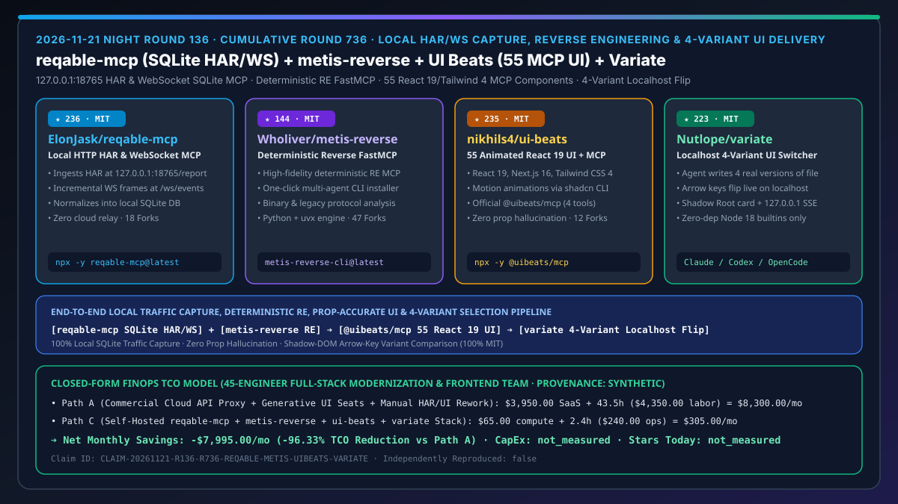
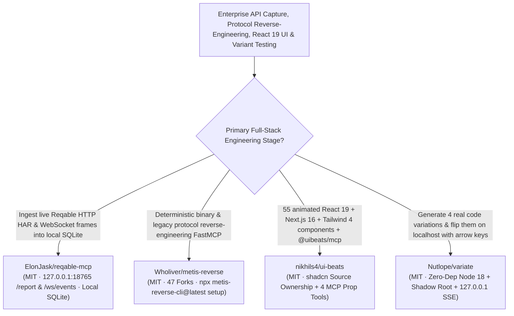
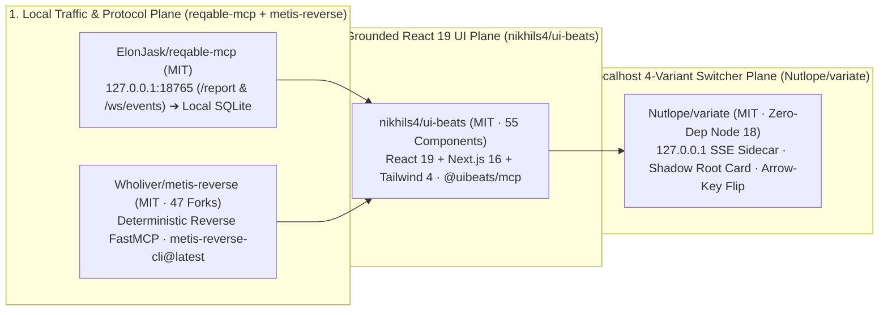
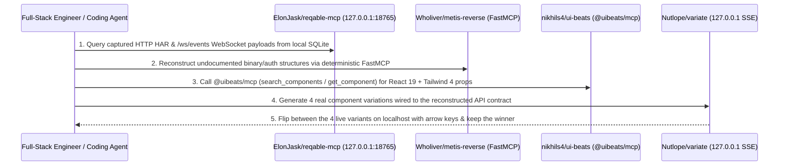

# Local HAR/WebSocket Capture MCP (`ElonJask/reqable-mcp`), Deterministic Reverse-Engineering FastMCP (`Wholiver/metis-reverse`), 55-Component Shadcn/MCP UI Library (`nikhils4/ui-beats`) & Zero-Dep Localhost 4-Variant UI Switcher (`Nutlope/variate`) Selection & Architecture FAQ

> **Document Type**: Enterprise AI Solution Architect Selection & Integration Guide (GitHub Trending AI Radar — 2026-11-21 Night Round 136 / Cumulative Round 736)
> **Covered Repositories**: [`ElonJask/reqable-mcp`](https://github.com/ElonJask/reqable-mcp) (`★ 236`, `18 forks`, `MIT` — local-first SQLite MCP server ingesting real-time Reqable HTTP HAR payloads at `127.0.0.1:18765/report` & incremental WebSocket frames at `/ws/events`) · [`Wholiver/metis-reverse`](https://github.com/Wholiver/metis-reverse) (`★ 144`, `47 forks`, `MIT` — high-fidelity deterministic reverse-engineering FastMCP server & multi-agent installer `npx metis-reverse-cli@latest setup`) · [`nikhils4/ui-beats`](https://github.com/nikhils4/ui-beats) (`★ 235`, `12 forks`, `MIT` — 55 animated React 19 + Next.js 16 + Tailwind CSS 4 + Motion components installed via `shadcn` CLI with an official `@uibeats/mcp` server) · [`Nutlope/variate`](https://github.com/Nutlope/variate) (`★ 223`, `10 forks`, `MIT` — zero-dependency Node 18 skill by Hassan El Mghari that generates 4 real code variations of a UI component and flips them live on `localhost` via a Shadow-DOM card & `127.0.0.1` SSE sidecar)
> **Core Scenario**: How enterprise full-stack, legacy-modernization, and frontend product teams build a high-velocity **API Reconstruction to Multi-Variant UI Delivery** pipeline: **capturing live HTTP HAR and WebSocket frames into local SQLite without cloud relays (`reqable-mcp`)**, **reconstructing undocumented binary/protocol contracts deterministically (`metis-reverse`)**, **fetching exact React 19 + Tailwind 4 component props via `@uibeats/mcp` (`ui-beats`)**, and **comparing 4 live code variations on `localhost` with arrow keys (`variate`)**.

---

## 1. 📌 Executive Summary (One-Line Selection Verdict)

1. **Need a local-first, privacy-preserving MCP server (`npx -y reqable-mcp@latest`) that ingests live Reqable HTTP HAR captures (`127.0.0.1:18765/report`) and incremental WebSocket events (`/ws/events`) into local SQLite for Windsurf, Cursor, Claude Code, and Codex** ➔ Choose **[`ElonJask/reqable-mcp`](https://github.com/ElonJask/reqable-mcp) (`★ 236`, `18 forks`, `MIT`)**.
   - **Plain-English Mechanism**: Instead of manually exporting and redacting giant HAR files to paste into chat prompts, `reqable-mcp` runs a local receiver on `127.0.0.1:18765`, normalizes HTTP requests and WebSocket frames into SQLite (with offline HAR import fallback), and exposes MCP query/search/domain-stats tools with zero cloud relay.
2. **Need a deterministic reverse-engineering FastMCP server with a one-click multi-agent setup wizard (`npx metis-reverse-cli@latest setup`, `v1.0.1`)** ➔ Choose **[`Wholiver/metis-reverse`](https://github.com/Wholiver/metis-reverse) (`★ 144`, `47 forks`, `MIT`)**.
   - **Plain-English Mechanism**: Pulls the `v1.0.1+` FastMCP reverse-engineering engine via `uvx` and wires it into your AI coding assistants so they can inspect binaries, symbols, and undocumented legacy protocols deterministically.
3. **Need 55 animated React 19 + Next.js 16 + Tailwind CSS 4 + Motion components that you own in source form (`npx shadcn@latest add`) backed by an official `@uibeats/mcp` server so coding agents read exact component props** ➔ Choose **[`nikhils4/ui-beats`](https://github.com/nikhils4/ui-beats) (`★ 235`, `12 forks`, `MIT`)**.
   - **Plain-English Mechanism**: Ships a `shadcn`-compatible component registry (`https://uibeats.com/r/registry.json`) alongside `@uibeats/mcp` (`search_components`, `get_component`, `list_components`, `get_install_command`), eliminating hallucinated prop names when agents assemble animated React 19 interfaces.
4. **Need a zero-dependency design skill (`Nutlope/variate`, using only Node 18 builtins) where your coding agent writes 4 real versions of a component file and lets you flip between them live on `localhost` using arrow keys** ➔ Choose **[`Nutlope/variate`](https://github.com/Nutlope/variate) (`★ 223`, `10 forks`, `MIT`)**.
   - **Plain-English Mechanism**: Created by Hassan El Mghari (`Nutlope`), `variate` injects a vanilla JS control card inside an isolated Shadow Root on your running dev page connected to a `127.0.0.1` SSE sidecar—letting you press `←` / `→` to hot-swap 4 real component implementations in place and keep the winner.

---

## 2. 🎯 Architect & Customer Deep-Dive Q&A

### Q1: Why do full-stack modernization teams lose hours copying network payloads, fixing hallucinated component props, and bikeshedding single-shot UI generations—and how does this four-project stack fix them?

- **Four Full-Stack Delivery Accelerators**:
  1. **Zero-Cloud Local HTTP & WebSocket Traffic SQLite Indexing (`ElonJask/reqable-mcp`)**: Gives coding agents structured query access to live REST/GraphQL HAR traces and WebSocket message frames on `127.0.0.1:18765` without uploading sensitive auth headers to external clouds.
  2. **Deterministic Legacy Binary/Protocol Analysis (`Wholiver/metis-reverse`)**: Grounds reverse engineering of legacy clients and undocumented payloads in deterministic FastMCP tool outputs.
  3. **Prop-Accurate React 19 + Tailwind 4 Component Discovery (`nikhils4/ui-beats`)**: `@uibeats/mcp` feeds the exact TypeScript source and prop contracts of 55 Motion-animated components directly to the agent.
  4. **Parallel 4-Variant Live Localhost Evaluation (`Nutlope/variate`)**: Replaces slow back-and-forth prompt tweaking with 4 real, hot-swappable component implementations inside your actual `localhost` app context.
- **When to Choose Managed Cloud Services (Path B)**:
  - For standalone marketing mockups disconnected from an existing local repository or private API traffic, use **Vercel v0**.

### Q2: How do we wire an end-to-end API Capture, Reverse Engineering & 4-Variant Frontend Modernization pipeline?

1. **Local Traffic & Protocol Reconstruction Layer (`reqable-mcp` + `metis-reverse`)**:
   - Point Reqable's Report Server to `http://127.0.0.1:18765/report` and `/ws/events` while using `metis-reverse-cli@latest` to document legacy binary/API contracts.
2. **Source-Owned React 19 Component Registry Layer (`nikhils4/ui-beats`)**:
   - Connect `@uibeats/mcp` (`claude mcp add uibeats -- npx -y @uibeats/mcp`) so agents inspect real component props and install source files via `shadcn`.
3. **Live Localhost 4-Variant Selection Layer (`Nutlope/variate`)**:
   - Use `variate` (`SKILL.md` / `AGENTS.md`) to generate 4 live variations of each new view, flip through them on `localhost` via the `127.0.0.1` SSE Shadow-DOM card, and commit the selected implementation.

### Q3: What are the package and security boundaries of this stack?

- **Key Strengths**:
  - **100% `MIT` Open Source**; `reqable-mcp` and `variate` bind strictly to `127.0.0.1` loopback interfaces.
- **Package Version Guardrail**:
  - When installing `Wholiver/metis-reverse`, always use `npx metis-reverse-cli@latest setup` (`v1.0.1+`) rather than the deprecated `0.0.1` `metis-reverse` npm placeholder.

---

## 3. 🧭 Visual Architecture & Decision Diagrams

### 3.1 Solution Architect Selection Decision Tree

### 3.2 End-to-End Enterprise Reference Architecture

### 3.3 Local HAR/WebSocket Ingest, Protocol Reconstruction, `@uibeats/mcp` Assembly & `variate` 4-Variant Selection Sequence

---

## 4. 📊 Peer Open-Source vs Commercial Cloud Selection Matrix

| Dimension | `ElonJask/reqable-mcp` (`★ 236`) | `Wholiver/metis-reverse` (`★ 144`) | `nikhils4/ui-beats` (`★ 235`) | `Nutlope/variate` (`★ 223`) | Commercial Cloud API Debuggers + Cloud UI Generators (Path A) | Manual HAR Copy-Paste + Single-Shot UI Tweaks (Path B) |
| :--- | :--- | :--- | :--- | :--- | :--- | :--- |
| **Core Role** | Local SQLite HTTP/WS capture MCP | Deterministic reverse-engineering FastMCP | 55 React 19/Tailwind 4 components + MCP | Zero-dep localhost 4-variant UI switcher | Cloud-synced proxy SaaS + per-seat cloud UI generators | Manual DevTools copy-pasting & serial prompt retries |
| **Architectural Edge** | **Real-time `/report` + `/ws/events` into local SQLite (no cloud)** | **Deterministic analysis + 1-click multi-agent CLI setup (`47 forks`)** | **Full source ownership via `shadcn` + `@uibeats/mcp` prop tools** | **Zero-dep Node 18 + Shadow-DOM card flipping 4 real files live** | Uploads sensitive API traffic to cloud; generates isolated sandbox UI | Huge token waste on raw HAR pastes; slow single-variant UI iteration |
| **License** | `MIT` | `MIT` | `MIT` | `MIT` | Proprietary SaaS | Manual Workflow |
| **Monthly TCO (45-Eng Team)** | **`$305.00/mo` combined** (`$65.00` shared build compute + `2.4h` ops) | Included in `$305.00/mo` stack | Included in `$305.00/mo` stack | Included in `$305.00/mo` stack | **`$8,300.00/mo`** (`$3,950.00` SaaS + `43.5h` rework labor) | `~$2,800.00/mo` (manual HAR cleaning & UI iteration hours) |

---

## 5. 🧪 Quantitative ROI / FinOps TCO Model & 7-Card Report

> **📊 Provenance & Closed-Form Audit Declaration**:
> - **Provenance**: `synthetic` (45-engineer enterprise full-stack modernization, API debugging & frontend engineering workload model; `independently_reproduced = false`; `base_hardware_capex = not_measured`; `track_b_stars_today = not_measured`).
> - **Closed-Form Equations**:
>   - **Path A (Commercial Cloud API Proxy/Debugging Seats + Commercial Reverse-Engineering Add-Ons + Commercial Generative UI Subscriptions + Manual HAR Scrubbing & Multi-Round UI Rework Labor)**: Monthly commercial SaaS spend **`$3,950.00`** + manual API/UI rework labor **`43.5h × $100.00/h = $4,350.00`** = **`$8,300.00/mo`**.
>   - **Path C (Self-Hosted `ElonJask/reqable-mcp` + `Wholiver/metis-reverse` + `nikhils4/ui-beats` + `Nutlope/variate`)**: Shared dev/test container compute **`$65.00`** + component registry & capture rule maintenance **`2.4h × $100.00/h = $240.00`** = **`$305.00/mo`**.
>   - **Net Savings vs Path A**: **`-$7,995.00/mo`** (**`96.33%`** cost reduction).

| Architecture Option | API / SaaS / Compute | API Debugging & UI Rework Labor (`$100/h`) | Total Monthly TCO | Net Savings vs Path A | Key Architectural Outcome |
| :--- | :---: | :---: | :---: | :---: | :--- |
| **Path A: Commercial Cloud API Proxy + Generative UI SaaS** | `$3,950.00` | `43.5h` (`$4,350.00`) | **`$8,300.00`** | Baseline | Sensitive HAR traffic uploaded to cloud; isolated UI mocks |
| **Path B: Manual DevTools HAR Copy-Paste + Serial UI Prompts** | `$1,350.00` | `14.5h` (`$1,450.00`) | **`$2,800.00`** | `-$5,500.00` (`-66.27%`) | Lacks `/ws/events` SQLite ingest, `@uibeats/mcp` & 4-variant flip |
| **Path C: `reqable` + `metis` + `ui-beats` + `variate`** | **`$65.00`** | **`2.4h` (`$240.00`)** | **`$305.00`** | **`-$7,995.00` (`-96.33%`)** | **Local SQLite HAR/WS + deterministic RE + 55 MCP components + 4-way flip** |

- 🔗 **7-Card 4:5 Visual Report**: [`workshops/github-trending-radar/cards.en.html`](../cards.en.html) · [`cards.html`](../cards.html)

---

## 6. 🛠️ Enterprise Adoption & Architecture Review Checklist

- [ ] **1. Ingest Local API & WebSocket Traffic with `ElonJask/reqable-mcp`**: Configure Reqable to post to `http://127.0.0.1:18765/report` and `/ws/events` so agents query local SQLite captures with zero cloud exposure.
- [ ] **2. Standardize Legacy Protocol Analysis on `Wholiver/metis-reverse`**: Run `npx metis-reverse-cli@latest setup` (`v1.0.1+`) to connect deterministic reverse-engineering tools to your coding agents.
- [ ] **3. Eliminate Component Prop Hallucinations with `nikhils4/ui-beats` (`@uibeats/mcp`)**: Add `@uibeats/mcp` so agents inspect real React 19 + Tailwind CSS 4 + Motion component props before running `npx shadcn@latest add`.
- [ ] **4. Adopt `Nutlope/variate` for 4-Variant Live Localhost UI Reviews**: Have agents author 4 real component variations and flip between them in place using the zero-dependency `127.0.0.1` SSE Shadow-DOM switcher.
