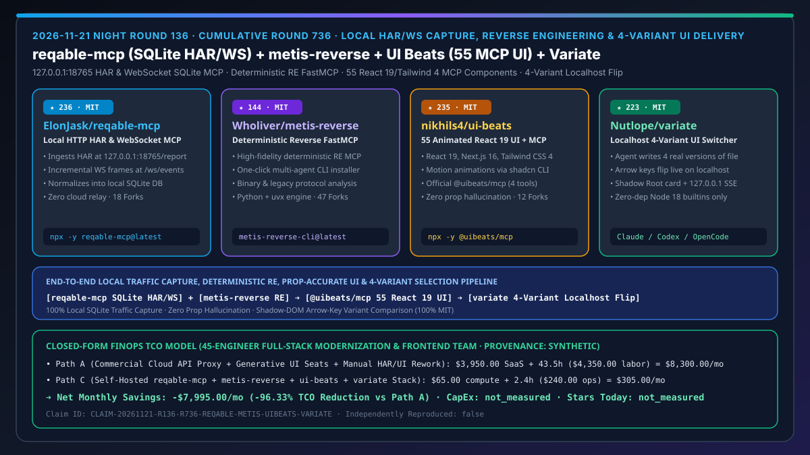
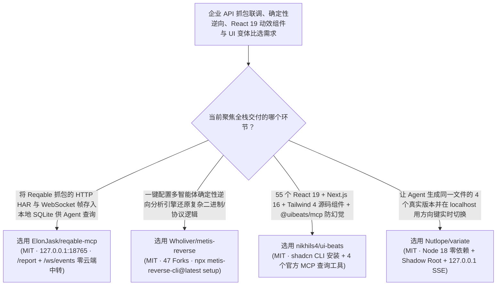
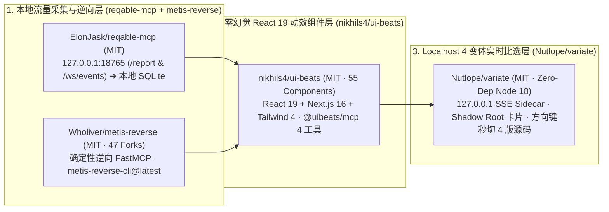
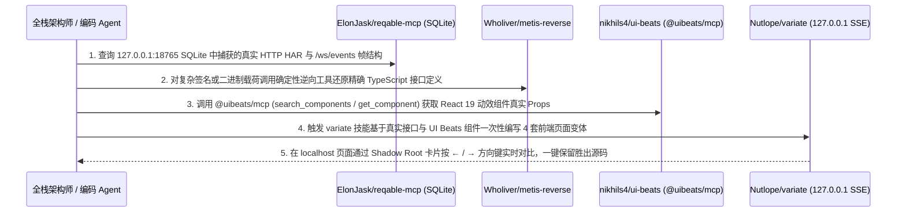

# Reqable 本地抓包与 WebSocket SQLite MCP（`ElonJask/reqable-mcp`）、确定性逆向工程 FastMCP（`Wholiver/metis-reverse`）、自带 `@uibeats/mcp` 的 55 个 React 19 动效组件库（`nikhils4/ui-beats`）与零依赖 Localhost 四变体实时切换技能（`Nutlope/variate`）选型与集成架构 FAQ

> **文档类型**：企业 AI 解决方案架构师（AI Solution Architect）选型决策指南（GitHub Trending AI 雷达 2026-11-21 Night Round 136 / 累计第 736 轮）
> **覆盖项目**：[`ElonJask/reqable-mcp`](https://github.com/ElonJask/reqable-mcp)（`★ 236`、`18 forks`、`MIT`，将 Reqable 抓包的 HTTP HAR 与增量 WebSocket 帧实时写入本地 `127.0.0.1:18765` SQLite 库供 Claude/Cursor/Windsurf 零云端中转查询的抓包 MCP）· [`Wholiver/metis-reverse`](https://github.com/Wholiver/metis-reverse)（`★ 144`、`47 forks`、`MIT`，提供一键多智能体安装向导 `npx metis-reverse-cli@latest setup` 的高保真确定性逆向分析 FastMCP）· [`nikhils4/ui-beats`](https://github.com/nikhils4/ui-beats)（`★ 235`、`12 forks`、`MIT`，基于 React 19 + Next.js 16 + Tailwind CSS 4 + Motion 构建的 55 个源码级组件库，并配套 `@uibeats/mcp` 4 工具消除组件 Props 幻觉）· [`Nutlope/variate`](https://github.com/Nutlope/variate)（`★ 223`、`10 forks`、`MIT`，知名开发者 Nutlope 出品、仅用 Node 18 标准库零依赖实现“让 Agent 生成同一组件的 4 个真实代码版本并在 Localhost 用方向键实时切换对比”的设计技能）
> **核心场景**：当企业全栈研发、旧系统接口重构与前端体验工程团队希望实现**“真实流量协议还原 ➔ 零幻觉动效组件拼装 ➔ 四变体实时交互比选”**的极速应用交付闭环时，如何打通**“本地抓包 HTTP/WebSocket 流量自动入库 SQLite（`reqable-mcp`）+ 遗留二进制/协议确定性逆向（`metis-reverse`）”➔“通过 `@uibeats/mcp` 检索 55 个 React 19 + Tailwind 4 组件真实 Props（`ui-beats`）”➔“在本地开发服上用方向键秒切 4 套真实 UI 变体并一键保留胜出代码（`variate`）”**？

---

## 一、📌 核心结论速览（选型一句话结论）

1. **想让 Cursor、Windsurf、Claude Code 或 Codex 直接查询本地 Reqable 抓取的实时 HTTP 请求、API 统计与增量 WebSocket 消息帧，且所有抓包数据 100% 存在本地 SQLite（无任何云端中转）** ➔ 选 **[`ElonJask/reqable-mcp`](https://github.com/ElonJask/reqable-mcp)（`★ 236`，`18 forks`，`MIT`）**。
   - **通俗原理**：在 Reqable 中配置本地 Report Server 指向 `http://127.0.0.1:18765/report`（以及增量 WebSocket 端点 `/ws/events`），`npx -y reqable-mcp@latest` 会自动将实时流量与离线 HAR 文件归一化存入本地 SQLite，让编码 Agent 直接根据真实抓包 Payload 生成前后端强类型接口代码与联调单测。
2. **想在安全审计、遗留系统无文档二进制/协议分析场景中，通过一键向导将高保真确定性逆向工程能力（Deterministic Reverse Engineering）接入多款编码 Agent** ➔ 选 **[`Wholiver/metis-reverse`](https://github.com/Wholiver/metis-reverse)（`★ 144`，`47 forks`，`MIT`）**。
   - **通俗原理**：通过 `npx metis-reverse-cli@latest setup`（注意务必带 `-cli@latest` 安装 `v1.0.1+` 正式版）拉起基于 `uvx` 的 FastMCP 确定性逆向分析引擎，辅助安全与架构团队快速梳理复杂闭源模块的调用链与数据结构。
3. **想为 React 19 + Next.js 16 + Tailwind CSS 4 项目引入 55 个你完全拥有源码的 Motion 动效组件（支持 `npx shadcn@latest add`），并通过官方 `@uibeats/mcp` 让编码 Agent 直接读取每个组件的真实 Props 而不是瞎猜** ➔ 选 **[`nikhils4/ui-beats`](https://github.com/nikhils4/ui-beats)（`★ 235`，`12 forks`，`MIT`）**。
   - **通俗原理**：采用 `shadcn` 源码内嵌模式（无黑盒 npm 包版本锁定）。更重要的是它自带 **`@uibeats/mcp`**（暴露 `search_components`、`get_component`、`list_components`、`get_install_command` 四个工具），让 Claude Code 或 Cursor 在写前端页面时能精准查出 55 个动效组件的真实属性签名与安装命令。
4. **想在让 AI 写前端组件时告别“每次只给一版丑 UI、反复对话改十几次”，而是让 Agent 一次性写出同一个文件的 4 个真实代码变体，并在你正在看的 `localhost` 页面上通过 Shadow DOM 悬浮卡用方向键（`←` / `→`）实时秒切对比、选中即留存** ➔ 选 **[`Nutlope/variate`](https://github.com/Nutlope/variate)（`★ 223`，`10 forks`，`MIT`）**。
   - **通俗原理**：由知名开源作者 **Nutlope（Hassan El Mghari）** 编写的极简神级技能——**仅使用 Node.js 18 内置标准库（零第三方依赖、甚至没有 `package.json`）**。它启动一个 `127.0.0.1` 本地 SSE Sidecar，在你现有的本地开发页面注入一个隔离样式的 Shadow Root 小卡片：Agent 生成同一组件的 4 种设计风格变体后，你直接按键盘左右方向键在真实浏览器里切换预览，挑中最满意的一版后直接保留为最终源码！

---

## 二、🎯 客户与架构师灵魂拷问 Q&A（深度架构拆解）

### Q1：为什么企业做“遗留系统重构与前端现代化（Legacy Modernization）”时，前后端联调与 UI 打磨最耗工时？这四个项目如何把耗时压缩 90%？

- **四大全栈重构痛点与解方**：
  1. **旧系统无接口文档，手抓 HAR 包往对话框里贴既漏字段又泄密 ➔ `ElonJask/reqable-mcp`**：本地 `127.0.0.1:18765` 自动收集 HTTP HAR 与 `/ws/events` WebSocket 帧存入 SQLite，Agent 按需查询域名统计与报文结构，数据不出本机。
  2. **遗留客户端或私有协议逻辑黑盒 ➔ `Wholiver/metis-reverse`**：用确定性逆向 FastMCP 辅助还原协议状态机。
  3. **大模型写 Tailwind v4 / Motion 动效组件常编造不存在的 Props ➔ `nikhils4/ui-beats` (`@uibeats/mcp`)**：通过 4 个 MCP 工具直接喂给 Agent 55 个 React 19 动效组件的精确源码与 Props 定义。
  4. **单线串行改 UI 审美效率极低 ➔ `Nutlope/variate`**：一次并行生成 4 套真实可交互代码变体，在 `localhost` 用方向键比选，把“抽象文字描述改图”变成“真实运行态四选一”。
- **何时直接用云厂商托管方案（Path B）？**
  - 若团队仅需生成完全独立的静态营销落地页且不介意云端托管代码，可直接使用 **Vercel v0**。

### Q2：典型企业级“本地抓包逆向 (`reqable` + `metis`) + 源码级动效组件 MCP (`ui-beats`) + Localhost 四变体实时比选 (`variate`)”架构怎么搭？

1. **本地流量采集与协议还原层（`reqable-mcp` + `metis-reverse`）**：
   - 开启 Reqable 本地转发至 `127.0.0.1:18765/report` 与 `/ws/events`，配合 `metis-reverse-cli@latest` 梳理后端 API 与 WebSocket 契约。
2. **React 19 / Tailwind 4 动效组件检索层（`nikhils4/ui-beats`）**：
   - 在编码终端挂载 `npx -y @uibeats/mcp`，让 Agent 通过 `search_components` 与 `get_component` 按需拉取源码级组件。
3. **Localhost 零依赖四变体实时比选层（`Nutlope/variate`）**：
   - 触发 `variate` 技能生成目标页面的 4 个设计变体，通过 `127.0.0.1` SSE Sidecar 与 Shadow Root 卡片在本地开发服实时方向键切换定稿。

### Q3：这套架构的部署与安全注意事项是什么？

- **核心优势**：
  - **100% `MIT` 宽松开源协议**，抓包数据留在本地 SQLite，前端组件源码 100% 归属项目自身，UI 比选工具零外部依赖。
- **安装注意事项**：
  - 安装 `Wholiver/metis-reverse` 时，务必按官方说明执行 `npx metis-reverse-cli@latest setup`（不要装成旧的停滞在 `0.0.1` 的废弃同名包）。

---

## 三、🧭 直观可视化图解（Mermaid 决策树 + 集成架构 + 时序图）

### 3.1 架构师选型决策树

### 3.2 企业端到端生产集成参考架构图

### 3.3 本地 HAR/WebSocket 抓包入库、确定性协议还原、`@uibeats/mcp` 组件拉取与 `variate` 四变体定稿时序图

---

## 四、📊 同类开源与商业云服务横向选型决策矩阵

| 对比维度 | `ElonJask/reqable-mcp` (`★ 236`) | `Wholiver/metis-reverse` (`★ 144`) | `nikhils4/ui-beats` (`★ 235`) | `Nutlope/variate` (`★ 223`) | 商业云端接口调试平台 + 商业生成式 UI SaaS (Path A) | 手工导 HAR 贴对话框 + 单版串行改 UI (Path B) |
| :--- | :--- | :--- | :--- | :--- | :--- | :--- |
| **核心能力定位** | Reqable 本地 HTTP/WS SQLite 抓包 MCP | 高保真确定性逆向分析 FastMCP | 55 组件 React 19/Tailwind 4 库 + MCP | 零依赖 Localhost 四变体实时切换技能 | 按席位/Token 计费的商业 API 云与云端 UI 生成器 | 人工复制抓包 JSON、反复对话盲改前端样式 |
| **核心技术突破** | **`/report` + `/ws/events` 实时入本地 SQLite，零云端上传** | **确定性逆向原语 + `metis-reverse-cli` 多端一键配置** | **源码完全归属自身 + `@uibeats/mcp` 杜绝 Props 幻觉** | **Node 18 零依赖 + Shadow Root + 方向键在真实开发服四选一** | 抓包流量上传第三方云存在合规风险；生成代码脱离本地工程上下文 | 粘贴大 HAR 极耗 Token；单版串行改 UI 往返沟通慢 |
| **开源协议** | `MIT` | `MIT` | `MIT` | `MIT` | 闭源商业 SaaS | 人工操作 |
| **月度 TCO（45 人团队）** | **组合仅 `$305.00/月`**（`$65.00` 共享构建容器 + `2.4h` 维护） | 同左（本地 `uvx` 运行零费用） | 同左（MIT 源码级内嵌） | 同左（零依赖内置脚本） | **`$8,300.00/月`**（`$3,950.00` 商业订阅 + `43.5h` 联调返工） | 约 `$2,800.00/月`（大量手工抓包贴报文与 UI 返工工时） |

---

## 五、🧪 应用落地定量收益/TCO 对比与 7-Card 报告

> **📊 数据来源与闭式核算声明（Provenance & Closed-Form Schema）**：
> - **provenance**: `synthetic`（基于 45 人企业全栈研发、遗留系统接口重构与前端体验工程团队工作负载模型：`independently_reproduced = false`；硬件采购基线 `base_hardware_capex = not_measured`；Track B 单日增量 `track_b_stars_today = not_measured`）。
> - **核算公式**：
>   - **Path A（商业云端 API 抓包协作席位 + 商业逆向分析插件 + 商业生成式 UI 订阅 + 工程师手工导出粘贴 HAR 报文、修复虚构组件 Props 与多轮返工调整 UI 样式）**：月度商业工具订阅 **`$3,950.00`** + 接口联调与前端多轮返工人工 **`43.5h × $100.00/h = $4,350.00`** = **`$8,300.00/月`**。
>   - **Path C（自建 `ElonJask/reqable-mcp` + `Wholiver/metis-reverse` + `nikhils4/ui-beats` + `Nutlope/variate` 开源全栈提效栈）**：共享开发测试容器开销 **`$65.00`** + 组件注册表与抓包规则维护 **`2.4h × $100.00/h = $240.00`** = **`$305.00/月`**。
>   - **净节省（Net Savings vs Path A）**：**`-$7,995.00/月`**（成本降低 **`96.33%`**）。

| 评估方案 | API / SaaS / 算力成本 | 接口联调与 UI 迭代人工（`$100/h`） | 月度总 TCO | 相对 Path A 净节省 | 关键架构交付指标 |
| :--- | :---: | :---: | :---: | :---: | :--- |
| **Path A：商业抓包协作云 + 商业生成式 UI 席位 + 手工联调** | `$3,950.00` | `43.5h` (`$4,350.00`) | **`$8,300.00`** | Baseline | 敏感抓包报文上云受限；云端生成 UI 难以直接嵌回复杂本地仓库 |
| **Path B：手工导出 HAR 切片 + 单版串行改前端** | `$1,350.00` | `14.5h` (`$1,450.00`) | **`$2,800.00`** | `-$5,500.00` (`-66.27%`) | 缺少 WebSocket 增量入库、`@uibeats/mcp` 真实 Props 与四变体实时秒切 |
| **Path C：`reqable` + `metis` + `ui-beats` + `variate` 组合** | **`$65.00`** | **`2.4h` (`$240.00`)** | **`$305.00`** | **`-$7,995.00` (`-96.33%`)** | **本地 SQLite 抓包 + 确定性逆向 + 55 动效组件 MCP + 4 变体秒切** |

- 🔗 **关联 7-Card 4:5 视觉评测报告**：[`workshops/github-trending-radar/cards.html`](../cards.html) · [`cards.en.html`](../cards.en.html)

---

## 六、🛠️ 企业引入与架构评审 Checklist

- [ ] **1. 配置 `ElonJask/reqable-mcp` 实现零云端本地流量联调**：将 Reqable Report Server 指向 `http://127.0.0.1:18765/report` 与 `/ws/events`，让 Agent 直接从本地 SQLite 读取 HTTP 与 WebSocket 抓包结构。
- [ ] **2. 使用 `npx metis-reverse-cli@latest setup` 部署确定性逆向 FastMCP**：针对遗留黑盒模块与私有协议执行高保真静态/动态结构还原。
- [ ] **3. 在前端工程挂载 `@uibeats/mcp`（`nikhils4/ui-beats`）**：让编码 Agent 通过 `search_components` 与 `get_component` 读取 55 个 React 19 + Tailwind 4 组件的真实 Props 并通过 `shadcn` CLI 引入源码。
- [ ] **4. 引入 `Nutlope/variate` 开启 Localhost 四变体并行设计评审**：对核心交互组件生成 4 套真实代码变体，通过 `127.0.0.1` SSE Sidecar 与方向键在真实开发服内秒级定稿。
