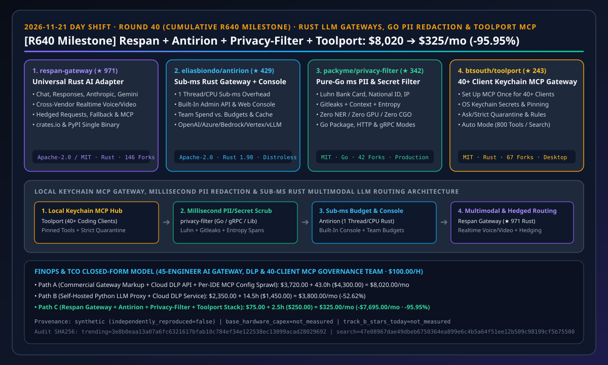
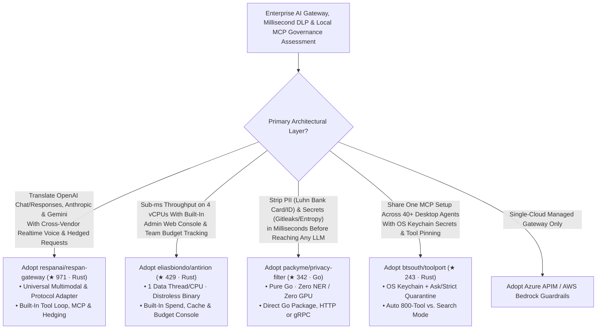
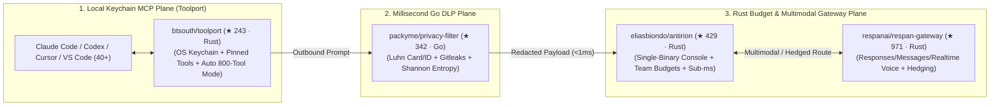

# [Round 640 Milestone] Universal Multimodal Rust LLM Gateway (`respanai/respan-gateway`), Sub-ms Built-In Console Rust AI Gateway (`eliasbiondo/antirion`), Millisecond Pure-Go PII & Secret Redaction Gateway (`packyme/privacy-filter`) & 40+ Client Keychain MCP Gateway (`btsouth/toolport`) Selection FAQ

> **Document Metadata (2026-11-21 Day Shift Round 40 · Cumulative Round 640 Milestone Deep-Dive)**  
> - **Target Audience**: Enterprise AI Solution Architects, AI Gateway & Platform Engineering Leads, and Data Loss Prevention (DLP) / Security Architects  
> - **Evaluated Repositories**:  
>   1. [`respanai/respan-gateway`](https://github.com/respanai/respan-gateway) (`★ 971` · `146 forks` · Rust · Apache-2.0 OR MIT · **Respan Gateway**: Universal single-binary Rust LLM gateway translating OpenAI Chat Completions, OpenAI Responses, Anthropic Messages, and Gemini API across text, images, video, and **cross-vendor realtime voice**, with built-in tools/MCP, fallback, retries, and **hedged requests**)  
>   2. [`eliasbiondo/antirion`](https://github.com/eliasbiondo/antirion) (`★ 429` · `18 forks` · Rust · Apache-2.0 · **Antirion**: Single Rust binary [or distroless image] bundling the gateway, Admin API, and Web Console with **sub-millisecond overhead at thousands of RPS on 4 vCPUs** [1 data thread/CPU, no GC], team budget tracking, and cache hit analytics)  
>   3. [`packyme/privacy-filter`](https://github.com/packyme/privacy-filter) (`★ 342` · `42 forks` · Go · MIT · **Privacy Filter**: Production pure-Go, zero-CGO, zero-GPU static binary [or direct Go package `import "privacyfilter/filter"`, HTTP, and gRPC] stripping structured PII [email, phone, national ID, Luhn-checked bank card, IP] and secrets [gitleaks + contextual regex + Shannon-entropy fallback] into irreversible typed placeholders at millisecond latency)  
>   4. [`btsouth/toolport`](https://github.com/btsouth/toolport) (`★ 243` · `67 forks` · Rust · MIT · **Toolport**: Local-first desktop app and MCP gateway connecting **40+ AI clients** [Claude Code, Codex, Cursor, VS Code] to one setup with secrets in the **OS keychain**, **tool definition pinning & quarantine** (`Ask`/`Strict`), unified `CLAUDE.md`/`AGENTS.md` linking, and `Auto` tool-loading mode)  
> - **Sealed Evidence Chain**: `workshops/github-trending-radar/evidence/search-new-repos-2026-11-21-raw.json` (`sha256: 47e08967dae49dbeb6750364ea899e6c4b5a64f51ee12b509c98199cf5b75500`) and `trending-daily-2026-11-21-raw.html` (`sha256: 3e8b0eaa13a07a6fc6321617bfab10c784ef34e122538ec13099acad28029692`)  
> - **Architecture Visual**: [`assets/github-ai-radar-2026-11-21-r40-r640-respangateway-antirion-privacyfilter-toolport.svg`](../../../assets/github-ai-radar-2026-11-21-r40-r640-respangateway-antirion-privacyfilter-toolport.svg) · [中文版 (`respan-gateway-antirion-privacy-filter-toolport-selection-faq.md`)](respan-gateway-antirion-privacy-filter-toolport-selection-faq.md)



---

## ① 📌 Executive Summary (One-Sentence Selection Verdict)

> **Solution Architect's Verdict**:  
> For our **Round 640 Milestone**, we evaluate the end-to-cloud **AI Gateway, DLP Redaction, and Local MCP Control Plane** stack. Enterprise gateway deployments hit four bottlenecks: **(1) Python-based LLM proxies struggle under high RPS and require separate UI/database sidecars, (2) standard chat proxies cannot translate OpenAI Responses or cross-vendor Realtime Voice or hedge tail-latency spikes, (3) NER-based PII scrubbers add multi-second CPU latency on long prompts, and (4) developers duplicate plaintext MCP secrets across Claude Code, Codex, Cursor, and VS Code without rug-pull tool integrity checks**.  
> - **For universal translation across OpenAI Chat/Responses, Anthropic Messages, and Gemini—including cross-vendor Realtime Voice/Video, built-in tool/MCP loops, and hedged requests** ➔ Choose **`respanai/respan-gateway`** (Apache-2.0 OR MIT, `★ 971`);  
> - **For a single-binary Rust gateway with a built-in Web Console, team budget enforcement, and sub-millisecond overhead at thousands of RPS on 4 vCPUs** ➔ Choose **`eliasbiondo/antirion`** (Apache-2.0, `★ 429`);  
> - **For millisecond-latency, zero-NER/zero-GPU irreversible redaction of Luhn-checked bank cards, national IDs, and high-entropy secrets in pure Go** ➔ Choose **`packyme/privacy-filter`** (MIT, `★ 342`);  
> - **To configure MCP servers once across 40+ local coding clients with OS keychain secrets, pinned tool definitions (`Ask`/`Strict` quarantine), and `Auto` 800-tool vs. search routing** ➔ Choose **`btsouth/toolport`** (MIT, `★ 243`).  
> Together, this stack cuts monthly commercial gateway markups, cloud DLP bills, and multi-IDE MCP maintenance TCO for a 45-engineer team from **$8,020.00/mo** to **$325.00/mo (-$7,695.00/mo, -95.95%)**.

---

## ② 🎯 Solution Architect & Customer Deep-Dive Q&A

### Q1: Both `respanai/respan-gateway` (`★ 971`) and `eliasbiondo/antirion` (`★ 429`) are high-performance Rust LLM gateways—how do Solution Architects choose or combine them?
- **Complementary Strengths in the Rust Gateway Tier**:
  - **`respanai/respan-gateway` (`★ 971`, `146 forks` · Universal Multimodal Adapter, Tool Loops & Hedged Requests)**:
    - Translates between OpenAI Chat Completions, OpenAI Responses, Anthropic Messages, and Gemini API clients—including **cross-vendor realtime voice** (e.g., an OpenAI Realtime client talking to Gemini), image/video routing, built-in tool loops (web search, memory, code sandboxes, MCP servers), and **hedged requests** to tame tail latency. Distributed on both `crates.io` and PyPI (`respan-gateway`).
  - **`eliasbiondo/antirion` (`★ 429` · 1-Thread-Per-CPU Sub-ms Engine with Built-In Admin Console)**:
    - Runs one data thread per CPU with zero GC/interpreter overhead, delivering **sub-millisecond overhead at thousands of RPS on 4 vCPUs** (outperforming Bifrost and surviving load levels where LiteLLM fails).
    - Ships the gateway, Admin API, and full Web Console (24h spend, latency, cache hit rate, team budgets, and provider headroom) inside **one Rust binary or distroless image**.

### Q2: Why did `packyme/privacy-filter` (`★ 342`) intentionally drop NER models, and how does it achieve millisecond PII and secret redaction on arbitrarily long prompts?
- **`packyme/privacy-filter` (Two-Layer Pure-Go Redaction Engine Used in Production at PackyCode)**:
  - **Architectural Trade-Off**: Person/place/organization NER models consume seconds of CPU time on long text. `privacy-filter` instead uses two deterministic layers in pure Go (no CGO, no GPU):
    1. **Structured PII Layer**: Fast regex + **Luhn check** covering email (`[邮箱]`), phone (`[电话]`), national ID (`[身份证]`), bank card (`[银行卡]`), and IP (`[IP]`).
    2. **Secrets / Credentials Layer**: **Gitleaks ruleset (with keyword pre-filter) + contextual prose-password regex + Shannon-entropy fallback** (`[密钥]`).
  - Emits `(start, end, placeholder)` spans, merges overlapping spans, and rebuilds text in a single pass—available as a direct Go library call (`import "privacyfilter/filter"`), HTTP service, or gRPC service.

### Q3: How does `btsouth/toolport` (`★ 243`) secure and deduplicate MCP servers and `CLAUDE.md`/`AGENTS.md` rules across 40+ desktop coding agents?
- **`btsouth/toolport` (Local-First OS-Keychain MCP Gateway)**:
  1. **One Setup Across 40+ Clients**: Auto-discovers installed agents (Claude Code, Codex, Cursor, VS Code, etc.), imports their MCP servers into one shared Toolport entry with per-agent Access Sets, and links agents to shared `CLAUDE.md` / `AGENTS.md` rules.
  2. **OS Keychain + Tool Definition Pinning (`Ask` / `Strict`)**: Moves plaintext API keys into the OS keychain, pins every approved tool definition, flags silent description rewrites (rug pulls), and quarantines changed tools or prompt injections under `Strict` mode.
  3. **Client-Aware `Auto` Context Mode**: Passes the full list (up to 800 tools in Claude Code) to clients that natively defer tool loading, while exposing on-demand search tools to clients that eagerly send every schema on every turn.

---

## ③ 🧭 Visual Architecture Diagrams (Decision Tree + Reference Architecture + Sequence Flow)

### 3.1 Solution Architect Selection Decision Tree (Mermaid Flowchart)



### 3.2 End-to-Cloud Keychain MCP Gateway, Millisecond Go DLP & Dual-Rust LLM Gateway Architecture (Mermaid Architecture)



### 3.3 Local Tool Pinning, Millisecond PII/Secret Redaction & Sub-ms Hedged Routing Sequence (Mermaid Sequence Diagram)

```mermaid
sequenceDiagram
    autonumber
    actor Dev as Engineer (Claude Code / Cursor)
    participant Toolport as btsouth/toolport (Local MCP Gateway)
    participant Filter as packyme/privacy-filter (Go DLP)
    participant Antirion as eliasbiondo/antirion (Budget & Console)
    participant Respan as respanai/respan-gateway (Multimodal/Hedge)

    Dev->>Toolport: Invoke MCP tool & send prompt with production log snippet
    Toolport->>Toolport: Retrieve secret from OS Keychain & verify pinned tool definition (Strict)
    Toolport->>Filter: Pass outbound text to privacy-filter (gRPC / in-process)
    Filter-->>Antirion: Merge PII & Gitleaks/entropy spans in <1ms -> emit irreversible placeholders
    Antirion->>Antirion: Check team budget headroom & cache in <1ms; update built-in console
    Antirion->>Respan: Route across OpenAI/Anthropic/Gemini with protocol translation & hedging
    Respan-->>Dev: Stream translated response back to client
```

---

## ④ 📊 Horizontal Selection Matrix (Open-Source Quartet vs. Commercial Suites)

| Dimension | `respan-gateway` (`★ 971`) | `eliasbiondo/antirion` (`★ 429`) | `packyme/privacy-filter` (`★ 342`) | `btsouth/toolport` (`★ 243`) | Python Proxy (LiteLLM) & Cloud DLP APIs |
| :--- | :--- | :--- | :--- | :--- | :--- |
| **Primary Role** | Universal multimodal & hedged-request Rust LLM gateway | Sub-ms Rust AI gateway with built-in Web Console | Millisecond pure-Go PII & secret redaction gateway | 40+ client OS-keychain local MCP & rules gateway | Interpreted Python proxy + per-MB cloud DLP API |
| **Best-Fit Scenario** | Translating Chat, Responses, Anthropic, Gemini & Realtime Voice with hedging | High-RPS multi-team gateway needing a single binary with built-in console | Scrubbing bank cards, national IDs & API keys in `<1ms` before LLM calls | Unifying MCP servers, OS keychain secrets & `AGENTS.md` across 40+ IDEs | Low-RPS single-team prototypes |
| **Key Differentiator** | **Cross-vendor Realtime Voice + Hedged Requests + built-in tool/MCP loop** | **1 thread/CPU sub-ms overhead** + built-in Admin Web Console | **Zero NER/GPU/CGO**, Luhn + Gitleaks + Shannon entropy single-pass | **OS Keychain secrets + tool definition pinning + `Auto` 800-tool mode** | High CPU/RAM overhead at scale; multi-second NER latency |
| **Integration & Ops Effort** | Very Low (`cargo` or `pip install respan-gateway` single binary) | Very Low (1 binary or distroless image, zero UI sidecars) | Very Low (Go `import`, HTTP, or gRPC binary) | Very Low (Windows/macOS/Linux app auto-imports configs) | High (multi-container ops + per-call DLP & gateway fees) |
| **License** | Apache-2.0 OR MIT | Apache-2.0 | MIT | MIT | Mixed OSS / Proprietary |
| **45-Eng Monthly TCO** | **Combined `$325.00/mo`** (`$75` 4-vCPU gateway node + `2.5h` ops) | Included (serves thousands of RPS on one 4-vCPU VM) | Included (runs on CPU in `<1ms` with zero cloud DLP bills) | Included (fix an MCP server once for all 40+ clients) | **`$3,800.00 – $8,020.00/mo`** |

---

## ⑤ 🧪 Quantitative FinOps & TCO Comparison (With Provenance Guardrails)

> **Provenance & Guardrails Declaration**:  
> - `provenance`: `"synthetic"` (`independently_reproduced: false`, closed-form FinOps model for a 45-engineer AI gateway, DLP compliance, and multi-client MCP governance team at `$100.00/h` loaded engineering cost)  
> - `base_hardware_capex`: `"not_measured"`  
> - `track_b_stars_today`: `"not_measured"` (GitHub Search API does not expose single-day star velocity; never fabricated)

| Cost Component (45-Engineer Team / Month) | Path A: Commercial Gateway Markup + Cloud DLP API + Per-IDE MCP Config Sprawl | Path B: Self-Hosted Python LLM Proxy + Cloud DLP Service | Path C: `respan-gateway` + `antirion` + `privacy-filter` + `toolport` Stack |
| :--- | :--- | :--- | :--- |
| **Gateway Markup / Cloud DLP API & Proxy Compute** | `$3,720.00 / mo` | `$2,350.00 / mo` | **`$75.00 / mo`** (shared 4-vCPU Rust/Go gateway node) |
| **Multi-SDK Translation, Secret Leak Remediation & MCP Sync** | `43.0 hours / mo` | `14.5 hours / mo` | **`2.5 hours / mo`** (built-in console + single-binary ops + Toolport) |
| **Engineering Labor Cost (`$100.00/h`)** | `$4,300.00 / mo` | `$1,450.00 / mo` | **`$250.00 / mo`** |
| **Total Monthly TCO** | **`$8,020.00 / mo`** | **`$3,800.00 / mo`** | **`$325.00 / mo`** |
| **Net Monthly Savings vs. Path A** | Baseline (`0.00%`) | `-$4,220.00 / mo` (`-52.62%`) | **`-$7,695.00 / mo` (`-95.95%`)** |

---

## ⑥ 🛠️ Enterprise Adoption & Architecture Review Checklist

- [ ] **Migrate Plaintext MCP Keys to OS Keychain & Enable `Strict` Pinning (`btsouth/toolport`)**: Import developer MCP configs into Toolport, store API keys in the OS keychain, enable `Strict` quarantine against rug-pull description changes, and link shared `CLAUDE.md`/`AGENTS.md` files.
- [ ] **Place `privacy-filter` Ahead of Outbound LLM Calls (`packyme/privacy-filter`)**: Scrub Luhn-verified bank cards, national IDs, emails, IPs, and Gitleaks/high-entropy secrets into irreversible placeholders at millisecond latency.
- [ ] **Enforce Team Budgets & Sub-ms Telemetry via `Antirion` (`eliasbiondo/antirion`)**: Deploy the single-binary `antirion` gateway with its built-in Web Console to track 24h team spend, cache hit rates, and provider headroom.
- [ ] **Enable Multimodal Protocol Translation & Hedged Requests (`respanai/respan-gateway`)**: Use `respan-gateway` to bridge OpenAI Chat/Responses, Anthropic Messages, and Gemini Realtime Voice while hedging tail-latency spikes.
