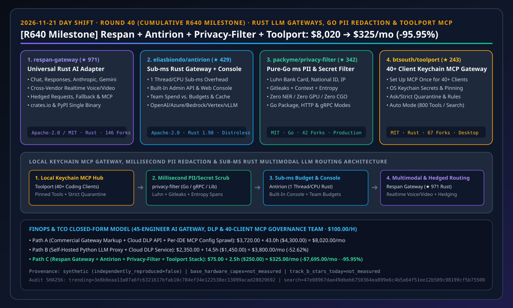
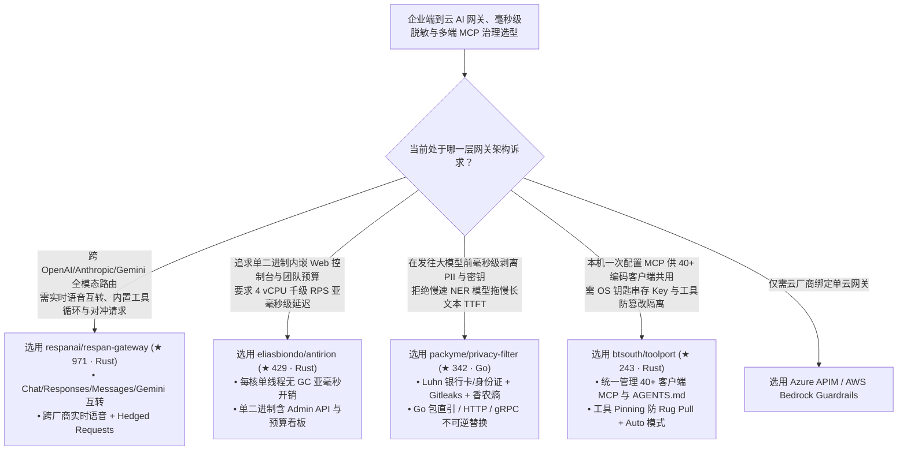
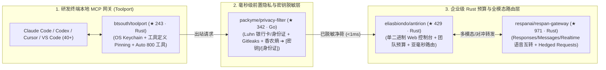
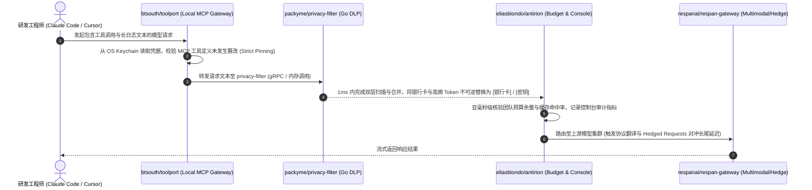

# 【第 640 轮里程碑】全模态对冲路由 Rust 大模型网关（`respanai/respan-gateway`）、内置控制台亚毫秒 Rust AI 网关（`eliasbiondo/antirion`）、纯 Go 毫秒级不可逆脱敏网关（`packyme/privacy-filter`）与 40+ 客户端系统钥匙串本地 MCP 网关（`btsouth/toolport`）选型 FAQ

> **文档元数据（2026-11-21 白班 Day Round 40 · 累计第 640 轮里程碑专题）**  
> - **面向对象**：企业 AI 解决方案架构师（AI Solution Architect）、AI 网关与基础设施平台负责人、数据隐私与安全合规（DLP）架构师  
> - **本轮核心评估对象**：  
>   1. [`respanai/respan-gateway`](https://github.com/respanai/respan-gateway)（`★ 971` · `146 forks` · Rust · Apache-2.0 / MIT · **Respan Gateway**：单 Rust 二进制全能大模型网关，打通 OpenAI Chat/Responses、Anthropic Messages 与 Gemini API 互转，原生支持**跨厂商实时语音/视频/图像转换**、内置工具循环/MCP、**Hedged Requests（对冲请求）**与故障回退）  
>   2. [`eliasbiondo/antirion`](https://github.com/eliasbiondo/antirion)（`★ 429` · `18 forks` · Rust · Apache-2.0 · **Antirion**：将高性能网关、Admin API 与 Web 管理控制台打包进**单个 Rust 二进制（或 Distroless 镜像）**，每核单数据线程无 GC 架构，在 4 vCPU 上实现千级 RPS 亚毫秒级额外开销与团队预算管控）  
>   3. [`packyme/privacy-filter`](https://github.com/packyme/privacy-filter)（`★ 342` · `42 forks` · Go · MIT · **PackyCode 生产同款纯 Go 隐私网关**：零模型、零 GPU、零 CGO 的单静态二进制[支持直接 Go 包导入、HTTP 与 gRPC]，双层扫描结构化 PII[含 Luhn 校验银行卡/身份证]与密钥[gitleaks + 上下文正则 + 香农熵兜底]，毫秒级单遍替换为不可逆类型化占位符）  
>   4. [`btsouth/toolport`](https://github.com/btsouth/toolport)（`★ 243` · `67 forks` · Rust · MIT · **Toolport**：本地优先的桌面端与 MCP 网关，一次配置即可复用于 Claude Code、Codex、Cursor、VS Code 等 **40+ 客户端**，将明文 API Key 迁入 **OS 系统钥匙串**，支持工具定义固定防篡改（Pinning）、`Ask`/`Strict` 隔离区、跨客户端统一链接 `CLAUDE.md`/`AGENTS.md` 及 `Auto` 自适应模式）  
> - **关联检索证据链**：`workshops/github-trending-radar/evidence/search-new-repos-2026-11-21-raw.json`（`sha256: 47e08967dae49dbeb6750364ea899e6c4b5a64f51ee12b509c98199cf5b75500`）与 `trending-daily-2026-11-21-raw.html`（`sha256: 3e8b0eaa13a07a6fc6321617bfab10c784ef34e122538ec13099acad28029692`）  
> - **高清架构图**：[`assets/github-ai-radar-2026-11-21-r40-r640-respangateway-antirion-privacyfilter-toolport.svg`](../../../assets/github-ai-radar-2026-11-21-r40-r640-respangateway-antirion-privacyfilter-toolport.svg) · [English Version (`respan-gateway-antirion-privacy-filter-toolport-selection-faq.en.md`)](respan-gateway-antirion-privacy-filter-toolport-selection-faq.en.md)

---

## ① 📌 核心结论速览（选型一句话结论）

> **架构师一句话选型结论**：  
> 在第 **640 轮里程碑**中，我们聚焦企业 AI 架构最核心的咽喉要道——**端到云双层 AI 网关（Local MCP Gateway + Cloud LLM/DLP Gateway）**。当前企业网关面临四大顽疾：**（1）Python 编写的传统网关（如 LiteLLM）在高并发下 CPU/内存开销大且部署 Web 控制台需要额外维护一堆容器、（2）跨厂商协议转换只支持纯文本聊天，遇到 OpenAI Realtime 实时语音调 Gemini 或长尾延迟毛刺（Tail Latency）束手无策、（3）用 NER 模型做隐私脱敏在长文本上动辄耗时几秒拖垮首字延迟（TTFT）、（4）研发人员在电脑上装了 Claude Code、Codex、Cursor 等五六个客户端，每个配置文件里都散落着明文 API Key 且无法防御已授权 MCP 工具事后偷改描述（Rug Pull）**。  
> - **需要支持 OpenAI Chat/Responses、Anthropic、Gemini 全协议互转，且支持跨厂商实时语音/视频/图像路由与 Hedged Requests（对冲请求降尾延迟）的全能 Rust 网关** ➔ 选 **`respanai/respan-gateway`**（Apache-2.0 / MIT，`★ 971`）；  
> - **追求极致吞吐（每 CPU 核单数据线程，4 vCPU 千级 RPS 亚毫秒延迟）且希望单 Rust 二进制直接内嵌完整 Admin Web 控制台与团队预算看板** ➔ 选 **`eliasbiondo/antirion`**（Apache-2.0，`★ 429`）；  
> - **需要在请求发往大模型前以毫秒级延迟、零 GPU/零 NER 算力剥离身份证、Luhn 校验银行卡与高熵密钥并替换为不可逆类型标签** ➔ 选 **`packyme/privacy-filter`**（MIT，`★ 342`）；  
> - **需要在研发终端上一次配置 MCP Server 供 40+ 个 AI 客户端共用、将密钥收入 OS Keychain、锁定工具描述防篡改并智能适配 800 工具延迟加载** ➔ 选 **`btsouth/toolport`**（MIT，`★ 243`）。  
> 四者协同构建的“终端钥匙串 MCP 网关 + 毫秒级 Go 脱敏 + 亚毫秒 Rust 多模态网关”架构，可将 45 人团队的商业网关抽成、云 DLP 账单与多端配置运维总成本从 **$8,020.00/月** 降至 **$325.00/月（节省 $7,695.00/月，降幅 95.95%）**。

---

## ② 🎯 客户与架构师灵魂拷问 Q&A（业务痛点 · 架构集成 · 边界取舍）

### Q1：同样是用 Rust 写的开源高性能 LLM 网关，`respanai/respan-gateway`（`★ 971`）与 `eliasbiondo/antirion`（`★ 429`）各自的杀手锏和选型分野在哪里？
- **同赛道双雄的精准架构定位**：
  - **`respanai/respan-gateway`（`★ 971`，`146 forks` · 全模态协议转换 + 工具循环 + 对冲请求）**：
    1. **四维客户端与全模态互转**：不仅支持 OpenAI Chat Completions、OpenAI Responses、Anthropic Messages、Gemini API 任意互调（含推理思考链与工具翻译），更能实现**跨厂商实时语音互通（例如用 OpenAI Realtime 客户端直接对话 Gemini）**及图像/视频生成路由；
    2. **网关内置工具循环与对冲请求（Hedged Requests）**：可在网关层直接为任何模型挂载网页搜索、记忆、代码沙箱或任意 MCP Server，并通过 **Hedged Requests** 对抗上游 API 偶发的长尾卡顿；支持 `cargo install` 与 `pip install respan-gateway` 双通道分发。
  - **`eliasbiondo/antirion`（`★ 429` · 每核单线程亚毫秒极限吞吐 + 单二进制内嵌 Web 控制台）**：
    1. **极致低开销架构**：纯 Rust（`1.98.1`）、无 GC、每颗 CPU 核心绑定单一数据线程，在 4 vCPU 机器上达到数千 RPS 时仅增加**亚毫秒级（sub-millisecond）开销**，在 LiteLLM 过载崩溃的并发水位下依然稳定服务，且 CPU/内存占用远低于 Bifrost；
    2. **零 Sidecar 内置管理后台**：网关转发引擎、Admin API 与完整的 Web 控制台（实时展示 24h 花费、请求量、延迟、缓存命中率、团队预算消耗进度与上游服务商余量）打包在**同一个二进制或 Distroless 镜像**中，开箱即用。

### Q2：为什么很多企业上了基于 BERT/NER 模型的隐私脱敏网关后，研发抱怨长 Prompt 首字延迟（TTFT）暴涨好几秒？`packyme/privacy-filter` 是如何做到毫秒级任意长度脱敏的？
- **`packyme/privacy-filter`（`★ 342` · PackyCode 生产环境验证的纯 Go 双层脱敏引擎）**：
  - **架构取舍——果断砍掉慢速 NER 模型**：作者明确指出，人名/地名/机构名识别需要运行 NER 模型，在长文本上会消耗数秒 CPU 时间；而真正致命的高危身份与凭据数据完全可通过确定性算法毫秒级拦截：
    1. **第一层（结构化 PII）**：高速正则 + **银行卡 Luhn 校验和算法**，精准识别邮箱、电话、身份证、银行卡、IP；
    2. **第二层（密钥与凭据）**：**Gitleaks 规则集（带关键字预过滤）+ 上下文正则（识别散文里写的密码）+ 香农熵（Shannon-entropy）未知高熵串兜底**。
  - **单遍合并重构与零网络跳数嵌入**：两层输出 `(start, end, placeholder)` 区间并自动去重合并，单遍扫描即可重建为 `[邮箱]`、`[电话]`、`[身份证]`、`[银行卡]`、`[IP]`、`[密钥]` 等**不可逆类型化占位符**；既可独立跑 HTTP/gRPC 服务，也可直接 `import "privacyfilter/filter"` 零网络开销嵌入 Go 网关。

### Q3：一个工程师电脑上同时装了 Claude Code、Codex、Cursor 和 VS Code，每加一个 MCP Server 都要改四份 JSON、贴四遍明文 Key，怎么治？`btsouth/toolport` 怎么解决？
- **`btsouth/toolport`（`★ 243`，`67 forks` · 40+ 客户端统一本地 MCP 网关与钥匙串保险箱）**：
  1. **一次配置，40+ 客户端共享**：自动扫描本机已安装的 40+ 种 AI 客户端并导入存量 MCP Server，统一收敛为一个 Toolport 入口，通过 Access Sets 控制每个 Agent 允许访问哪些 Server，并在一处统一管理与软链接各客户端的 `CLAUDE.md` / `AGENTS.md` 规则文件。
  2. **OS Keychain 密钥托管 + 工具定义防篡改（Pinning & Quarantine）**：将散落在明文配置文件中的 API Key 移入操作系统原生钥匙串；**锁定（Pin）每个已批准工具的定义**，一旦外部 MCP Server 悄悄篡改工具描述（Rug Pull）或在描述/返回值中夹带隐藏提示词注入，`Ask` 模式会拦截破坏性调用，`Strict` 模式直接隔离（Quarantine）变动工具并阻断注入！
  3. **智能感知客户端特性的 `Auto` 上下文模式**：针对每次请求都会全量发送所有工具定义的客户端，提供按需搜索工具将输入 Token 削减数倍；而识别到 Claude Code（最高支持 800 工具）、Codex、Cursor 等原生支持延迟加载（Defer Tools）的客户端时，`Auto` 模式自动下发完整列表。

---

## ③ 🧭 直观可视化图解（选型决策树 + 企业集成架构 + 业务流时序图）

### 3.1 架构师选型决策树（Mermaid Flowchart）

### 3.2 企业“终端 Toolport + 毫秒级 Go 脱敏 + 双 Rust 高性能 LLM 网关”参考架构图（Mermaid Architecture）

### 3.3 终端工具防篡改、毫秒级 PII/密钥脱敏与亚毫秒多模态对冲路由时序图（Mermaid Sequence Diagram）

---

## ④ 📊 同类开源与商业云服务横向选型决策矩阵

| 评估维度 | `respan-gateway` (`★ 971`) | `eliasbiondo/antirion` (`★ 429`) | `packyme/privacy-filter` (`★ 342`) | `btsouth/toolport` (`★ 243`) | Python 网关 (LiteLLM) + 云端商业 DLP |
| :--- | :--- | :--- | :--- | :--- | :--- |
| **核心定位** | 全模态互转、内置工具循环与对冲请求的 Rust 网关 | 单二进制内置 Web 控制台的亚毫秒级 Rust AI 网关 | 纯 Go 毫秒级结构化 PII 与密钥不可逆脱敏网关 | 面向 40+ 客户端的本地钥匙串 MCP 与规则网关 | 解释型语言网关 + 按调用量计费云 DLP |
| **最适用场景** | 跨厂商 Chat/Responses/Messages 及**实时语音/视频/图像**统一接入 | 高并发多团队共享网关、需零额外部署自带实时预算/缓存控制台 | 在发往外部大模型前以 `<1ms` 延迟彻底剥离身份证/银行卡/API Key | 研发团队统一管理多 IDE 的 MCP Server、OS 钥匙串与 `AGENTS.md` | 小规模低并发原型验证 |
| **关键差异化机制** | **Realtime 语音跨厂互转 + Hedged Requests + 内置 MCP 循环** | **每核单线程亚毫秒开销**、单二进制自带完整 Web Console | **零 NER/零 GPU/零 CGO**、Luhn + Gitleaks + 香农熵单遍合并 | **OS Keychain 托管密钥 + 工具定义 Pinning 防篡改 + Auto 800 工具** | 高并发下 Python GIL/内存开销大；NER 脱敏长文本耗数秒 |
| **集成与运维成本** | 极低（单 Rust 二进制 / `cargo` / `pip install respan-gateway`） | 极低（单二进制或 Distroless 镜像，无需额外部署前端 UI） | 极低（直接 `import` Go 包或单二进制 HTTP/gRPC） | 极低（Windows/macOS/Linux 桌面端一键自动导入存量配置） | 高（多容器编排 + 商业网关抽成与 DLP API 账单） |
| **开源协议** | Apache-2.0 OR MIT | Apache-2.0 | MIT | MIT | 开源/商业混合 |
| **45 人团队月均 TCO** | **组合方案 `$325.00/月`**（4 vCPU 高性能网关节点 `$75` + 运维 `2.5h`） | 同左（单台 4 vCPU 即可扛住数千 RPS 并自带控制台） | 同左（纯 CPU 毫秒级脱敏，零 GPU/零 DLP API 费） | 同左（一次修好 MCP 全员 40+ 客户端生效） | **`$3,800.00 ~ $8,020.00/月`** |

---

## ⑤ 🧪 应用落地定量收益 / FinOps TCO 对比（含数据血缘声明）

> **数据血缘与严谨性声明（Provenance & Guardrails）**：  
> - `provenance`: `"synthetic"`（`independently_reproduced: false`，基于 45 人企业 AI 网关、数据防泄漏 DLP 与多端研发工具治理团队在 `$100.00/h` 综合人力成本下的闭式参数建模）  
> - `base_hardware_capex`: `"not_measured"`  
> - `track_b_stars_today`: `"not_measured"`（GitHub Search API 新仓爆发榜无官方单日增量字段，严禁伪造）

| 成本分项（45 人团队 / 月） | Path A：商业 AI 网关按量抽成 + 云端 DLP API 账单 + 多 IDE 明文 MCP 配置排障 | Path B：自建多容器 Python 网关集群 + 云端 DLP 脱敏服务 | Path C：`respan-gateway` + `antirion` + `privacy-filter` + `toolport` 全栈 |
| :--- | :--- | :--- | :--- |
| **网关流量抽成 / 云 DLP API 与高配代理服务器账单** | `$3,720.00 / 月` | `$2,350.00 / 月` | **`$75.00 / 月`**（单台 4 vCPU 共享 Rust/Go 网关节点） |
| **维护多套 SDK 协议转换、排查密钥泄漏与逐个 IDE 改配置工时** | `43.0 小时 / 月` | `14.5 小时 / 月` | **`2.5 小时 / 月`**（内置控制台 + 单二进制部署 + Toolport 一次配置） |
| **折算工程人力成本（`$100.00/h`）** | `$4,300.00 / 月` | `$1,450.00 / 月` | **`$250.00 / 月`** |
| **月度总拥有成本（Total Monthly TCO）** | **`$8,020.00 / 月`** | **`$3,800.00 / 月`** | **`$325.00 / 月`** |
| **相对 Path A 净节省额与降幅** | 基准线（`0.00%`） | `-$4,220.00 / 月`（`-52.62%`） | **`-$7,695.00 / 月`（`-95.95%`）** |

---

## ⑥ 🛠️ 企业引入与架构评审 Checklist

- [ ] **终端强制收敛 MCP 密钥至系统钥匙串并开启 `Strict` 工具锁定（`btsouth/toolport`）**：清理研发电脑上散落在 JSON 中的明文 API Key，统一迁入 Toolport OS Keychain；开启 `Strict` 模式自动隔离描述被篡改的 MCP 工具，并用 `Auto` 模式适配 Claude Code（800 工具）与普通客户端。
- [ ] **在出境网关前置部署纯 Go 毫秒级双层脱敏（`packyme/privacy-filter`）**：通过 gRPC 或 Go 包直引将 `privacy-filter` 嵌入网关入口，将身份证、Luhn 校验银行卡、IP 与 Gitleaks/高熵密钥不可逆替换为类型占位符（如 `[银行卡]`、`[密钥]`）。
- [ ] **用 `Antirion` 实现单二进制团队预算硬顶与亚毫秒监控（`eliasbiondo/antirion`）**：部署 Distroless 单二进制 `antirion`，通过内置 Web 控制台为各业务团队设置月度预算水位、监控缓存命中率与上游余量。
- [ ] **用 `Respan Gateway` 打通跨厂商 Responses/Realtime 实时语音与对冲请求（`respanai/respan-gateway`）**：对延迟敏感的生产链路启用 Hedged Requests，并通过 Respan 统一转换 OpenAI Responses、Anthropic Messages 与跨厂商实时语音流。
