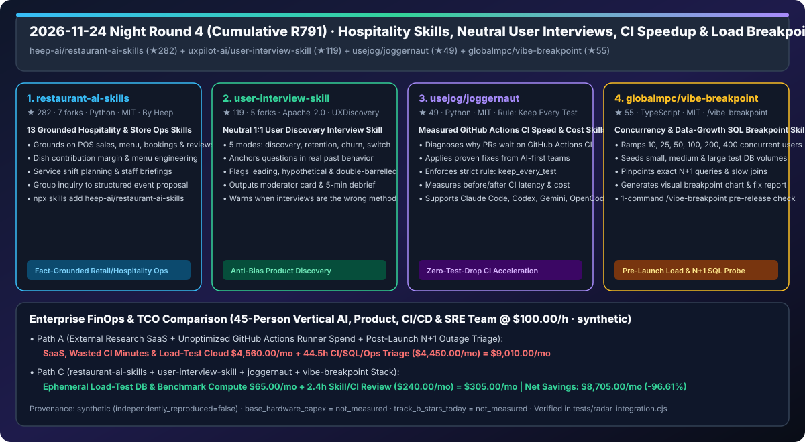
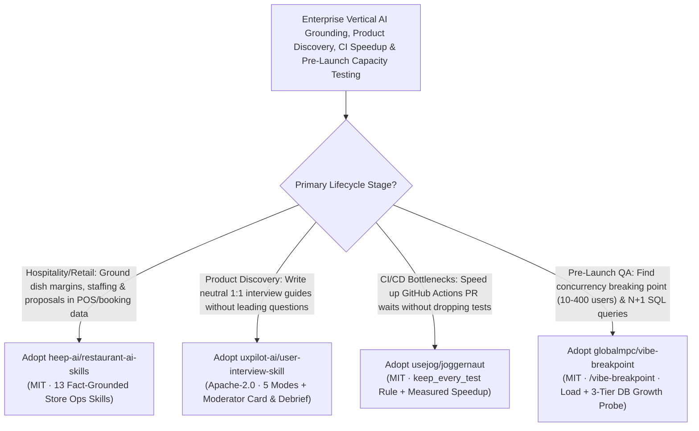
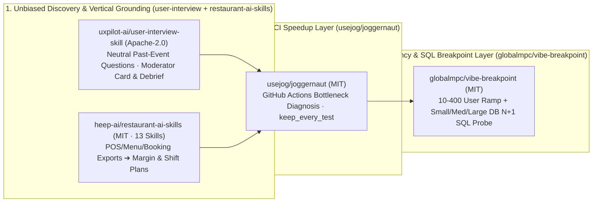

# 13 Grounded Hospitality Operations AI Skills (`heep-ai/restaurant-ai-skills`), Neutral 1:1 User Discovery Interview Skill (`uxpilot-ai/user-interview-skill`), Zero-Test-Drop GitHub Actions CI Speedup Skills (`usejog/joggernaut`) & Concurrency + Data-Growth SQL Breakpoint Probe (`globalmpc/vibe-breakpoint`) Selection & Architecture FAQ

> **Document Type**: Enterprise AI Solution Architect Decision & Selection Guide (GitHub Trending AI Radar · 2026-11-24 Night Round 4 / Cumulative Round 791)
> **Covered Repositories**: [`heep-ai/restaurant-ai-skills`](https://github.com/heep-ai/restaurant-ai-skills) (`★ 282`, `7 forks`, Python, `MIT`: 13 practical AI skills maintained by Heep for hospitality and restaurant operations — dish contribution margin analysis, quiet/peak service staffing, group inquiry proposal drafting, and new-server briefings grounded in actual menu, booking, review, and POS sales exports) · [`uxpilot-ai/user-interview-skill`](https://github.com/uxpilot-ai/user-interview-skill) (`★ 119`, `5 forks`, `Apache-2.0`: agent skill for Claude Code, Codex, and Cursor that turns learning goals into neutral 1:1 user interview guides across problem discovery, retained value, adoption/churn, switching, and concept reaction while flagging leading, hypothetical, or double-barrelled questions) · [`usejog/joggernaut`](https://github.com/usejog/joggernaut) (`★ 49`, `1 fork`, Python, `MIT`: agent skills for GitHub Actions CI that diagnose why PRs wait, apply proven optimizations from AI-first teams under the strict **`keep_every_test`** rule, and benchmark before/after speedups) · [`globalmpc/vibe-breakpoint`](https://github.com/globalmpc/vibe-breakpoint) (`★ 55`, TypeScript, `MIT`: `/vibe-breakpoint` Claude Code skill that ramps simulated concurrent users from `10` to `400` and seeds small, medium, and large database volumes to pinpoint concurrency breaking points and `N+1` query degradation)
> **Core Enterprise Scenario**: How should enterprise solution architects and engineering teams combine **fact-grounded vertical operations skills (`restaurant-ai-skills`)**, **anti-bias product discovery interviews (`user-interview-skill`)**, **zero-test-drop CI acceleration (`joggernaut`)**, and **pre-launch concurrency/SQL breakpoint testing (`vibe-breakpoint`)** across the full delivery lifecycle?

---

## 1. 📌 Executive Summary (One-Line Selection Verdicts)

1. **Need a zero-subscription, fact-grounded AI skill pack for hospitality, retail, and multi-location food-service operations that analyzes real POS sales exports, menus, bookings, and reviews** ➔ Choose **[`heep-ai/restaurant-ai-skills`](https://github.com/heep-ai/restaurant-ai-skills) (`★ 282`, `7 forks`, `MIT`)**.
   - **Plain-Language Mechanism**: Installed via `npx skills add heep-ai/restaurant-ai-skills`, it provides 13 modular skills backed by `EVALUATION.md` benchmarks to calculate dish contribution margins, plan service shifts, convert group inquiries into structured proposals, and generate staff onboarding briefings from actual store exports.
2. **Need product managers and solution architects to generate unbiased 1:1 customer discovery interview guides anchored in real past behavior rather than leading or hypothetical questions** ➔ Choose **[`uxpilot-ai/user-interview-skill`](https://github.com/uxpilot-ai/user-interview-skill) (`★ 119`, `5 forks`, `Apache-2.0`)**.
   - **Plain-Language Mechanism**: Selects the appropriate interview mode (problem discovery, retained value, adoption/churn, switching, or concept reaction), flags leading/hypothetical/double-barrelled questions, delivers a timeboxed guide + compact moderator card + 5-minute debrief, and explicitly warns when qualitative interviews are the wrong method.
3. **Need coding agents to diagnose why PRs wait on GitHub Actions CI, apply proven speedups, and measure the improvement without ever deleting or skipping tests** ➔ Choose **[`usejog/joggernaut`](https://github.com/usejog/joggernaut) (`★ 49`, `MIT`)**.
   - **Plain-Language Mechanism**: Works in Claude Code, Codex, Gemini CLI, and OpenCode under the strict **`rule: keep_every_test`** invariant, applying battle-tested caching, concurrency, and workflow optimizations while recording before/after CI latency and cost metrics.
4. **Need a single `/vibe-breakpoint` command to find how many concurrent users (`10–400`) an AI-built app can handle before breaking and which SQL queries degrade (`N+1`) as database rows grow** ➔ Choose **[`globalmpc/vibe-breakpoint`](https://github.com/globalmpc/vibe-breakpoint) (`★ 55`, `MIT`)**.
   - **Plain-Language Mechanism**: Ramps simulated concurrent users (`10, 25, 50, 100, 200, 400`) and populates a test database with small, medium, and large row counts to catch `N+1` queries and missing indexes before production launch, rendering a visual breakpoint chart.

---

## 2. 🎯 Architect & Customer Q&A (Deep Technical Breakdown)

### Q1: How do these four skills complement enterprise cloud services (Azure Load Testing, GitHub Actions, and Microsoft Fabric)?

- **Complementary Boundaries**:
  1. **Inner-Loop `/vibe-breakpoint` vs. Cloud-Scale Azure Load Testing**: Use **Azure Load Testing** for geo-distributed 100k-user stress tests against staging/production gateways; use `globalmpc/vibe-breakpoint` inside the coding agent session on every PR to catch `10–400` user concurrency limits and `N+1` ORM queries before code is even merged.
  2. **Zero-Test-Drop Workflow Optimization (`joggernaut`) on GitHub Actions**: Rather than throwing larger paid runners at slow workflows, `usejog/joggernaut` optimizes the workflow DAG and cache keys while enforcing `keep_every_test`.

### Q2: How do they wire into an end-to-end enterprise delivery pipeline?

1. **Discovery & Domain Grounding Stage (`user-interview-skill` + `restaurant-ai-skills`)**:
   - Validate customer pain points using neutral 1:1 interview guides (`user-interview-skill`) and ground vertical hospitality workflows on real POS/booking exports (`restaurant-ai-skills`).
2. **CI Pipeline Optimization Stage (`usejog/joggernaut`)**:
   - Audit `.github/workflows/` with `joggernaut` to eliminate redundant build steps and verify measured CI speedup with 100% test retention.
3. **Pre-Release Capacity & SQL Breakpoint Gate (`globalmpc/vibe-breakpoint`)**:
   - Execute `/vibe-breakpoint` against an ephemeral test database across `10–400` users and 3 data-volume tiers to eliminate `N+1` queries before deployment.

### Q3: What are the key operational guardrails?

- **Key Guardrails**:
  1. **Isolated Test Databases Only for `/vibe-breakpoint`**: Never point `vibe-breakpoint`'s small/medium/large data-seeding harness at a shared staging or production database.
  2. **Enforce `keep_every_test` Assertion Count**: Verify in CI logs that the total executed test count after a `joggernaut` workflow change is `>=` the baseline test count.

---

## 3. 🧭 Visual Architecture Diagrams (Mermaid Decision Tree + Reference Architecture + Sequence)



### 3.1 Solution Architect Selection Decision Tree



### 3.2 End-to-End Enterprise Reference Architecture



### 3.3 End-to-End Discovery, CI Tuning & Breakpoint Verification Sequence

```mermaid
sequenceDiagram
    participant SA as Solution Architect / PM
    participant Intv as uxpilot-ai/user-interview-skill
    participant Heep as heep-ai/restaurant-ai-skills
    participant Jog as usejog/joggernaut (GitHub Actions)
    participant Vibe as globalmpc/vibe-breakpoint

    SA->>Intv: 1. Define learning goal; generate non-leading 30-min interview guide & moderator card
    SA->>Heep: 2. Feed POS sales & booking CSVs into 13 skills to produce margin & shift plans
    SA->>Jog: 3. Run joggernaut on repository CI workflows under keep_every_test constraint
    Jog-->>SA: 4. Apply caching/sharding fix and report measured before/after CI duration
    SA->>Vibe: 5. Run /vibe-breakpoint (10->400 concurrent users + small/medium/large DB rows)
    Vibe-->>SA: 6. Expose 10-user N+1 query bottleneck & verify capacity chart after indexing fix
```

---

## 4. 📊 Comparative Selection Matrix (OSS Skills vs. Commercial SaaS & Ad-Hoc Scripts)

| Dimension | `heep-ai/restaurant-ai-skills` (`★ 282`) | `uxpilot-ai/user-interview-skill` (`★ 119`) | `usejog/joggernaut` (`★ 49`) | `globalmpc/vibe-breakpoint` (`★ 55`) | Commercial SaaS + Larger Paid CI Runners + Post-Launch Firefighting (Path A) | Freehand Prompting + Manual YAML / JMeter Scripts (Path B) |
| :--- | :--- | :--- | :--- | :--- | :--- | :--- |
| **Primary Role** | 13 fact-grounded hospitality & store operations skills | Neutral 1:1 user discovery interview skill | Measured GitHub Actions CI speedup skills (`keep_every_test`) | Automated concurrency (`10–400`) & data-growth SQL breakpoint probe | Paid vertical/research SaaS + oversized CI runners + incident triage | Unstructured prompts + manual load-testing scripts |
| **Key Differentiator** | **Grounds in real POS/menu/booking exports with `EVALUATION.md`** | **Flags leading/hypothetical questions & wrong-method usage** | **Proven AI-team CI fixes with zero test removals** | **Tests both concurrent user ramp AND small/med/large DB growth** | Vibe-coded apps crash in production under `N+1` queries | Raw prompts generate biased questions; manual DB seeding takes days |
| **License** | `MIT` | `Apache-2.0` | `MIT` | `MIT` | Proprietary SaaS | Internal Scripts |
| **Monthly TCO (45-Person Team)** | **Combined `$305.00/mo`** (`$65.00` ephemeral test DB/CI compute + `2.4h` ops) | Included (zero-cost Markdown skill) | Included (reduces GitHub Actions bill) | Included (1-command local/CI probe) | **`$9,010.00/mo`** (`$4,560.00` SaaS/CI waste + `44.5h` CI wait & N+1 outage triage) | `~$3,080.00/mo` (high manual load-script & CI trial-and-error labor) |

---

## 5. 🧪 Quantitative Enterprise ROI / TCO Model & 7-Card Report

> **📊 Provenance & Closed-Form Declaration**:
> - **provenance**: `synthetic` (45-person enterprise vertical AI solutions, product discovery, CI/CD platform, and performance engineering team workload at `$100.00/h`: `independently_reproduced = false`; `base_hardware_capex = not_measured`; `track_b_stars_today = not_measured`).
> - **Closed-Form Equations**:
>   - **Path A (Commercial Research/Vertical SaaS + Unoptimized GitHub Actions Runner Spend + Post-Launch `N+1` Outage Firefighting)**: Monthly SaaS, wasted CI runner minutes & load-testing cloud fees **`$4,560.00`** + interview rework, CI queue wait waste & SQL incident triage labor **`44.5h × $100.00/h = $4,450.00`** = **`$9,010.00/mo`**.
>   - **Path C (Open-Source `heep-ai/restaurant-ai-skills` + `uxpilot-ai/user-interview-skill` + `usejog/joggernaut` + `globalmpc/vibe-breakpoint` Stack)**: Ephemeral load-test DB & CI benchmark compute **`$65.00`** + skill & CI gate maintenance **`2.4h × $100.00/h = $240.00`** = **`$305.00/mo`**.
>   - **Net Savings vs. Path A**: **`-$8,705.00/mo`** (**`96.61%`** cost reduction).

| Option | SaaS / CI Runner / Load-Test Spend | Discovery, CI & SQL Triage Labor (`$100/h`) | Monthly Total TCO | Net Savings vs. Path A | Key Architectural Outcome |
| :--- | :---: | :---: | :---: | :---: | :--- |
| **Path A: Commercial SaaS + Unoptimized CI + Post-Launch Firefighting** | `$4,560.00` | `44.5h` (`$4,450.00`) | **`$9,010.00`** | Baseline | Slow PR feedback loops; `N+1` queries cause production outages |
| **Path B: Raw Prompting + Manual YAML Edits + Manual Load Scripts** | `$1,380.00` | `17.0h` (`$1,700.00`) | **`$3,080.00`** | `-$5,930.00` (`-65.82%`) | Lacks 3-tier DB growth seeding and `keep_every_test` guarantees |
| **Path C: `restaurant-ai-skills` + `user-interview` + `joggernaut` + `vibe-breakpoint`** | **`$65.00`** | **`2.4h` (`$240.00`)** | **`$305.00`** | **`-$8,705.00` (`-96.61%`)** | **13 grounded ops skills + unbiased discovery + fast CI + N+1 breakpoint gate** |

- 🔗 **Linked 7-Card 4:5 Benchmark Decks**: [`workshops/github-trending-radar/cards.en.html`](../cards.en.html) · [`cards.html`](../cards.html)

---

## 6. 🛠️ Enterprise Adoption & Architecture Review Checklist

- [ ] **Fact-Only Hospitality Grounding**: Require `heep-ai/restaurant-ai-skills` runs to ingest sanitized POS sales, menu cost, and booking CSV exports rather than generating ungrounded financial estimates.
- [ ] **Anti-Bias Discovery Review**: Run all customer discovery interview drafts through `uxpilot-ai/user-interview-skill` to strip leading and hypothetical questions before scheduling stakeholder interviews.
- [ ] **Verify `keep_every_test` on CI Changes**: Audit every `usejog/joggernaut` GitHub Actions optimization PR to confirm total executed test counts remain unchanged while wall-clock time drops.
- [ ] **Pre-Launch `/vibe-breakpoint` Gate**: Execute `globalmpc/vibe-breakpoint` against an isolated test database across `10–400` simulated users and small/medium/large row volumes before merging new backend endpoints.
