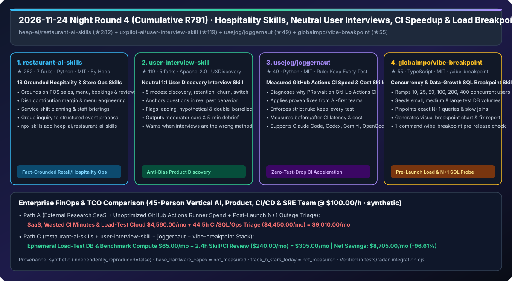
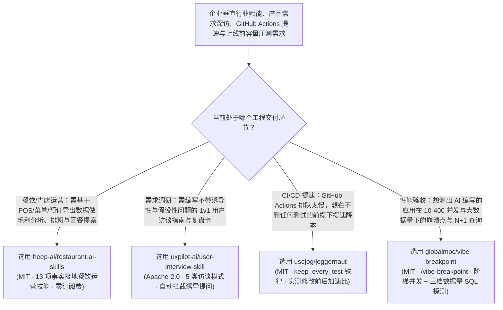
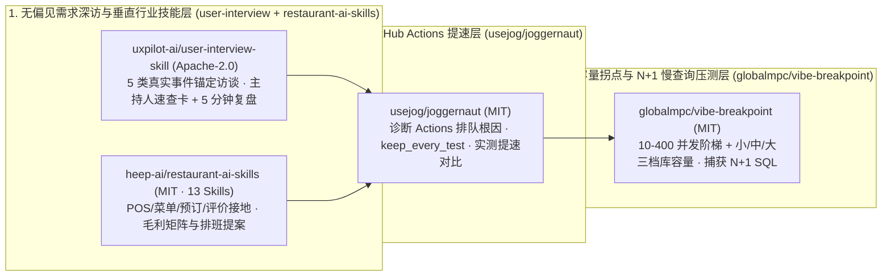
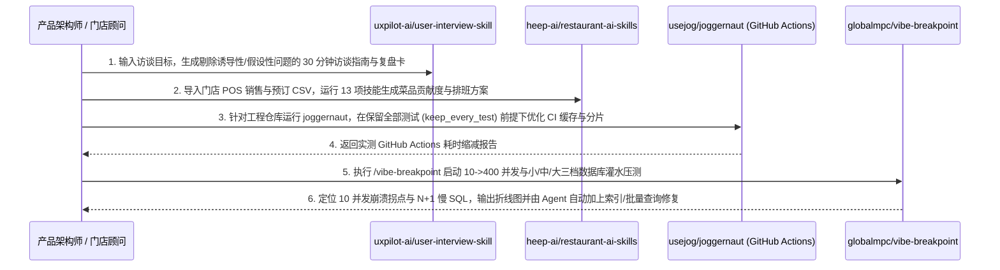

# 13 项连锁餐饮与门店经营数据接地技能（`heep-ai/restaurant-ai-skills`）、反诱导性提问的 1v1 用户深访指南技能（`uxpilot-ai/user-interview-skill`）、零删测试的 GitHub Actions CI 提速降本技能集（`usejog/joggernaut`）与并发容量拐点及 N+1 慢查询压测技能（`globalmpc/vibe-breakpoint`）选型与集成架构 FAQ

> **文档类型**：企业 AI 解决方案架构师（AI Solution Architect）选型决策指南（GitHub Trending AI 雷达 2026-11-24 Night Round 4 / 累计第 791 轮）
> **覆盖项目**：[`heep-ai/restaurant-ai-skills`](https://github.com/heep-ai/restaurant-ai-skills)（`★ 282`、`7 forks`、`MIT`，由餐饮 AI 客户沟通平台 Heep 开源的 **13 项实战餐饮与门店运营 AI 技能包**，直接基于门店真实菜单、预订记录、评论与 POS 销售导出数据完成菜品毛利贡献分析、平峰/高峰排班规划、团餐询价方案生成与新员工班前简报）· [`uxpilot-ai/user-interview-skill`](https://github.com/uxpilot-ai/user-interview-skill)（`★ 119`、`5 forks`、`Apache-2.0`，面向 Claude Code、Codex 与 Cursor 的无偏见 1v1 用户研究访谈指南生成技能，支持问题探索、留存价值、流失归因、竞品切换与概念测试 5 类访谈，自动拦截诱导性/假设性/双重提问并输出主持人卡片与 5 分钟复盘表）· [`usejog/joggernaut`](https://github.com/usejog/joggernaut)（`★ 49`、`1 fork`、`MIT`，专为 GitHub Actions CI 打造的提速与降本技能集，严守 **`keep_every_test`（绝不通过删减测试来伪造提速）** 铁律，诊断 PR 排队根因、应用一线 AI 团队验证过的优化方案并实测前后耗时对比）· [`globalmpc/vibe-breakpoint`](https://github.com/globalmpc/vibe-breakpoint)（`★ 55`、`MIT`，单命令 `/vibe-breakpoint` 自动压测技能，通过 `10 ➔ 25 ➔ 50 ➔ 100 ➔ 200 ➔ 400` 阶梯并发用户与小/中/大三档数据库容量填充，精准测出 AI 生成应用的性能崩溃拐点与随数据量恶化的 `N+1` 慢查询）
> **核心场景**：当企业架构师将 AI Agent 从“写 Demo”推向“真实行业门店落地、严谨需求调研、高速 CI 交付与生产级容量验收”全生命周期时，如何解决**“通用大模型不懂餐饮门店毛利工程与班次排班、产品经理用 AI 生成的用户访谈提纲充满自嗨式诱导提问、AI 编码后 PR 数量暴增把 GitHub Actions CI 堵死、以及 Vibe-Coding 应用在 1 个用户时飞快但上线遇到 25 人并发或万级数据行就因 N+1 查询雪崩”**四大痛点？

---

## 一、📌 核心结论速览（选型一句话结论）

1. **想为连锁餐饮、零售门店或本地生活服务客户快速交付一套“直接吃进 POS 销售导出、菜单、预订与评价数据，输出菜品贡献度矩阵、服务排班计划、团餐报价单与新员工培训简报”的零订阅费行业方案** ➔ 选 **[`heep-ai/restaurant-ai-skills`](https://github.com/heep-ai/restaurant-ai-skills)（`★ 282`，`7 forks`，`MIT`）**。
   - **通俗原理**：通过 `npx skills add heep-ai/restaurant-ai-skills` 按需安装 13 个独立业务技能。它拒绝让大模型凭空编造餐饮建议，而是强制要求先导入门店真实 CSV/表格事实（菜单成本、预订波峰、顾客差评、POS 流水），并内置了经过 `EVALUATION.md` 验证的行业分析框架。
2. **想让产品经理、售前架构师或业务分析师在启动新功能研发前，生成一份严格锚定“用户过去真实发生的行为”、绝不包含诱导性或假设性问题（如“如果我们做个 X 功能你会买吗？”）的专业 1v1 访谈提纲** ➔ 选 **[`uxpilot-ai/user-interview-skill`](https://github.com/uxpilot-ai/user-interview-skill)（`★ 119`，`5 forks`，`Apache-2.0`）**。
   - **通俗原理**：遵循《The Mom Test》等严谨用户研究方法论：先逐一追问你的研究目标与决策用途，自动匹配 5 种访谈类型（问题发现、留存价值、采纳与流失、竞品切换、概念反应），自动揪出并重写诱导性、假设性、一问多题（Double-barrelled）的废问题，交付带时间盒的访谈指南、单页主持人速查卡（Moderator Card）与访谈后 5 分钟结构化复盘模板；甚至在你试图用访谈去解决“统计发生率”或“因果 A/B 归因”时主动提醒你换用定量工具。
3. **想把团队每天等待 20–40 分钟的 GitHub Actions CI 流水线大幅提速并砍掉冗余 Runner 账单，且强制要求 Agent 绝不能通过偷偷注释或跳过测试用例来作弊** ➔ 选 **[`usejog/joggernaut`](https://github.com/usejog/joggernaut)（`★ 49`，`MIT`）**。
   - **通俗原理**：兼容 Claude Code、Codex、Gemini CLI 与 OpenCode，提炼了一线工程团队实测有效的 GitHub Actions 优化模式（依赖缓存命中、构建产物复用、矩阵分片、慢步骤并行化），并在 `RESULTS.md` 与 `evals/` 中内置了严格的 **`rule: keep_every_test`** 门禁与修改前后耗时量化对比。
4. **想在 AI 编写的全栈应用（如 Express/Next.js + Postgres）上线前，用一条 `/vibe-breakpoint` 命令摸清它到底能扛住多少并发用户，并自动抓出数据量变大后拖垮数据库的 `N+1` 查询** ➔ 选 **[`globalmpc/vibe-breakpoint`](https://github.com/globalmpc/vibe-breakpoint)（`★ 55`，`MIT`）**。
   - **通俗原理**：AI 写出的代码往往在空表和单人调试时毫无破绽，一上线就因为循环查库（`N+1`）或缺少索引直接雪崩。`/vibe-breakpoint` 自动完成两维探测：① **并发拐点压测（Breaking Point）**：按 `10 ➔ 25 ➔ 50 ➔ 100 ➔ 200 ➔ 400` 阶梯拉起并发模拟用户；② **数据膨胀压测（Data Growth）**：向测试库依次灌入小、中、大三档真实规模数据行，精确定位随着行数增长耗时呈线性/指数恶化的慢 SQL，并生成可视化折线图与修复建议。

---

## 二、🎯 客户与架构师灵魂拷问 Q&A（深度架构拆解）

### Q1：在企业 AI 方案交付的全流程（需求访谈 ➔ 行业技能落地 ➔ CI 持续集成 ➔ 上线前压测）中，何时选这四个开源技能 vs 云厂商托管工具（如 Azure Load Testing / Power BI）？

- **选型边界拆解**：
  1. **上线前编码会话内自测 vs 企业级分布式全链路压测**：当需要模拟全球多地域数十万并发流量冲击生产网关时，应选用 **Azure Load Testing**；但在 **开发者/Agent 刚写完一个微服务或全栈模块的本地与 PR 阶段**，直接运行 `/vibe-breakpoint` 能在几分钟内零配置抓出 `10–400` 并发下的 `N+1` 数据库查询瓶颈。
  2. **敏捷门店运营决策 vs 重型企业数仓 BI**：大型集团跨区域财务合并报表选 **Microsoft Fabric + Power BI**；单店店长、餐饮代运营机构或售前 PoC 团队基于导出 CSV 快速产出菜品毛利优化、排班与团餐提案，直接挂载 `heep-ai/restaurant-ai-skills` 成本为零且立竿见影。

### Q2：典型企业级“反偏见需求深访 (`user-interview-skill`) + 行业技能接地 (`restaurant-ai-skills`) + 零删测 CI 加速 (`joggernaut`) + 并发与慢 SQL 拐点压测 (`vibe-breakpoint`)”架构怎么搭？

1. **需求探索与垂直业务接地层（`user-interview-skill` + `restaurant-ai-skills`）**：
   - 售前与产品架构师先用 `user-interview-skill` 生成无诱导的客户深访提纲与 5 分钟复盘卡；针对餐饮/零售门店客户直接加载 `restaurant-ai-skills` 的 13 个技能处理菜单、排班与团餐数据。
2. **持续集成加速层（`usejog/joggernaut`）**：
   - 编码 Agent 完成功能实现后，调用 `joggernaut` 分析 `.github/workflows/` 耗时瓶颈，在不减少任何测试（`keep_every_test`）的前提下优化缓存与并发配置并输出前后耗时对比。
3. **上线前容量拐点与 SQL 退化探测层（`globalmpc/vibe-breakpoint`）**：
   - 发布前自动执行 `/vibe-breakpoint`，遍历 `10–400` 并发与小/中/大三档数据库规模，拦截所有 `N+1` 查询并生成可视化容量报告图。

### Q3：这套架构的局限性与生产落地红线是什么？

- **架构师落地红线**：
  1. **严禁对生产数据库直接运行数据膨胀测试**：`globalmpc/vibe-breakpoint` 的 Data Growth 测试会写入小/中/大三档灌水数据，必须始终针对隔离的本地容器或 CI 临时测试库执行，严禁连接生产库。
  2. **CI 提速的测试完整性审计**：在使用 `usejog/joggernaut` 修改 GitHub Actions 工作流后，必须在 PR 审查中核对测试用例总数（Test Count）只增不减。

---

## 三、🧭 直观可视化图解（Mermaid 决策树 + 集成架构 + 时序图）

### 3.1 架构师选型决策树

### 3.2 企业端到端生产集成参考架构图

### 3.3 需求深访、门店数据接地、CI 零删测提速与 `/vibe-breakpoint` 容量压测时序图

---

## 四、📊 同类开源与商业云服务横向选型决策矩阵

| 对比维度 | `heep-ai/restaurant-ai-skills` (`★ 282`) | `uxpilot-ai/user-interview-skill` (`★ 119`) | `usejog/joggernaut` (`★ 49`) | `globalmpc/vibe-breakpoint` (`★ 55`) | 外部咨询/SaaS 套件 + 盲目扩充高配 CI Runner + 上线后救火 (Path A) | 裸写 Prompt 提问 + 手工改 YAML / 手写 JMeter 脚本 (Path B) |
| :--- | :--- | :--- | :--- | :--- | :--- | :--- |
| **核心能力定位** | 13 项餐饮与门店运营事实接地 AI 技能 | 反诱导性提问的 1v1 用户深访指南技能 | 严守 `keep_every_test` 的 GitHub Actions 提速技能 | `10–400` 并发与三档数据量 `N+1` 慢查询压测技能 | 高价商业 SaaS 订阅、盲目购买高配 Runner 与线上故障抢修 | 缺乏方法论约束的自由对话与高门槛手工压测脚本 |
| **核心技术突破** | **强制锚定真实 POS/菜单/预订导出事实，含 `EVALUATION.md`** | **自动识别诱导/假设/双重问题并提示访谈方法适用边界** | **复刻一线 AI 团队 CI 提速方案且强制测量修改前后收益** | **同时探测并发用户上限与随数据量增长恶化的慢 SQL** | 未压测的 Vibe-Coding 应用极易在 25+ 并发下因 `N+1` 挂死 | 裸 Prompt 写的访谈提纲充满自嗨诱导；手配压测库耗时数天 |
| **开源协议** | `MIT` | `Apache-2.0` | `MIT` | `MIT` | 闭源商业服务 | 内部脚本 |
| **月度 TCO（45 人团队）** | **组合仅 `$305.00/月`**（`$65.00` 临时压测容器 + `2.4h` 维护） | 同左（纯 Markdown 技能零运行费） | 同左（直接降低 GitHub Actions 账单） | 同左（单命令自动压测与出图） | **`$9,010.00/月`**（`$4,560.00` 冗余 CI 分钟/SaaS + `44.5h` 排队等待与线上慢 SQL 抢修） | 约 `$3,080.00/月`（大量手写压测造数脚本与 CI 试错工时） |

---

## 五、🧪 应用落地定量收益/TCO 对比与 7-Card 报告

> **📊 数据来源与闭式核算声明（Provenance & Closed-Form Schema）**：
> - **provenance**: `synthetic`（基于 45 人企业垂直行业交付、产品研究、CI/CD 平台与性能工程团队月度工作负载模型：`independently_reproduced = false`；硬件采购基线 `base_hardware_capex = not_measured`；Track B 单日增量 `track_b_stars_today = not_measured`）。
> - **核算公式**：
>   - **Path A（采购外部商业门店分析/用研 SaaS + 放任低效 GitHub Actions 消耗高额 Runner 分钟数 + 应用未做数据量拐点压测上线后引发 `N+1` 数据库故障抢修）**：月度商业 SaaS、浪费的 CI 分钟包与云压测费 **`$4,560.00`** + 访谈返工、PR 排队空等与线上慢 SQL 救火人工 **`44.5h × $100.00/h = $4,450.00`** = **`$9,010.00/月`**。
>   - **Path C（自建 `heep-ai/restaurant-ai-skills` + `uxpilot-ai/user-interview-skill` + `usejog/joggernaut` + `globalmpc/vibe-breakpoint` 开源技能栈）**：临时隔离压测数据库与 CI 基准验证容器开销 **`$65.00`** + 技能模板与 CI 门禁维护人工 **`2.4h × $100.00/h = $240.00`** = **`$305.00/月`**。
>   - **净节省（Net Savings vs Path A）**：**`-$8,705.00/月`**（成本降低 **`96.61%`**）。

| 评估方案 | SaaS / CI 分钟 / 压测算力成本 | 用研、CI 排障与慢 SQL 修复人工（`$100/h`） | 月度总 TCO | 相对 Path A 净节省 | 关键架构交付指标 |
| :--- | :---: | :---: | :---: | :---: | :--- |
| **Path A：商业 SaaS + 低效 GitHub Actions + 上线后救火** | `$4,560.00` | `44.5h` (`$4,450.00`) | **`$9,010.00`** | Baseline | PR 等待耗时长；`N+1` 慢查询直到生产高并发才暴露 |
| **Path B：裸写 Prompt 提纲 + 手工改 CI + 手写压测造数脚本** | `$1,380.00` | `17.0h` (`$1,700.00`) | **`$3,080.00`** | `-$5,930.00` (`-65.82%`) | 缺少三档数据量自动灌水与 `keep_every_test` 门禁 |
| **Path C：`restaurant-ai-skills` + `user-interview` + `joggernaut` + `vibe-breakpoint`** | **`$65.00`** | **`2.4h` (`$240.00`)** | **`$305.00`** | **`-$8,705.00` (`-96.61%`)** | **13 项餐饮技能 + 无偏见深访 + 零删测 CI 提速 + 并发/N+1 拐点探测** |

- 🔗 **关联 7-Card 4:5 视觉评测报告**：[`workshops/github-trending-radar/cards.html`](../cards.html) · [`cards.en.html`](../cards.en.html)

---

## 六、🛠️ 企业引入与架构评审 Checklist

- [ ] **行业技能事实接地校验**：在使用 `heep-ai/restaurant-ai-skills` 为门店客户出具经营改进方案时，必须绑定脱敏后的真实 POS 销售明细与菜单成本表，禁止在缺失基础数据时直接生成毛利数字。
- [ ] **需求访谈提纲反偏见审查**：所有新项目立项访谈提纲必须通过 `uxpilot-ai/user-interview-skill` 扫描，剔除一切假设性未来意愿提问，确保 100% 锚定受访者过去真实发生的具体事件。
- [ ] **`joggernaut` 零删测门禁核对**：在采纳 `usejog/joggernaut` 生成的 GitHub Actions 优化 PR 前，强制比对优化前后的测试执行总数量与实测 Wall-Clock 耗时收益。
- [ ] **全栈应用上线前强制 `/vibe-breakpoint` 压测**：任何由编码 Agent 生成或大改的后端接口与数据库查询，在合并主干前必须在隔离测试库上跑通 `10–400` 并发与小/中/大三档数据量探测，清零所有 `N+1` 慢查询。
