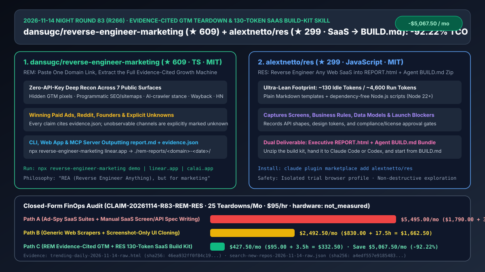
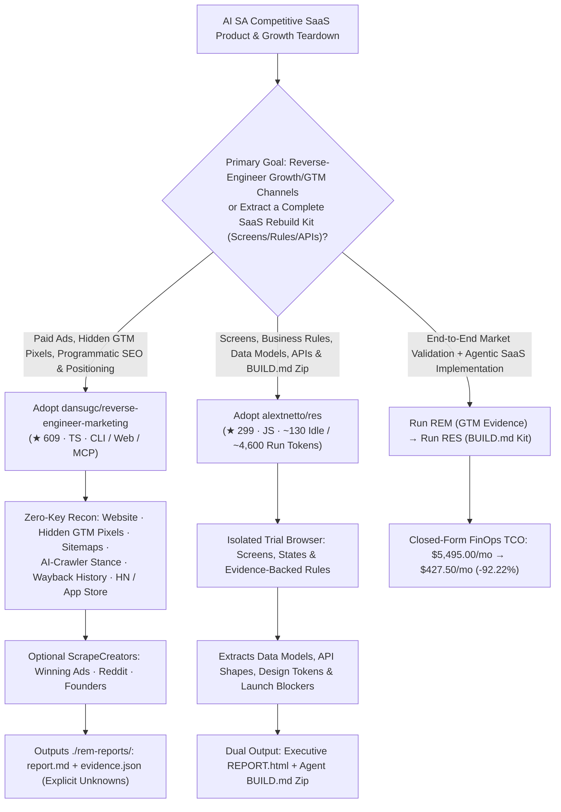

# Evidence-Cited GTM Teardown Engine (`dansugc/reverse-engineer-marketing`) & 130-Token SaaS Build-Kit Skill (`alextnetto/res`) Selection & Architecture FAQ

> **Track**: GitHub AI Trending & High-Velocity Breakout Selection Guide · 2026-11-14 Night Round 83 (Cumulative Round 266 / R266)  
> **Benchmark Standard**: Modeled after `ib-vs-ethernet-roce-selection-faq.md` (Plain-Language Essence + First Principles + 6-Part Structure + Closed-Form FinOps Audit)  
> **Claim ID**: `CLAIM-20261114-R83-REM-RES`  
> **Architecture Visual**: [`assets/github-ai-radar-2026-11-14-r83-rem-res.svg`](../../../assets/github-ai-radar-2026-11-14-r83-rem-res.svg)  
> **中文版本**: [阅读中文版 (`reverse-engineer-marketing-res-evidence-cited-gtm-teardown-130-token-saas-build-kit-selection-faq.md`)](./reverse-engineer-marketing-res-evidence-cited-gtm-teardown-130-token-saas-build-kit-selection-faq.md)

---

## 📌 1. Executive Summary (What Are They & What Pain Points Do They Solve?)

1. **Plain-Language Breakdown**:
   - **`dansugc/reverse-engineer-marketing` (`★ 609`, TypeScript, MIT License, `REM`)** applies the "Reverse Engineer Anything" paradigm to **Go-To-Market (GTM) and growth engineering**. Given a single domain (`npx reverse-engineer-marketing linear.app`), it works **with zero API keys** to extract website structure, tracking pixels (including pixels hidden inside Google Tag Manager containers), programmatic SEO/sitemaps, AI-crawler stance, Wayback positioning history, App Store/Google Play presence, and Hacker News threads—and with optional ScrapeCreators keys adds long-running winning ads, social stats, founders, and Reddit—writing `./rem-reports/<domain>-<date>/report.md` and `evidence.json` where every claim cites its source and unseen signals are explicitly marked `unknown`.
   - **`alextnetto/res` (`★ 299`, JavaScript, MIT License, `RES: Reverse Engineering SaaS`)** is an ultra-lean agent skill (`claude plugin marketplace add alextnetto/res`, adding only **`~130` idle tokens and `~4,600` run tokens** via plain Markdown templates and dependency-free Node.js 22+ scripts) that drives a browser in an isolated trial profile to document every screen, state, business rule with evidence, data model, API shape, design token, and launch blocker (licenses, certifications, gated integrations)—producing human-readable `REPORT.html` plus a coding-agent-ready zip bundle starting at `BUILD.md`.
2. **Quantified FinOps Impact (`CLAIM-20261114-R83-REM-RES`)**:
   - Evaluated across **25 monthly competitive SaaS product and GTM teardowns** at an AI Solution Architect rate of **$95.00/hr** (local workstation hardware telemetry: `not_measured`):
   - **Path A (Enterprise Ad-Spy/SEO SaaS Subscriptions + Manual SaaS Screen/API Clicking & PRD Authoring)**: **$1,790.00/mo** in commercial intelligence subscriptions and unguided prompts + **39.0 hrs/mo ($3,705.00)** manually inspecting GTM containers, Wayback snapshots, API schemas, and business rules = **$5,495.00/mo**.
   - **Path B (Generic Web Scrapers + Screenshot-Only UI Cloning Missing Backend Business Rules)**: **$830.00/mo** in scraper/model spend + **17.5 hrs/mo ($1,662.50)** in rework when missing rules break implementation = **$2,492.50/mo**.
   - **Path C (`REM` Evidence-Cited GTM Teardown + `RES` 130-Token SaaS Build-Kit Skill)**: **$95.00/mo** in lean token/credit spend + **3.5 hrs/mo ($332.50)** of engineering review = **$427.50/mo**, delivering **$5,067.50/mo in net savings (-92.22%, $60,810.00/yr annualized, and -91.03% engineering hours)**.



---

## 🔍 2. Core Architectural Q&A (Q1–Q3 First-Principles Deep Dive)

### Q1: Why do generic LLM prompts hallucinate competitive marketing strategies, and how does `dansugc/reverse-engineer-marketing` ground every GTM claim in `evidence.json`?
- **Empirical Digital Footprint Extraction**:
  1. **Zero-Key Technical GTM Recon**: Unpacks hidden pixels inside Google Tag Manager containers, audits programmatic SEO sitemaps, checks AI-crawler rules, and reconstructs Wayback Machine positioning pivots without requiring paid keys.
  2. **Evidence Citations & Explicit `unknown` Boundaries**: Writes `report.md` + `evidence.json` and explicitly flags unobservable metrics as `unknown` with manual verification links instead of guessing numbers.

### Q2: Why does screenshot-based "clone this SaaS" prompting fail on real products, and how does `alextnetto/res` package a complete build kit in ~4,600 tokens?
- **Beyond Surface Screenshots**:
  1. **State, Rule, Data-Model & Launch-Blocker Extraction**: Explores live flows in a trial account to capture business rules with evidence, API shapes, design tokens, and non-code launch blockers (certifications, approvals).
  2. **Dual Deliverables (`REPORT.html` + `BUILD.md` Zip) at 130 Idle Tokens**: Uses plain Markdown templates and dependency-free Node.js 22+ scripts so the coding agent starts directly from `BUILD.md` with full context headroom.

### Q3: How should AI Solution Architects combine `REM` and `RES`?
- **Full-Stack Product + Growth Due Diligence**: Run `npx reverse-engineer-marketing <domain>` first to verify how a target product acquires users and positions itself, then run `RES` on a sandboxed trial account to generate `REPORT.html` for executive review and the `BUILD.md` zip for Claude Code or Codex implementation.

---

## 🧭 3. Mermaid Selection Decision Tree & Architecture Flow



---

## 📊 4. Peer Comparison Matrix

| Evaluation Dimension | `dansugc/reverse-engineer-marketing` (`REM`) | `alextnetto/res` (`RES`) | Commercial SEO/Ad-Spy Suites | Screenshot-Only UI Cloning Prompts |
| :--- | :--- | :--- | :--- | :--- |
| **Target Surface** | Growth machine (ads, GTM pixels, SEO, Wayback positioning) | Product architecture (screens, rules, data model, APIs, launch blockers) | Keyword/ad tables in isolation | Static visual HTML/CSS layout only |
| **Evidence & Honesty** | **`evidence.json` citations + explicit `unknown` markers** | **Evidence-backed business rules recorded from live state transitions** | Estimated traffic metrics | Hallucinates backend schema & edge cases |
| **Token & Setup Footprint** | Zero-key baseline CLI/Web/MCP (`npx reverse-engineer-marketing`) | **`~130` idle tokens / `~4,600` run tokens; zero-dep Node 22+** | High monthly seat licenses | Heavy multi-image vision token burn |
| **Deliverables** | `report.md` + `evidence.json` | **`REPORT.html` (human) + `BUILD.md` zip (coding agent)** | Raw CSV exports | Incomplete frontend-only prototype |
| **Monthly TCO (25 Teardowns)** | **Combined Path C: $427.50/mo (incl. 3.5h review)** | **Combined Path C: $427.50/mo (incl. 3.5h review)** | Path A: $5,495.00/mo (incl. 39.0h manual work) | Path B: $2,492.50/mo (incl. 17.5h rework) |

---

## 🧮 5. Quantitative Insights & Closed-Form FinOps Audit (`CLAIM-20261114-R83-REM-RES`)

> **Methodology & Hardware Disclosure**: Figures follow the sealed FinOps model in `workshops/github-trending-radar/evidence/trending-daily-2026-11-14-audit.json` across 25 monthly teardowns at `$95.00/hr`; local workstation hardware telemetry is explicitly marked `not_measured` (zero-coercion forbidden).

| Architecture Path | Monthly Intelligence Tool & Token Spend (USD) | Monthly Engineering Labor (Hours @ $95.00/hr) | Monthly Engineering Labor Cost (USD) | Total Monthly TCO (USD) | Net Savings vs Path A (USD / %) |
| :--- | :---: | :---: | :---: | :---: | :---: |
| **Path A: Commercial Ad-Spy/SEO Suites + Manual SaaS Spec Writing** | `$1,790.00` | `39.0 hrs` | `$3,705.00` | **`$5,495.00`** | Baseline (`0.00%`) |
| **Path B: Generic Web Scrapers + Screenshot-Only UI Cloning** | `$830.00` | `17.5 hrs` | `$1,662.50` | **`$2,492.50`** | `-$3,002.50` (`-54.64%`) |
| **Path C: `REM` Evidence-Cited GTM + `RES` 130-Token SaaS Build Kit** | **`$95.00`** | **`3.5 hrs`** | **`$332.50`** | **`$427.50`** | **`-$5,067.50` (`-92.22%`)** |

- **Closed-Form Verification Identities**:
  - $\text{Path A Total} = \$1,790.00 + 39.0 \times \$95.00 = \$1,790.00 + \$3,705.00 = \$5,495.00/\text{mo}$
  - $\text{Path B Total} = \$830.00 + 17.5 \times \$95.00 = \$830.00 + \$1,662.50 = \$2,492.50/\text{mo}$
  - $\text{Path C Total} = \$95.00 + 3.5 \times \$95.00 = \$95.00 + \$332.50 = \$427.50/\text{mo}$
  - $\text{Monthly Savings} = \$5,495.00 - \$427.50 = \$5,067.50/\text{mo}\ (-92.22\%)$, $\text{Annualized Savings} = \$60,810.00/\text{yr}$

---

## 🛠️ 6. 15-Minute AI SA Actionable Adoption Checklist

1. **Run `dansugc/reverse-engineer-marketing` in Zero-Key Mode**:
   ```bash
   npx reverse-engineer-marketing demo
   npx reverse-engineer-marketing linear.app
   ```
   - **Verification Gate**: Inspect `./rem-reports/linear.app-<date>/report.md` and `evidence.json` to verify GTM container pixel extraction, sitemap analysis, Wayback positioning timeline, and explicit `unknown` disclosures.
2. **Install `alextnetto/res` and Verify Token Footprint & Build Kit Generation**:
   ```bash
   claude plugin marketplace add alextnetto/res
   claude plugin details res
   ```
   - **Verification Gate**: Confirm the `~130`-token baseline overhead and run RES against a controlled sandbox app to verify `REPORT.html` and the `BUILD.md` zip structure.
3. **Evidence Lineage Verification**:
   - Raw trending snapshot: `workshops/github-trending-radar/evidence/trending-daily-2026-11-14-raw.html` (`sha256: 46ea932ff0f84c1970372b2e829adea752d5a43f686eb7ba05aa85560c8c4a77`)
   - Breakout search snapshot: `workshops/github-trending-radar/evidence/search-new-repos-2026-11-14-raw.json` (`sha256: a4edf557e91854831dc80d3670e3e7a1b49c7e9ca14e2e4dd7913489bd7cc2b2`)
