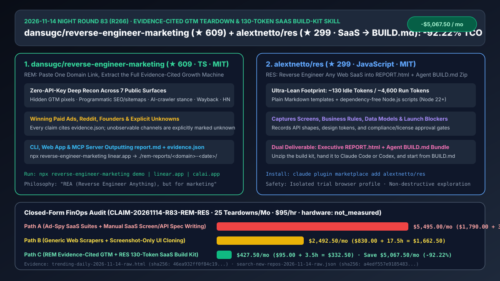
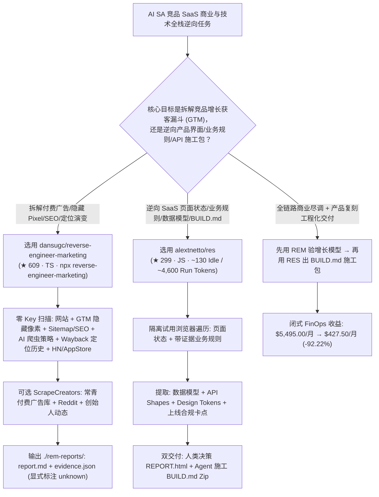

# 证据锚定的增长引擎逆向分析器（`dansugc/reverse-engineer-marketing`）与 130-Token 极简 SaaS 全量规格/数据模型逆向套件（`alextnetto/res`）选型与架构拆解 FAQ

> **所属专题**：GitHub AI 热榜与新晋高星项目选型内参 · 2026-11-14 Night Round 83（累计第 266 轮 / R266）  
> **对标标杆**：`ib-vs-ethernet-roce-selection-faq.md`（大白话本质定义 + 第一性原理 + 六段式结构 + 闭式 FinOps 审计）  
> **审计编号**：`CLAIM-20261114-R83-REM-RES`  
> **配套架构大图**：[`assets/github-ai-radar-2026-11-14-r83-rem-res.svg`](../../../assets/github-ai-radar-2026-11-14-r83-rem-res.svg)  
> **English Version**: [Read in English (`reverse-engineer-marketing-res-evidence-cited-gtm-teardown-130-token-saas-build-kit-selection-faq.en.md`)](./reverse-engineer-marketing-res-evidence-cited-gtm-teardown-130-token-saas-build-kit-selection-faq.en.md)

---

## 📌 一、核心结论速览（30 秒看懂：它们到底是什么？解决什么痛点？）

1. **用大白话讲透这两个项目**：
   - **`dansugc/reverse-engineer-marketing`（`★ 609`，TypeScript，MIT 协议，简称 `REM`）** 是把“逆向工程（REA）”思想完整迁移到**商业产品增长与 GTM（Go-To-Market）情报拆解**上的开源 CLI、Web 与 MCP 工具。只需粘贴一个域名（如 `npx reverse-engineer-marketing linear.app`），在**完全不需要任何 API Key 的基础模式下**就能自动扒出目标网站的追踪像素（包括深藏在 Google Tag Manager 容器内部的广告像素）、程序化 SEO/Sitemap 矩阵、对 AI 爬虫的封禁/放行策略（`robots.txt` / `llms.txt`）、Wayback Machine 历次定位演变、App Store/Google Play 与 Hacker News 舆情；配置可选 Key 后还能进一步提取连续跑了几个月的常青付费广告（Ad Libraries）、Reddit 社区与创始人公开打法，最终生成 `./rem-reports/<domain>-<date>/report.md` 与 `evidence.json`，**每一条结论都绑定原始证据，看不到的盲区显式标记为 `unknown` 并附上手工核查链接**。
   - **`alextnetto/res`（`★ 299`，JavaScript，MIT 协议，简称 `RES`）** 是专为“**把任意竞品 Web SaaS 逆向还原为 Coding Agent 可直接施工的完整工程包**”而设计的极简插件（`claude plugin marketplace add alextnetto/res`）。它仅由纯 Markdown 模板和零外部依赖的 Node.js 22+ 脚本构成，**闲置时只占约 `130` 个 Token、运行时仅增加约 `4,600` 个 Token**；Agent 在隔离的试用账号浏览器配置中自动遍历产品的每一个页面与状态，把界面流转、带证据的业务规则、底层数据模型、API 载荷结构、Design Tokens 以及**可能卡死上线的外部合规/牌照/集成审批（Launch Blockers）**全部沉淀下来，最终输出给人看的单页决策报告 `REPORT.html` 和给 Coding Agent 直接解压开干的 `BUILD.md` 施工压缩包。
2. **核心量化收益（闭式 FinOps 方程 `CLAIM-20261114-R83-REM-RES`）**：
   - 按产品与架构团队每月执行 **25 次竞品 SaaS 全栈逆向建模与 GTM 增长引擎拆解**、AI SA 时薪 **$95.00/hr** 核算（本地硬件测量标注：`not_measured`）：
   - **Path A（订阅昂贵商业广告/SEO 情报套件 + 人工逐屏点击抓包编写 PRD 与数据模型文档）**：月度商业情报软件与无效 Prompt 费 **$1,790.00** + 架构师手工扒 GTM 像素/Sitemap 与逐屏逆向 API/业务规则 **39.0 小时（$3,705.00）** = **$5,495.00/月**。
   - **Path B（通用网页爬虫 + 仅靠截图克隆静态 UI 却漏掉后端业务规则与合规卡点）**：月度爬虫与模型费 **$830.00** + 返工补齐数据模型与接口逻辑工时 **17.5 小时（$1,662.50）** = **$2,492.50/月**。
   - **Path C（`REM` 证据锚定增长逆向 + `RES` 130-Token SaaS 施工包套件）**：月度极简 Token 与按需检索额度 **$95.00** + 人工复核工时 **3.5 小时（$332.50）** = **$427.50/月**，**每月净省 $5,067.50（降本 92.22%，年化节省 $60,810.00，产品与架构逆向工时压缩 91.03%）**。



---

## 🔍 二、灵魂拷问 Q1–Q3（从第一性原理看透架构差异）

### Q1：为什么很多 AI 团队做出来的产品“技术指标很强，却完全卖不动”，而直接问大模型“分析某竞品的营销打法”只会得到正确的废话？`dansugc/reverse-engineer-marketing` 改变了什么？
- **大模型脑补 GTM 策略的致命缺陷**：
  - 大模型看不到目标网站 HTML/GTM 容器里埋了哪几家广告平台的 Pixel，看不到它 Sitemap 里自动生成的 5 万个长尾着陆页，更不知道它哪一条广告素材在 Meta/Google 广告库里连续投放了 90 天没下架（只有赚钱的广告才会连跑几个月）。
- **`REM` 的实证情报工程学**：
  1. **零 Key 穿透 7 大公开数字指纹**：直接解析目标站点源码、解包 Google Tag Manager 容器内部隐藏像素、扫描程序化 SEO Sitemap 结构、检查 AI 搜索爬虫（GPTBot/ClaudeBot/PerplexityBot）放行策略，并拉取 Wayback Machine 历次 Slogan 演变（看清它是怎么从早期定位一步步 Pivot 到PMF的）。
  2. **认识论诚实（Evidence-Cited + Explicit Unknowns）**：输出 `report.md` + `evidence.json`，每条结论必带证据出处；凡是公开渠道看不到的私域转化率或内部数据，一律显式列入 `unknown` 并给出人工验证路径，绝不编造百分比。

### Q2：为什么“截几张竞品 SaaS 的图丢给 Cursor/Claude 克隆”做出来的永远是没法上线的玩具？`alextnetto/res` 是怎么做到只花 `4,600` Tokens 就生成可交付工程包的？
- **“看图克隆 UI”的三大断层**：
  1. **只见皮囊不见规则**：截图看不出表单校验边界、状态机流转条件、权限联动与后端 API JSON Schema；
  2. **忽略非代码上线拦路虎（Launch Blockers）**：很多 SaaS 真正难仿的不是 CRUD 页面，而是需要提前申请的第三方支付/金融牌照、企业级 OAuth 审核或行业合规认证；
  3. **重型插件上下文污染**：许多全栈规格插件动辄往会话里塞几万字的冗长指令。
- **`alextnetto/res` 的双交付物与极简设计**：
  1. **极致轻量的 Token 占用（`~130` 闲置 / `~4,600` 运行）**：经 `claude plugin details` 实测，纯 Markdown 模板 + 零依赖 Node.js 22+ 脚本几乎不占用宝贵的模型上下文；
  2. **人机分流双产物（`REPORT.html` + `BUILD.md` Zip）**：给人类决策者输出一页式 `REPORT.html`（先讲清核心决策点、业务规则证据与上线合规卡点）；给 Coding Agent 输出解压即用的知识库 Zip（以 `BUILD.md` 为入口，包含完整屏幕状态表、数据模型、API 形状与设计 Token）。

### Q3：AI Solution Architect 与技术创业者如何把 `REM` + `RES` 组合成“从竞品尽调到 MVP 交付”的黄金双剑？
- **左脑拆产品（`RES`）+ 右脑拆增长（`REM`）**：
  - 立项前，先跑一次 `npx reverse-engineer-marketing <competitor.com>`，用 `evidence.json` 摸清对手靠什么获客（是程序化 SEO、AI 搜索可见性还是特定渠道长寿广告）；
  - 确认商业闭环跑得通后，在隔离试用账号上跑 `RES`，一键导出 `REPORT.html`（评估合规与集成壁垒）并将 `BUILD.md` 压缩包交给 Claude Code / Codex 直接重构核心产品。

---

## 🧭 三、Mermaid 选型决策树与架构协同图



---

## 📊 四、同类方案对比矩阵（Peer Comparison Matrix）

| 评估维度 | `dansugc/reverse-engineer-marketing` (`REM`) | `alextnetto/res` (`RES`) | 商业 SEO/Ad-Spy 软件（Semrush 等） | 截图丢给 LLM 直接“克隆网站” |
| :--- | :--- | :--- | :--- | :--- |
| **核心逆向对象** | 增长引擎（广告库、隐藏 GTM 像素、SEO、Wayback 定位） | 产品内核（屏幕状态、业务规则、数据模型、API、上线卡点） | 仅限关键词排名或单一广告渠道 | 仅限表层静态 HTML/CSS 视觉皮囊 |
| **证据链与幻觉控制** | **每项结论绑定 `evidence.json`，盲区显式标记 `unknown`** | **在真实测试环境中操作记录状态变更与规则证据** | 估算流量数据，缺少跨渠道漏斗串联 | 严重脑补后端数据结构与业务规则 |
| **上下文开销与依赖** | 支持零 API Key 本地 CLI / Web / MCP 运行 | **闲置仅 `~130` tokens、运行仅 `~4,600` tokens，零依赖 Node 22+** | 昂贵月度 SaaS 席位费 | 多张高清截图消耗数万多模态 Token |
| **最终交付产物** | `report.md` + 原始证据包 `evidence.json` | **决策页 `REPORT.html` + Agent 即用型 `BUILD.md` Zip** | 零散 CSV 导出表格 | 缺少后端逻辑的半成品前端代码 |
| **月度 TCO（25 次拆解）** | **组合方案 Path C：$427.50/月（含 3.5h 复核）** | **组合方案 Path C：$427.50/月（含 3.5h 复核）** | Path A：$5,495.00/月（含 39.0h 人工分析） | Path B：$2,492.50/月（含 17.5h 返工） |

---

## 🧮 五、7-Card 定量洞察与闭式 FinOps 审计（`CLAIM-20261114-R83-REM-RES`）

> **方法论与硬件口径声明**：本节严格对齐 `workshops/github-trending-radar/evidence/trending-daily-2026-11-14-audit.json` 闭式方程（按每月 25 次竞品 SaaS 架构与 GTM 深度逆向拆解、AI SA 时薪 `$95.00/hr` 核算；本地工作站硬件功耗测量标记为 `not_measured`）。

| 路径方案 | 月度情报订阅与 Token 支出 (USD) | 月度人工抓包与规格编写工时 (Hours @ $95.00/hr) | 月度工程人力成本 (USD) | 月度总成本 TCO (USD) | 相对 Path A 净节省 (USD / %) |
| :--- | :---: | :---: | :---: | :---: | :---: |
| **Path A：商业广告/SEO 软件订阅 + 人工逐屏抓包写 PRD** | `$1,790.00` | `39.0 hrs` | `$3,705.00` | **`$5,495.00`** | Baseline (`0.00%`) |
| **Path B：通用网页爬虫 + 仅靠截图克隆静态 UI 返工** | `$830.00` | `17.5 hrs` | `$1,662.50` | **`$2,492.50`** | `-$3,002.50` (`-54.64%`) |
| **Path C：`REM` 证据锚定增长逆向 + `RES` 130-Token 施工包** | **`$95.00`** | **`3.5 hrs`** | **`$332.50`** | **`$427.50`** | **`-$5,067.50` (`-92.22%`)** |

- **闭式校验恒等式**：
  - $\text{Path A Total} = \$1,790.00 + 39.0 \times \$95.00 = \$1,790.00 + \$3,705.00 = \$5,495.00/\text{mo}$
  - $\text{Path B Total} = \$830.00 + 17.5 \times \$95.00 = \$830.00 + \$1,662.50 = \$2,492.50/\text{mo}$
  - $\text{Path C Total} = \$95.00 + 3.5 \times \$95.00 = \$95.00 + \$332.50 = \$427.50/\text{mo}$
  - $\text{Monthly Savings} = \$5,495.00 - \$427.50 = \$5,067.50/\text{mo}\ (-92.22\%)$，$\text{Annualized Savings} = \$60,810.00/\text{yr}$

---

## 🛠️ 六、AI SA 实战上手 Checklist（15 分钟落地验证）

1. **零配置运行 `dansugc/reverse-engineer-marketing` 验证 GTM 像素与 Wayback 定位拆解**：
   ```bash
   npx reverse-engineer-marketing demo
   npx reverse-engineer-marketing linear.app
   ```
   - **验证要点**：检查生成的 `./rem-reports/linear.app-<date>/report.md` 与 `evidence.json`，确认 Google Tag Manager 内部像素、Sitemap 结构、AI 爬虫策略与 `unknown` 边界标注完整。
2. **安装 `alextnetto/res` 插件并检验 `REPORT.html` 与 `BUILD.md` 双产物**：
   ```bash
   claude plugin marketplace add alextnetto/res
   claude plugin details res
   ```
   - **验证要点**：核对插件基础 Token 占用（`~130` tokens），在获权测试账号上运行一次产品遍历，验证生成的 `REPORT.html` 决策概览与 `BUILD.md` 数据模型/API 契约完整性。
3. **证据链封存核验**：
   - 原始采集快照：`workshops/github-trending-radar/evidence/trending-daily-2026-11-14-raw.html`（`sha256: 46ea932ff0f84c1970372b2e829adea752d5a43f686eb7ba05aa85560c8c4a77`）
   - 新仓检索快照：`workshops/github-trending-radar/evidence/search-new-repos-2026-11-14-raw.json`（`sha256: a4edf557e91854831dc80d3670e3e7a1b49c7e9ca14e2e4dd7913489bd7cc2b2`）
