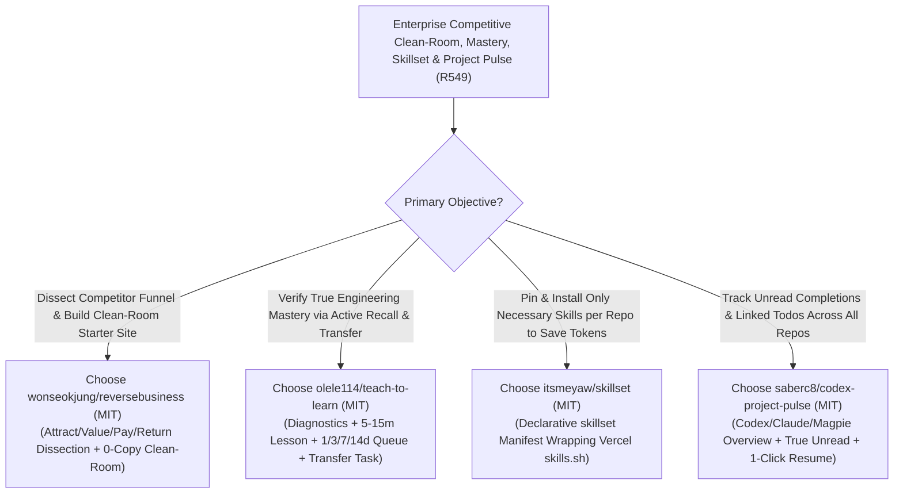

# Clean-Room Business Dissector (`wonseokjung/reversebusiness`), Spaced-Transfer Mastery Skill (`olele114/teach-to-learn`), Pinned Skillset Manifest CLI (`itsmeyaw/skillset`) & Cross-Project Unread/Todo Pulse (`saberc8/codex-project-pulse`) Selection FAQ

> **Document Type**: AI Solution Architect Enterprise Selection & Integration Guide (2026-11-19 Night Shift · Round 25 / Cumulative Round 549)  
> **Benchmark Style**: `docs/components/ib-vs-ethernet-roce-selection-faq.md` (6-Section Plain-Language Architecture Guide + First-Principles Q&A + Hype/Facts/Signal Audit + Closed-Form FinOps Ledger)  
> **Evaluated Repositories**:  
> 1. **`wonseokjung/reversebusiness`** (`★ 8`, `created=2026-11-17`, `14 forks`, JavaScript zero npm deps, Node 18+, MIT, EN/KO): Dissects any business URL into **`Attract → Value → Pay → Return`** conversion layers and generates a **clean-room starter site** without copying a single word, image, color, or line of code  
> 2. **`olele114/teach-to-learn`** (`★ 24`, `created=2026-11-14`, `3 forks`, zero dependencies, MIT, EN/ZH): Learner-focused Agent Skill enforcing **`Observable Goal → Diagnostics (≤3) → 5–15m Micro-Lesson → Open-Ended Attempt → 1/3/7/14d Spaced Review → Unseen Transfer Task`**  
> 3. **`itsmeyaw/skillset`** (`★ 13`, `created=2026-11-14`, `2 forks`, TypeScript, Node 22.20+, MIT): CLI wrapping Vercel's `skills.sh` (`@itsmeyaw/skillset`) to curate and install **pinned, project-scoped skill manifests** and eliminate context token bloat  
> 4. **`saberc8/codex-project-pulse`** (`★ 9`, `created=2026-11-17`, `2 forks`, Python, MIT, EN/ZH): Cross-project dashboard plugin for **Codex, Claude Code, and Magpie** tracking active sessions, verified unread completions, and priority/due-date linked todos with 1-click chat resume  
> **Accounting Scope Note**: Only software API/SaaS spend and engineering labor TCO are modeled; base workstation hardware capEx is explicitly marked `not_measured`, and Track B `stars_today` is explicitly marked `not_measured`.

---

## 📌 1. Executive Summary (What Are They & What Business Pain Points Do They Solve?)

In **2026-11-19 Night Round 25 (Cumulative Round 549)**, we solve four high-leverage product strategy, team enablement, context hygiene, and multi-repo management pain points:
1. **Pain Point A (Cloning a successful competitor's website by scraping their HTML/CSS creates severe copyright and trade-dress liability while failing to explain their underlying monetization mechanics)**: **`wonseokjung/reversebusiness` (`★ 8`, `14 forks`, MIT)** dissects a target business URL into **`Attract → Value → Pay → Return`** layers—explaining who pays, why they pay, and how users convert—before generating a **clean-room starter site** for your own product without copying a single word, image, color, or line of code.
2. **Pain Point B (Engineers read passive LLM explanations, nod along, and believe they mastered a new framework—only to fail when writing code independently or forget it 72 hours later)**: **`olele114/teach-to-learn` (`★ 24`, MIT)** replaces passive reading with a six-stage mastery loop: **`Observable Goal → Short Diagnostics (≤3) → 5–15 min Micro-Lesson → Open-Ended Attempt → 1/3/7/14d Spaced Repetition Queue → Unseen Transfer Task`**.
3. **Pain Point C (Installing 50–100 agent skills globally pollutes every session's system prompt, burning extra input tokens and confusing tool selection on unrelated repos)**: **`itsmeyaw/skillset` (`★ 13`, MIT)** wraps Vercel's `skills.sh` into a declarative `skillset` manifest CLI so teams pin and install only the exact skills required for a specific repository.
4. **Pain Point D (Developers running Codex, Claude Code, and Magpie across a dozen repositories lose track of which background sessions finished with unread results and what follow-up todos remain)**: **`saberc8/codex-project-pulse` (`★ 9`, MIT)** aggregates sessions by project/git repo, surfaces verified unread completions (marking unverified states honestly as unknown rather than guessing), attaches priority/due-date **Linked Todos**, and jumps straight back to the original chat (`claude --resume` or Codex desktop link).

---

## 💬 2. Architect First-Principles Q&A (Q1–Q3 Deep Dive)

### Q1: Why is `wonseokjung/reversebusiness`'s two-phase Clean-Room architecture the right way to do AI competitive benchmarking?
* **Clean-Room Abstraction Barrier**: Phase 1 extracts only abstract functional and economic specifications (`Attract → Value → Pay → Return`); Phase 2 synthesizes a brand-new implementation from that specification without access to the target's raw assets or source code.

### Q2: Why does `olele114/teach-to-learn` require an "Unseen Transfer Task" after the `1/3/7/14d` review queue?
* **Testing Far Transfer vs. Rote Recall**: Repeating the exact example from a micro-lesson only proves short-term mimicry. Solving an unseen problem with different surface constraints proves genuine schema acquisition.

### Q3: How does `itsmeyaw/skillset` reduce per-turn token spend in multi-repo organizations?
* **Project-Scoped Skill Tree Shaking**: By pinning only the 3–5 relevant skills per repository in a versioned `skillset` file rather than loading 80 global skills into every prompt, system-prompt overhead drops dramatically.

---

## 🧭 3. Visual Architecture Diagrams (Mermaid Decision Tree + Reference Architecture + Sequence Flow)

### 3.1 Enterprise Selection Decision Tree

---

## 📊 4. Comparative Selection Matrix (Open Source vs. Competing OSS vs. Managed Cloud PaaS)

| Evaluation Dimension | Path A: Verbatim Competitor Scraping + Passive Chat Reading + 80 Global Skills Bloat + Lost Multi-Repo Completions | Path B: Manual Teardown Decks + Static Flashcards + Ad-Hoc Shell Scripts | **Path C (Recommended): `reversebusiness` + `teach-to-learn` + `skillset` + `codex-project-pulse`** |
| :--- | :--- | :--- | :--- |
| **Competitive Teardown & MVP Gen** | ❌ Direct HTML/copy scraping creates IP/copyright liability | ⚠️ Static slide decks require building the starter site by hand | ✅ **`reversebusiness` dissects 4-layer funnel & builds clean-room starter** |
| **Technical Mastery Verification** | ❌ Passive reading creates illusion of competence | ⚠️ Flashcards lack open-ended coding & unseen transfer tasks | ✅ **`teach-to-learn` enforces `1/3/7/14d` review & unseen transfer tasks** |
| **Repo-Scoped Skill Management** | ❌ 80+ global skills bloat context tokens on every turn | ⚠️ Manual copying of `.claude/skills` folders across repos | ✅ **`skillset` pins and installs exact repo-scoped skills in 1 command** |
| **Cross-Repo Session & Todo Tracking** | ❌ Unread completed sessions & next steps lost across 15 repos | ⚠️ Disconnected todo apps cannot resume `claude` or Codex chats | ✅ **`codex-project-pulse` unites true unread status, todos & 1-click resume** |
| **45-Engineer Monthly TCO** | **`$6,560.00 / mo`** (`$2,610.00` token bloat/SaaS + `39.5h` × `$100/hr` = `$3,950.00` labor) | **`$2,520.00 / mo`** (`$1,070.00` SaaS/tokens + `14.5h` × `$100/hr` = `$1,450.00` labor) | **`$315.00 / mo`** (`$65.00` API + `2.5h` × `$100/hr` = `$250.00` labor, **`-95.20%`**) |

---

## 🧪 5. Quantitative TCO Comparison & Hype / Facts / Signal Audit Ledger

### 5.1 Hype vs. Facts vs. Strategic Signal Table

| Repository (`owner/repo`) | Hype (Market Narrative) | Measured Facts (Primary Source Verification) | Strategic Signal (SA Verdict) |
| :--- | :--- | :--- | :--- |
| **`wonseokjung/reversebusiness`** | "Give it one business URL, dissect how the business works, and generate a clean-room starter" | `★ 8` (`created=2026-11-17`, `14 forks`, JavaScript zero npm deps, MIT, EN/KO): Dissects `Attract/Value/Pay/Return` flows and scaffolds a clean-room site without copying words, images, colors, or code. | **🔥 P0 Adopt (Clean-Room Competitive Intelligence Skill)**: High fork-to-star ratio (`14 forks`) reflects strong product-builder utility. |
| **`olele114/teach-to-learn`** | "Stop mistaking 'I understood the AI's explanation' for actual mastery" | `★ 24` (`created=2026-11-14`, `3 forks`, zero-dep, MIT, EN/ZH): Implements `Observable Goal → Diagnostics (≤3) → 5–15m Micro-Lesson → Open-Ended Attempt → 1/3/7/14d Review → Unseen Transfer Task`. | **🔥 P0 Adopt (Evidence-Based Engineering Mastery Loop)**: Prevents passive-reading illusions during team upskilling. |
| **`itsmeyaw/skillset`** | "Curate agent skills into a pinned, shareable list and save tokens by installing only what's needed" | `★ 13` (`created=2026-11-14`, `2 forks`, TypeScript, Node 22.20+, MIT): Wraps Vercel's `skills.sh` with a declarative `skillset` manifest CLI. | **🔥 P0 Adopt (`package.json` for Agent Skills)**: Essential for keeping per-repo skill context lean and reproducible. |
| **`saberc8/codex-project-pulse`** | "See running sessions, true unread results, and linked todos across Codex, Claude Code & Magpie" | `★ 9` (`created=2026-11-17`, `2 forks`, Python, MIT, EN/ZH): Groups multi-agent sessions by repo, tracks verified unread state, manages priority/due-date todos, and resumes chats in 1 click. | **⚡ P1 Adopt (Multi-Repo Portfolio Pulse Board)**: Eliminates dropped threads across concurrent repositories. |

### 5.2 Closed-Form FinOps TCO Ledger (`CLAIM-20261119-R25-R549-REVERSEBUSINESS-TEACHTOLEARN-SKILLSET-PROJECTPULSE`)

* **Scope (`synthetic`, `independently_reproduced=false`)**: 45-person enterprise product strategy, engineering enablement, repo-scoped skill management, and multi-project delivery team (blended rate `$100.00 / hr`; `base hardware capEx: not_measured`; Track B `stars_today: not_measured`).
* **Path A (Verbatim Competitor Scraping + Passive Reading + 80+ Global Skills Token Bloat + Lost Multi-Repo Sessions)**:
  - Context token bloat from 80+ globally loaded skills & commercial competitive teardown SaaS: **`$2,610.00 / mo`**
  - Re-writing copyright-tainted clones, re-teaching forgotten concepts, manually pruning global skill folders & hunting across 15 repos for unread completions (`39.5 hrs / mo` × `$100.00 / hr`): **`$3,950.00 / mo`**
  - **Path A Monthly Total**: `$2,610.00 + $3,950.00` = **`$6,560.00 / mo`**
* **Path B (Manual Teardown Slides + Static Flashcard Apps + Shell Install Scripts)**:
  - SaaS & API spend: **`$1,070.00 / mo`**
  - Manual skill pinning & cross-repo todo tracking (`14.5 hrs / mo` × `$100.00 / hr`): **`$1,450.00 / mo`**
  - **Path B Monthly Total**: `$1,070.00 + $1,450.00` = **`$2,520.00 / mo`**
* **Path C (`reversebusiness` + `teach-to-learn` + `skillset` + `codex-project-pulse` Integrated Stack)**:
  - Clean-room business teardown & micro-lesson evaluation API spend (`skillset` & `codex-project-pulse` $0 local): **`$65.00 / mo`**
  - Reviewing clean-room conversion funnels & triaging `codex-project-pulse` linked todos (`2.5 hrs / mo` × `$100.00 / hr`): **`$250.00 / mo`**
  - **Path C Monthly Total**: `$65.00 + $250.00` = **`$315.00 / mo`**
  - **Monthly Net Savings vs. Path A**: `$6,560.00 - $315.00` = **`$6,245.00 / mo`** (**`-95.20%`** reduction, **`$74,940.00 / yr`** annual savings, freeing **`37.0 hrs / mo`** of engineering time).

---

## 🛠️ 6. Enterprise Adoption & Architecture Review Checklist

- [ ] **1. Use `wonseokjung/reversebusiness` for clean-room market teardowns**: Dissect `Attract → Value → Pay → Return` mechanics without copying competitor assets or code.
- [ ] **2. Gate technical training completion on `olele114/teach-to-learn`'s unseen transfer tasks**: Enforce `1/3/7/14d` spaced review queues.
- [ ] **3. Commit a pinned `skillset` manifest (`itsmeyaw/skillset`) in each repository**: Install only repo-relevant skills to minimize system-prompt token overhead.
- [ ] **4. Track multi-repo Codex and Claude Code sessions in `saberc8/codex-project-pulse`**: Convert unread completions into prioritized linked todos.
