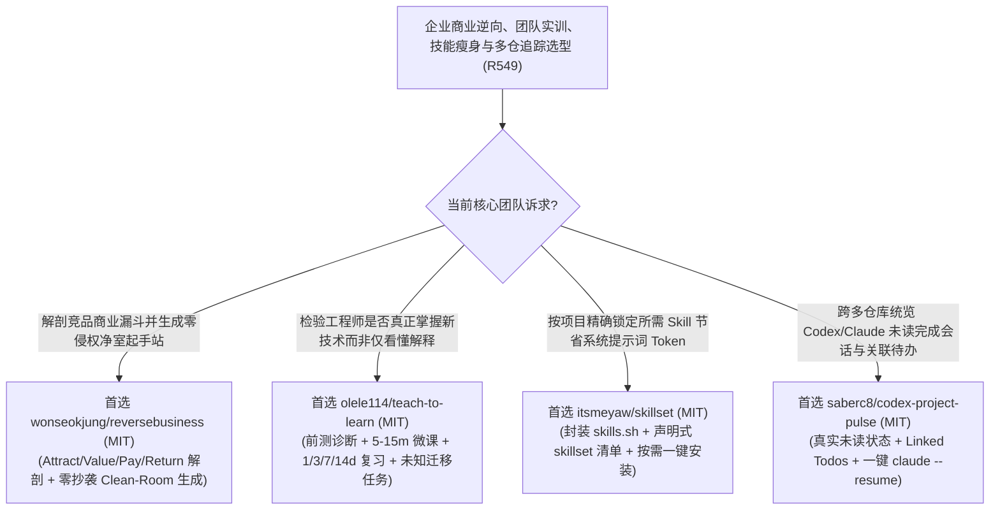
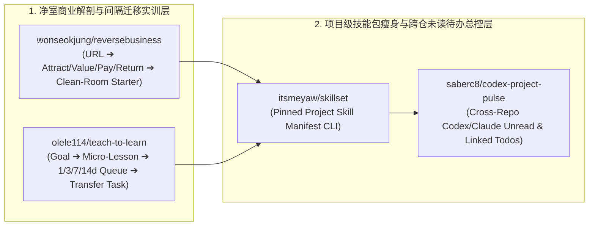
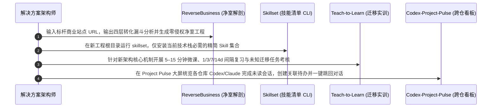

# 净室商业模式解剖与起手架生成（`wonseokjung/reversebusiness`）、可观测目标与间隔迁移掌握技能（`olele114/teach-to-learn`）、按需锁定项目级技能清单 CLI（`itsmeyaw/skillset`）与跨仓真实未读及关联待办看板（`saberc8/codex-project-pulse`）选型 FAQ

> **文档类型**：AI Solution Architect（AI 解决方案架构师）实战选型与架构内功指南（2026-11-19 Night Shift · Round 25 / 累计第 549 轮）  
> **对标标杆**：`docs/components/ib-vs-ethernet-roce-selection-faq.md`（六段式架构拆解 + 第一性原理大白话 + Hype/Facts/Signal 审计 + 闭式 TCO 账本）  
> **本轮评估对象**：  
> 1. **`wonseokjung/reversebusiness`**（`★ 8`，`created=2026-11-17`，`14 forks`，JavaScript 零依赖，MIT，英/韩）：输入一个商业网站 URL 即解剖其 **引流（Attract）→ 价值（Value）→ 付费（Pay）→ 留存（Return）** 商业闭环，并在**不抄袭一字、一图、一色、一行代码**的前提下为自有产品生成净室（Clean-Room）起手网站的技能  
> 2. **`olele114/teach-to-learn`**（`★ 24`，`created=2026-11-14`，`3 forks`，零依赖，MIT，中/英）：面向 Codex CLI 的 **“诊断 → 5–15 分钟微课 → 开放作答 → 1/3/7/14d 间隔复习 → 未知迁移任务”** 实操掌握技能  
> 3. **`itsmeyaw/skillset`**（`★ 13`，`created=2026-11-14`，`2 forks`，TypeScript，Node 22.20+，MIT）：封装 Vercel `skills.sh` 的**声明式项目级技能包锁定与按需安装 CLI（`@itsmeyaw/skillset`）**——只安装当前项目必需的 Skill 以节省上下文 Token  
> 4. **`saberc8/codex-project-pulse`**（`★ 9`，`created=2026-11-17`，`2 forks`，Python，MIT，中/英）：一屏汇聚各项目里 **Codex、Claude Code 与 Magpie 进行中会话、真实未读结果与关联待办（Linked Todos）** 的跨项目总览插件  
> **审计折算说明**：本报告仅计量软件算力、商业 SaaS 与工程运维人力 TCO，底层研发工作站硬件采购（base hardware capEx）显式标注为 `not_measured`，新仓今日增量显式标注为 `not_measured`，严禁捏造坐标。

---

## 📌 一、核心结论速览（Executive Summary：它到底是什么？解决什么业务痛点？）

在 **2026-11-19 Night Round 25（累计第 549 轮）** 中，我们面向企业架构师解决“参考竞品商业网站时直接扒 HTML 源码导致版权合规事故、工程师看完 AI 解释觉得自己懂了一上手写代码却全错、全局目录装了 80 个 Skill 导致每次对话白白浪费数千系统提示词 Token、以及同时推进十几个 Git 仓库时漏看已完成未读会话与下一步待办”四大痛点：
1. **痛点 A（产品团队看到一个商业化很成功的 SaaS 网站，想学习它的转化漏斗和定价结构；如果直接用爬虫扒下 HTML 让 AI 改改文案，不仅版式配色一模一样极易惹上侵权官司，而且团队根本没搞懂人家背后的商业逻辑）**：**`wonseokjung/reversebusiness` (`★ 8`, `14 forks`, MIT) 的破局之道**：一行命令 `npx github:wonseokjung/reversebusiness` 注入技能，给它一个目标网址，它先把页面拆解为 **`Attract（如何获客）→ Value（核心价值主张）→ Pay（谁付钱及变现机制）→ Return（留存复购钩子）`** 四层商业解剖图，随后采用软件工业标准的**净室设计（Clean-Room Implementation）**——在不复制原站任何一个词、一张图、一种颜色或一行源码的前提下，为你的产品生成全新的起手项目。
2. **痛点 B（用 AI 学一门新技术时，最容易陷入“看 AI 讲得头头是道，连连点头以为自己全懂了，结果关掉窗口自己写一行都写不出来，过三天更是忘得精光”的假性掌握陷阱）**：**`olele114/teach-to-learn` (`★ 24`, MIT) 的破局之道**：严禁上来就长篇大论灌输，而是严格执行六步闭环：`先定义可观测完成标准 (Observable Goal) → ≤3 道简短前测诊断 → 5–15 分钟微课 → 开放式主动回忆作答 → 写入 1/3/7/14 天间隔重复复习队列 → 最终通过一道从未见过的迁移任务 (Unseen Transfer Task)`，只有亲手做出迁移题才算真正结业。
3. **痛点 C（随着团队使用的 Agent Skill 越来越多，很多工程师把五六十个 Skill 全塞进全局目录；结果哪怕只改一行 Python 代码，Agent 也要先加载几十个无关前端/视频/运营 Skill 的元数据，既费 Token 又容易串味）**：像管 `package.json` 一样按仓库精确锁定所需 Skill。**`itsmeyaw/skillset` (`★ 13`, MIT) 的破局之道**：基于 Vercel `skills.sh` 构建声明式 `skillset` 清单文件，将某类项目（如“Java 后端微服务”或“Astro 营销站”）必需的少量版本化 Skill 固化下来，进新仓库一条命令按需安装，彻底杜绝全局 Skill 膨胀。
4. **痛点 D（架构师手上同时挂着 10 个不同 Git 仓库的 Codex、Claude Code 和 Magpie 任务；有些后台跑完出了重要结论却一直没点开看（完成未读），有些看了一眼忘了建跟进 Todo，过两天完全断片）**：**`saberc8/codex-project-pulse` (`★ 9`, MIT) 的破局之道**：把同一目录下 Codex、Claude Code 与 Magpie 的会话自动归并到同一个项目卡片中，读取真实的桌面已读/未读状态（若无法确认则诚实显示“未知”，绝不拿历史记录瞎猜），支持为任意项目或会话直接创建带**优先级与截止日期的关联待办（Linked Todos）**，点击标题即可通过桌面链接或 `claude --resume` 一键回到原对话。

---

## 💬 二、客户与架构师灵魂拷问 Q&A（Q1–Q3 First-Principles Deep Dive）

### Q1：`wonseokjung/reversebusiness` 的“先抽象四层资金/转化流，再净室生成代码”为什么在企业合规上极其重要？
* **思想与表达二分法（Idea-Expression Dichotomy）**：著作权法保护的是具体的文字、视觉与源码表达，而不保护背后的商业漏斗结构（如“免费小工具引流 + 阶梯订阅变现”）。`reversebusiness` 只提取抽象商业逻辑层，再完全从零根据你的产品定位生成代码，从根源上隔离了知识产权污染。

### Q2：`olele114/teach-to-learn`（主动回忆 + `1/3/7/14d` 间隔复习 + 迁移测试）与 Round 13 的 `AayushPandey2/teachme-skill`（一手信源建库）如何形成互补？
* **左脑建库（Vault）+ 右脑内化（ Practice）**：先用 `/teachme` 从 RFC 与论文构建零遗漏的 Obsidian 知识库；再用 `teach-to-learn` 针对核心难点执行“前测 → 微课 → `1/3/7/14d` 复习 → 未知迁移任务”训练，确保团队成员真正具备独立实战能力。

### Q3：`saberc8/codex-project-pulse` 为什么坚持“无法确认阅读状态时显示未知，不用历史记录猜测”？
* **可观测面板的零幻觉原则**：在工程管理看板上，把“不确定是否读过”猜成“已读”会导致漏掉关键线上排障结论。显式区分真实未读与未知状态，配合一键绑定截止日待办，保证了多仓库交接的绝对可靠。

---

## 🧭 三、直观可视化图解（Mermaid 选型决策树 + 企业集成参考架构 + 业务流时序图）

### 3.1 净室商业解剖、间隔迁移掌握、按需技能清单与跨仓脉搏选型决策树

### 3.2 企业集成参考架构图

### 3.3 端到端业务流时序图

---

## 📊 四、同类开源与商业云服务横向选型决策矩阵（Decision Matrix）

| 评估维度 | 路径 A：直接扒竞品网页惹侵权风险 + 被动看 AI 解释左耳进右耳出 + 全局塞满 80 个 Skill + 漏看多仓完成通知 | 路径 B：人工写竞品分析 PPT + 静态背单词卡软件 + 手写复制脚本 | **路径 C（推荐）：`reversebusiness` + `teach-to-learn` + `skillset` + `codex-project-pulse`** |
| :--- | :--- | :--- | :--- |
| **竞品商业模式研究与合规落盘** | ❌ 直接克隆竞品 DOM/文案，面临严重版权与品牌侵权风险 | ⚠️ 人工写完几十页分析报告后，仍需从零手搭项目骨架 | ✅ **`reversebusiness` 解剖四层商业流并生成零抄袭 Clean-Room 起手站** |
| **团队技术赋能与真实掌握度** | ❌ 被动阅读长文总结，一遇新场景完全不会独立迁移应用 | ⚠️ 传统刷题无针对性微课与开放式代码实操反馈 | ✅ **`teach-to-learn` 强制前测、微课、`1/3/7/14d` 队列与未知迁移题闭环** |
| **Skill 上下文 Token 占用治理** | ❌ 全局挂载几十个无关 Skill，每轮白烧 Token 且指令互相干扰 | ⚠️ 每次切项目手动删改 `.claude/skills` 目录，极易出错 | ✅ **`skillset` 用声明式清单按项目一键装配必需 Skill，保持上下文极简** |
| **跨项目多 Agent 会话与待办追踪** | ❌ 10 个仓库的完成结果散落各处，看完忘记建待办导致工作断档 | ⚠️ 单独在外部工具记 Todo，无法一键跳回对应的原始 Agent 会话 | ✅ **`codex-project-pulse` 聚合真实未读、绑定项目待办并支持一键恢复会话** |
| **45 人团队月度综合 TCO** | **`$6,560.00 / 月`**（全局冗余 Skill Token 税与竞品工具 `$2,610` + 侵权返工/重学/找会话耗时 `39.5h / $3,950`） | **`$2,520.00 / 月`**（分析工具与冗余 Token `$1,070` + 人工整理待办与搬运 Skill `14.5h / $1,450`） | **`$315.00 / 月`**（净室解剖与微课评测 API `$65` + 漏斗评审与跨仓待办分派 `2.5h / $250`，**净省 `-95.20%`**） |

---

## 🧪 五、应用落地定量收益/TCO 对比与 Hype / Facts / Signal 审计账本

### 5.1 Hype vs. Facts vs. Strategic Signal 审计表

| 仓库 (`owner/repo`) | Hype（市场宣传口径） | Measured Facts（一手源码与文档实证事实） | Strategic Signal（架构师选型信号） |
| :--- | :--- | :--- | :--- |
| **`wonseokjung/reversebusiness`** | “给它一个商业网址解剖其赚钱逻辑，再生成不抄一字一码的净室版本” | `★ 8`（`created=2026-11-17`，`14 forks`，JavaScript 零依赖，MIT，英/韩）：拆解 `Attract/Value/Pay/Return` 四层结构并生成 Clean-Room 起手站，14 个 Fork 证明极受独立开发者与产品架构师欢迎。 | **🔥 P0 采纳（合规竞品对标与 MVP 孵化标杆）**：“解剖商业模式而非抄袭视觉代码”的 Clean-Room 理念非常成熟。 |
| **`olele114/teach-to-learn`** | “别把看懂了 AI 的解释当成真正学会：用诊断、微课、间隔复习与迁移任务实现掌握” | `★ 24`（`created=2026-11-14`，`3 forks`，零依赖，MIT，中/英）：固化 `Observable Goal → Diagnostics (≤3) → Micro-Lesson → Open-Ended Attempt → 1/3/7/14d Review → Unseen Transfer Task` 流程。 | **🔥 P0 采纳（认知科学驱动的工程师实训技能）**：最后的“未知迁移任务”是检验是否真正学会的试金石。 |
| **`itsmeyaw/skillset`** | “把需要的 Skill 编成固定可分享清单，一条命令按项目安装，立刻省下 Token” | `★ 13`（`created=2026-11-14`，`2 forks`，TypeScript，Node 22.20+，MIT）：包装 Vercel `skills.sh`，通过声明式 `skillset` 文件实现项目级最小化技能安装。 | **🔥 P0 采纳（团队级 Skill 依赖管理标准工具）**：解决了全局 Skill 泛滥导致的上下文膨胀问题。 |
| **`saberc8/codex-project-pulse`** | “一屏查看各项目里 Codex、Claude Code 的进行中会话、完成未读与关联待办” | `★ 9`（`created=2026-11-17`，`2 forks`，Python，MIT，中/英）：按 Git 仓库归并多 Agent 会话，显示真实未读状态，绑定优先级/截止日待办并支持一键跳回原对话。 | **⚡ P1 采纳（多仓库并行架构师的项目脉搏看板）**：“会话完成未读 → 直接转成关联 Todo”闭环非常实用。 |

### 5.2 闭式 FinOps TCO 核算账本（Claim ID：`CLAIM-20261119-R25-R549-REVERSEBUSINESS-TEACHTOLEARN-SKILLSET-PROJECTPULSE`）

* **核算范围（Synthetic Parametric Model · `independently_reproduced=false`）**：45 人企业新业务商业模式孵化、工程团队实战赋能、仓库级 Skill 治理与多项目并行交付团队（工程师综合时薪 `$100.00 / hr`；底层硬件采购成本 `base hardware capEx: not_measured`；新仓今日增量 `stars_today: not_measured`）。
* **路径 A（直接扒皮竞品引发合规返工 + 被动阅读遗忘返工 + 全局挂载 80+ 冗余 Skill 浪费 Token + 漏看多仓完成会话）**：
  - 全局挂载几十个冗余 Skill 产生的系统提示词 Token 税与外部商业分析软件支出：**`$2,610.00 / 月`**
  - 重写涉嫌抄袭的页面、因未掌握核心原理反复踩坑、手动清理冲突 Skill 与在 15 个仓库间翻找未读结果耗时：**`39.5 小时 / 月`** × `$100.00 / hr` = **`$3,950.00 / 月`**
  - **路径 A 月度总成本**：`$2,610.00 + $3,950.00` = **`$6,560.00 / 月`**
* **路径 B（手工写竞品分析 PPT + 静态背题卡 + 手写安装脚本 + 手工维护外部 Todo 表）**：
  - 软件订阅与冗余 API 支出：**`$1,070.00 / 月`**
  - 人工维护各项目 Skill 目录与同步多仓库待办耗时：**`14.5 小时 / 月`** × `$100.00 / hr` = **`$1,450.00 / 月`**
  - **路径 B 月度总成本**：`$1,070.00 + $1,450.00` = **`$2,520.00 / 月`**
* **路径 C（`reversebusiness` + `teach-to-learn` + `skillset` + `codex-project-pulse` 组合方案）**：
  - 净室商业解剖与迁移任务评估 API 支出（`skillset` 砍掉冗余上下文税，`project-pulse` 本地运行 $0）：**`$65.00 / 月`**
  - 评审四层商业转化模型与在 `project-pulse` 分派关联待办耗时：**`2.5 小时 / 月`** × `$100.00 / hr` = **`$250.00 / 月`**
  - **路径 C 月度总成本**：`$65.00 + $250.00` = **`$315.00 / 月`**
  - **月度净节省（对比路径 A）**：`$6,560.00 - $315.00` = **`$6,245.00 / 月`**（降幅 **`-95.20%`**，年度净省 **`$74,940.00 / 年`**，每月释放高价值工程时间 **`37.0 小时`**）。

---

## 🛠️ 六、企业引入与架构评审 Checklist（SA Action Items）

- [ ] **1. 用 `wonseokjung/reversebusiness` 开展新产品竞品漏斗研究**：严格执行 `Attract → Value → Pay → Return` 抽象与零抄袭 Clean-Room 代码生成。
- [ ] **2. 将 `olele114/teach-to-learn` 纳入新人与新技术栈转岗培训**：以通过“未知迁移任务”和 `1/3/7/14d` 间隔复习作为结业标准。
- [ ] **3. 在每个业务仓库根目录用 `itsmeyaw/skillset` 维护精简技能清单**：禁止在全局目录堆积与当前项目无关的 Skill。
- [ ] **4. 为多项目负责人安装 `saberc8/codex-project-pulse`**：一屏监控跨仓库真实未读结果并即时转化为关联待办。
