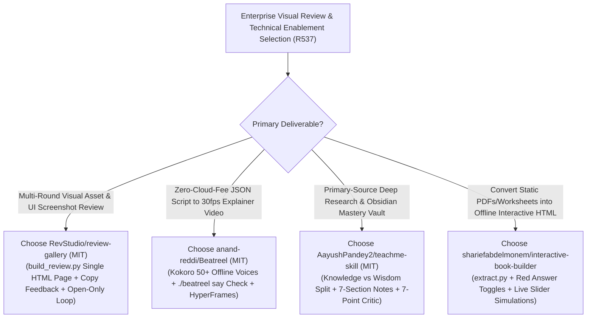

# Local Visual Review Gallery (`RevStudio/review-gallery`), Offline Kokoro+HyperFrames Explainer Reels (`anand-reddi/Beatreel`), 7-Point Critic Study Vault (`AayushPandey2/teachme-skill`) & Single-File Offline Interactive Flipbook (`shariefabdelmonem/interactive-book-builder`) Selection FAQ

> **Document Type**: AI Solution Architect Enterprise Selection & Integration Guide (2026-11-19 Night Shift · Round 13 / Cumulative Round 537)  
> **Benchmark Style**: `docs/components/ib-vs-ethernet-roce-selection-faq.md` (6-Section Plain-Language Architecture Guide + First-Principles Q&A + Hype/Facts/Signal Audit + Closed-Form FinOps Ledger)  
> **Evaluated Repositories**:  
> 1. **`RevStudio/review-gallery`** (`★ 10`, `created=2026-11-16`, Python, MIT, EN/KO/JA/ZH): Agent skill (`build_review.py`) that compiles screenshots, generated images, design options, and before/after pairs into one local HTML review page—supporting **Looks good / Needs work** marks, 1-click **Copy feedback**, and next-round filtering to show only open items  
> 2. **`anand-reddi/Beatreel`** (`★ 22`, `created=2026-11-15`, `2 forks`, CSS/JS + Kokoro-82M + GSAP + HyperFrames, MIT): 100% local JSON-script-to-explainer-video pipeline (`1080×1920` or `1920×1080` @ 30fps) with 50+ offline Kokoro voices, word-level timing sync, animated presenter, and a **`./beatreel say` pronunciation checker** that flags guessed words before rendering  
> 3. **`AayushPandey2/teachme-skill`** (`★ 11`, `created=2026-11-15`, `1 fork`, Python, MIT): Primary-source research and mastery learning OS (`/teachme` + 9 subcommands across 7+ coding agents) that separates vetted **Knowledge** (RFCs/papers/docs) from practitioner **Wisdom** (post-mortems/benchmarks) into an interlinked Obsidian/Markdown vault with a **7-Point Critic Audit**  
> 4. **`shariefabdelmonem/interactive-book-builder`** (`★ 10`, `created=2026-11-15`, `1 fork`, HTML + Python): Claude skill (`scripts/extract.py`, `scripts/image_to_page.py`) turning static PDFs and worksheet photos into a **single offline HTML interactive flipbook** with red handwritten answer toggles, controllable science simulations, and live slider-driven math graphs  
> **Accounting Scope Note**: Only software API/SaaS spend and engineering labor TCO are modeled; base workstation hardware capEx is explicitly marked `not_measured`, and Track B `stars_today` is explicitly marked `not_measured`.

---

## 📌 1. Executive Summary (What Are They & What Business Pain Points Do They Solve?)

In **2026-11-19 Night Round 13 (Cumulative Round 537)**, we solve four high-friction workflows across visual design review, offline explainer video production, deep technical onboarding, and interactive training courseware:
1. **Pain Point A (Reviewing a batch of agent-generated UI screenshots or design variants by opening file paths one-by-one and typing feedback from memory wastes time and causes regressions on already-approved screens)**: **`RevStudio/review-gallery` (`★ 10`, MIT)** compiles all assets into one numbered local HTML page (`build_review.py` in EN/KO/JA/ZH) where reviewers mark **Looks good** or **Needs work**, pick options side-by-side, click **Copy feedback**, and see **only remaining open items** in the next round.
2. **Pain Point B (Producing vertical or widescreen explainer reels via commercial cloud avatar SaaS incurs recurring fees and ruins takes when TTS mispronounces technical acronyms)**: **`anand-reddi/Beatreel` (`★ 22`, MIT)** runs `script.json → Kokoro-82M offline voice → word timings → HTML + GSAP → HyperFrames render → mix → video.mp4` 100% locally with zero API keys, using `./beatreel say "..."` to list every out-of-vocabulary word it had to guess before rendering.
3. **Pain Point C (Standard LLM explanations dump superficial walls of text that conflate official specifications with anecdotal blog opinions)**: **`AayushPandey2/teachme-skill` (`★ 11`, MIT)** builds a topologically ordered Obsidian/Markdown vault (`~/notes/<topic-slug>/`), explicitly separating primary-source **Knowledge** (RFCs, papers, official docs) from practitioner **Wisdom** (post-mortems, benchmarks) and auditing every 7-section note against a 7-point critic rubric.
4. **Pain Point D (Enterprise training handouts and certification workbooks locked in static PDFs lack interactive parameter sliders and per-question answer toggles)**: **`shariefabdelmonem/interactive-book-builder` (`★ 10`)** extracts PDF coordinates (`extract.py`) or flattens phone photos (`image_to_page.py`) into a **single offline HTML flipbook** with per-question/per-page answer toggles, animated science models, and slider-driven math graphs.

---

## 💬 2. Architect First-Principles Q&A (Q1–Q3 Deep Dive)

### Q1: Why does `RevStudio/review-gallery`'s "show only what is still open next time" rule accelerate visual convergence?
* **Monotonic Visual Convergence**: Re-feeding approved assets into subsequent multimodal turns wastes tokens and invites accidental regressions. Freezing items marked `Looks good` and rendering only `Needs work` items narrows the agent's edit scope deterministically each round.

### Q2: How does `anand-reddi/Beatreel`'s `./beatreel say` pre-check eliminate costly video re-renders?
* **Pre-Render OOV Phoneme Gate**: Rendering a 30fps GSAP + HyperFrames video takes minutes of compute, whereas checking phonemizer fallback events via `./beatreel say` takes milliseconds—catching mispronounced product names, tickers, and acronyms before a single frame is rendered.

### Q3: How do `AayushPandey2/teachme-skill` and `shariefabdelmonem/interactive-book-builder` modernize enterprise technical enablement?
* **Vault-to-Interactive-Flipbook Pipeline**: Architects use `/teachme` to synthesize primary-source RFCs and post-mortems into a critic-verified Markdown vault, then use `interactive-book-builder` to package hands-on architecture exercises into a single offline HTML flipbook for air-gapped customer workshops.

---

## 🧭 3. Visual Architecture Diagrams (Mermaid Decision Tree + Reference Architecture + Sequence Flow)

### 3.1 Enterprise Selection Decision Tree

---

## 📊 4. Comparative Selection Matrix (Open Source vs. Competing OSS vs. Managed Cloud PaaS)

| Evaluation Dimension | Path A: Scattered File Paths + Cloud Avatar Video SaaS + Wall-of-Text Chat Notes + Static PDF Handouts | Path B: Commercial Design Review SaaS + Paid Cloud TTS API + Manual Online Quiz Portals | **Path C (Recommended): `review-gallery` + `Beatreel` + `teachme-skill` + `interactive-book-builder`** |
| :--- | :--- | :--- | :--- |
| **Visual Iteration & Feedback Loop** | ❌ Opening files one-by-one; typing feedback from memory | ⚠️ Uploading internal screens to cloud review SaaS | ✅ **`review-gallery` local HTML page w/ 1-click Copy feedback & open-only filter** |
| **Explainer Video Cost & Pronunciation** | ❌ High monthly SaaS fees; mispronounced acronyms ruin renders | ⚠️ Cloud TTS charges per character without guessed-word warnings | ✅ **`Beatreel` 100% local Kokoro + `./beatreel say` OOV pronunciation gate** |
| **Technical Onboarding Depth** | ❌ Ephemeral chat dumps mixing official specs with blog rumors | ⚠️ Unaudited Markdown notes miss prerequisite dependencies | ✅ **`teachme-skill` separates Knowledge/Wisdom w/ 7-point critic audits** |
| **Interactive Training Delivery** | ❌ Static PDFs cannot animate diagrams or toggle answers per blank | ⚠️ Web LMS portals fail in offline or air-gapped client rooms | ✅ **`interactive-book-builder` compiles a single offline HTML flipbook w/ sliders** |
| **45-Engineer Monthly TCO** | **`$6,420.00 / mo`** (`$2,520.00` SaaS/re-renders + `39.0h` × `$100/hr` = `$3,900.00` labor) | **`$2,480.00 / mo`** (`$1,030.00` SaaS/TTS + `14.5h` × `$100/hr` = `$1,450.00` labor) | **`$315.00 / mo`** (`$65.00` API + `2.5h` × `$100/hr` = `$250.00` labor, **`-95.09%`**) |

---

## 🧪 5. Quantitative TCO Comparison & Hype / Facts / Signal Audit Ledger

### 5.1 Hype vs. Facts vs. Strategic Signal Table

| Repository (`owner/repo`) | Hype (Market Narrative) | Measured Facts (Primary Source Verification) | Strategic Signal (SA Verdict) |
| :--- | :--- | :--- | :--- |
| **`RevStudio/review-gallery`** | "Shows visual work as one local review page and turns marks into the next round" | `★ 10` (`created=2026-11-16`, Python, MIT): `build_review.py` renders a localized (EN/KO/JA/ZH) light/dark HTML review gallery with option pickers, Copy feedback, and open-item filtering. | **🔥 P0 Adopt (Standard Visual HITL Review Surface)**: Eliminates scattered file-path hunting in agentic UI and media workflows. |
| **`anand-reddi/Beatreel`** | "Make 30fps explainer videos from a JSON script entirely on your machine" | `★ 22` (`created=2026-11-15`, `2 forks`, MIT): Chains offline `Kokoro-82M` (50+ voices), `./beatreel say` pronunciation checker, HTML+GSAP scenes, and HyperFrames into 9:16 or 16:9 MP4s. | **🔥 P0 Adopt (Zero-Cost Offline Explainer Studio)**: Pre-render pronunciation checking saves hours of wasted video renders. |
| **`AayushPandey2/teachme-skill`** | "Primary-source research & mastery agent skill from absolute zero to complete mastery" | `★ 11` (`created=2026-11-15`, `1 fork`, Python, MIT): `/teachme` + 9 subcommands building topological Obsidian vaults with separated Knowledge/Wisdom and 7-point critic audits. | **🔥 P0 Adopt (Structured Technical Mastery Engine)**: Turns ad-hoc Q&A into durable, critic-verified team knowledge vaults. |
| **`shariefabdelmonem/interactive-book-builder`** | "Turns any textbook or worksheet PDF/photo into a single offline interactive flipbook" | `★ 10` (`created=2026-11-15`, `1 fork`, HTML/Python): Uses `extract.py` and `image_to_page.py` to generate a single offline HTML file with red answer toggles, animated science models, and slider graphs. | **⚡ P1 Adopt (Offline Interactive Courseware Compiler)**: Ideal for packaging interactive architecture workbooks. |

### 5.2 Closed-Form FinOps TCO Ledger (`CLAIM-20261119-R13-R537-REVIEWGALLERY-BEATREEL-TEACHME-BOOKBUILDER`)

* **Scope (`synthetic`, `independently_reproduced=false`)**: 45-person enterprise visual design review, technical explainer media, and engineering enablement team (blended rate `$100.00 / hr`; `base hardware capEx: not_measured`; Track B `stars_today: not_measured`).
* **Path A (Scattered File Review + Cloud Avatar Video SaaS + Ephemeral Chat Summaries + Static PDFs)**:
  - Cloud voice/video SaaS seats & multi-turn visual rework tokens: **`$2,520.00 / mo`**
  - Hunting down screenshots, re-rendering mispronounced videos & manual courseware authoring (`39.0 hrs / mo` × `$100.00 / hr`): **`$3,900.00 / mo`**
  - **Path A Monthly Total**: `$2,520.00 + $3,900.00` = **`$6,420.00 / mo`**
* **Path B (Commercial Design Review SaaS + Paid Cloud TTS + Manual Online Quizzes)**:
  - SaaS & API spend: **`$1,030.00 / mo`**
  - Manual review coordination & editing (`14.5 hrs / mo` × `$100.00 / hr`): **`$1,450.00 / mo`**
  - **Path B Monthly Total**: `$1,030.00 + $1,450.00` = **`$2,480.00 / mo`**
* **Path C (`review-gallery` + `Beatreel` + `teachme-skill` + `interactive-book-builder` Integrated Stack)**:
  - Script & curriculum synthesis LLM API spend (`Beatreel` TTS & `review-gallery` $0 local): **`$65.00 / mo`**
  - 1-click Copy-Feedback review & vault sign-off (`2.5 hrs / mo` × `$100.00 / hr`): **`$250.00 / mo`**
  - **Path C Monthly Total**: `$65.00 + $250.00` = **`$315.00 / mo`**
  - **Monthly Net Savings vs. Path A**: `$6,420.00 - $315.00` = **`$6,105.00 / mo`** (**`-95.09%`** reduction, **`$73,260.00 / yr`** annual savings, freeing **`36.5 hrs / mo`** of team capacity).

---

## 🛠️ 6. Enterprise Adoption & Architecture Review Checklist

- [ ] **1. Standardize multi-round visual reviews on `RevStudio/review-gallery` (`build_review.py`)**: Freeze `Looks good` items and iterate only on `Needs work` feedback.
- [ ] **2. Run `./beatreel say` before rendering explainer videos in `anand-reddi/Beatreel`**: Fix guessed technical acronyms before invoking GSAP + HyperFrames rendering.
- [ ] **3. Build onboarding vaults with `AayushPandey2/teachme-skill`**: Enforce the Knowledge vs. Wisdom split and 7-point critic audit on all subtopic notes.
- [ ] **4. Compile static PDF training workbooks into offline HTML via `shariefabdelmonem/interactive-book-builder`**: Deliver self-contained interactive flipbooks with live parameter sliders.
