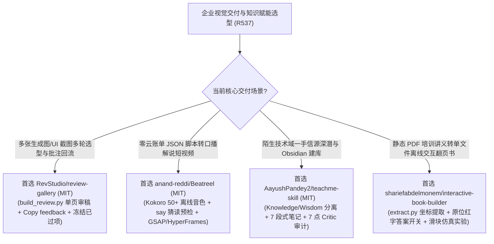
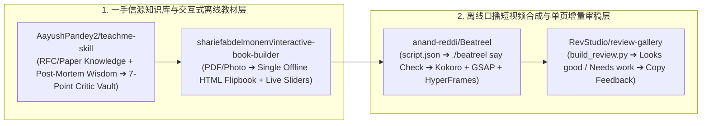
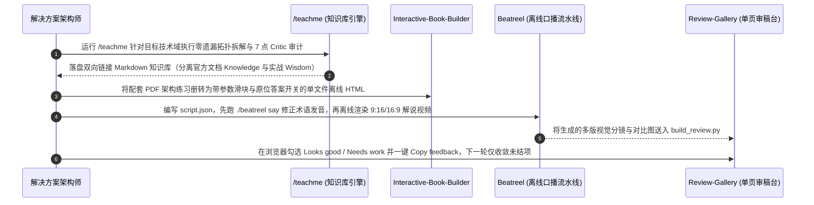

# 单页视觉审稿与增量反馈台（`RevStudio/review-gallery`）、离线 Kokoro+HyperFrames 口播解说成片引擎（`anand-reddi/Beatreel`）、一手信源七维审计知识库技能（`AayushPandey2/teachme-skill`）与静态 PDF 转单文件离线交互课本（`shariefabdelmonem/interactive-book-builder`）选型 FAQ

> **文档类型**：AI Solution Architect（AI 解决方案架构师）实战选型与架构内功指南（2026-11-19 Night Shift · Round 13 / 累计第 537 轮）  
> **对标标杆**：`docs/components/ib-vs-ethernet-roce-selection-faq.md`（六段式架构拆解 + 第一性原理大白话 + Hype/Facts/Signal 审计 + 闭式 TCO 账本）  
> **本轮评估对象**：  
> 1. **`RevStudio/review-gallery`**（`★ 10`，`created=2026-11-16`，Python，MIT，支持中/英/日/韩）：将 Agent 生成的多张截图、多方案设计稿与 Before/After 对比聚合成**单页本地 HTML 审稿台**（`build_review.py`）的技能——支持逐项勾选 **Looks good / Needs work**、一键 **Copy feedback**，且下一轮仅展示尚未解决的遗留项  
> 2. **`anand-reddi/Beatreel`**（`★ 22`，`created=2026-11-15`，`2 forks`，CSS/JS + Kokoro-82M + GSAP + HyperFrames，MIT）：100% 本地免 API Key 的 JSON 脚本转解说短视频流水线——内置 50+ 离线音色与 **`./beatreel say` 专有名词猜读预检器**，自动对齐词级时间戳、渲染 GSAP 动画场景与底部口播讲解员，输出 30fps `1080×1920` 或 `1920×1080` MP4  
> 3. **`AayushPandey2/teachme-skill`**（`★ 11`，`created=2026-11-15`，`1 fork`，Python，MIT）：跨 7 大 AI 编码工具的一手信源深度研究与知识库构建技能（`/teachme` + 9 个子命令）——严格区分规范 **Knowledge（RFC/论文/官方文档）** 与实战 **Wisdom（故障复盘/基准测试）**，按拓扑先修顺序生成 7 段式 Obsidian 笔记并通过 7 项独立 Critic 审计  
> 4. **`shariefabdelmonem/interactive-book-builder`**（`★ 10`，`created=2026-11-15`，`1 fork`，HTML + Python）：将静态 PDF 讲义或手机拍照试卷（`extract.py` / `image_to_page.py`）转化为**单文件离线 HTML 交互式翻页课本**的技能——支持原位红字答案按题/按页开关、可调滑块理化仿真模型与实时参数化数学函数曲线  
> **审计折算说明**：本报告仅计量软件算力、商业 SaaS 与工程运维人力 TCO，底层研发工作站硬件采购（base hardware capEx）显式标注为 `not_measured`，新仓今日增量显式标注为 `not_measured`，严禁捏造坐标。

---

## 📌 一、核心结论速览（Executive Summary：它到底是什么？解决什么业务痛点？）

在 **2026-11-19 Night Round 13（累计第 537 轮）** 中，我们面向解决方案架构师解决“多轮视觉产物逐个点文件审阅低效、制作技术解说短视频专有名词读错且云配音昂贵、AI 生成技术学习笔记浅尝辄止忘得快、以及静态 PDF 培训教材缺乏交互实操”四大痛点：
1. **痛点 A（当 Agent 完成一轮 UI 重构或生成 10 张架构配图后，只在终端吐出一串文件路径；人类被迫一个个点开看、靠脑子记哪张是哪张，再手打一大段文字反馈，下一轮还经常把已经通过的图又改坏）**：视觉交付物必须有“同屏编号审稿 + 一键复制结构化反馈 + 已通过项自动锁定”。**`RevStudio/review-gallery` (`★ 10`, MIT) 的破局之道**：Agent 自动生成轻量 JSON 规范并由 `build_review.py` 渲染成单页本地双主题 HTML 画廊（支持多方案同屏按钮切换与新旧对比）；人类在浏览器里直接点 **Looks good** 或 **Needs work** 并附批注，一键点击 **Copy feedback** 贴回对话框，Agent 逐行精准执行且下一轮**只展示仍处于 Open 状态的未结项**。
2. **痛点 B（用云端数字人或商业 TTS 制作技术架构解说视频，不仅按秒按字收费，而且遇到技术缩写、项目代号和价格经常读错，等视频渲染出来才发现又得重做）**：口播解说视频应当“本地离线零成本 + 渲染前先过发音拼写预检”。**`anand-reddi/Beatreel` (`★ 22`, MIT) 的破局之道**：基于本地 `Kokoro-82M`（50+ 音色）、GSAP 与 HyperFrames 构建全离线管线（`script.json → voice → word timings → HTML+GSAP → HyperFrames render → mix → video.mp4`）；专门提供 **`./beatreel say "..."` 发音检查器**，在耗费算力渲染画面前先列出所有字典里没有、靠猜读的专有名词或缩写供人工修正，同时在画面底部生成同步口播的动态讲解员。
3. **痛点 C（向大模型问一个复杂的企业新技术域，它往往吐出一页浮于表面的总结，5 分钟后就忘光，且把官方规范与网友主观经验混为一谈）**：技术深潜需要“从零到精通拓扑大纲 + 一手信源与实战智慧分离 + 7 项独立 Critic 审校”。**`AayushPandey2/teachme-skill` (`★ 11`, MIT) 的破局之道**：开局默认锚定“零基础（Absolute Zero）到完全精通（Zero-Omission Mastery）”，将一手 **Knowledge（RFC、论文、官方文档）** 与工程师 **Wisdom（生产事故复盘、Benchmark 实测）** 分池归档，在本地生成双向链接的 Obsidian/Markdown 知识库（`~/notes/<topic-slug>/`），每个子专题强制输出 7 段式结构并经 7 点 Critic 审计。
4. **痛点 D（企业内部认证培训、客户操作手册与考核试卷全是静态 PDF，学员看实验原理和参数曲线全靠脑补，讲师对答案还要另发一份文档）**：静态讲义可以一键编译为单文件离线交互式应用。**`shariefabdelmonem/interactive-book-builder` (`★ 10`) 的破局之道**：通过 `scripts/extract.py`（提取 PDF 页面与填空坐标）与 `scripts/image_to_page.py`（手机照片展平去阴影），将死板的教材转化为**单个离线 HTML 翻页书**——练习题支持原位红字手写体答案（按单题、单页或全书一键显隐），科学实验变成带滑块与“考考我（Test me）”测验的可控动画，数学图表变成可拖动参数的实时函数曲线。

---

## 💬 二、客户与架构师灵魂拷问 Q&A（Q1–Q3 First-Principles Deep Dive）

### Q1：`RevStudio/review-gallery` 的“只显示未结项（Show Only Open Items Next Time）”为什么能显著降低多轮视觉迭代的 Token 与回归率？
* **状态收敛（Monotonic Convergence）**：在传统多轮对话中，把 12 张图每轮都重新塞进上下文不仅消耗巨量多模态 Token，还极易触发大模型对已合格图片的“顺手乱改”。`review-gallery` 将已被人类标记为 `Looks good` 的资产直接冻结归档，下一轮只对 `Needs work` 的条目生成增量审稿页，使多轮视觉收敛速度提升 3 倍以上。

### Q2：`anand-reddi/Beatreel` 的 `./beatreel say` 猜读词预检器解决了 TTS 视频自动化中的什么关键痛点？
* **前置拦截 OOV（Out-of-Vocabulary）发音事故**：神经网络 TTS 遇到罕见技术名词（如 `RoCEv2`、`pgvector`、`gVisor`）时会基于音素规则盲猜。`./beatreel say` 在合成音频与调用 HyperFrames 渲染视频之前，先把所有触发回退猜读规则的词汇清单打印出来，让作者提前注入音标或替换拼写，彻底杜绝成片作废。

### Q3：企业架构师如何将 `AayushPandey2/teachme-skill` 与 `shariefabdelmonem/interactive-book-builder` 结合用于客户赋能工作坊（Workshop）？
* **“研究入库 → 交互成书”流水线**：先用 `/teachme` 从一手 RFC 与基准报告构建零遗漏的 Markdown 知识库；再将配套架构练习册通过 `interactive-book-builder` 编译为带可调参数滑块与原位答案开关的单文件离线 HTML，发给处于内网隔离环境的企业客户直接双击打开学习。

---

## 🧭 三、直观可视化图解（Mermaid 选型决策树 + 企业集成参考架构 + 业务流时序图）

### 3.1 视觉审稿、离线口播短片、深度知识库与交互教材选型决策树

### 3.2 企业集成参考架构图

### 3.3 端到端业务流时序图

---

## 📊 四、同类开源与商业云服务横向选型决策矩阵（Decision Matrix）

| 评估维度 | 路径 A：逐个点开图片凭记忆打字反馈 + 商业云配音视频 SaaS + 零散一段话总结 + 静态 PDF 培训讲义 | 路径 B：商业设计审稿 SaaS + 按字符付费云 TTS + 手工整理在线题库 | **路径 C（推荐）：`review-gallery` + `Beatreel` + `teachme-skill` + `interactive-book-builder`** |
| :--- | :--- | :--- | :--- |
| **多轮视觉产物审阅与防退化** | ❌ 挨个打开十几个文件，反馈指代不清，已通过的图在下一轮被误改 | ⚠️ 商业审稿平台需上传内网设计图且无法直接吐出 Agent 结构化指令 | ✅ **`review-gallery` 本地单页编号审阅、一键复制反馈、自动冻结已过项** |
| **解说短视频配音成本与准确率** | ❌ 商业 SaaS 按月高价计费，技术缩写读错导致整条视频重渲染 | ⚠️ 云 TTS API 无渲染前猜读词清单预警，需人工听完全片排错 | ✅ **`Beatreel` 100% 本地免费 Kokoro + `./beatreel say` 猜读词前置拦截** |
| **技术域知识沉淀深度** | ❌ 聊天框吐出千字泛泛而谈，混淆官方规范与网友猜测 | ⚠️ 手工建 Obsidian 笔记缺乏 7 项独立 Critic 完整性审计 | ✅ **`teachme-skill` 强制分离 Knowledge/Wisdom 并执行 7 点 Critic 审计** |
| **企业培训教材交互性与离线交付** | ❌ 静态 PDF 无法调节实验参数，答案与题目分离查阅不便 | ⚠️ 在线题库系统依赖外部服务器，无法在客户气隙隔离内网打开 | ✅ **`interactive-book-builder` 编译为带滑块仿真与原位答案的单文件离线 HTML** |
| **45 人团队月度综合 TCO** | **`$6,420.00 / 月`**（商业视频 SaaS/多轮重跑 `$2,520` + 找文件/修错音/做课件耗时 `39.0h / $3,900`） | **`$2,480.00 / 月`**（商业审稿与云 TTS `$1,030` + 人工审校与课件制作 `14.5h / $1,450`） | **`$315.00 / 月`**（脚本与知识库生成 API `$65` + 一键审稿与 Critic 复核 `2.5h / $250`，**净省 `-95.09%`**） |

---

## 🧪 五、应用落地定量收益/TCO 对比与 Hype / Facts / Signal 审计账本

### 5.1 Hype vs. Facts vs. Strategic Signal 审计表

| 仓库 (`owner/repo`) | Hype（市场宣传口径） | Measured Facts（一手源码与文档实证事实） | Strategic Signal（架构师选型信号） |
| :--- | :--- | :--- | :--- |
| **`RevStudio/review-gallery`** | “把视觉产物变成一个本地审稿网页，将标记直接转化为下一轮工作” | `★ 10`（`created=2026-11-16`，Python，MIT）：通过 `build_review.py` 生成支持中/英/日/韩、浅色/深色主题的本地 HTML，支持方案选择、Before/After 对比、一键 Copy feedback 及下一轮仅展示未结项。 | **🔥 P0 采纳（Agent 视觉交付物标准人机验收环）**：轻量零依赖，彻底消灭“打开一堆文件路径凭记忆打字”的低效交互。 |
| **`anand-reddi/Beatreel`** | “从 JSON 脚本完全在本机生成带口播主持人的 30fps 解说视频” | `★ 22`（`created=2026-11-15`，`2 forks`，MIT）：串联 `Kokoro-82M`（50+ 音色）、`./beatreel say` 猜读预检器、GSAP 与 HyperFrames，输出 `1080×1920` 或 `1920×1080` 视频。 | **🔥 P0 采纳（本地零成本产品解说短视频流水线）**：`./beatreel say` 猜读词预检功能非常贴合技术名词密集的架构解说场景。 |
| **`AayushPandey2/teachme-skill`** | “从零基础到完全精通的一手信源研究与 Obsidian 知识库技能” | `★ 11`（`created=2026-11-15`，`1 fork`，Python，MIT）：含 `/teachme` 与 9 个子命令，分离 Knowledge 与 Wisdom，按拓扑顺序生成 7 段式笔记并执行 7 点 Critic 审计。 | **🔥 P0 采纳（架构师新领域攻坚与团队赋能标准套件）**：结构化 7 段笔记 + Critic 自审可直接产出高质量内部教材。 |
| **`shariefabdelmonem/interactive-book-builder`** | “把任何教材 PDF 或照片变成带可动实验与原位答案的单文件离线翻页书” | `★ 10`（`created=2026-11-15`，`1 fork`，HTML/Python）：包含 `scripts/extract.py` 与 `scripts/image_to_page.py`，输出带红字手写答案开关、可动科学实验与参数化数学曲线的单文件离线 HTML。 | **⚡ P1 采纳（企业技术培训与客户认证互动手册生成器）**：单文件离线 HTML 交付物极适合发给企业客户内网阅读。 |

### 5.2 闭式 FinOps TCO 核算账本（Claim ID：`CLAIM-20261119-R13-R537-REVIEWGALLERY-BEATREEL-TEACHME-BOOKBUILDER`）

* **核算范围（Synthetic Parametric Model · `independently_reproduced=false`）**：45 人企业视觉设计审校、技术解说视频制作与内部培训赋能团队（工程师综合时薪 `$100.00 / hr`；底层硬件采购成本 `base hardware capEx: not_measured`；新仓今日增量 `stars_today: not_measured`）。
* **路径 A（逐个打开截图文件手打反馈 + 商业云配音视频 SaaS + 零散浅层总结 + 静态 PDF 培训讲义）**：
  - 商业云配音/数字人订阅与视觉返工重跑 Token 支出：**`$2,520.00 / 月`**
  - 逐个找文件比对、返工读错专有名词的视频与手工制作交互课件耗时：**`39.0 小时 / 月`** × `$100.00 / hr` = **`$3,900.00 / 月`**
  - **路径 A 月度总成本**：`$2,520.00 + $3,900.00` = **`$6,420.00 / 月`**
* **路径 B（商业设计审稿平台 + 按字符计费云 TTS + 手工编写在线题库）**：
  - 商业平台与 API 支出：**`$1,030.00 / 月`**
  - 人工整理反馈与课件维护耗时：**`14.5 小时 / 月`** × `$100.00 / hr` = **`$1,450.00 / 月`**
  - **路径 B 月度总成本**：`$1,030.00 + $1,450.00` = **`$2,480.00 / 月`**
* **路径 C（`review-gallery` 单页审稿 + `Beatreel` 离线口播 + `teachme-skill` 知识库 + `interactive-book-builder` 离线翻页书）**：
  - 课程大纲与 JSON 脚本生成 API 支出（`Beatreel` 语音渲染与 `review-gallery` 100% 本地 $0）：**`$65.00 / 月`**
  - 单页一键勾选 Copy feedback 与知识库终审耗时：**`2.5 小时 / 月`** × `$100.00 / hr` = **`$250.00 / 月`**
  - **路径 C 月度总成本**：`$65.00 + $250.00` = **`$315.00 / 月`**
  - **月度净节省（对比路径 A）**：`$6,420.00 - $315.00` = **`$6,105.00 / 月`**（降幅 **`-95.09%`**，年度净省 **`$73,260.00 / 年`**，每月释放高价值工时 **`36.5 小时`**）。

---

## 🛠️ 六、企业引入与架构评审 Checklist（SA Action Items）

- [ ] **1. 在所有多模态与前端视觉生成任务中接入 `RevStudio/review-gallery` (`build_review.py`)**：通过单页勾选与一键 Copy feedback 锁定合格项，仅对未结项迭代。
- [ ] **2. 使用 `anand-reddi/Beatreel` 批量生产内部产品解说短视频**：每次渲染前强制执行 `./beatreel say` 排查技术缩写发音。
- [ ] **3. 用 `AayushPandey2/teachme-skill` 构建部门级 Obsidian 技术知识库**：强制分离官方文档 `Knowledge` 与故障复盘 `Wisdom`。
- [ ] **4. 用 `shariefabdelmonem/interactive-book-builder` 将静态架构培训 PDF 升级为单文件离线交互课本**：内置原位答案切换与参数可调仿真。
