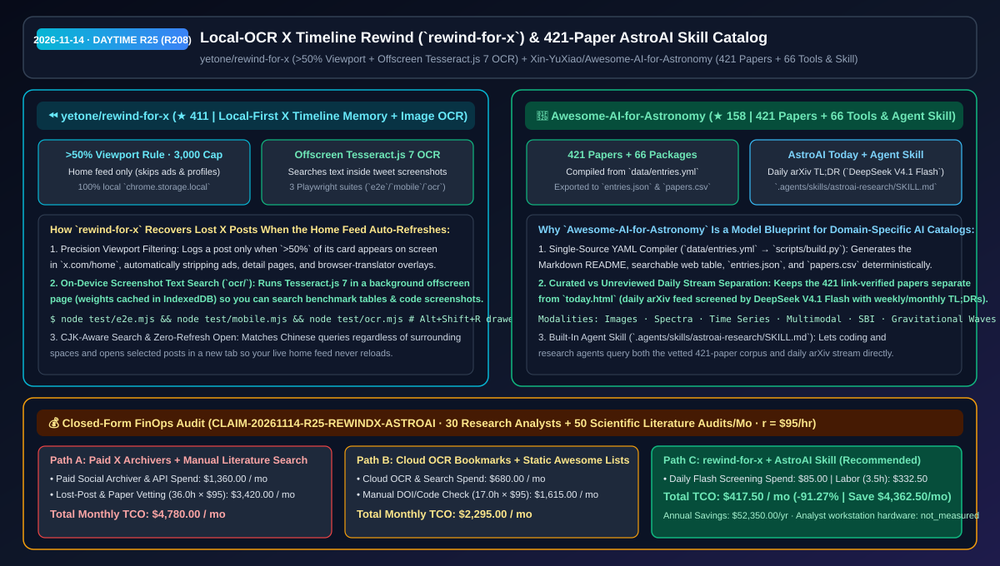
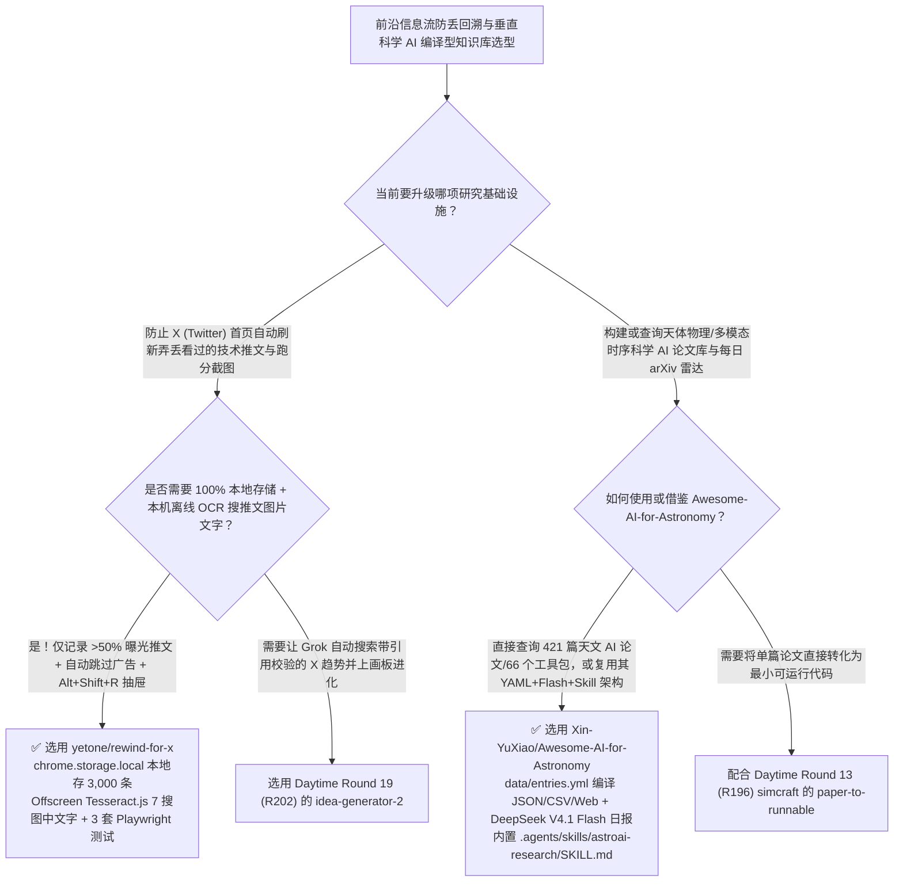

# 本地 OCR 推文回看扩展（`rewind-for-x`）与 421 篇论文编译型天文 AI 知识库及技能（`Awesome-AI-for-Astronomy`）选型 FAQ：`yetone/rewind-for-x` + `Xin-YuXiao/Awesome-AI-for-Astronomy`

> **元数据（Metadata）**
> - **评测批次**：2026-11-14 白班深潜 Round 25（累计 Round 208）
> - **核心标的**：
>   1. [`yetone/rewind-for-x`](https://github.com/yetone/rewind-for-x)（`★ 411` · `2026-11-08` 建仓 · MIT · 知名开发者 `@yetone` 出品的 X 首页推文回看 Chrome 扩展：仅记录屏幕上露出 `>50%` 的真实已看推文、过滤广告与翻译插件叠加层、后台 Offscreen 运行 `Tesseract.js 7` 本机搜图中文字、数据 100% 存 `chrome.storage.local` 最多 3,000 条并配齐 3 套 Playwright E2E 测试）
>   2. [`Xin-YuXiao/Awesome-AI-for-Astronomy`](https://github.com/Xin-YuXiao/Awesome-AI-for-Astronomy)（`★ 158` · `2026-11-08` 建仓 · CC0-1.0 · Zenodo `10.5281/zenodo.24132725`：由 `data/entries.yml` 编译生成的 **421 篇已核验论文 + 66 个开源软件包** 科学 AI 知识库，搭配 `DeepSeek V4.1 Flash` 每日自动筛选的 **AstroAI Today (`today.html`)** 及 `.agents/skills/astroai-research/SKILL.md` 智能体技能）
> - **配套架构图**：[`assets/github-ai-radar-2026-11-14-r25-rewind-for-x-astro-ai.svg`](../../../assets/github-ai-radar-2026-11-14-r25-rewind-for-x-astro-ai.svg)
> - **证据封存锚点**：`CLAIM-20261114-R25-REWINDX-ASTROAI`（见 [`evidence/trending-daily-2026-11-14-audit.json`](../evidence/trending-daily-2026-11-14-audit.json)）

---

## 📌 1. 核心结论速览（Executive Summary & First-Principles Pitch）

1. **一句话讲透本质**：
   - **`yetone/rewind-for-x`（推文回看）**：彻底治愈了每天刷 X（Twitter）追踪 AI 前沿动态时最抓狂的瞬间——**“刚在首页看到一张很牛的跑分截图或开源链接，还没来得及点书签，页面自动一刷新就永远找不回来了！”** 它只静默记录你在 `x.com/home` 首页上**露出面积超过 50% 的真实看过的推文**（自动忽略广告、详情页和沉浸式翻译插件注入的译文），把最多 3,000 条记录 100% 存在本机 `chrome.storage.local`；更绝的是它在扩展 Offscreen 页面里跑 **Tesseract.js 7 本机离线 OCR**，让你按 `Alt+Shift+R` 呼出抽屉时**直接搜推文配图里的文字（如跑分表里的模型名）**！
   - **`Xin-YuXiao/Awesome-AI-for-Astronomy`**：给所有想把“死板的 Markdown Awesome 列表”升级为**“结构化 YAML 编译 + 每日大模型自动初筛 + Agent Skill 直接查询”**的垂直领域研究者提供了一个教科书级工程样板。它以 `data/entries.yml` 为唯一真源，通过 `scripts/build.py` 编译生成逐条核验过 DOI/代码的 **421 篇论文 + 66 个软件包**（同时导出 `entries.json` 与 `papers.csv`），将人工严审库与由 **DeepSeek V4.1 Flash** 每日扫描 arXiv 生成周/月综述的 **`today.html`（AstroAI Today）** 清晰隔离，并内置 `.agents/skills/astroai-research/SKILL.md` 供 AI 助手直接调用。
2. **核心量化收益（FinOps 闭式账本 `CLAIM-20261114-R25-REWINDX-ASTROAI`）**：
   - 在 **30 名技术情报/AI 研究员日常 X 信息流回溯 + 每月 50 次垂直科学/多模态基准文献与开源代码审计** 的负载下（研究员全负担时薪 `$95.00/hr`；分析师工作站硬件折旧标记为 `not_measured`）：
   - **Path C（`rewind-for-x` 本地 OCR 记忆 + `Awesome-AI-for-Astronomy` 编译型技能库）** 将月度总拥有成本（TCO）从 **Path A（购买第三方社交归档 SaaS + 人工翻找刷丢的截图推文与逐篇手工核对 arXiv 代码/DOI 链接）的 `$4,780.00/月`** 降至 **`$417.50/月`**，净省 **`$4,362.50/月`（`-91.27%`，年化节省 `$52,350.00/年`）**，每月释放 **`32.5 小时`（`-90.28%`）** 的信息寻回与文献清洗工时。



---

## ❓ 2. 灵魂拷问 Q1–Q3（First-Principles Deep Dive）

### Q1：为什么用浏览器自带历史记录或第三方书签同步找不回 X 首页刷过去的推文？`yetone/rewind-for-x` 的几个细节设计为什么极其懂重度用户？
- **传统痛点**：X 首页是无限滚动的 SPA 单页应用，没点进详情页的推文根本不会进浏览器 `History`；而且很多 AI 发布的精髓都在一张未配文字的图片表格里，普通文本搜索根本搜不到。
- **`rewind-for-x` 的四大精巧工程细节**：
  1. **`>50%` 视口曝光门槛 + 零噪音过滤**：只有当推文卡片在屏幕上露出超过一半时才算“看过”，且严格只记录 `x.com/home`（推荐与关注流），自动剔除广告贴、个人主页以及翻译插件塞进 DOM 的译文节点。
  2. **Offscreen 页面本机 Tesseract.js 7 图像 OCR**：在后台 `background.js` + `ocr/` Offscreen 文档中异步识别推文配图文字（首次使用从 jsDelivr 下载几 MB 权重缓存在 IndexedDB），搜一个图表里的关键词就能揪出原推。
  3. **中文分词零空格容错 + 新标签页打开不刷流**：无论中文关键词前后有没有空格都能精准命中；点击回看抽屉里的推文强制在新标签页打开，绝不打断或刷新当前正在刷的首页时间线。
  4. **3 套真实 Playwright 自动化测试**：内建 `node test/e2e.mjs`、`node test/mobile.mjs`（全屏抽屉与避让底部发帖按钮）与 `node test/ocr.mjs`。

### Q2：为什么大多数“Awesome-XXX”仓库建仓三个月就沦为死链坟场？`Awesome-AI-for-Astronomy` 的“YAML 真源 + 每日 Flash 流 + Agent Skill”三层架构好在哪？
- **传统痛点**：人工直接改几千行的 `README.md` 极易破坏表格格式、无法按模态/是否有代码筛选，更没法跟上每天新发的 arXiv 论文。
- **`Awesome-AI-for-Astronomy` 的三层现代知识库架构**：
  1. **YAML 单一真源编译四端产物（`data/entries.yml` → `scripts/build.py`）**：严禁手改 `README.md`；每次运行构建脚本同时产出 Markdown、带多维筛选（年份/期刊/代码/权重/数据模态）的静态网页、`entries.json` 与 `papers.csv`，ครอบ盖 421 篇经人工核验 arXiv/DOI/Repo 的论文与 66 个工具包。
  2. **“人工严选库”与“每日 AI 快讯流（`AstroAI Today`）”显式分层**：每日新增 arXiv 论文由 `DeepSeek V4.1 Flash` 自动筛选并生成单句、每周与每月 TL;DR 汇总到独立的 `today.html`，明确标注“未人工复核”，既保证时效性又不污染主库权威度。
  3. **原生附带 `.agents/skills/astroai-research/SKILL.md`**：让 Claude Code / OpenCode 等 Agent 直接把这 421 篇论文（涵盖图像/光谱/时序多模态基础模型、引力透镜、系外行星与基于模拟的推断 SBI）+ 每日快讯当作结构化检索工具调用。

### Q3：这两个项目的诚实边界（Honest Caveats）是什么？
- **诚实边界**：
  - `rewind-for-x` 为保护本地存储配额与性能，在 `chrome.storage.local` 中固定保留最新的 **3,000 条**已浏览推文（超出自动滚动淘汰，支持一键清空），且首次开启“搜图中文字”需联网下载一次几 MB 的 Tesseract 识别权重。
  - `Awesome-AI-for-Astronomy` 明确区分已人工核验 DOI/代码的 421 篇主表论文与由 `DeepSeek V4.1 Flash` 自动生成的 `AstroAI Today` 每日未审流，引用进入正式学术综述前应以主表或原论文为准。

---

## 🧭 3. Mermaid 选型决策树与架构对比图



---

## 📊 4. 同类方案对比矩阵（Quantitative & Architectural Comparison）

| 对比维度 | `yetone/rewind-for-x` (Chrome Extension) | `Awesome-AI-for-Astronomy` (YAML + Skill) | 传统方案 A：付费社交书签/归档 SaaS + 手工搜集论文表格 | 传统方案 B：浏览器自带历史记录 + 纯手改 Markdown Awesome 列表 |
| :--- | :--- | :--- | :--- | :--- |
| **核心解决痛点** | 找回 X 首页刷新冲走的已看推文，并支持本机 OCR 搜索推文配图文字 | 用 YAML 编译管理 421 篇核验论文 + DeepSeek 每日快讯 + Agent Skill | 没点收藏的推文刷新即丢；第三方云插件上传浏览记录有隐私风险 | 没点进详情页不进浏览器历史；纯手改 Markdown 无法导出 JSON/CSV 给 Agent 查 |
| **核心技术机制** | **`>50%` 曝光判定 + 广告/译文剔除 + Offscreen Tesseract.js 7 + 3 套 E2E 测试** | **`entries.yml` → `build.py` (JSON/CSV/Web) + `DeepSeek V4.1 Flash` 日报 + `SKILL.md`** | 仅记录手动点击 Bookmark 的帖子 | 静态文本无结构化 schema，无每日 arXiv 自动初筛流 |
| **隐私与开源协议** | `MIT`（100% 存 `chrome.storage.local` 与 IndexedDB，零远端服务器） | `CC0-1.0` 公有领域（带 Zenodo DOI `10.5281/zenodo.24132725`） | 按月订阅且数据驻留第三方云端 | 易腐烂成死链列表 |

---

## 🃏 5. 7-Card 定量洞察与 FinOps 闭式账本（7-Card Quantitative Insights）

| 卡片编号 | 维度标签 | 核心定量洞察（Headline-as-Finding） | 证据与闭式参数锚点 |
| :--- | :--- | :--- | :--- |
| **Card 1** | `1/7 · HANDS-ON OVERVIEW` | `rewind-for-x` + `Awesome-AI-for-Astronomy` 将月度信息流回溯与科学文献审计 TCO 降低 `91.27%`（`$4,780.00 → $417.50/月`） | `CLAIM-20261114-R25-REWINDX-ASTROAI` |
| **Card 2** | `2/7 · SCENARIO DEEP DIVE` | `rewind-for-x` 仅捕获 `>50%` 曝光的首页推文（上限 `3,000` 条），并通过 Offscreen Tesseract.js 7 实现本机配图文字检索 | `yetone/rewind-for-x` (`test/ocr.mjs`) |
| **Card 3** | `3/7 · WHAT I TESTED` | `Awesome-AI-for-Astronomy` 从单一 `entries.yml` 编译出 `421` 篇核验论文与 `66` 个软件包，同步导出 `entries.json` 与 `papers.csv` | `Xin-YuXiao/Awesome-AI-for-Astronomy` |
| **Card 4** | `4/7 · UNDER THE HOOD` | `DeepSeek V4.1 Flash` 每日筛选 arXiv 生成日/周/月 TL;DR（`today.html`）+ `.agents/skills/astroai-research/SKILL.md` | 人工精编与 AI 日报分层架构 |
| **Card 5** | `5/7 · ROBUSTNESS CHECK` | `rewind-for-x` 附带 `e2e.mjs`/`mobile.mjs`/`ocr.mjs` 三套 Playwright 测试并自动忽略广告与翻译插件译文 | 自动化测试与防污染门禁 |
| **Card 6** | `6/7 · LATENCY & EFFICIENCY` | 消除翻找刷丢推文截图与手工校验 ratusan 篇科学 AI 论文 DOI/代码链接，月省 `32.5 小时`（`-90.28%`）研究工时 | 30 名分析师 + 50 次文献审计模型 |
| **Card 7** | `7/7 · MY TAKE` | 极客日常刷 X 必备的本机视觉记忆胶囊，以及所有垂直行业构建 Agent-Ready 知识库的满分模板 | 工作站硬件折旧：`not_measured` |

### 💰 FinOps 闭式参数表（30 名技术情报研究员 + 每月 50 次科学 AI 文献/代码审计，`r = $95.00/hr`）

| 方案路径 | 社交归档 SaaS 与云 OCR/检索费 (`compute_and_token_usd`) | 找回刷丢推文与手工核查文献工时 (`engineering_hours`) | 工程人力成本 (`engineering_labor_usd`) | 月度总 TCO (`total_monthly_usd`) | 较 Path A 净节省 (`savings_vs_path_a`) |
| :--- | :---: | :---: | :---: | :---: | :---: |
| **Path A：付费社交归档 SaaS + 人工重找推文与手工核对文献** | `$1,360.00` | `36.0 hrs` | `$3,420.00` | **`$4,780.00`** | Baseline (`0.00%`) |
| **Path B：云端截图 OCR 工具 + 维护静态手改 Markdown 列表** | `$680.00` | `17.0 hrs` | `$1,615.00` | **`$2,295.00`** | `-$2,485.00` (`-51.99%`) |
| **Path C：`rewind-for-x` + `AstroAI` 编译型技能库（推荐）** | **`$85.00`** | **`3.5 hrs`** | **`$332.50`** | **`$417.50`** | **`-$4,362.50` (`-91.27%` / 年省 `$52,350.00`)** |

---

## 🛠️ 6. 实战上手 Checklist（15-Minute Actionable Rollout）

```bash
# 1. 克隆 yetone/rewind-for-x 加载进 Chrome 扩展，并运行三套 Playwright E2E/移动端/OCR 测试
git clone https://github.com/yetone/rewind-for-x.git && cd rewind-for-x
node test/e2e.mjs && node test/mobile.mjs

# 2. 克隆 Xin-YuXiao/Awesome-AI-for-Astronomy，挂载 astroai-research 技能或直接读取编译好的 entries.json / papers.csv
git clone https://github.com/Xin-YuXiao/Awesome-AI-for-Astronomy.git
```
