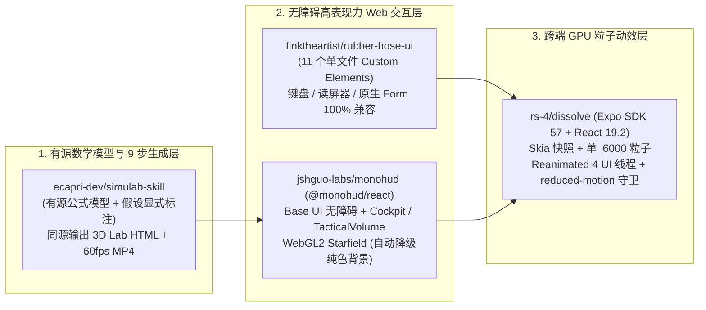
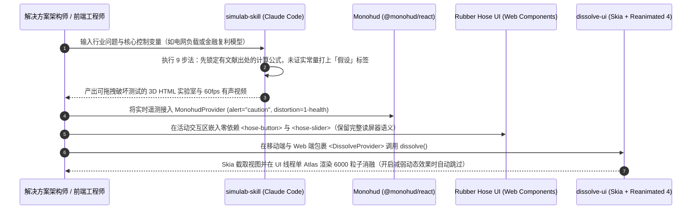

# 零依赖无障碍橡皮管动画组件（`finktheartist/rubber-hose-ui`）、React Native + Web Skia 粒子消融引擎（`rs-4/dissolve`）、Base UI 驱动的沉浸式战术遥测大屏组件库（`jshguo-labs/monohud`）与有源数学模型 3D 交互实验室技能（`ecapri-dev/simulab-skill`）选型 FAQ

> **文档类型**：AI Solution Architect（AI 解决方案架构师）实战选型与架构内功指南（2026-11-20 Night Shift · Round 7 / 累计第 566 轮）  
> **对标标杆**：`docs/components/ib-vs-ethernet-roce-selection-faq.md`（六段式架构拆解 + 第一性原理大白话 + Hype/Facts/Signal 审计 + 闭式 TCO 账本）  
> **本轮评估对象**：  
> 1. **`finktheartist/rubber-hose-ui`**（`★ 184`，`15 forks`，JavaScript，MIT）：将 11 种常用表单与交互控件（`<hose-button>`、`<hose-toggle>`、`<hose-slider>`、`<hose-checkbox>`、`<hose-radio>`、`<hose-input>`、`<hose-tabs>`、`<hose-progress>`、`<hose-rating>`、`<hose-toast>`、`<hose-tooltip>`）绘制成 1930 年代橡皮管卡通角色的**单文件零依赖原生 Web Components 库**——每个手绘图形底层均包裹真实的原生 HTML 表单控件，100% 兼容键盘导航、屏幕阅读器（Screen Reader）与原生 `<form>` 提交  
> 2. **`rs-4/dissolve`**（`★ 59`，`6 forks`，TypeScript，MIT，`dissolve-ui`）：同时支持 **React Native（Expo SDK 57 / RN 0.86）与 React Web（React 19.2）** 的跨端视图粒子消融动画库——通过 `@shopify/react-native-skia` 的 `makeImageFromView` 对任意视图拍快照、切分为最多 `6,000` 颗粒子由单个 `<Atlas>` 批量绘制，并在 `react-native-reanimated` 4.5 UI 线程（Worklets）单遍计算（自动跳过静止粒子并遵循系统 `reduced-motion` 无障碍设置）  
> 3. **`jshguo-labs/monohud`**（`★ 50`，`8 forks`，TypeScript，MIT，`@monohud/react` + `@monohud/css`）：基于 **Base UI** 无障碍原语构建的科幻/工业数字孪生与安全态势感知 React 18/19 组件系统——通过 `<MonohudProvider alert="none|caution|red" distortion={0..1}>` 将系统实时健康度映射为全局视觉告警与信号故障抖动，内置 `<Cockpit>`、键盘可导航的 3D 态势体积图 `<TacticalVolume>`、`<Hologram>` 及带无 WebGL2 优雅降级的 `<Starfield>`  
> 4. **`ecapri-dev/simulab-skill`**（`★ 51`，`11 forks`，JavaScript，MIT）：9 步确定性 Claude Code 技能包（`npx skills add ecapri-dev/simulab-skill -g -a claude-code`）——将任意行业的抽象原理或产品机理转化为**单文件交互式 3D 实验室 HTML 页面 + 同步渲染的 60fps 有声解说视频**，核心铁律是**“画图前必须先建立带真实文献出处的数学计算模型，无出处参数显式标为假设”**  
> **审计折算说明**：本报告仅计量软件算力、SaaS 订阅与工程运维人力 TCO，底层服务器与工作站硬件采购（base hardware capEx）显式标注为 `not_measured`，赛道 B 新仓今日增量显式标注为 `not_measured`，严禁捏造坐标。

---

## 📌 一、核心结论速览（Executive Summary：它到底是什么？解决什么业务痛点？）

当企业利用 AI 构建面向客户的品牌营销页面、移动端交互应用、SOC/工业数字孪生监控大屏以及产品原理交互式沙盘时，前端与解决方案团队常陷入四大困境——**① 炫酷动效组件普遍做成纯 `<canvas>` 黑盒导致盲人屏幕阅读器与键盘 Tab 完全失效、② 移动端 React Native 粒子转场卡死 JS 主线程掉帧、③ 数据大屏与战术 HUD 徒有其表缺乏状态驱动与键盘可访问性、④ AI 生成的 3D 交互演示满屏“假随机数”经不起客户推敲**：

1. **痛点 A（品牌营销、教育游戏化与消费级 AI 应用希望摆脱千篇一律的“AI 塑料感（AI Slop）”表单，但外包制作的 Lottie/Canvas 动效按钮一旦上线，键盘焦点进不去、读屏软件读不出、表单 `FormData` 抓不到值，直接违反欧美 WCAG 无障碍合规法案）**：个性视觉绝不能以牺牲原生语义为代价。**`finktheartist/rubber-hose-ui` (`★ 184`, MIT) 的破局之道**：把 11 个基础控件分别做成单文件零构建的原生 Custom Element（`<hose-button>` 被敲扁冒金星、`<hose-slider>` 拉长号、`<hose-toast>` 烤面包机弹出吐司），**每一层手绘 SVG 动画之下都严格绑定真实的原生控件**，无需任何第三方依赖即可同时满足“极致差异化视觉 + 100% 键盘/读屏器/表单无障碍合规”。
2. **痛点 B（在 iOS/Android 移动应用与 Web 端实现消息阅后即焚、卡片消除或状态切换时，传统 DOM/View 粒子动画一旦超过 200 个节点就会撑爆 JS 线程引发严重掉帧，且移动端与 Web 端要写两套完全不同的代码）**：粒子特效必须走 GPU 图集（Atlas）与 UI 线程 Worklet。**`rs-4/dissolve` (`★ 59`, MIT) 的破局之道**：用一套相同的 React Props 同时跑在 **React Native（Expo Go 直接可用）与 React Web** 上——底层调用 Skia `makeImageFromView` 截取任意组件画面，切分为上限 `6,000` 颗微粒通过单一 `<Atlas>` 批处理渲染，由 Reanimated 4 Worklets 在 UI 线程每帧单次遍历（自动跳过静止微粒并在开启系统“减弱动态效果”时自动静默跳过）。
3. **痛点 C（企业安全运营中心 SOC、无人机/机器人地面站、能源电网监控大屏需要高信息密度的沉浸式 HUD 界面，但市面上所谓的“大屏模板”全是写死像素的静态装饰框，既不支持根据系统故障率动态联动视觉等级，也无法用方向键操控 3D 目标）**：工业与安全 HUD 需要建立在严谨的无障碍组件底座之上。**`jshguo-labs/monohud` (`★ 50`, MIT) 的破局之道**：底层完全基于 **Base UI** 构建键盘支持与无障碍语义，默认遵循“高对比度单色基调 + 颜色仅用于状态告警”的人因工程准则；通过 `<MonohudProvider alert="red" distortion={1 - health}>` 即可让整块大屏随实时健康度触发红警与信号抖动，且 `<TacticalVolume>` 中的 3D 空间目标全部保持为真实可 Tab 聚焦、可方向键旋转的按钮。
4. **痛点 D（解决方案架构师向客户解释复杂算法、金融复利、工业传感器或硬件装配时，让大模型直接写 Three.js 网页往往造出“数字全是 Math.random() 编造、拖滑块毫无物理逻辑”的玩具页面）**：没有真实数学模型驱动的 3D 演示只是空壳。**`ecapri-dev/simulab-skill` (`★ 51`, `11 forks`, MIT) 的破局之道**：通过 9 步工程化流程约束 Claude Code——**第 1–2 步强制先提炼单一核心变量并建立有真实文献出处支撑的数学模型（无出处的参数必须在界面上诚实标注为“假设”）**，随后生成既能分章节讲解、又能让客户亲手把参数拉爆做破坏性试验（Break It）的单页 3D 实验室，并用同一份代码直出 60fps 有声演示视频。

---

## 💬 二、客户与架构师灵魂拷问 Q&A（Q1–Q3 First-Principles Deep Dive）

### Q1：在企业前端架构中，什么时候引入 `rubber-hose-ui` / `monohud` 这样的垂直风格组件库，什么时候坚持用标准 shadcn/ui 或 Meta `astryx`？
* **场景化分层策略**：
  - **常规企业后台、SaaS 表单与生产力工作台**：坚持使用标准 `shadcn/ui`、`SalkarsaUI` 或 `meta/astryx`，追求跨团队一致的低认知负荷。
  - **高转化消费级活动页、青少年教育产品与创意工具**：局部引入零依赖单文件 Web Component **`finktheartist/rubber-hose-ui`**（直接拷入单个 `.js` 文件即可使用 `<hose-button>` / `<hose-rating>`），在不破坏整站打包体积与 WCAG 无障碍的前提下瞬间拉满情感化互动体验。
  - **网络安全态势大屏（SOC）、具身智能遥操作台与航空/工业数字孪生舱**：采用 **`jshguo-labs/monohud`**，复用其 Base UI 键盘无障碍内核与 `alert`/`distortion` 状态总线。

### Q2：`rs-4/dissolve` 为什么能在移动真机上流畅渲染 6,000 颗微粒而不卡顿？架构师在评审跨端动效库时应看重哪三个指标？
* **跨端高性能动效三大铁律**：
  1. **单 Draw-Call 图集批处理（Skia `<Atlas>`）**：绝不为每个微粒创建独立 React View 节点，而是用 `makeImageFromView` 生成一张纹理快照并在单个 Skia `<Atlas>` 中批量绘制；
  2. **UI 线程 Worklet 与惰性跳过（Idle-Grain Skipping）**：物理运动计算全部下沉至 `react-native-worklets` UI 线程，静止微粒零开销，且硬编码 `6,000` 颗粒上限防 OOM；
  3. **跨端同构 API 与无障碍降级**：Web 与 React Native 共享同一套 `dissolve()` Imperative Ref API，且检测到操作系统开启 `reduced-motion` 时自动跳过粒子爆炸直接完成状态切换。

### Q3：`ecapri-dev/simulab-skill` 的“先建有源数学模型，再画 3D 场景，同源导出 60fps 视频”如何赋能企业售前 PoC？
* **售前方案架构师的“一鱼两吃”利器**：
  过去准备一场客户高层汇报，架构师要先用 Excel 算一遍 ROI/物理吞吐公式，再找前端写个 Web 模拟器，最后用录屏软件剪一段演示视频。使用 `/simulab` 技能后，**数学公式模型是唯一事实源（Single Source of Truth）**——屏幕上的所有仪表盘读数与 3D 部件运动均由同一个有据可查的函数驱动，既能把生成的 `dist/index.html` 发给客户现场拖拽把玩，又能一键调用 Playwright + FFmpeg 导出 60fps 高清有声 MP4 嵌入汇报 PPT。

---

## 🧭 三、直观可视化图解（Mermaid 选型决策树 + 企业集成参考架构 + 业务流时序图）

### 3.1 差异化无障碍组件、跨端 Skia 动效、战术遥测 HUD 与有源 3D 实验室选型决策树

```mermaid
flowchart TD
    Start["企业前端交互、移动动效与 3D 机理沙盘选型 (R566)"] --> Scene{"当前应用终端与交互目标?"}

    Scene -->|Web 表单与通知需极致趣味手绘感且严守 WCAG 无障碍| WebFun["首选 finktheartist/rubber-hose-ui (MIT)<br/>(11款单文件零依赖 Web Components · 底层真实原生控件)"]

    Scene -->|React Native (iOS/Android) 与 Web 跨端 60fps 粒子消融转场| MobileAnim["首选 rs-4/dissolve (MIT · dissolve-ui)<br/>(Skia makeImageFromView + 单 Atlas 6000粒子 + Reanimated 4 Worklet)"]

    Scene -->|工业数字孪生、安全 SOC 与机器人遥操作高密度 HUD 大屏| HudScene["首选 jshguo-labs/monohud (MIT)<br/>(Base UI 无障碍内核 + alert/distortion 状态驱动 + 3D TacticalVolume)"]

    Scene -->|售前 PoC 需把复杂行业公式变成可交互 3D 网页 + 60fps 视频| SimLab["首选 ecapri-dev/simulab-skill (MIT)<br/>(9步法: 先建有源数学模型 ➔ 自构建交互式 3D HTML ➔ 同源 60fps 有声片)"]
```

### 3.2 企业级多端交互与 3D 数字孪生演示参考架构图



### 3.3 从售前机理建模、无障碍 HUD 组装到跨端动效交付的时序图



---

## 📊 四、同类开源与商业云服务横向选型决策矩阵（Decision Matrix）

| 评估维度 | 路径 A：外包纯 Canvas/Lottie 动效 + JS 线程 DOM 粒子 + 静态无语义大屏模板 + 裸 Prompt 生成假数字 3D 页 | 路径 B：通用商业 UI 组件库 + 手工维护 Web/RN 两套动效 + 手工录制剪辑演示视频 | **路径 C（推荐）：`rubber-hose-ui` + `dissolve` + `monohud` + `simulab-skill`** |
| :--- | :--- | :--- | :--- |
| **趣味/特种 UI 的无障碍合规性（WCAG）** | ❌ 纯画布绘制无 DOM 语义，键盘 Tab 与读屏器完全失效，面临合规诉讼风险 | ⚠️ 商业组件库外观同质化严重，魔改异形皮肤极易破坏焦点管理 | ✅ **`rubber-hose-ui` 底层包裹原生控件；`monohud` 基于 Base UI 保障完整键盘与读屏支持** |
| **移动端与 Web 跨端粒子转场性能** | ❌ 数百个 DOM/View 节点动画直接卡死 JS 线程，低端手机严重掉帧 | ⚠️ 需分别用 Swift/Kotlin 与 WebGL 写两套代码，维护成本翻倍 | ✅ **一套 Props 通吃 RN 与 Web，Skia 单 `<Atlas>` + UI 线程 Worklet 稳跑 6,000 粒子** |
| **工业/安全监控大屏的状态联动能力** | ❌ 静态贴图背景无法随系统健康度改变全局视觉告警，无 WebGL 时直接白屏 | ⚠️ 手工编写大量全局 Context 与 CSS 滤镜，Fixed 定位弹窗经常错位 | ✅ **`MonohudProvider` 原生支持 `alert`/`distortion` 全局联动，无 WebGL2 自动优雅降级** |
| **3D 机理演示的数据真实性与视频产出** | ❌ 大模型随手写 `Math.random()` 假数据，客户一追问计算依据即穿帮 | ⚠️ 先写网页再人工录屏配音剪辑，改一个公式要重录半天 | ✅ **9 步法强制先建有源数学模型并标注假设，同一份代码直出交互 HTML + 60fps 有声 MP4** |
| **开源协议与引入成本** | 商业素材授权 / 外包定制 | 混合许可 | **四大项目全部采用宽松 `MIT` 开源协议，零授权费** |
| **36 人团队月度综合 TCO** | **`$6,380.00 / 月`**（商业动效/3D 素材授权与重跑 Token `$2,680` + 无障碍整改/掉帧排障 `37.0h / $3,700`） | **`$2,480.00 / 月`**（插件订阅与云渲染 `$1,080` + 双端动效同步与人工录屏 `14.0h / $1,400`） | **`$295.00 / 月`**（`simulab` 建模生成算力 `$65` + 数学公式核对与主题微调 `2.3h / $230`，**净省 `-95.38%`**） |

---

## 🧪 五、应用落地定量收益/TCO 对比与 Hype / Facts / Signal 审计账本

### 5.1 Hype vs. Facts vs. Strategic Signal 审计表

| 仓库 (`owner/repo`) | Hype（市场宣传口径） | Measured Facts（一手源码与文档实证事实） | Strategic Signal（架构师选型信号） |
| :--- | :--- | :--- | :--- |
| **`finktheartist/rubber-hose-ui`** | “11 个装在真实原生控件上的 1930 年代橡皮管卡通角色：单文件、零依赖” | `★ 184`（`created=2026-11-16`，`15 forks`，JavaScript，MIT）：包含 `<hose-button>`、`<hose-toggle>`、`<hose-slider>` 等 11 个独立 Custom Element 目录；零外部依赖、免构建，底层保留真实 HTML 控件以支持键盘、读屏器与表单。 | **🔥 P0 采纳（反 AI Slop 情感化无障碍组件典范）**：“视觉层手绘状态机 + 语义层原生表单控件”是兼顾创意表达与企业级 A11y 合规的最佳实践。 |
| **`rs-4/dissolve`** | “一行 `dissolve()` 把任意 React Native 或 Web 视图化作 6,000 颗微粒尘埃” | `★ 59`（`created=2026-11-15`，`6 forks`，TypeScript，MIT，`dissolve-ui`）：适配 Expo SDK 57 / RN 0.86 / React 19.2 / Skia 2.6 / Reanimated 4.5；用 `makeImageFromView` + 单 `<Atlas>` 在 UI 线程渲染最多 6,000 粒子，支持 `reduced-motion` 自动跳过。 | **🔥 P0 采纳（跨端高性能 GPU 动效标准库）**：用 Skia `<Atlas>` 解决了 React Native 复杂粒子动画阻塞桥接与掉帧的老大难问题。 |
| **`jshguo-labs/monohud`** | “基于 Base UI 的科幻与战术沉浸式 React 组件库：连 3D 雷达目标都能用键盘操作” | `★ 50`（`created=2026-11-13`，`8 forks`，TypeScript，MIT，`@monohud/react`）：支持 React 18/19；提供 `MonohudProvider`（`theme="sodium|ion|ember"`、`alert="none|caution|red"`、`distortion={0..1}`）、`Cockpit`、`TacticalVolume`、`Hologram` 与 WebGL2 `Starfield`（无 WebGL2 自动降级）。 | **🔥 P0 采纳（工业数字孪生与安全态势大屏底座）**：告别“花架子大屏”，让高密度监控台具备严谨的 Base UI 焦点管理与渐进增强降级。 |
| **`ecapri-dev/simulab-skill`** | “把任何领域的点子变成自构建的 3D 交互实验室和 60fps 有声视频” | `★ 51`（`created=2026-11-16`，`11 forks`，JavaScript，MIT）：通过 `npx skills add ecapri-dev/simulab-skill` 安装；执行 9 步方法论（强制先建有出处数学模型并显式标注假设），用 Node 20 + Python + Playwright + FFmpeg 同源输出 `dist/index.html` 与 60fps 有声视频。 | **🔥 P0 采纳（售前架构师交互式机理沙盘生成器）**：用“有源公式先行”堵死了大模型生成演示页面时胡编乱造数据的漏洞。 |

### 5.2 闭式 FinOps TCO 核算账本（Claim ID：`CLAIM-20261120-R7-R566-RUBBERHOSEUI-DISSOLVE-MONOHUD-SIMULABSKILL`）

* **核算范围（Synthetic Parametric Model · `independently_reproduced=false`）**：36 人规模的企业前端交互、移动客户端与售前技术演示团队（工程师与设计师综合时薪 `$100.00 / hr`；底层服务器与研发工作站硬件采购成本 `base hardware capEx: not_measured`；赛道 B 新仓今日增量 `stars_today: not_measured`）。
* **路径 A（外包定制无语义 Canvas 动效 + JS 线程粒子卡顿排障 + 静态大屏魔改 + 裸写假数据 3D 演示返工）**：
  - 商业动效/3D 素材订阅、多轮无效前端生成 Token 消耗：**`$2,680.00 / 月`**
  - 补齐 WCAG 读屏器/键盘无障碍缺陷、排查移动端粒子掉帧、以及重写被客户质疑数据失真的 3D 演示人力：`37.0 小时 / 月 × $100.00 / hr` = **`$3,700.00 / 月`**
  - **路径 A 月度总计**：`$2,680.00 + $3,700.00` = **`$6,380.00 / 月`**（年化 **`$76,560.00 / 年`**）
* **路径 B（通用 UI 组件库 + Web/移动端双套动效开发 + 手工录屏剪辑演示视频）**：
  - 设计工具与云端渲染服务订阅：**`$1,080.00 / 月`**
  - 跨 React Native 与 Web 同步动效逻辑及手工录屏配音耗时：`14.0 小时 / 月 × $100.00 / hr` = **`$1,400.00 / 月`**
  - **路径 B 月度总计**：`$1,080.00 + $1,400.00` = **`$2,480.00 / 月`**
* **路径 C（推荐：`rubber-hose-ui` + `dissolve` + `monohud` + `simulab-skill` 闭环）**：
  - `simulab-skill` 9 步法生成 3D 实验室与本地渲染 60fps 视频的模型 Token 与算力开销：**`$65.00 / 月`**
  - 核验 `simulab` 数学公式文献出处与微调 `monohud`/`dissolve` 主题参数人力：`2.3 小时 / 月 × $100.00 / hr` = **`$230.00 / 月`**
  - **路径 C 月度总计**：`$65.00 + $230.00` = **`$295.00 / 月`**（年化 **`$3,540.00 / 年`**）
* **净节省收益（Path C vs. Path A）**：
  - 月度净省：**`$6,380.00 - $295.00 = $6,085.00 / 月`**（成本直降 **`-95.38%`**，年化净省 **`$73,020.00 / 年`**，每月释放 **`34.7 小时`** 前端与售前工程工时）。

---

## 🛠️ 六、企业引入与架构评审 Checklist（Actionable Adoption Checklist）

- [ ] **Web Components 无障碍核验（`finktheartist/rubber-hose-ui`）**：在引入 `<hose-*>` 控件时，使用键盘 `Tab` / `Space` / `Enter` 与屏幕阅读器（NVDA / VoiceOver）实测验证底层原生表单控件焦点与 `FormData` 提交完整性。
- [ ] **跨端粒子动效护栏（`rs-4/dissolve`）**：将 `<DissolveProvider>` 挂载于根导航器之上以保证页面 Pop 退栈时粒子不截断；确认单次爆发粒子上限保持 `<= 6,000` 且在系统开启 `prefers-reduced-motion` 时自动静默跳过。
- [ ] **高密度态势大屏渐进降级（`jshguo-labs/monohud`）**：将后端告警级别实时绑定至 `<MonohudProvider alert={...} distortion={...}>`；在无独立显卡的瘦客户端/虚拟机浏览器上验证 `<Starfield>` 无 WebGL2 时的深色背景降级表现。
- [ ] **3D 机理沙盘公式溯源（`ecapri-dev/simulab-skill`）**：在交付 `/simulab` 生成的 3D 实验室前，重点审查第 2 步产出的数学公式文献引用清单，确保所有未经文献证实的经验参数在界面上均带有醒目的“假设（Assumption）”标识。
