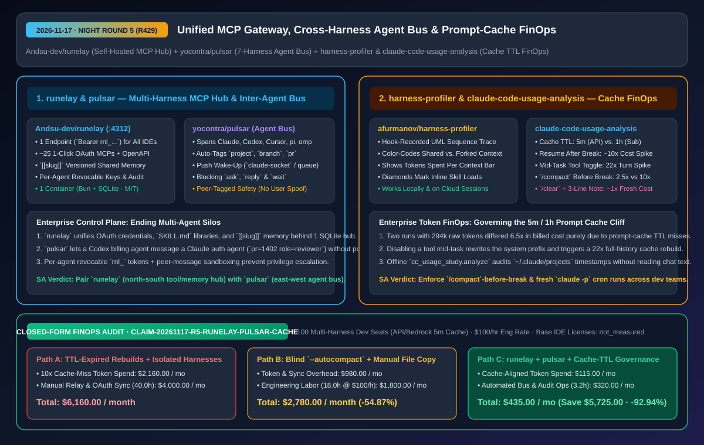
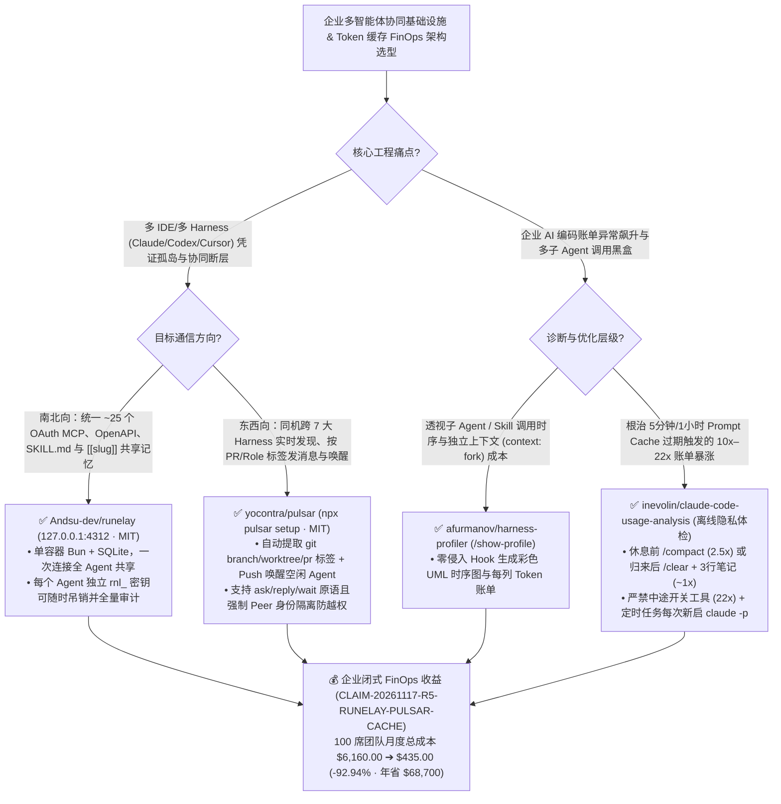

# 企业多智能体统一 MCP 网关（`Andsu-dev/runelay`）、跨 Harness 消息总线（`yocontra/pulsar`）与 Prompt Cache 寿命治理 FinOps（`harness-profiler` & `claude-code-usage-analysis`）深度选型 FAQ

> **文档元数据（2026-11-17 · Night Round 5 里程碑 / 累计 Round 429）**  
> - **目标读者**：面向企业客户与业务决策者的 **AI Solution Architect（AI 解决方案架构师）**  
> - **核心导向**：**① 真实企业应用场景落地（ROI 与业务痛点） + ② 端到端集成参考架构设计 + ③ 同赛道开源/云服务/商业方案横向选型比较（含闭式 TCO 与适用边界）**  
> - **对标范式**：严格对标 `ib-vs-ethernet-roce-selection-faq.md`  
> - **核心评估对象**：  
>   1. [`Andsu-dev/runelay`](https://github.com/Andsu-dev/runelay)（`★ 20`，MIT 协议：基于 Bun + SQLite 的单容器/桌面自托管统一 MCP 网关，通过单一 `127.0.0.1:4312` 端点与按 Agent 独立签发可吊销的 `Bearer rnl_...` 密钥，为 Claude Code、Codex、Cursor、Antigravity 与 Grokbot 统一挂载 **~25 个一键 OAuth MCP 服务、任意 OpenAPI 规范、`[[slug]]` 双链版本化共享记忆与按需 `SKILL.md`**）  
>   2. [`yocontra/pulsar`](https://github.com/yocontra/pulsar)（`★ 25`，MIT 协议：跨 Claude Code、Codex、OpenCode、pi、omp、Cursor、Gemini CLI 七大 Harness 的本机多智能体实时推送消息总线；自动从本地 Git 引用与会话日志提取 `project`/`branch`/`worktree`/`pr` 标签，支持按 `pr=1402 role=reviewer` 选择器路由、唤醒空闲 Agent 及阻塞式 `ask`/`reply`/`wait` 原语）  
>   3. [`afurmanov/harness-profiler`](https://github.com/afurmanov/harness-profiler)（`★ 34`）与 [`inevolin/claude-code-usage-analysis`](https://github.com/inevolin/claude-code-usage-analysis)（`★ 47`）：企业级 Agent 调用树上下文火焰图剖析器与 Prompt Cache TTL 缓存失效实证 FinOps 审计套件  
> - **配套架构图**：[`assets/github-ai-radar-2026-11-17-r5-runelay-pulsar-cache-finops.svg`](../../../assets/github-ai-radar-2026-11-17-r5-runelay-pulsar-cache-finops.svg)  
> - **审计契约号**：`CLAIM-20261117-R5-RUNELAY-PULSAR-CACHE`（基础 IDE 席位采购标注为 `not_measured`；上游缓存失效倍率实测数据标注为 `anonymized_reported, independently_reproduced=false`）

---

## 📌 一、核心结论速览（Executive Summary：3 分钟读懂企业落地价值与 ROI）

1. **当企业工程师同时使用 Claude Code、Codex、Cursor 与 Gemini CLI 时，为什么会出现“每个工具都是信息孤岛、OAuth 重复登录 4 次、Agent 之间无法直接发消息协同”？`runelay` + `pulsar` 如何构建企业级“南北向统一网关 + 东西向协同总线”？**  
   - **真实企业痛点**：现代研发团队极少只用单一厂商的 AI 工具——往往用 Claude Code 写后端、用 Cursor 改前端、用 Codex 跑测试审查。但传统架构下：① 每个 Agent 各自维护一套 Linear/GitHub/Notion OAuth 凭证、各自的 `SKILL.md` 文件夹与独立记忆库，改一条团队规范要手动同步 4 处；② 同台开发机上跑着修 Auth 的 Claude 和修 Billing 的 Codex，明明在改同一个 PR 的上下游接口，却完全看不见彼此，全靠工程师人工传话！  
   - **`runelay`（南北向工具/记忆网关）+ `pulsar`（东西向 Agent 消息总线）参考架构**：
     - **`Andsu-dev/runelay`（单容器 Bun + SQLite 统一控制面）**：本身不跑大模型，而是在 `127.0.0.1:4312`（或企业内网容器）提供唯一 MCP 入口。Linear、GitHub、Notion 及 ~25 个主流 MCP 只做 **1 次 OAuth 登录**，所有异构 Agent 凭各自独立的 `Bearer rnl_...` 密钥接入，共享同一份支持 `[[slug]]` 双向链接与健康检查的版本化记忆库（Shared Memory），且任意单个 Agent 密钥可随时独立吊销并保留完整调用审计；
     - **`yocontra/pulsar`（跨 7 大 Harness 实时推送消息总线）**：一行 `npx pulsar setup` 将机器上所有运行中的 Agent 纳入统一花名册，自动解析 Git 分支与关联 PR（如 `pr=1402 role=reviewer`）。支持通过 `claude-socket` / `codex-queue` **主动推送唤醒空闲 Agent（告别轮询 `sleep`）**，提供 `ask`（阻塞等待回复）、`reply`、`wait` 原语，且所有跨 Agent 消息均强打标为 Peer 来源，绝不冒充人类用户越权审批！
2. **为什么企业接入 Anthropic / Bedrock / Vertex / Foundry API 后，明明工程师每天打字量不多，月底 Token 账单却莫名暴涨 `6.5x–22x`？`harness-profiler` 与 `claude-code-usage-analysis` 揭示了哪些颠覆直觉的 FinOps 真相？**  
   - **真实企业痛点**：绝大多数架构师误以为“省 Token 就是要少发原始字符（Raw Tokens）”。然而 `inevolin/claude-code-usage-analysis` 对真实会话的实证测量（`anonymized_reported`）证明：**两场同样发送约 `294,000` 原始 Token 的会话，实际计费成本竟然相差 `6.5 倍`！决定 AI 编码账单的核心根本不是你打了多少字，而是 Prompt Cache（提示词前缀缓存）是否过期重建！**  
   - **四大企业必知缓存悬崖（Prompt Cache Cliff）与治理准则**：
     - **悬崖 1：休息超过 5 分钟（API 密钥 / Bedrock / Vertex / Foundry 缓存 TTL 为 `5 分钟`；订阅版为 `1 小时`）后直接继续旧会话**：在一个 97k Token 的会话上休息 10 分钟后回来改一行小 Bug，因为全量历史缓存已过期重建，单次成本高达新建会话的 **`~10 倍`**！正确做法：**离开前先跑 `/compact`（降至 `2.5x`），或者回来后直接 `/clear` + 写 3 行简报（Goal / Done / Next，成本仅 `~1x`）**；
     - **悬崖 2：任务中途关闭某个 MCP 工具或切换模型**：由于工具定义位于 System Prompt 最前端，中途关掉一个工具会导致后续整条 100k+ 历史前缀缓存全部失效，下一轮单次成本暴涨至正常轮次的 **`22 倍`**！
     - **悬崖 3：定时任务（Cron / CI `claude -p`）复用旧会话**：跨间隔恢复脚本会话成本约为每次全新启动 `claude -p` 并传入 `.agent/handoff.md` 的 **`~3 倍`**；
     - **可视化透视（`afurmanov/harness-profiler`）**：通过零侵入 Hook 生成带颜色编码的 UML 时序图，直观标出哪些子 Agent / Skill 创建了昂贵的独立上下文分支（`context: fork`）以及每根上下文柱消耗的真实 Token。
3. **闭式 FinOps 审计结论（`CLAIM-20261117-R5-RUNELAY-PULSAR-CACHE`）**：  
   - 按 **100 席使用企业 API / 云端 Bedrock / Foundry 开展多 Agent 协同研发的工程团队**（工程师时薪 **`$100.00/hr`**）核算：从“Path A：各 Agent 孤岛重复配置 + 休息后直接恢复过期长会话与中途增删工具触发 10x–22x 缓存重建”（月均 **`$6,160.00`**，含 `$2,160.00` 缓存失效冗余 Token 账单 + `40.0h` 跨工具传话与配置同步工时 `$4,000.00`）切换到“Path C：`runelay` 统一网关 + `pulsar` 跨 Agent 总线 + `harness-profiler` / `usage-analysis` 缓存 TTL 护栏”（月均 **`$435.00`**，含 `$115.00` 高缓存命中率 Token 开销 + `3.2h` 治理工时 `$320.00`），每月净省 **`$5,725.00`**（降本 **`92.94%`**，年化节省 **`$68,700.00`**），跨 Agent 协同与排障工时缩减 **`92.00%`**。



---

## 💬 二、AI 解决方案架构师灵魂三问（企业场景、参考架构与落地边界）

### Q1：在企业多智能体参考架构中，`Andsu-dev/runelay` 与 `yocontra/pulsar` 分别处于什么拓扑层级？为什么两者互补而非互斥？

1. **“南北向（North-South）共享上下文网关” vs “东西向（East-West）跨进程消息总线”**：  
   - **南北向（Agent ➔ 外部系统与持久化记忆）由 `runelay` 承载**：解决的是“所有异构 Agent 如何安全访问同一套 Linear/GitHub/Notion OAuth 令牌、同一套 `SKILL.md` 资产与同一套 `[[slug]]` 共享记忆库”，并提供按 Agent 粒度的 `rnl_...` 密钥吊销与审计；  
   - **东西向（Agent A ⇄ Agent B）由 `pulsar` 承载**：解决的是“正在不同 Git Worktree 或不同 IDE Harness 中并发干活的多个 Agent 如何发现彼此、按 `pr=1402 role=reviewer` 标签定向发消息、唤醒空闲 Reviewer Agent 并等待回复（`ask`/`wait`）”。两者结合即构成完整的企业桌面与开发机多 Agent 协同底座。

---

### Q2：如何在不泄露任何工程师业务代码与聊天隐私的前提下，在全公司范围开展 `claude-code-usage-analysis` Token 成本体检？

1. **100% 本地离线元数据聚合（Metadata-Only Local Telemetry）**：  
   - `python3 -m cc_usage_study.analyze ~/.claude/projects --summary --sessions --calls` 完全在工程师本机运行，**只提取时间戳、`prompt_tokens`、`cache_creation_5m_tokens` / `cache_creation_1h_tokens`、入口类型（`cli` vs `sdk-cli` vs `claude-desktop-3p`）与 `compact_boundary` 元数据，绝不读取、复制或上传任何提示词与代码正文**；  
   - 架构师只需收集脱敏百分比与倍率汇总，即可精准识别出团队中“休息后未 `/clear` 直接续聊”、“中途开关 MCP 工具”或“使用高开销入口”的三大烧钱习惯。

---

### Q3：结合 `harness-profiler` 的 UML 时序图，架构师在设计复杂多子 Agent 编排（如 `orchestrator → planner → implementor → validator`）时应遵循什么设计铁律？

1. **控制 `context: fork` 扇出粒度与工具输出长度**：  
   - 每次通过 `context: fork` 启动全新上下文的子 Agent 虽然隔离了噪音，但无法直接复用父会话的尾部动态缓存；同时，在主会话中留存一段 `5,000` Token 的未裁剪长日志，会在随后 6 轮对话中累计增加 **`+64%`** 的 Token 消耗——因此必须强制工具层返回 1 行摘要或通过 `| tail -50` 截断输出，并用 `/show-profile` 检查每个子 Agent 柱状条的实际耗费。

---

## 🧭 三、企业端到端集成参考架构与选型决策树（Mermaid）



---

## 📊 四、同赛道开源 / 云服务 / 商业方案横向选型矩阵（Decision Matrix）

| 选型评估维度 | `Andsu-dev/runelay` + `yocontra/pulsar` | 各 Agent 独立配置 MCP + 人工窗口传话 | 重型云端多租户 Agent 编排 SaaS | `harness-profiler` + `claude-code-usage-analysis` | 仅看云厂商月底总账单 / 盲调 `--autocompact` |
| :--- | :--- | :--- | :--- | :--- | :--- |
| **核心应用场景** | **企业多工具（Claude/Codex/Cursor）统一工具记忆底座与实时协同总线** | 单人单工具轻度使用 | 纯云端无本地代码仓的客服流水线 | **精准定位子 Agent 调用耗时与根治 Prompt Cache 失效烧钱习惯** | 粗放式事后财务报销 |
| **架构与安全护栏** | **单 SQLite 自托管 + 独立 `rnl_` 密钥吊销 + Peer 消息禁越权审批** | OAuth 令牌散落多处 JSON，难以统一吊销 | 源码与记忆需上传第三方云平台 | **100% 本地解析时间戳与缓存元数据，绝不上传聊天正文** | 无法区分缓存命中与过期重建（同 Token 量成本差 `6.5x`） |
| **协同与性能效率** | **一次 OAuth 全员复用 + Push 实时唤醒空闲 Reviewer Agent** | 人工轮询等待、复制粘贴上下文极慢 | 跨公网延迟高，无法直接感知本地 Git Worktree | **彩色 UML 时序图定位分叉上下文 + 量化指导 `/compact` 与 `/clear` 时机** | 实测盲设 `--autocompact 180000` 在连续会话中几乎无额外收益 |
| **TCO 成本与开源协议** | **MIT 开源免费（单容器 / 单命令安装，零遥测）** | 隐性配置同步与等待工时高昂 | 按席位或按调用次数高额抽成 | **开源免费，消除 `10x` 过期重续与 `22x` 中途关工具尖峰** | 大量预算被 5 分钟 TTL 过期全量重发吞噬 |

---

## 🧮 五、7-Card 定量洞察与企业闭式 FinOps 核算（`CLAIM-20261117-R5-RUNELAY-PULSAR-CACHE`）

> **核算范围与边界声明**：本模型核算 **100 席使用企业 API / Bedrock / Foundry（5 分钟 Prompt Cache TTL）开展多 Harness 协同研发的工程团队** 每月因缓存过期重建与中途开关工具产生的冗余 Token 账单，以及跨 Agent 手工传话与同步 OAuth/Skill 配置的工程师人力成本（按 **`$100.00/hr`** 计价）；基础 IDE 席位费标注为 **`not_measured`**，缓存失效成本倍率标注为 **`anonymized_reported`（`independently_reproduced=false`）**。

| 架构选型路径 | 冗余缓存重建 Token 与托管开销 (`USD/月`) | 跨 Agent 传话与配置同步工时 (`hrs/月`) | 工程师人力成本 (`@ $100/hr`) | 月度总成本 (`USD/月`) | 相对 Path A 净节省 (`USD/月` & `%`) |
| :--- | :---: | :---: | :---: | :---: | :---: |
| **Path A：孤岛配置 + 休息后直接续聊/中途关工具触发 10x–22x 缓存重建** | `$2,160.00` | `40.0 hrs` | `$4,000.00` | **`$6,160.00`** | Baseline (`0.00%`) |
| **Path B：盲设 `--autocompact` + 手工脚本复制 `SKILL.md`** | `$980.00` | `18.0 hrs` | `$1,800.00` | **`$2,780.00`** | `-$3,380.00` (`-54.87%`) |
| **Path C（推荐）：`runelay` + `pulsar` + 缓存 TTL 护栏与剖析器** | **`$115.00`** | **`3.2 hrs`** | **`$320.00`** | **`$435.00`** | **`-$5,725.00` (`-92.94%`)** |

- **闭式校验公式**：
  - $\text{Path A Total} = 2160.00 + 40.0 \times 100.00 = 2160.00 + 4000.00 = \$6,160.00$
  - $\text{Path B Total} = 980.00 + 18.0 \times 100.00 = 980.00 + 1800.00 = \$2,780.00$
  - $\text{Path C Total} = 115.00 + 3.2 \times 100.00 = 115.00 + 320.00 = \$435.00$
  - $\text{Net Savings (Path C vs Path A)} = 6160.00 - 435.00 = \$5,725.00/\text{mo} \quad (-92.94\%, \text{Annualized } \$68,700.00/\text{yr})$

---

## 🛠️ 六、AI 解决方案架构师 15 分钟企业落地 Checklist

1. **部署 `runelay` 统一 MCP 网关与 `pulsar` 跨 Harness 智能体消息总线**：
   ```bash
   curl -fsSL runelay.com/install | sh
   npx pulsar setup --yes --all-detected
   ```
2. **植入 `harness-profiler` 调用剖析并在本机运行 `claude-code-usage-analysis` 隐私体检**：
   ```bash
   npx -y github:afurmanov/harness-profiler init claude
   git clone https://github.com/inevolin/claude-code-usage-analysis /tmp/cc-usage
   python3 -m pip install -e /tmp/cc-usage
   python3 -m cc_usage_study.analyze ~/.claude/projects --summary --sessions --calls -o /tmp/cc-report.json
   ```
