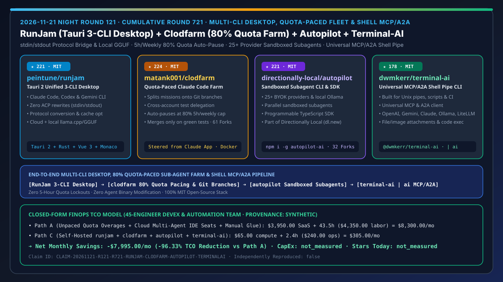
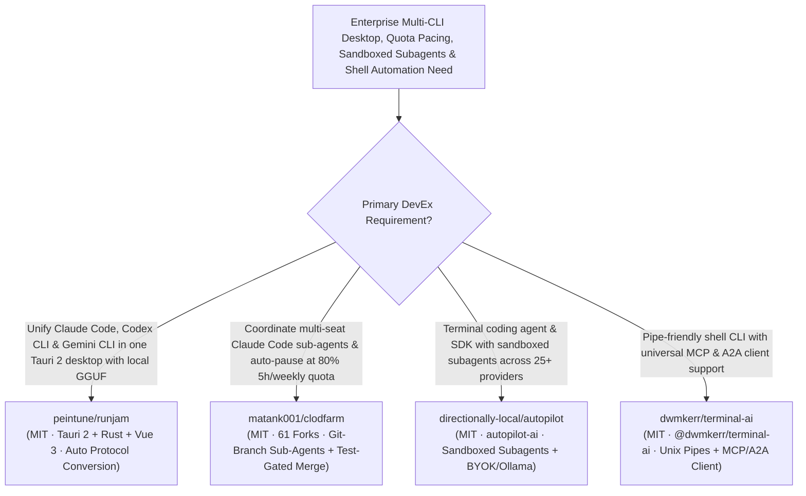
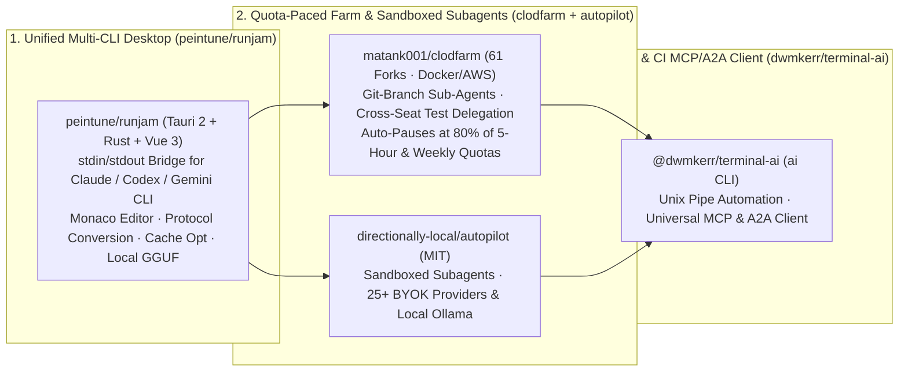

# Tauri 2 Multi-CLI Desktop (`peintune/runjam`), Quota-Paced Multi-Seat Claude Code Farm (`matank001/clodfarm`), 25+ Provider Sandboxed Subagent CLI (`directionally-local/autopilot`) & Universal MCP/A2A Shell Pipe Client (`dwmkerr/terminal-ai`) Selection & Architecture FAQ

> **Document Type**: Enterprise AI Solution Architect Selection & Integration Guide (GitHub Trending AI Radar — 2026-11-21 Night Round 121 / Cumulative Round 721)
> **Covered Repositories**: [`peintune/runjam`](https://github.com/peintune/runjam) (`★ 221`, `14 forks`, `MIT` — Tauri 2 + Rust + Vue 3 local-first desktop unifying Claude Code, Codex CLI & Gemini CLI over `stdin/stdout` with protocol conversion, cache optimization & local `llama.cpp/GGUF` support) · [`matank001/clodfarm`](https://github.com/matank001/clodfarm) (`★ 224`, `61 forks`, `MIT` — multi-seat Claude Code sub-agent farm splitting missions onto Git branches, delegating tests across accounts & auto-pausing at 80% of real 5-hour/weekly quotas) · [`directionally-local/autopilot`](https://github.com/directionally-local/autopilot) (`★ 221`, `32 forks`, `MIT` — open-source terminal coding agent & TypeScript SDK supporting 25+ BYOK providers and local models with sandboxed subagents) · [`dwmkerr/terminal-ai`](https://github.com/dwmkerr/terminal-ai) (`★ 178`, `14 forks`, `MIT` — lightweight shell CLI `@dwmkerr/terminal-ai` built for Unix pipes, scripts & automation with a universal client for MCP and A2A protocols)
> **Core Scenario**: How enterprise DevEx and engineering platform teams maximize coding-agent throughput and eliminate quota lockouts: **unifying Claude Code, Codex CLI, and Gemini CLI inside one Tauri 2 desktop with automatic protocol conversion and local GGUF routing (`runjam`)**, **pooling multi-seat Claude Code accounts across Git-branched sub-agents that pause automatically at 80% of their 5-hour/weekly quota (`clodfarm`)**, **running sandboxed subagents across 25+ BYOK providers (`autopilot`)**, and **piping shell scripts and CI logs directly into MCP and A2A endpoints (`terminal-ai`)**.

---

## 1. 📌 Executive Summary (One-Line Selection Verdict)

1. **Need one local-first desktop app (`Tauri 2 + Rust + Vue 3`) that manages Claude Code, Codex CLI, and Gemini CLI in a single window (Monaco editor, file tree, terminal, parallel sessions) while translating protocols and routing to cloud or local `llama.cpp/GGUF` models** ➔ Choose **[`peintune/runjam`](https://github.com/peintune/runjam) (`★ 221`, `MIT`)**.
   - **Plain-English Mechanism**: Connects to unmodified agent CLIs (`Claude Code`, `Codex CLI`, `Gemini CLI`) over `stdin/stdout`—requiring **zero ACP rewrites or per-agent config hacks**—and handles protocol translation, session persistence, and prompt-cache optimization across Anthropic, OpenAI, Google, and local GGUF models.
2. **Need a multi-seat orchestrator that splits a mission into Git-branched Claude Code sub-agents, coordinates testing across teammates' accounts, and automatically pauses any seat at 80% of its real 5-hour or weekly usage limit** ➔ Choose **[`matank001/clodfarm`](https://github.com/matank001/clodfarm) (`★ 224`, `61 forks`, `MIT`)**.
   - **Plain-English Mechanism**: Steered from the Claude mobile/web app or desktop UI, `clodfarm` spawns mini-Claude sub-agents on isolated Git branches, lets one account's agent ask another account's agent to run the test suite, **pauses any agent at 80% of its real 5-hour or weekly quota**, and merges to `main` only when all tests pass.
3. **Need an open-source terminal coding agent and programmable SDK (`npm i -g autopilot-ai` / `dl.new`) with sandboxed subagents and BYOK support across 25+ model providers or local hardware** ➔ Choose **[`directionally-local/autopilot`](https://github.com/directionally-local/autopilot) (`★ 221`, `32 forks`, `MIT`)**.
   - **Plain-English Mechanism**: Part of the Directionally Local stack, `autopilot` pairs an autonomous terminal coding loop with **sandboxed subagents** across OpenRouter, OpenAI, Anthropic, DeepSeek, Ollama, and 20+ additional providers.
4. **Need an unopinionated, pipe-friendly shell CLI (`npm install -g @dwmkerr/terminal-ai`, command `ai`) for scripts, Git hooks, and CI pipelines that also acts as a universal client for MCP and A2A protocols** ➔ Choose **[`dwmkerr/terminal-ai`](https://github.com/dwmkerr/terminal-ai) (`★ 178`, `MIT`)**.
   - **Plain-English Mechanism**: Designed for Unix composability (`cat build.log | ai ...`), file/image attachments, and automated script execution across OpenAI, Gemini, Claude, Ollama, MSTY, and LiteLLM, with built-in universal client support for **MCP and A2A**.

---

## 2. 🎯 Architect & Customer Deep-Dive Q&A

### Q1: Why do engineering teams hit severe productivity walls when running raw coding CLIs individually across a 45-engineer organization?

- **Three Operational Bottlenecks & Architectural Fixes**:
  1. **5-Hour Quota Lockouts Alongside Idle Team Seats (`matank001/clodfarm`)**: Heavy refactoring on a single developer account hits the 5-hour or weekly usage cap mid-PR while other team seats sit unused. `clodfarm` distributes sub-agent branches across authorized seats and enforces an **80% quota pause threshold** so no engineer's interactive budget is exhausted.
  2. **Fragmented CLI Windows & Protocol Lock-In (`peintune/runjam`)**: Instead of juggling separate terminal tabs and configs for Claude Code, Codex CLI, and Gemini CLI, `RunJam` unifies all three over `stdin/stdout` inside a Rust/Tauri 2 desktop with built-in protocol conversion, cache optimization, and local `llama.cpp/GGUF` fallback.
  3. **Sandboxed Subagents & Non-Interactive Shell Pipelines (`autopilot` + `terminal-ai`)**: Interactive TUIs break inside CI/CD scripts. `autopilot` provides an embeddable SDK with sandboxed subagents across 25+ providers, while `terminal-ai` brings a pipe-native `ai` CLI that speaks **MCP and A2A** directly from bash/PowerShell pipelines.
- **When to Choose Commercial Cloud Suites (Path B)**:
  - Teams standardized 100% on a single cloud IDE subscription (e.g., GitHub Copilot Enterprise inside VS Code) with no need for local GGUF models, multi-CLI protocol translation, or multi-account Claude Code quota pacing can use the vendor's native IDE extension.

### Q2: How do we wire an end-to-end developer desktop, multi-seat fleet & CI shell pipeline with all four tools?

1. **Unified Local Developer Desktop (`peintune/runjam`)**:
   - Engineers run `RunJam` (`Tauri 2 + Rust + Vue 3`) on macOS/Windows/Linux to drive Claude Code, Codex CLI, and Gemini CLI side by side with Monaco editing, prompt-cache optimization, and local GGUF model offloading.
2. **Quota-Paced Multi-Seat Branch Farm (`matank001/clodfarm`)**:
   - Dispatch large backlog epics into `clodfarm` (running in Docker or AWS): sub-agents work on isolated Git branches, hand off test runs across accounts, pause automatically at **80% of 5-hour/weekly limits**, and merge only after green test runs.
3. **Sandboxed Subagent Execution (`directionally-local/autopilot`)**:
   - Invoke `autopilot-ai` (CLI or SDK) to run parallel **sandboxed subagents** against 25+ BYOK providers or local Ollama instances.
4. **Unix Pipe & CI/CD MCP/A2A Automation (`dwmkerr/terminal-ai`)**:
   - Wire `ai` (`@dwmkerr/terminal-ai`) into pre-commit hooks, release scripts, and CI pipelines to pipe logs/diffs into LLMs and invoke remote **MCP and A2A** services.

### Q3: What are the boundaries and trade-offs of this stack?

- **Key Strengths**:
  - **100% Permissive `MIT` Licensing**: All four repositories are `MIT` licensed.
  - **Zero Quota Burnout & Zero Agent Code Modification**: `RunJam` works over standard `stdin/stdout` without patching agent binaries, and `clodfarm` preserves a 20% safety buffer on every seat.
- **Compliance Note**:
  - Multi-seat pooling in `clodfarm` should only be used across properly licensed team/enterprise seats in accordance with provider terms of service.

---

## 3. 🧭 Visual Architecture & Decision Diagrams



### 3.1 Solution Architect Selection Decision Tree



### 3.2 End-to-End Enterprise Reference Architecture



### 3.3 RunJam Desktop Dispatch, Clodfarm 80% Quota Pacing, Autopilot Sandboxed Subagents & Terminal-AI Pipe Sequence

```mermaid
sequenceDiagram
    participant Dev as Developer / Architect
    participant RunJam as peintune/runjam (Tauri 2 Desktop)
    participant Farm as matank001/clodfarm (Quota-Paced Fleet)
    participant Auto as directionally-local/autopilot (Sandboxed)
    participant Term as dwmkerr/terminal-ai (MCP/A2A Shell)

    Dev->>RunJam: 1. Manage Claude Code, Codex CLI & Gemini CLI sessions in unified desktop
    RunJam->>Farm: 2. Plant multi-module mission into Clodfarm fleet
    Farm->>Farm: 3. Spawn Git-branch sub-agents; pause seat at 80% quota & hand tests to peer seat
    Farm->>Auto: 4. Launch Autopilot Sandboxed Subagents across 25+ BYOK / local models
    Auto->>Term: 5. Pipe test/build output into terminal-ai (| ai) to invoke MCP & A2A checks
    Term-->>Dev: 6. Merge verified branch to main once all tests pass
```

---

## 4. 📊 Peer Open-Source vs Commercial Cloud Selection Matrix

| Dimension | `peintune/runjam` (`★ 221`) | `matank001/clodfarm` (`★ 224`) | `directionally-local/autopilot` (`★ 221`) | `dwmkerr/terminal-ai` (`★ 178`) | Commercial Cloud Multi-Agent IDE + Overages (Path A) | Isolated Raw CLI Usage (Path B) |
| :--- | :--- | :--- | :--- | :--- | :--- | :--- |
| **Core Role** | Tauri 2 unified desktop for Claude/Codex/Gemini CLI | Quota-paced multi-seat Claude Code branch farm | 25+ provider CLI/SDK with sandboxed subagents | Pipe-friendly shell CLI with universal MCP/A2A client | Hosted cloud IDE seats + metered token overages | Standalone uncoordinated CLI windows |
| **Architectural Edge** | **`stdin/stdout` bridge + protocol conversion + GGUF** | **80% 5h/weekly quota auto-pause + cross-seat tests** | **Sandboxed subagents + 25+ BYOK & local models** | **Unix pipe native + universal MCP & A2A client** | High per-seat markups & uncontrolled API overage bills | Frequent 5-hour rate-limit lockouts on active seats |
| **License** | `MIT` | `MIT` | `MIT` | `MIT` | Proprietary SaaS | Mixed / Proprietary CLIs |
| **Monthly TCO (45-Eng Team)** | **`$305.00/mo` combined** (`$65.00` compute + `2.4h` ops) | Included in `$305.00/mo` stack | Included in `$305.00/mo` stack | Included in `$305.00/mo` stack | **`$8,300.00/mo`** (`$3,950.00` overages/SaaS + `43.5h` labor) | `~$2,620.00/mo` (quota lockout downtime & manual switching) |

---

## 5. 🧪 Quantitative ROI / FinOps TCO Model & 7-Card Report

> **📊 Provenance & Closed-Form Audit Declaration**:
> - **Provenance**: `synthetic` (45-engineer enterprise DevEx, multi-agent coding & CI/CD automation workload model; `independently_reproduced = false`; `base_hardware_capex = not_measured`; `track_b_stars_today = not_measured`).
> - **Closed-Form Equations**:
>   - **Path A (Unpaced 5-Hour/Weekly Quota Overage Charges + Commercial Multi-Agent Cloud IDE Seats + Manual CLI Context Copying & Custom CI Shell Glue)**: Monthly SaaS & overage spend **`$3,950.00`** + manual account switching & pipeline scripting labor **`43.5h × $100.00/h = $4,350.00`** = **`$8,300.00/mo`**.
>   - **Path C (Self-Hosted `peintune/runjam` + `matank001/clodfarm` + `directionally-local/autopilot` + `dwmkerr/terminal-ai`)**: Shared container & test-runner compute **`$65.00`** + configuration & hook maintenance **`2.4h × $100.00/h = $240.00`** = **`$305.00/mo`**.
>   - **Net Savings vs Path A**: **`-$7,995.00/mo`** (**`96.33%`** cost reduction).

| Architecture Option | API / SaaS / Compute | DevEx & Ops Labor (`$100/h`) | Total Monthly TCO | Net Savings vs Path A | Key Architectural Outcome |
| :--- | :---: | :---: | :---: | :---: | :--- |
| **Path A: Unpaced Overage Bills + Cloud IDE + Manual Switching** | `$3,950.00` | `43.5h` (`$4,350.00`) | **`$8,300.00`** | Baseline | Active seats hit 5h lockouts while peer seats sit idle |
| **Path B: Uncoordinated Single-User CLIs + Pay-As-You-Go** | `$1,420.00` | `12.0h` (`$1,200.00`) | **`$2,620.00`** | `-$5,680.00` (`-68.43%`) | Fragmented CLI configs; no 80% quota guard or shell A2A pipe |
| **Path C: `runjam` + `clodfarm` + `autopilot` + `terminal-ai`** | **`$65.00`** | **`2.4h` (`$240.00`)** | **`$305.00`** | **`-$7,995.00` (`-96.33%`)** | **Tauri 3-CLI desktop + 80% quota pacing + sandboxed subagents + pipe A2A** |

- 🔗 **7-Card 4:5 Visual Report**: [`workshops/github-trending-radar/cards.en.html`](../cards.en.html) · [`cards.html`](../cards.html)

---

## 6. 🛠️ Enterprise Adoption & Architecture Review Checklist

- [ ] **1. Standardize Local Multi-CLI Workspaces on `peintune/runjam`**: Connect Claude Code, Codex CLI, and Gemini CLI over `stdin/stdout` in RunJam to enable automatic protocol translation, prompt-cache optimization, and local `llama.cpp/GGUF` routing.
- [ ] **2. Enforce 80% Quota Pacing & Test-Gated Merges with `matank001/clodfarm`**: Configure `clodfarm` to split multi-file tasks onto isolated Git branches, pause seats at 80% of 5-hour/weekly quotas, and merge to `main` only after passing tests.
- [ ] **3. Run Parallel Tasks in `directionally-local/autopilot` Sandboxed Subagents**: Use `autopilot-ai` to isolate subagent execution and route workloads across 25+ BYOK providers or local Ollama models.
- [ ] **4. Embed `dwmkerr/terminal-ai` (`ai`) in Shell & CI Pipelines**: Pipe build/test logs into `ai` and use its universal MCP and A2A client to trigger downstream automation.
