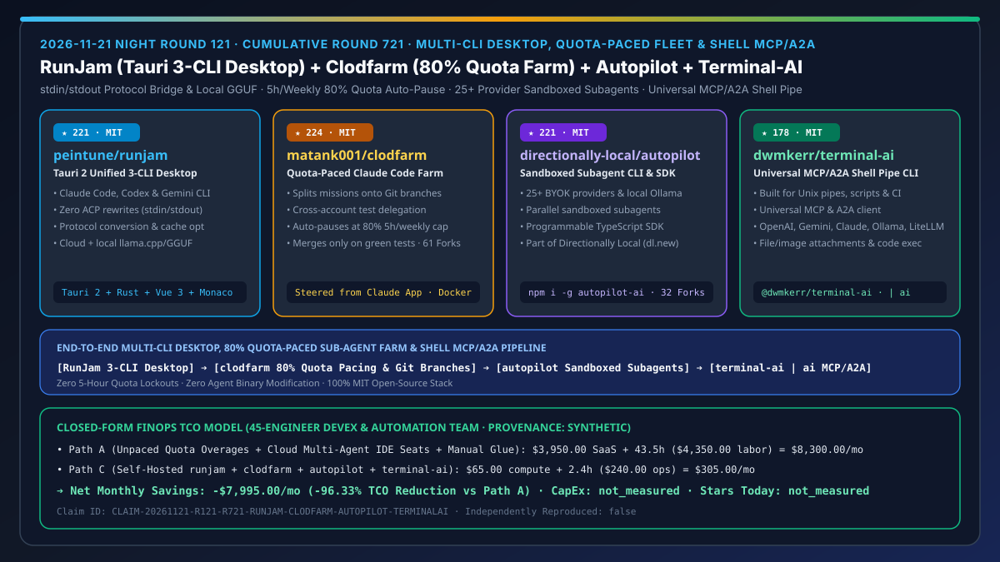
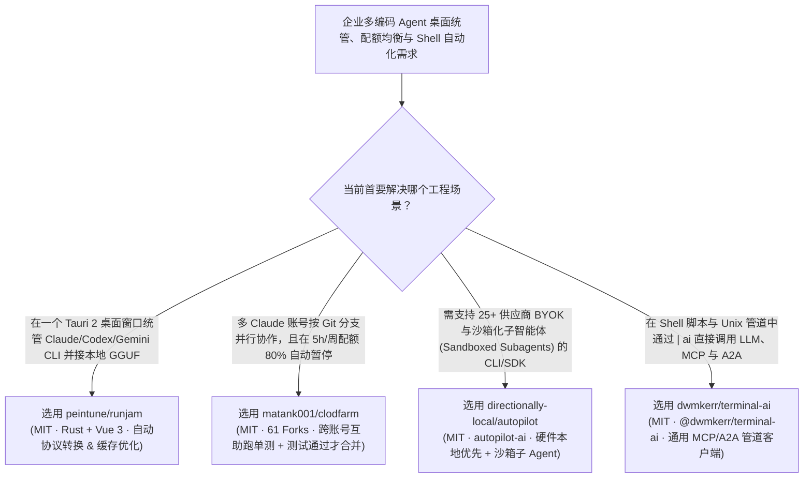
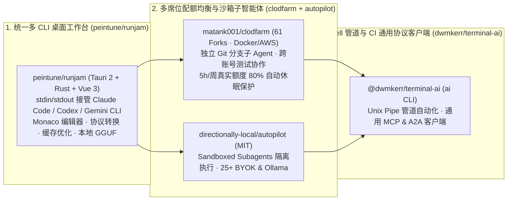
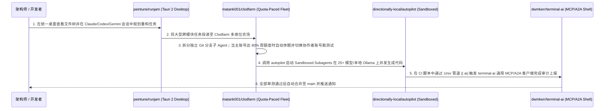

# Tauri 2 三大编码器统一桌面台（`peintune/runjam`）、按 5 小时/周配额自动控速的多账号 Claude 农场（`matank001/clodfarm`）、25+ 模型沙箱子智能体终端（`directionally-local/autopilot`）与 Shell 管道通用 MCP/A2A 客户端（`dwmkerr/terminal-ai`）选型与集成架构 FAQ

> **文档类型**：企业 AI 解决方案架构师（AI Solution Architect）选型决策指南（GitHub Trending AI 雷达 2026-11-21 Night Round 121 / 累计第 721 轮）
> **覆盖项目**：[`peintune/runjam`](https://github.com/peintune/runjam)（`★ 221`、`14 forks`、`MIT`，基于 Tauri 2 + Rust + Vue 3 构建、通过 `stdin/stdout` 零改码统管 Claude Code/Codex CLI/Gemini CLI 并内置协议转换、缓存优化与本地 `llama.cpp/GGUF` 的桌面工作台）· [`matank001/clodfarm`](https://github.com/matank001/clodfarm)（`★ 224`、`61 forks`、`MIT`，支持手机端 Claude App 遥控、按 Git 分支拆分迷你子 Agent、跨团队账号互助跑单测并在达到 5 小时/周配额 80% 时自动休眠控速的多席位编码农场）· [`directionally-local/autopilot`](https://github.com/directionally-local/autopilot)（`★ 221`、`32 forks`、`MIT`，支持 25+ 供应商 BYOK 与本地模型、内置沙箱化子智能体 Sandboxed Subagents 的开源终端编码 Agent 及 SDK）· [`dwmkerr/terminal-ai`](https://github.com/dwmkerr/terminal-ai)（`★ 178`、`14 forks`、`MIT`，专为 Shell 脚本、Unix 管道与 CI 自动化打造、原生兼容 MCP 与 A2A 协议的轻量命令行工具 `@dwmkerr/terminal-ai`）
> **核心场景**：当企业研发团队同时配备了 **Claude Code、Codex CLI、Gemini CLI 与多套团队订阅账号** 时，如何解决**不同 CLI 各自为政、协议与本地 GGUF 模型不互通（`runjam`）**、**重度任务跑一半把单账号 5 小时/周限额刷爆而其他团队成员账号却在闲置（`clodfarm`）**、**无人值守编码任务需要启动隔离沙箱子 Agent 并自由切换 25+ 廉价/本地模型（`autopilot`）**，以及**运维与 CI 流水线需要用标准 Unix 管道（`| ai`）直接调用 MCP 与 A2A 服务（`terminal-ai`）**这四大研发效能痛点？

---

## 一、📌 核心结论速览（选型一句话结论）

1. **想在一个轻量级 Tauri 2 + Rust 桌面窗口（含 Monaco 编辑器、文件树与并行终端）里同时驾驭 Claude Code、Codex CLI 与 Gemini CLI，且自动完成协议转换、Prompt Cache 优化与本地 `llama.cpp / GGUF` 挂载** ➔ 选 **[`peintune/runjam`](https://github.com/peintune/runjam)（`★ 221`，`MIT`）**。
   - **通俗原理**：各大编码 CLI（Claude Code、Codex、Gemini）都有自己硬编码的接口协议和分散的配置文件。`RunJam` 通过标准 `stdin/stdout` 无侵入接管现有 Agent CLI（**零 ACP 改写、零 Agent 源码修改**），在 Rust 中间层自动完成协议互译、会话管理与缓存命中率优化，后端无缝适配 Anthropic/OpenAI/Google 云模型与本地 `llama.cpp / GGUF` 权重。
2. **团队拥有多个 Claude 订阅席位，想把大任务自动拆成多个独立 Git 分支的子 Agent 并行开发、跨账号互助跑测试，且在任意账号达到真实 5 小时或周配额 80% 时自动暂停防封号/防超支** ➔ 选 **[`matank001/clodfarm`](https://github.com/matank001/clodfarm)（`★ 224`，`61 forks`，`MIT`）**。
   - **通俗原理**：高达 `61 forks` 的多席位 Claude Code 协同调度器。你可以直接从手机端 Claude App 下达任务（Plant a mission），`clodfarm` 会把任务拆解为多个运行在各自独立 Git 分支上的 mini-Claude 子 Agent；更巧妙的是它支持**跨账号互助（例如 A 账号的 Agent 请 B 账号的 Agent 接管耗时测试）**，并实时追踪每个账号真实的 **5 小时窗口与周度额度（达到 80% 阈值即自动停机休眠，绝不刷爆主工作额度）**，仅当全部单测通过后才合并入 `main`。
3. **想要一个开源、可嵌入 SDK、支持 25+ 模型供应商（OpenRouter / Anthropic / OpenAI / DeepSeek / 本地 Ollama）且内置“沙箱化子智能体（Sandboxed Subagents）”的全自动终端编码器** ➔ 选 **[`directionally-local/autopilot`](https://github.com/directionally-local/autopilot)（`★ 221`，`32 forks`，`MIT`）**。
   - **通俗原理**：作为 Directionally Local（`dl.new`）开源硬件编码栈的核心组件（也可独立通过 `npm i -g autopilot-ai` 安装），`autopilot` 提供完整的终端 Agent 与可编程 TypeScript SDK，支持将高风险或高并发子任务派发给受控的 **Sandboxed Subagents**，自由混用 25+ 云端 BYOK 与本地模型。
4. **想在 Linux/macOS/Windows Shell 脚本、Git Hooks 与 CI/CD 管道里像用 `grep`/`awk` 一样用管道符（`| ai`）调用大模型，同时原生作为 MCP 与 A2A 协议的通用命令行客户端** ➔ 选 **[`dwmkerr/terminal-ai`](https://github.com/dwmkerr/terminal-ai)（`★ 178`，`MIT`）**。
   - **通俗原理**：由知名开源作者 Dave Kerr 编写（`npm install -g @dwmkerr/terminal-ai`）。不同于重量级交互式 IDE，`terminal-ai` 专为**非侵入式 Shell 自动化与流水线管道**设计：支持多行输入、附件/图片传入、剪贴板/文件直出、脚本自动执行，并在底层内置了面向 **MCP、A2A 等 AI 协议的通用客户端（Universal Client）**，兼容 OpenAI、Gemini、Claude、Ollama、MSTY 与 LiteLLM。

---

## 二、🎯 客户与架构师灵魂拷问 Q&A（深度架构拆解）

### Q1：研发团队已经买了 Claude Pro/Max 或各类 API Key，为什么单兵使用 CLI 经常遇到“额度浪费与闲置并存”以及“CI 管道难以自动化”？

- **三大研发效能瓶颈与工程解方**：
  1. **单人刷爆 5 小时限额 vs 多席位 80% 水位线智能均衡（`matank001/clodfarm`）**：团队里 10 个工程师账号往往 2 个人在跑大重构迅速触发 5 小时限流，另外 8 个人的额度在睡觉闲置。`clodfarm` 把多个账号组织成共享农场，按 Git 分支拆分任务、跨账号委派测试，并在 80% 额度水位线自动休眠保留日常余量。
  2. **多 CLI 窗口切换与本地模型割裂 vs Tauri 2 统一工作台（`peintune/runjam`）**：开发者无需开三个终端分别配 Claude Code、Codex 和 Gemini CLI，`runjam` 用单个 Rust/Tauri 桌面窗口把文件树、Monaco 编辑器、并行会话与本地 GGUF 模型全部打通。
  3. **交互式 TUI 无法塞进 Shell 管道 vs 沙箱 SDK + 通用 MCP/A2A 管道客户端（`autopilot` + `terminal-ai`）**：在无人值守脚本与 CI 流水线中，用 `autopilot` 的 Sandboxed Subagents 执行代码修改，用 `terminal-ai`（`| ai`）通过管道串联日志分析并直接触发远端 MCP / A2A 端点。
- **何时直接用商业云托管方案（Path B）？**
  - 若企业全员统一采购 **GitHub Copilot Enterprise** 且仅在 VS Code / GitHub.com 云端工作区开发，无需管理多 CLI 协议转换或跨账号额度均衡，直接使用官方托管方案最省心。

### Q2：典型企业级“RunJam 桌面统管 + Clodfarm 多席位配额均衡 + Autopilot 沙箱子智能体 + Terminal-AI 管道自动化”架构怎么搭？

1. **开发者本地统一桌面层（`peintune/runjam`）**：
   - 工程师日常交互使用 `RunJam`（Tauri 2 + Rust + Vue 3），在一个窗口内并行驱动 Claude Code、Codex CLI 与 Gemini CLI，利用内置缓存优化与协议转换自由切换云端模型与本地 `llama.cpp / GGUF`。
2. **多账号配额池化与分支并行层（`matank001/clodfarm`）**：
   - 针对夜间或周末的大型重构与测试补齐任务，通过手机或桌面将使命投递至 `clodfarm`：自动切分 Git 分支子任务，在团队多账号间均衡调度并在 80% 真实配额水位线精准刹车，测试全绿后自动合入主干。
3. **沙箱化子智能体与 25+ 模型路由层（`directionally-local/autopilot`）**：
   - 对需要隔离执行的模块生成任务，调用 `autopilot-ai` 启动 **Sandboxed Subagents**，将常规长尾任务分流至高性价比的 DeepSeek / OpenRouter / 本地 Ollama 模型。
4. **Shell 脚本与 CI/CD 管道 MCP/A2A 连接层（`dwmkerr/terminal-ai`）**：
   - 在 Git Hooks、运维巡检脚本与 CI/CD 流水线中嵌入 `ai` 命令，通过标准输入输出管道处理构建日志，并作为通用客户端直接调用企业内部 MCP 工具与 A2A 服务。

### Q3：这套组合的适用边界是什么？

- **核心优势**：
  - **100% 采用 `MIT` 开源协议**，零商业锁死。
  - **将昂贵的包月编码席位利用率提升至极致，同时彻底杜绝超额溢价与主账号限流停工**。
- **适用边界**：
  - 使用 `clodfarm` 进行多账号跨席位协作时，应确保所有参与账号均属于同一企业/团队内部授权范围并遵守上游服务商的使用条款。

---

## 三、🧭 直观可视化图解（Mermaid 决策树 + 集成架构 + 时序图）

### 3.1 架构师选型决策树

### 3.2 企业端到端生产集成参考架构图

### 3.3 RunJam 桌面发起、Clodfarm 跨账号 80% 配额控速、Autopilot 沙箱执行与 Terminal-AI 管道交接时序图

---

## 四、📊 同类开源与商业云服务横向选型决策矩阵

| 对比维度 | `peintune/runjam` (`★ 221`) | `matank001/clodfarm` (`★ 224`) | `directionally-local/autopilot` (`★ 221`) | `dwmkerr/terminal-ai` (`★ 178`) | 商业云端多 Agent IDE + 按量超支账单 (Path A) | 单一厂商官方 CLI 独立使用 (Path B) |
| :--- | :--- | :--- | :--- | :--- | :--- | :--- |
| **核心能力定位** | Tauri 2 统管三大编码 CLI 桌面台 | 按 5h/周额度 80% 控速的多账号 Claude 农场 | 25+ 模型 + 沙箱子 Agent 终端与 SDK | 面向 Shell 管道的通用 MCP/A2A 轻量 CLI | 商业多席位云端 IDE + 按量 API 溢出计费 | 单独跑原生 Claude Code / Codex CLI |
| **核心工程优势** | **零修改接管 `stdin/stdout` + 协议互译 + 本地 GGUF** | **跨账号互助跑单测 + 80% 额度自动休眠防限流** | **内置 Sandboxed Subagents + 25+ 供应商 BYOK** | **原生 Unix 管道亲和 + 内置 MCP/A2A 通用客户端** | 无法复用各成员闲置包月额度，超支账单不可控 | 多 CLI 窗口割裂，单账号极易触发 5 小时限流锁死 |
| **开源协议** | `MIT` | `MIT` | `MIT` | `MIT` | 闭源商业 SaaS | 专有/混合 CLI |
| **月度 TCO（45 人团队）** | **组合仅 `$305.00/月`**（含共享容器算力与 2.4h 运维） | 同左（`$65.00` 算力 + `$240.00` 人工） | 同左（复用免费/本地模型与 BYOK） | 同左（npm 轻量 CLI 零月租） | **`$8,300.00/月`**（`$3,950.00` 超支/席位 + `43.5h` 人工） | 约 `$2,620.00/月`（含限流停工损失与手工切号） |

---

## 五、🧪 应用落地定量收益/TCO 对比与 7-Card 报告

> **📊 数据来源与闭式核算声明（Provenance & Closed-Form Schema）**：
> - **provenance**: `synthetic`（基于 45 人企业研发效能、全栈工程与 DevOps 自动化团队工作负载模型：`independently_reproduced = false`；硬件采购基线 `base_hardware_capex = not_measured`；Track B 单日增量 `track_b_stars_today = not_measured`）。
> - **核算公式**：
>   - **Path A（未做配额控速导致的 5 小时/周限额溢出按量计费 + 商业云端多 Agent IDE 席位 + 人工跨多个 CLI 窗口搬运上下文与手写 Shell/MCP 胶水脚本）**：月度超支账单与 SaaS 席位 **`$3,950.00`** + 切号重跑与脚本维护人工 **`43.5h × $100.00/h = $4,350.00`** = **`$8,300.00/月`**。
>   - **Path C（自建 `peintune/runjam` + `matank001/clodfarm` + `directionally-local/autopilot` + `dwmkerr/terminal-ai` 开源组合）**：共享容器与分支测试算力 **`$65.00`** + 规则与配置维护 **`2.4h × $100.00/h = $240.00`** = **`$305.00/月`**。
>   - **净节省（Net Savings vs Path A）**：**`-$7,995.00/月`**（成本降低 **`96.33%`**）。

| 评估方案 | API / SaaS / 算力成本 | 研发与 DevOps 维护人工（`$100/h`） | 月度总 TCO | 相对 Path A 净节省 | 关键架构交付指标 |
| :--- | :---: | :---: | :---: | :---: | :--- |
| **Path A：无控速超额 API 账单 + 商业云 IDE + 手工切号** | `$3,950.00` | `43.5h` (`$4,350.00`) | **`$8,300.00`** | Baseline | 核心账号频繁触发 5h 限流停工；闲置席位浪费 |
| **Path B：单兵独立使用官方 CLI + 基础按量兜底** | `$1,420.00` | `12.0h` (`$1,200.00`) | **`$2,620.00`** | `-$5,680.00` (`-68.43%`) | 缺乏跨 CLI 桌面统管、80% 额度保护与 Shell 管道 A2A |
| **Path C：`runjam` + `clodfarm` + `autopilot` + `terminal-ai`** | **`$65.00`** | **`2.4h` (`$240.00`)** | **`$305.00`** | **`-$7,995.00` (`-96.33%`)** | **Tauri 统管三 CLI + 80% 配额控速 + 沙箱子 Agent + 管道 MCP/A2A** |

- 🔗 **关联 7-Card 4:5 视觉评测报告**：[`workshops/github-trending-radar/cards.html`](../cards.html) · [`cards.en.html`](../cards.en.html)

---

## 六、🛠️ 企业引入与架构评审 Checklist

- [ ] **1. 在开发者桌面部署 `peintune/runjam` 统管三大 CLI**：通过 `stdin/stdout` 自动识别并纳管本地 Claude Code、Codex CLI 与 Gemini CLI，开启内置缓存优化与本地 `llama.cpp / GGUF` 降本路由。
- [ ] **2. 配置 `matank001/clodfarm` 实施 80% 配额水位线控速与分支测试门禁**：将团队批处理重构任务接入 `clodfarm`，设定 5 小时及周度真实用量达到 **80%** 时自动暂停该席位，并强制所有子 Agent 分支必须通过单测后才允许合入 `main`。
- [ ] **3. 使用 `directionally-local/autopilot` 隔离执行高并发子任务**：通过 `autopilot-ai` 启动 **Sandboxed Subagents**，将常规编码与单测生成路由至高性价比的 25+ BYOK 供应商或本地 Ollama。
- [ ] **4. 在 CI/CD 与运维脚本中普及 `dwmkerr/terminal-ai` (`ai`)**：用标准 Unix 管道将日志分析、变更摘要与企业内部 MCP / A2A 服务调用串联进自动化 Shell 脚本。
