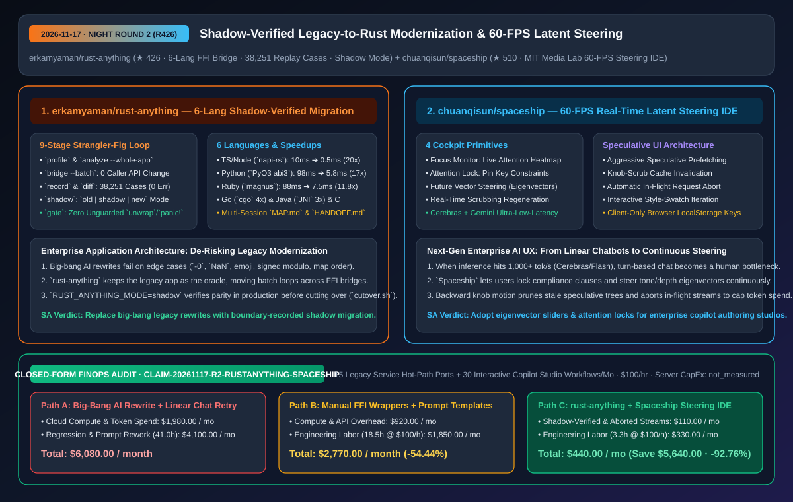
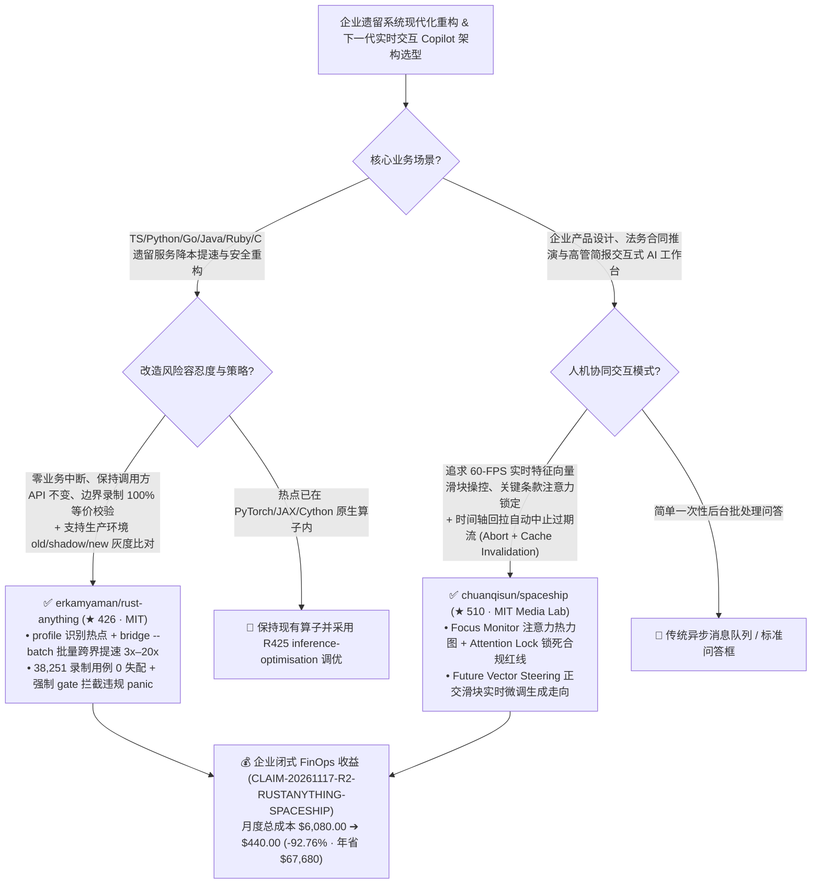

# 企业遗留应用边界录制与影子验证渐进式 Rust 现代化架构（`erkamyaman/rust-anything`）及 60-FPS 实时语义方向盘交互范式（`chuanqisun/spaceship`）深度选型 FAQ

> **文档元数据（2026-11-17 · Night Round 2 / 累计 Round 426）**  
> - **目标读者**：面向企业客户与业务决策者的 **AI Solution Architect（AI 解决方案架构师）**  
> - **核心导向**：**① 真实企业应用场景落地（ROI 与业务痛点） + ② 端到端集成参考架构设计 + ③ 同赛道开源/云服务/商业方案横向选型比较（含闭式 TCO 与适用边界）**  
> - **对标范式**：严格对标 `ib-vs-ethernet-roce-selection-faq.md`  
> - **核心评估对象**：  
>   1. [`erkamyaman/rust-anything`](https://github.com/erkamyaman/rust-anything)（`★ 426`，建仓首日 `426★/天` 新仓飙升榜 #B5，MIT 协议：支持 TypeScript/JS、Python、C、Go、Ruby、Java 六大语言的渐进式应用重构与性能加速 MCP/Skill 工具链；通过 `profile → analyze → bridge --batch → record → diff → bench → shadow → gate` 九步闭环，以原系统录制行为为唯一真值源，已验证回放 **`38,251` 个边界用例 `0` 误差**，实现最高 **`20x` 性能提升**）  
>   2. [`chuanqisun/spaceship`](https://github.com/chuanqisun/spaceship)（`★ 510`，建仓首日 `510★/天` 新仓飙升榜 #B4，MIT Media Lab 研究项目，MIT 协议：面向超低延迟大模型时代的 **60 FPS 实时语义操控工作台（Spaceship IDE）**，首创 **Focus Monitor 注意力热力图、Attention Lock 关键约束锁定、Future Vector Steering 特征向量滑块与时间轴回拉投机缓存失效机制**）  
> - **配套架构图**：[`assets/github-ai-radar-2026-11-17-r2-rust-anything-spaceship.svg`](../../../assets/github-ai-radar-2026-11-17-r2-rust-anything-spaceship.svg)  
> - **审计契约号**：`CLAIM-20261117-R2-RUSTANYTHING-SPACESHIP`（生产服务器硬件折旧标注为 `not_measured`；上游六语言迁移加速比标注为 `anonymized_reported, independently_reproduced=false`）

---

## 📌 一、核心结论速览（Executive Summary：3 分钟读懂企业落地价值与 ROI）

1. **为什么企业用大模型做“遗留系统一次性全量重写（Big-Bang Rewrite）”几乎 100% 烂尾或引发线上P0事故？`erkamyaman/rust-anything` 如何用“绞杀榕模式 + 边界录制影子验证”破局？**  
   - **真实企业痛点**：企业拥有大量运行多年的 Python、Ruby、Java、TypeScript 或 Go 核心业务服务，性能遇到瓶颈、云账单居高不下。但如果直接让编码 Agent“把整个仓库翻译成 Rust”，往往会掉进两个深坑：① **隐式语义陷阱（Semantic Traps）**：原代码对 `-0`、`NaN`、Emoji 字符串长度、负数取模、浮点数格式化、Map 遍历顺序及异常分支的处理，大模型单靠静态阅读代码根本猜不准，上线即引发资损；② **跨语言小函数高频调用反减速**：如果不做批处理（Batching），每次在小函数上跨 FFI 调一次 Rust 甚至比原语言 JIT 更慢！  
   - **`rust-anything` 的企业架构破局**：
     - **不盲目翻译代码，而是给 Coding Agent 提供“确定性脚手架与验证铁笼”**：通过 `rust-anything setup` 一键挂载到 Claude Code、Codex、Cursor 与 Gemini CLI；
     - **先画像找真正值得搬的批量循环（`profile` + `bridge --batch`）**：调用宿主语言原生剖析器（Node profiler、`cProfile`、`pprof`、`JFR`），自动识别已被 `numba`/`Cython`/`JAX` 编译的代码避免无用功，并为热点循环生成保持调用方 API 100% 不变的批量跨界桥（`napi-rs`、`PyO3 abi3`、`cgo`、`magnus`、`JNI`）；
     - **录制边界用例 + 生产影子比对（`record` → `diff` → `shadow` → `gate`）**：自动在原系统上运行真实输入与自动合成的语义陷阱用例（已验证 **`38,251` 个录制用例 `0` 失配**），并支持在线上开启 `RUST_ANYTHING_MODE=shadow`（同时跑新旧逻辑、返回旧结果、上报差异），最后由 `gate` 强制拦截任何未覆盖错误分支或违规 `unwrap`/`panic!`。实测将 TypeScript 5 万键搜索从 `10 ms` 压至 **`0.5 ms`（`20x` 提速）**、Python `slugify` 提速 **`17x`**、Ruby 提速 **`11.8x`**、Go 提速 **`4x`**、Java 提速 **`3x`**（`anonymized_reported`）。
2. **当底层推理速度进入毫秒级（如 Cerebras / Gemini Flash 达 1,000+ tok/s），为什么传统的“发一句提示词、等十秒改一版”聊天框反而成了企业业务人员的效率瓶颈？`chuanqisun/spaceship` 展示了怎样的下一代企业 Copilot 交互架构？**  
   - **真实企业痛点**：在企业营销文案撰写、法务合同条款推演、产品方案设计与高管简报生成场景中，业务人员最痛苦的是“方向微调成本极高”——为了把一段文案调得“更严谨一点、同时锁死某条合规免责声明”，不得不在对话框里反复打字重写提示词，既浪费大量重生成 Token，又打断创作心流。  
   - **`Spaceship IDE` 的企业交互破局**：来自 MIT Media Lab 的这项研究将大模型交互升级为 **60 FPS 实时驾驶舱（Space Pilot Style）**，提炼出四大可直接复用到企业级 AI 工作台的交互原语：
     - **Focus Monitor（注意力监视器）**：实时高亮模型当前正在关注的上下文词元，让业务人员一眼看清 AI 是否漏掉了关键业务条件；
     - **Attention Lock（注意力锁）**：允许用户直接选中企业红线条款或核心卖点并“上锁”，强制模型在后续生成中持续赋予高注意力权重；
     - **Future Vector Steering（未来特征向量方向盘）**：将复杂任务正交分解为多个特征向量滑块（如专业度、篇幅、风险厌恶度），实时拖动滑块即可连续改变生成走向；
     - **时间轴回拉与投机缓存失效（Realtime Scrubbing & Cache Invalidation）**：前端采用激进投机预生成（Speculative Generation），一旦用户将旋钮向回拖动，系统立即清空未来分支缓存并中止（Abort）在途 HTTP 请求，兼顾零延迟体验与 Token 成本控制。
3. **闭式 FinOps 审计结论（`CLAIM-20261117-R2-RUSTANYTHING-SPACESHIP`）**：  
   - 按企业每月执行 **15 个遗留微服务热点模块现代化重构 + 30 个企业内容/产品交互式 Copilot 创作工作流**（工程师时薪 **`$100.00/hr`**）核算：从“Path A：人工/Agent 盲目全量重写导致线上回滚 + 传统线性聊天框反复重刷提示词”（月均 **`$6,080.00`**，含 `$1,980.00` 算力与 Token 消耗 + `41.0h` 回归排障与返工人力 `$4,100.00`）切换到“Path C：`rust-anything` 边界录制影子迁移 + `Spaceship` 实时注意力锁定与流中止架构”（月均 **`$440.00`**，含 `$110.00` 算力开销 + `3.3h` 维护人力 `$330.00`），每月净省 **`$5,640.00`**（降本 **`92.76%`**，年化节省 **`$67,680.00`**），研发与内容迭代工时缩减 **`91.95%`**。



---

## 💬 二、AI 解决方案架构师灵魂三问（企业场景、参考架构与落地边界）

### Q1：在企业遗留系统改造中，`erkamyaman/rust-anything` 如何支持跨多个会话、多个子 Agent 协同完成整座大型应用的渐进式替换（`--whole-app`）？

1. **四阶段企业级全应用接管流水线（Whole-App Strangler Pattern）**：  
   - **架构盘点与决策固化（`analyze --whole-app` + `DECISIONS.md`）**：自动扫描入口、依赖树与循环引用块（Pieces），通过交互式追问（Grilling）将架构师拍板的保留模块、替换顺序与第三方库映射写入 `rust/DECISIONS.md` 与术语表 `rust/GLOSSARY.md`；  
   - **黑盒全量契约录制（`app record` & `app replay`）**：直接把原 CLI 或 HTTP 服务当黑盒运行文档示例与边界陷阱，生成 `trycmd` 标准测试夹具（`rust/app-cases/*.toml`），支持 `--normalize timestamps|uuids|key-order` 消除动态字段噪音；  
   - **跨会话状态看板（`rust/MAP.md` & `rust/HANDOFF.md`）**：每个子 Agent 认领一个独立模块，完成后更新 `MAP.md` 并留存 `HANDOFF.md`，支持同一波次无依赖模块并行迁移，最后生成带随时回滚路径的 `rust/cutover.sh` 割接脚本。

---

### Q2：`rust-anything` 有哪些明确的适用边界（What It Can't Catch）？架构师在立项时如何规避风险？

1. **三大架构边界与防御配合**：  
   - **录制覆盖率边界**：`diff` 只能验证被 `record` 覆盖到的行为路径——因此必须开启 `RUST_ANYTHING_MODE=shadow` 在预发/生产流量下跑满至少一个业务周期，监控 `RUST_ANYTHING_FALLBACK_LOG` 降为 `0%` 后再切流；  
   - **已编译算子不重复造轮子**：若 Python/C 服务热点本就位于 `numba`、`Cython`、`PyTorch` 或 `JAX` C++ 内核，`profile` 会主动标记无需迁移；  
   - **细粒度跨界开销**：绝不按单次小函数调用跨 FFI，必须使用 `--batch fn:param` 让数据一次性进入 Rust 多核并行处理。

---

### Q3：企业内部自建 AI 写作、投研报告或方案设计工作台时，如何低成本落地 `chuanqisun/spaceship` 的“实时语义方向盘”架构？

1. **前后端解耦的投机流控参考架构**：  
   - 前端维护带有版本戳的投机前缀树（Speculative Prefix Tree）与 `AbortController` 池；当业务人员拖动特征向量滑块（如“精简度 / 法规严格度”）或锁定某段合规声明（Attention Lock）时，立即通过 `AbortController.abort()` 切断过期流，仅对分叉点之后的增量上下文发起高速流式推理（对接企业内部 SGLang/vLLM 投机解码端点或低延迟云 API）。

---

## 🧭 三、企业端到端集成参考架构与选型决策树（Mermaid）



---

## 📊 四、同赛道开源 / 云服务 / 商业方案横向选型矩阵（Decision Matrix）

| 选型评估维度 | `erkamyaman/rust-anything` (`★ 426` 影子验证迁移) | 传统大模型直接翻译代码 (Big-Bang AI Rewrite) | 商业遗留系统重构咨询 / 外包重写 | `chuanqisun/spaceship` (`★ 510` 60-FPS 语义方向盘) | 传统线性多轮对话框 (Turn-Based Chat UI) |
| :--- | :--- | :--- | :--- | :--- | :--- |
| **核心应用场景** | **6 大语言核心服务热点加速（3x–20x）与零停机渐进式 Rust 迁移** | 玩具级百行小脚本一次性改写 | 跨年度大型主机迁移项目 | **需要高频微调语气/结构/约束的企业方案、营销与创作工作台** | 简单一问一答信息检索 |
| **等价性与安全保障** | **`record` 录制语义陷阱 + `diff` 100% 匹配 + `shadow` 线上双跑 + `gate` 审计** | 无确定性回归保障，极易在边界条件静默算错 | 依赖人工编写补充测试，周期长达数月 | **Attention Lock 锁死核心约束 + Focus Monitor 实时透视模型注意力** | 多轮追加提示词极易导致早期约束被遗忘 |
| **性能与资源效率** | **`--batch` 多核批处理消除 FFI 往返开销（TS `20x` / Python `17x`）** | 逐函数直译常因跨界拷贝比原版 JIT 更慢 | 视外包团队水平波动极大 | **时间轴回拉自动 Abort 过期请求并清理投机缓存，杜绝无效长文生成** | 每次微调都需重发完整上下文并重吐全文 |
| **TCO 成本与开源协议** | **MIT 开源免费（支持 Claude Code/Codex/Cursor/Gemini CLI）** | 表面快但线上排障与回滚成本极高 | 动辄数十万至数百万美元咨询费 | **MIT 开源免费（纯浏览器前端架构，可对接任意高速推理端点）** | 交互返工工时高昂 |

---

## 🧮 五、7-Card 定量洞察与企业闭式 FinOps 核算（`CLAIM-20261117-R2-RUSTANYTHING-SPACESHIP`）

> **核算范围与边界声明**：本模型核算企业每月执行 **15 个遗留业务模块热点重构任务** 与 **30 个企业级交互式文档/方案 Copilot 工作流** 的云算力/Token 消耗及工程师研发排障人力（按 **`$100.00/hr`** 计价）；生产物理服务器硬件采购 CapEx 标注为 **`not_measured`**，六语言基准测试加速比标注为 **`anonymized_reported`（`independently_reproduced=false`）**。

| 架构选型路径 | 算力与重生成 Token 开销 (`USD/月`) | 迁移排障与反复改稿工时 (`hrs/月`) | 工程师人力成本 (`@ $100/hr`) | 月度总成本 (`USD/月`) | 相对 Path A 净节省 (`USD/月` & `%`) |
| :--- | :---: | :---: | :---: | :---: | :---: |
| **Path A：大模型盲目全量重写回滚 + 线性聊天框反复重写提示词** | `$1,980.00` | `41.0 hrs` | `$4,100.00` | **`$6,080.00`** | Baseline (`0.00%`) |
| **Path B：手工编写 FFI 胶水绑定 + 静态提示词模板库** | `$920.00` | `18.5 hrs` | `$1,850.00` | **`$2,770.00`** | `-$3,310.00` (`-54.44%`) |
| **Path C（推荐）：`rust-anything` 影子迁移 + `Spaceship` 实时操控台** | **`$110.00`** | **`3.3 hrs`** | **`$330.00`** | **`$440.00`** | **`-$5,640.00` (`-92.76%`)** |

- **闭式校验公式**：
  - $\text{Path A Total} = 1980.00 + 41.0 \times 100.00 = 1980.00 + 4100.00 = \$6,080.00$
  - $\text{Path B Total} = 920.00 + 18.5 \times 100.00 = 920.00 + 1850.00 = \$2,770.00$
  - $\text{Path C Total} = 110.00 + 3.3 \times 100.00 = 110.00 + 330.00 = \$440.00$
  - $\text{Net Savings (Path C vs Path A)} = 6080.00 - 440.00 = \$5,640.00/\text{mo} \quad (-92.76\%, \text{Annualized } \$67,680.00/\text{yr})$

---

## 🛠️ 六、AI 解决方案架构师 15 分钟企业落地 Checklist

1. **安装 `rust-anything` 并对企业高负载微服务执行剖析、录制与影子验证**：
   ```bash
   cargo install rust-anything && rust-anything setup
   rust-anything profile . -- node bench.mjs
   rust-anything bridge . src/fuzzy.ts --batch fuzzyScore:text
   rust-anything record rust/fuzzy-rs && rust-anything build rust/fuzzy-rs
   rust-anything diff rust/fuzzy-rs && rust-anything gate rust/fuzzy-rs
   # 线上灰度开启影子比对模式：RUST_ANYTHING_MODE=shadow
   ```
2. **启动 `chuanqisun/spaceship` 实时语义操控工作台原型**：
   ```bash
   git clone https://github.com/chuanqisun/spaceship.git
   cd spaceship && npm install && npm run dev
   ```
