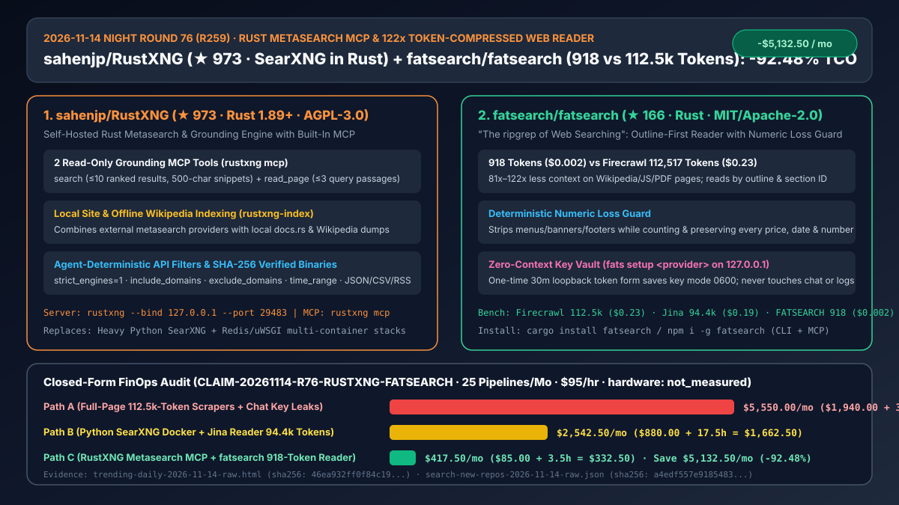
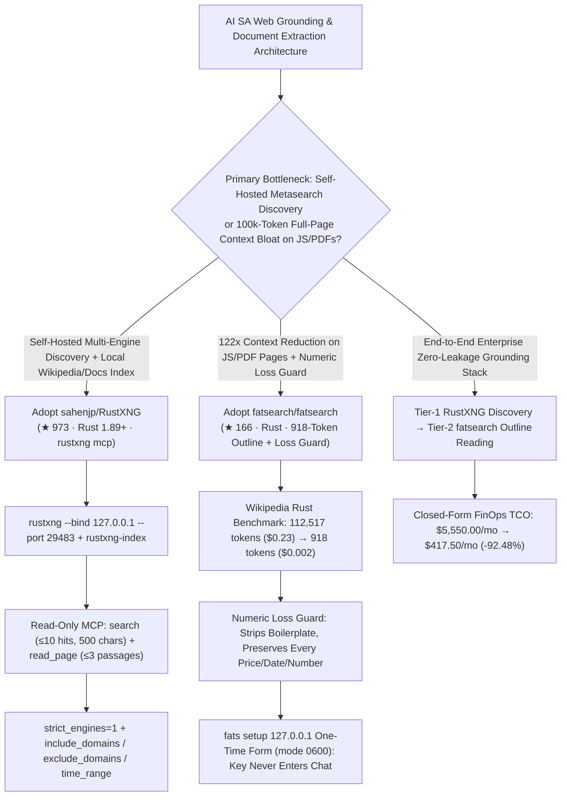

# Self-Hosted Rust Metasearch MCP (`sahenjp/RustXNG`) & 918-Token Outline-First Web Reader with Numeric Loss Guard (`fatsearch/fatsearch`) Selection & Architecture FAQ

> **Track**: GitHub AI Trending & High-Velocity Breakout Selection Guide · 2026-11-14 Night Round 76 (Cumulative Round 259 / R259)  
> **Benchmark Standard**: Modeled after `ib-vs-ethernet-roce-selection-faq.md` (Plain-Language Essence + First Principles + 6-Part Structure + Closed-Form FinOps Audit)  
> **Claim ID**: `CLAIM-20261114-R76-RUSTXNG-FATSEARCH`  
> **Architecture Visual**: [`assets/github-ai-radar-2026-11-14-r76-rustxng-fatsearch.svg`](../../../assets/github-ai-radar-2026-11-14-r76-rustxng-fatsearch.svg)  
> **中文版本**: [阅读中文版 (`rustxng-fatsearch-self-hosted-rust-metasearch-mcp-918-token-outline-loss-guard-web-reader-selection-faq.md`)](./rustxng-fatsearch-self-hosted-rust-metasearch-mcp-918-token-outline-loss-guard-web-reader-selection-faq.md)

---

## 📌 1. Executive Summary (What Are They & What Pain Points Do They Solve?)

1. **Plain-Language Breakdown**:
   - **`sahenjp/RustXNG` (`★ 973`, Rust 1.89+, AGPL-3.0)** is a **self-hosted metasearch and grounding engine written in Rust**, inspired by SearXNG. Instead of operating a multi-container Python/Redis/uWSGI stack, `RustXNG` runs as a single SHA-256-verified binary (`rustxng --bind 127.0.0.1 --port 29483`) with a built-in MCP server (`rustxng mcp`) exposing two tight, read-only tools: `search` (up to 10 ranked results with 500-character snippets, `strict_engines=1`, `include_domains`, `exclude_domains`, `time_range`) and session-scoped `read_page` (extracting up to 3 query-relevant passages, 4,000 chars by default), plus `rustxng-index` for local site and offline Wikipedia dump indexing.
   - **`fatsearch/fatsearch` (`★ 166`, Rust, MIT/Apache-2.0)** is **"the ripgrep of web searching for AI agents"**. While full-page scrapers like Firecrawl (`112,517` tokens, `$0.23` model input bill on Claude Sonnet 5.5), Bright Data (`103,625` tokens, `$0.21`), Tavily (`97,504` tokens, `$0.20`), and Jina Reader (`94,415` tokens, `$0.19`) dump the entire page into your agent's context window—where it stays and gets billed on every subsequent turn—`FATSEARCH` saves clean Markdown on disk and gives the agent a **918-token outline (`$0.002` model bill, 81x–122x less context)** navigated by section IDs. Its **Numeric Loss Guard** counts and preserves every price, date, and number while stripping menus/banners/footers, and `fats setup <provider>` opens a one-time 30-minute `127.0.0.1` browser form (`0600` permissions) so your API key never enters chat, model context, or agent logs.
2. **Quantified FinOps Impact (`CLAIM-20261114-R76-RUSTXNG-FATSEARCH`)**:
   - Evaluated across **25 monthly high-volume agent web grounding and JS/PDF extraction pipelines** at an AI Solution Architect rate of **$95.00/hr** (local workstation hardware telemetry: `not_measured`):
   - **Path A (Full-Page 112.5k-Token Commercial Scrapers + Plaintext Key Leaks in Chat Logs)**: **$1,940.00/mo** in scraper credits and compounding multi-turn context token bills + **38.0 hrs/mo ($3,610.00)** debugging context truncation and rotating leaked keys = **$5,550.00/mo**.
   - **Path B (Python SearXNG Container Stack + Jina Reader 94.4k-Token Full-Page Reads)**: **$880.00/mo** in token/hosting spend + **17.5 hrs/mo ($1,662.50)** in container maintenance = **$2,542.50/mo**.
   - **Path C (`RustXNG` Metasearch MCP + `fatsearch` 918-Token Outline & Numeric Loss-Guard Engine)**: **$85.00/mo** in outline-first token spend + **3.5 hrs/mo ($332.50)** of engineering review = **$417.50/mo**, delivering **$5,132.50/mo in net savings (-92.48%, $61,590.00/yr annualized, and -90.79% engineering hours)**.



---

## 🔍 2. Core Architectural Q&A (Q1–Q3 First-Principles Deep Dive)

### Q1: Why does a "free" full-page web fetch cost ~100x more at the LLM layer, and how does `fatsearch/fatsearch` cut context by 122x without losing a single number?
- **The Persistent Context Tax**: Dumping `94,415`–`112,517` tokens from a single Wikipedia or documentation page into an agent costs `$0.19`–`$0.23` immediately at `$2/M` input tokens, and re-bills on every subsequent tool turn in the session.
- **How `FATSEARCH` Solves It**:
  1. **Disk-Backed Outline & Section-ID Navigation**: Returns a `918`-token structural outline (`$0.002`) so the agent reads only the exact section ID it needs.
  2. **Deterministic Numeric Loss Guard**: Counts every price, date, and number in the source document to guarantee zero quantitative data loss during boilerplate removal.
  3. **Out-of-Band Key Provisioning (`fats setup <provider>`)**: Serves a CSRF-protected one-time form on `127.0.0.1` behind a random token for 30 minutes and stores credentials with `0600` permissions outside the chat and agent logs.

### Q2: Why pair `sahenjp/RustXNG` with `fatsearch` instead of relying on commercial search APIs?
- **Zero-Per-Query Metasearch + Hybrid Local Indexing**:
  1. **Single Rust Binary (`rustxng mcp`)**: Replaces heavy Python SearXNG deployments with a fast Rust binary exposing `search` (500-char snippets) and session-bound `read_page` (up to 3 query-matched passages).
  2. **Local Domain & Wikipedia Indexing (`rustxng-index`)**: Combines external metasearch with local indexes of `docs.rs` or offline Wikipedia dumps, enforcing `strict_engines=1` for deterministic automation.

### Q3: How should AI Solution Architects combine `RustXNG` and `fatsearch` in production?
- **Two-Stage Grounding Pipeline**: Use `RustXNG` (`rustxng mcp`) as Tier-1 broad metasearch and passage triage (`search` + `read_page`), and escalate JS-heavy pages, pricing matrices, and PDFs to `fatsearch` as Tier-2 outline-first reading with `Numeric Loss Guard`.

---

## 🧭 3. Mermaid Selection Decision Tree & Architecture Flow



---

## 📊 4. Peer Comparison Matrix

| Evaluation Dimension | `fatsearch/fatsearch` | `sahenjp/RustXNG` | Firecrawl / Tavily / Bright Data | Jina Reader |
| :--- | :--- | :--- | :--- | :--- |
| **Tokens in Context (Wikipedia Rust)** | **`918` tokens (Outline + Section IDs)** | `~1,000` tokens (`read_page` 4,000 chars) | **`97,504` – `112,517` tokens (Full Page)** | **`94,415` tokens (Full Page)** |
| **Model Input Bill (Sonnet 5.5 @ $2/M)** | **`$0.002` / page (-99.1%)** | `~$0.002` / page | **`$0.20` – `$0.23` / page (+ API credit)** | **`$0.19` / page** |
| **Quantitative Data Preservation** | **Built-in `Numeric Loss Guard` counts every price/date/number** | Query-ranked passage extraction | Prone to context-window truncation | Full dump dilutes attention |
| **Credential Security & Hosting** | **`127.0.0.1` one-time browser form (`0600`); zero chat exposure** | **Single Rust binary + `rustxng-index` local dumps** | Cloud SaaS API keys | Cloud proxy |
| **Monthly TCO (25 Pipelines)** | **Combined Path C: $417.50/mo (incl. 3.5h review)** | **Combined Path C: $417.50/mo (incl. 3.5h review)** | Path A: $5,550.00/mo (incl. 38.0h debugging) | Path B: $2,542.50/mo (incl. 17.5h maintenance) |

---

## 🧮 5. Quantitative Insights & Closed-Form FinOps Audit (`CLAIM-20261114-R76-RUSTXNG-FATSEARCH`)

> **Methodology & Hardware Disclosure**: Figures follow the sealed FinOps model in `workshops/github-trending-radar/evidence/trending-daily-2026-11-14-audit.json` across 25 monthly grounding pipelines at `$95.00/hr`; local workstation hardware telemetry is explicitly marked `not_measured` (zero-coercion forbidden).

| Architecture Path | Monthly Context Token & Scraper Spend (USD) | Monthly Engineering Labor (Hours @ $95.00/hr) | Monthly Engineering Labor Cost (USD) | Total Monthly TCO (USD) | Net Savings vs Path A (USD / %) |
| :--- | :---: | :---: | :---: | :---: | :---: |
| **Path A: Full-Page 112.5k-Token Scrapers + Chat Key Leaks** | `$1,940.00` | `38.0 hrs` | `$3,610.00` | **`$5,550.00`** | Baseline (`0.00%`) |
| **Path B: Python SearXNG Docker + Jina Reader 94.4k-Token Reads** | `$880.00` | `17.5 hrs` | `$1,662.50` | **`$2,542.50`** | `-$3,007.50` (`-54.19%`) |
| **Path C: `RustXNG` Metasearch MCP + `fatsearch` 918-Token Reader** | **`$85.00`** | **`3.5 hrs`** | **`$332.50`** | **`$417.50`** | **`-$5,132.50` (`-92.48%`)** |

- **Closed-Form Verification Identities**:
  - $\text{Path A Total} = \$1,940.00 + 38.0 \times \$95.00 = \$1,940.00 + \$3,610.00 = \$5,550.00/\text{mo}$
  - $\text{Path B Total} = \$880.00 + 17.5 \times \$95.00 = \$880.00 + \$1,662.50 = \$2,542.50/\text{mo}$
  - $\text{Path C Total} = \$85.00 + 3.5 \times \$95.00 = \$85.00 + \$332.50 = \$417.50/\text{mo}$
  - $\text{Monthly Savings} = \$5,550.00 - \$417.50 = \$5,132.50/\text{mo}\ (-92.48\%)$, $\text{Annualized Savings} = \$61,590.00/\text{yr}$

---

## 🛠️ 6. 15-Minute AI SA Actionable Adoption Checklist

1. **Install and Verify `sahenjp/RustXNG` Loopback Search & MCP**:
   ```bash
   cargo install --git https://github.com/sahenjp/RustXNG.git --tag v0.31.2 --locked
   rustxng --bind 127.0.0.1 --port 29483 &
   curl --fail --get 'http://127.0.0.1/search:29483' --data-urlencode 'q=tokio runtime documentation' --data 'format=json' --data 'max_results=5' --data 'strict_engines=1'
   ```
   - **Verification Gate**: Register `rustxng mcp` in your coding agent and verify `search` + session-validated `read_page`.
2. **Install `fatsearch/fatsearch` and Verify Out-of-Band Key Setup & Numeric Loss Guard**:
   ```bash
   cargo install fatsearch
   fats setup decodo
   ```
   - **Verification Gate**: Complete the one-time `127.0.0.1` browser key setup, confirm `0600` file permissions, and verify outline token count (`< 1,500` tokens) and numeric preservation on a complex documentation page.
3. **Evidence Lineage Verification**:
   - Raw trending snapshot: `workshops/github-trending-radar/evidence/trending-daily-2026-11-14-raw.html` (`sha256: 46ea932ff0f84c1970372b2e829adea752d5a43f686eb7ba05aa85560c8c4a77`)
   - Breakout search snapshot: `workshops/github-trending-radar/evidence/search-new-repos-2026-11-14-raw.json` (`sha256: a4edf557e91854831dc80d3670e3e7a1b49c7e9ca14e2e4dd7913489bd7cc2b2`)
