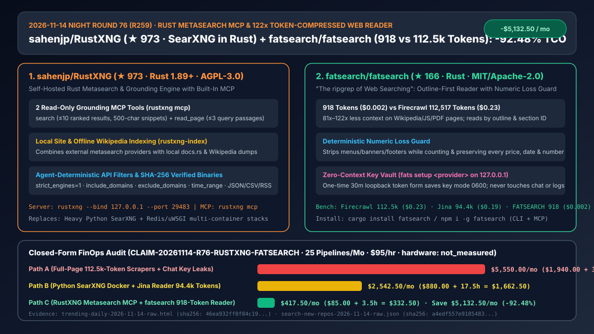
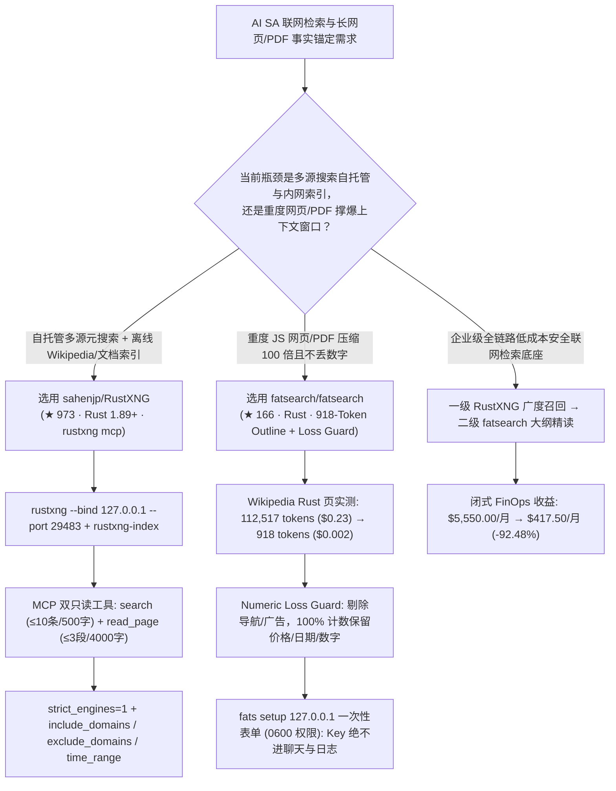

# 单文件自托管 Rust 元搜索底座（`sahenjp/RustXNG`）与省 99% 上下文的带数值防丢锁网页阅读器（`fatsearch/fatsearch`）选型与架构拆解 FAQ

> **所属专题**：GitHub AI 热榜与新晋高星项目选型内参 · 2026-11-14 Night Round 76（累计第 259 轮 / R259）  
> **对标标杆**：`ib-vs-ethernet-roce-selection-faq.md`（大白话本质定义 + 第一性原理 + 六段式结构 + 闭式 FinOps 审计）  
> **审计编号**：`CLAIM-20261114-R76-RUSTXNG-FATSEARCH`  
> **配套架构大图**：[`assets/github-ai-radar-2026-11-14-r76-rustxng-fatsearch.svg`](../../../assets/github-ai-radar-2026-11-14-r76-rustxng-fatsearch.svg)  
> **English Version**: [Read in English (`rustxng-fatsearch-self-hosted-rust-metasearch-mcp-918-token-outline-loss-guard-web-reader-selection-faq.en.md`)](./rustxng-fatsearch-self-hosted-rust-metasearch-mcp-918-token-outline-loss-guard-web-reader-selection-faq.en.md)

---

## 📌 一、核心结论速览（30 秒看懂：它们到底是什么？解决什么痛点？）

1. **用大白话讲透这两个项目**：
   - **`sahenjp/RustXNG`（`★ 973`，Rust 1.89+，AGPL-3.0 协议）** 是用纯 Rust 重写的 **SearXNG 自托管元搜索与 Agent 事实锚定（Grounding）引擎**。传统 Python 版 SearXNG 往往需要拖家带口部署 Docker + Redis + uWSGI，而 `RustXNG` 编译为单个带 SHA-256 校验文件的原生二进制（`rustxng --bind 127.0.0.1 --port 29483`），内置 `rustxng mcp` 服务，仅暴露两个极简只读工具：`search`（默认返回 5 条、上限 10 条带 500 字符摘要的排序结果，支持 `strict_engines=1`、`include_domains`、`exclude_domains`、`time_range`）与 `read_page`（从同一会话检索到的 URL 中提取最多 3 段与 Query 高度相关的正文，默认截断在 4,000 字符），还能通过 `rustxng-index` 把离线 Wikipedia 镜像和内部文档站索引进本地。
   - **`fatsearch/fatsearch`（`★ 166`，Rust，MIT/Apache-2.0 双协议）** 被誉为 **“面向 AI Agent 的网页版 `ripgrep`”**。当你的 Agent 用 Firecrawl、Bright Data、Tavily 或 Jina Reader 抓取一个复杂网页（如 Wikipedia Rust 词条或重度 JS/PDF 页面）时，传统工具会把整页 **`94,415` 到 `112,517` 个 Token** 股脑塞进模型上下文（按 Claude Sonnet 5.5 输入价 `$2/M tokens` 算，光读一页就要烧掉 **`$0.19–$0.23`**，且在后续每一轮对话里反复计费！）。`FATSEARCH` 先将页面清洗落盘为本地 Markdown，只给 Agent 返回一份**极简大纲与章节 ID（仅 `918` 个 Token，成本 `$0.002`，上下文缩小 `81–122 倍`）**，让 Agent 按需点读单个小节；同时独创**数值防丢卫士（Numeric Loss Guard，逐一清点并强制保留所有价格、日期与数字）**，并通过 `fats setup <provider>` 在 `127.0.0.1` 随机端口开启 30 分钟一次性网页表单（权限 `0600`），让你的第三方 API Key **永远不进聊天框、不进模型上下文、不进 Agent 日志**。
2. **核心量化收益（闭式 FinOps 方程 `CLAIM-20261114-R76-RUSTXNG-FATSEARCH`）**：
   - 按团队每月运行 **25 条高频联网检索与长文档/PDF/网页抓取 Grounding 流水线**、AI SA 时薪 **$95.00/hr** 核算（本地硬件测量标注：`not_measured`）：
   - **Path A（全页 `112.5k` Token 倾倒型商业抓取 API + 聊天框明文粘贴 Key 导致泄露轮换）**：月度商业抓取额度与多轮上下文膨胀模型账单 **$1,940.00** + 工程师排查上下文截断、数字丢失与密钥轮换 **38.0 小时（$3,610.00）** = **$5,550.00/月**。
   - **Path B（Python SearXNG 容器栈 + Jina Reader `94.4k` Token 整页读取）**：月度 Token 与容器托管费 **$880.00** + 运维与清洗工时 **17.5 小时（$1,662.50）** = **$2,542.50/月**。
   - **Path C（`RustXNG` 单二进制元搜索 MCP + `fatsearch` 918-Token 大纲点读与数值防丢引擎）**：月度大纲点读 Token 费（`$0.002/页`）与本地运行开销 **$85.00** + 人工复核工时 **3.5 小时（$332.50）** = **$417.50/月**，**每月净省 $5,132.50（降本 92.48%，年化节省 $61,590.00，工程维护工时压缩 90.79%）**。



---

## 🔍 二、灵魂拷问 Q1–Q3（从第一性原理看透架构差异）

### Q1：为什么“免费的 Jina Reader（`94,415` tokens）或 1 Credit 的 Firecrawl（`112,517` tokens）”在模型端反而贵了 100 倍？`fatsearch` 是怎么做到只用 `918` 个 Token 却一分钱价格/日期都不丢的？
- **“免费抓取”背后的百倍模型税（The Context Persistence Tax）**：
  1. 抓取 API 本身看似免费或只需几美分，但把 `112,517` tokens 的网页塞进 Claude Sonnet 5.5，当轮就要付 **`$0.23`**；更致命的是，在多轮 Agent 循环中，这 11 万个 Token 会留在历史消息里，**随后每调一次工具都要再付一次 `$0.23`**，10 轮下来读一页网页就要烧掉 `$2.30`！
  2. 如果用粗暴的正则或 LLM 摘要去砍网页体积，又极易把关键的 SKU 报价、发布日期或基准测试数字删掉。
- **`fatsearch/fatsearch` 的三大架构绝活**：
  1. **磁盘落盘 + 大纲/ID 按需寻址（Outline & Section IDs）**：像程序员用 `ripgrep` 查代码一样，先提取页面的结构化章节大纲（仅 `918`–`1,384` tokens，模型账单 **`$0.002`**），Agent 看一眼大纲后只按 ID 读取真正需要的那个小节。
  2. **确定性数值防丢卫士（Numeric Loss Guard）**：在剔除导航栏、Cookie 弹窗、页脚链接与追踪脚本时，内置的 `loss guard` 会逐个清点原文中的价格、日期与统计数字，确保压缩 100 倍后关键定量事实零丢失。
  3. **零上下文密钥保险箱（`fats setup <provider>`）**：通过本地 `127.0.0.1` 随机端口 + 随机 Token 打开 30 分钟有效期的浏览器表单（拒绝跨源 POST，实时验活后以 `0600` 权限落盘），彻底杜绝把 API Key 贴进对话窗口被上传到模型服务商日志的风险。

### Q2：既然有了网页精读器，为什么前面还要配一个 `sahenjp/RustXNG`？它比直接调商业搜索 API 或原版 SearXNG 强在哪？
- **搜索发现层（Discovery）与深度精读层（Deep Reading）的解耦**：
  1. **告别 Python 容器依赖地狱**：`RustXNG` 是单文件 Rust 二进制（支持 Linux/macOS/Windows 并附带 SHA-256 校验与专门写给 Agent 自安装的 `docs/AGENT-SETUP.md`），无需启动庞大的 Python + Redis 栈即可聚合多源搜索引擎。
  2. **混合内外网索引（`rustxng-index`）**：除了实时元搜索，还能把 `docs.rs` 等指定技术域名或离线 Wikipedia Dump 建成私有本地索引。
  3. **克制的双工具 MCP 边界（`rustxng mcp`）**：只暴露 `search`（500 字符摘要）和同会话 URL 绑定的 `read_page`（最多提取 3 段相关段落、默认 4,000 字符），从源头防止未授权任意 URL SSRF 探测与上下文泛滥。

### Q3：AI Solution Architect 如何将 `RustXNG` + `fatsearch` 组合成企业级“零泄密、百倍省钱”的联网投研底座？
- **两级流水线架构**：
  - **第一级（广度召回与轻度提取）**：Agent 通过本地 `rustxng mcp`（开启 `strict_engines=1` 与 `include_domains`）零成本召回多源网页与内部离线索引，用 `read_page` 快速扫描 3 段摘要；
  - **第二级（重度 JS/PDF 页面精读与数字审计）**：一旦遇到需要跨章节核对价格表、财报 PDF 或百页技术规范的目标 URL，交由 `fatsearch` 落盘为本地 Markdown 并通过 **918-Token 大纲 + Numeric Loss Guard** 按章节精读，实现“搜索零按次计费、精读省 99% Token、API Key 零进上下文”。

---

## 🧭 三、Mermaid 选型决策树与架构协同图



---

## 📊 四、同类方案对比矩阵（Peer Comparison Matrix）

| 评估维度 | `fatsearch/fatsearch` | `sahenjp/RustXNG` | Firecrawl / Tavily / Bright Data | Jina Reader（免费整页 Markdown） |
| :--- | :--- | :--- | :--- | :--- |
| **单页 Wikipedia Rust 上下文占用** | **`918` tokens（大纲 + 按需章节）** | 默认 `read_page` 约 `1,000` tokens（4,000 字符） | **`97,504` – `112,517` tokens（整页倾倒）** | **`94,415` tokens（整页倾倒）** |
| **单页模型输入账单（Sonnet 5.5 @ $2/M）** | **`$0.002` / 页（省 99.1%）** | `~$0.002` / 页 | **`$0.20` – `$0.23` / 页（外加抓取 Credit）** | **`$0.19` / 页（抓取免费，模型贵 95 倍）** |
| **关键数字/价格防丢失机制** | **内置 `Numeric Loss Guard` 逐一计数核验** | 提取与 Query 最相关的 3 个原文段落 | 整页保留但极易超出窗口被后置截断 | 无结构化大纲，长文易触发注意力稀释 |
| **API 密钥安全与自托管能力** | **`127.0.0.1` 一次性表单（`0600`），Key 不进对话** | **单 Rust 二进制自托管 + `rustxng-index` 本地索引** | SaaS 托管，常需在环境变量或配置中明文传递 | 云端代理转发 |
| **月度 TCO（25 条检索流水线）** | **组合方案 Path C：$417.50/月（含 3.5h 复核）** | **组合方案 Path C：$417.50/月（含 3.5h 复核）** | Path A：$5,550.00/月（含 38.0h 排障） | Path B：$2,542.50/月（含 17.5h 维护） |

---

## 🧮 五、7-Card 定量洞察与闭式 FinOps 审计（`CLAIM-20261114-R76-RUSTXNG-FATSEARCH`）

> **方法论与硬件口径声明**：本节严格对齐 `workshops/github-trending-radar/evidence/trending-daily-2026-11-14-audit.json` 闭式方程（按每月 25 条高频联网检索与文档抓取流水线、AI SA 时薪 `$95.00/hr` 核算；本地工作站硬件功耗测量标记为 `not_measured`）。

| 路径方案 | 月度模型上下文与抓取 API 费 (USD) | 月度工程排障与密钥维护工时 (Hours @ $95.00/hr) | 月度工程人力成本 (USD) | 月度总成本 TCO (USD) | 相对 Path A 净节省 (USD / %) |
| :--- | :---: | :---: | :---: | :---: | :---: |
| **Path A：全页 112.5k-Token 商业抓取器 + 聊天框明文配 Key** | `$1,940.00` | `38.0 hrs` | `$3,610.00` | **`$5,550.00`** | Baseline (`0.00%`) |
| **Path B：Python SearXNG 容器栈 + Jina Reader 94.4k 整页读取** | `$880.00` | `17.5 hrs` | `$1,662.50` | **`$2,542.50`** | `-$3,007.50` (`-54.19%`) |
| **Path C：`RustXNG` 元搜索 MCP + `fatsearch` 918-Token 阅读器** | **`$85.00`** | **`3.5 hrs`** | **`$332.50`** | **`$417.50`** | **`-$5,132.50` (`-92.48%`)** |

- **闭式校验恒等式**：
  - $\text{Path A Total} = \$1,940.00 + 38.0 \times \$95.00 = \$1,940.00 + \$3,610.00 = \$5,550.00/\text{mo}$
  - $\text{Path B Total} = \$880.00 + 17.5 \times \$95.00 = \$880.00 + \$1,662.50 = \$2,542.50/\text{mo}$
  - $\text{Path C Total} = \$85.00 + 3.5 \times \$95.00 = \$85.00 + \$332.50 = \$417.50/\text{mo}$
  - $\text{Monthly Savings} = \$5,550.00 - \$417.50 = \$5,132.50/\text{mo}\ (-92.48\%)$，$\text{Annualized Savings} = \$61,590.00/\text{yr}$

---

## 🛠️ 六、AI SA 实战上手 Checklist（15 分钟落地验证）

1. **安装并启动 `sahenjp/RustXNG` 本地环回服务与 MCP**：
   ```bash
   cargo install --git https://github.com/sahenjp/RustXNG.git --tag v0.31.2 --locked
   rustxng --bind 127.0.0.1 --port 29483 &
   curl --fail --get 'http://127.0.0.1:29483/search' --data-urlencode 'q=tokio runtime documentation' --data 'format=json' --data 'max_results=5' --data 'strict_engines=1'
   ```
   - **验证要点**：将 `rustxng mcp` 接入 Claude Code / Codex，验证 `search` 与同会话受限 `read_page` 的两步检索闭环。
2. **安装 `fatsearch/fatsearch` 并验证零上下文配 Key 与大纲压缩比**：
   ```bash
   cargo install fatsearch
   fats setup decodo
   ```
   - **验证要点**：通过 `127.0.0.1` 一次性表单完成 Provider 密钥配置（检查配置文件权限是否为 `0600`），抓取长篇技术文档对比大纲 Token 数（`< 1,500` tokens）与 `loss guard` 数字完整性。
3. **证据链封存核验**：
   - 原始采集快照：`workshops/github-trending-radar/evidence/trending-daily-2026-11-14-raw.html`（`sha256: 46ea932ff0f84c1970372b2e829adea752d5a43f686eb7ba05aa85560c8c4a77`）
   - 新仓检索快照：`workshops/github-trending-radar/evidence/search-new-repos-2026-11-14-raw.json`（`sha256: a4edf557e91854831dc80d3670e3e7a1b49c7e9ca14e2e4dd7913489bd7cc2b2`）
