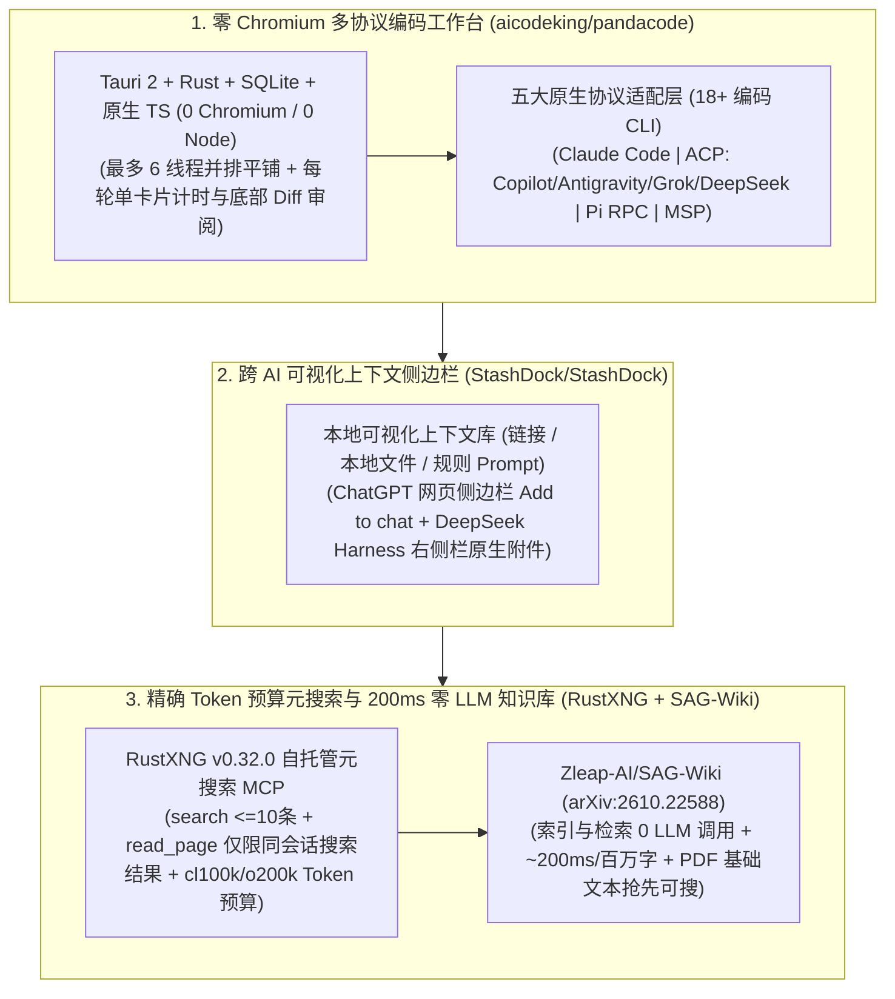

# 精确 Token 预算元搜索 MCP（`RustXNG/RustXNG`）、200ms 百万字零 LLM 索引知识库（`Zleap-AI/SAG-Wiki`）、零 Chromium 18+ 协议编码工作台（`aicodeking/pandacode`）与跨对话上下文侧边栏（`StashDock/StashDock`）选型 FAQ

> **文档类型**：AI Solution Architect（AI 解决方案架构师）实战选型与架构内功指南（2026-11-18 Night Shift · Round 21 / 累计第 501 轮）  
> **对标标杆**：`docs/components/ib-vs-ethernet-roce-selection-faq.md`（六段式架构拆解 + 第一性原理大白话 + Hype/Facts/Signal 审计 + 闭式 TCO 账本）  
> **本轮评估对象**：  
> 1. **`RustXNG/RustXNG`**（`★ 982`, `82 forks`, Rust `1.89+`, `v0.32.0`）：基于 SearXNG 理念用纯 Rust 重构的自托管元搜索与网页正文提取引擎（内置 `rustxng mcp`，提供只读 `search` 与同会话 URL 绑定的 `read_page`，原生支持按 `cl100k_base` / `o200k_base` 强制卡控 `max_payload_tokens` 序列化 Token 预算）  
> 2. **`Zleap-AI/SAG-Wiki`**（`★ 1,449`, `170 forks`, Rust 2021 + Tauri 2 + Svelte 5, MIT, `arXiv:2610.22588`）：面向人与 Agent 的轻量级本地知识库（无需安装外部数据库，**索引与检索全程 0 LLM 调用**，约 **200 ms 索引 100 万字符文本**，支持 PDF 基础文本抢先可搜与后台 OCR/表格增强并行，基于原创 `SAG2` 算法超越传统 RAG/GraphRAG）  
> 3. **`aicodeking/pandacode`**（`★ 1,304`, `220 forks`, Tauri 2 + Rust + SQLite + 原生 TypeScript）：不打包 Chromium、不跑常驻 Node 服务的超轻量多 Agent 桌面工作台（通过 Claude Code 协议、ACP、App-Server、Pi RPC 与 Meta MSP 协议同时并排运行 **18+ 种主流编码 CLI**，支持 6 分屏实时平铺与每轮单卡片 Diff 审阅）  
> 4. **`StashDock/StashDock`**（`★ 558`, `16 forks`, AGPL-3.0, Windows/macOS 桌面端 + Chrome 扩展 + DeepSeek Harness 插件）：AI 原生本地可视化上下文库（将分散在书签、文件夹与历史对话中的链接、文件与 Prompt 卡片化收纳，并在 ChatGPT 网页侧边栏与 DeepSeek Harness 右侧栏一键注入当前对话）  
> **审计折算说明**：本报告仅计量开发运维与软件推理/人力 TCO，底层开发机硬件采购（base hardware capEx）标注为 `not_measured`，严禁虚构硬件折旧坐标。

---

## 📌 一、核心结论速览（Executive Summary：它到底是什么？解决什么业务痛点？）

当企业研发团队将多个编码 Agent（Claude Code、Codex、Copilot CLI、DeepSeek、Grok Build）投入日常工程交付时，最容易在“联网搜索、本地文档检索、多终端窗口切换与常用上下文复用”四个环节产生严重的 Token 浪费与内存膨胀：
1. **痛点 A（商业联网搜索 API 按次计费昂贵 + 抓取原始网页动辄塞入几万 Token 撑爆上下文并引发任意 URL SSRF 风险）**：普通网页抓取 MCP 工具把整页 HTML 文本直接返回给大模型，一次搜索就消耗数万 Token，还容易被恶意 Prompt 诱导去抓取内网敏感地址。**`RustXNG/RustXNG` (`v0.32.0`) 的破局之道**：用纯 Rust 实现自托管元搜索引擎（并支持 `rustxng-index` 建立指定站点本地索引及导入维基百科离线包），内置 `rustxng mcp` 只暴露两个严控边界的只读工具——`search`（默认返回 5 条、上限 10 条，摘要严格限制在 500 字符内）与 `read_page`（**仅允许读取同一会话中由 `search` 返回过的 URL**，彻底阻断盲目 SSRF，按查询提取最多 3 段相关正文，默认 4,000 字符并通过 `offset`/`next_offset` 分页至最高 20,000 字符）；更硬核的是，调用方只要传入 `tokenizer`（`cl100k_base` 或 `o200k_base`）与 `max_payload_tokens`，`rustxng mcp` 就会在服务端对序列化 `structuredContent` 执行**精确 Token 预算截断**。
2. **痛点 B（传统 GraphRAG 建索引要跑成千上万次 LLM 调用既慢又贵 + 大型 PDF 等到全部 OCR 跑完才能搜）**：给几百兆项目文档建 GraphRAG 索引往往要花几十分钟并烧掉几十美元 API 费。**`Zleap-AI/SAG-Wiki` (`arXiv:2610.22588`) 的破局之道**：基于原创 **SAG2** 检索架构（Rust + Tauri 2 + Svelte 5，无需额外部署数据库），在**索引与检索阶段消耗 0 次 LLM 调用**，仅需约 **200 ms 即可完成 100 万字符文本索引**；针对 PDF 文档采用“基础文本先行可搜 + 后台异步执行 OCR 与表格识别（且多段 PDF 复用已加载模型）”的流水线，并提供一行命令即可挂载的 `cli/skills/sag/SKILL.md` 供编码 Agent 直接检索溯源。
3. **痛点 C（同时打开 Cursor、VS Code、Warp 和多个 Electron 套壳客户端，内存轻松飙上 16GB+，且十几个编码 CLI 协议互不相通）**：每个基于 Electron/Chromium 的 AI 客户端都自带几百兆运行时。**`aicodeking/pandacode` 的破局之道**：采用 Tauri 2 + Rust + SQLite + 原生 TypeScript 直接复用操作系统 Webview（**0 捆绑 Chromium、0 常驻 Node 服务、0 React 运行时**），通过五大协议适配器（Claude Code 兼容层、ACP 协议、ZCode App-Server、Pi RPC、Meta MSP）把 **Claude Code、Codex、GitHub Copilot CLI、Antigravity、xAI Grok Build、DeepSeek、Kimi Code、OpenCode、Cline、Devin CLI、Hermes Agent、Cursor CLI** 等 18+ 种编码工具收纳进同一个原生窗口；支持最多 **6 个会话分屏平铺（Tile up to 6 threads）**、每轮回复折叠为单张带耗时与文件 Diff 页脚的卡片，以及按 `Active` / `Finished` / `Settled` / `Pinned` 自动归类的侧边栏。
4. **痛点 D（每次开启新对话都要去书签栏翻网址、去磁盘找架构文档、去旧聊天里翻规则 Prompt）**：高频复用的参考资料散落在各处，跨 AI 工具切换时重复粘贴极其低效。**`StashDock/StashDock` 的破局之道**：在本地电脑构建可视化卡片上下文库（含 Windows/macOS 桌面端），通过 **ChatGPT Chrome 扩展侧边栏**（一键 `Add to chat` 插入选中参考项）与 **DeepSeek Harness 官方插件**（`plugins/stashdock-dsh`，在右侧栏将链接/笔记作为上下文引用注入、将本地文件作为原生附件挂载），实现“一处收纳，任意 AI 随调随用”。

---

## 💬 二、三大灵魂拷问（Q1–Q3 First-Principles Deep Dive）

### Q1：为什么 Agent 联网搜索 MCP（`RustXNG/RustXNG`）必须在协议层强制执行“同会话 `search` URL 白名单绑定 + `cl100k_base`/`o200k_base` 精确 Token 预算截断”？
* **第一性原理剖析**：
  - **消灭 SSRF 与任意内网探测**：如果 `read_page` 允许 Agent 传入任意 URL，一旦上下文遭遇提示词注入（Prompt Injection），攻击者就能利用 `read_page("http://169.254.169.254/...")` 或内网地址窃取敏感元数据。`RustXNG` 在机械层规定 `read_page` **只能抓取当前会话中由 `search` 工具返回的结果 URL**，从源头切断了非搜索来源的任意 URL 读取。
  - **精确到 Token 的上下文防火墙**：不同网页长度相差百倍，仅靠字符截断仍可能因高密度符号撑爆模型窗口。`RustXNG` 原生内置 `cl100k_base` 与 `o200k_base` 分词器，允许调用方指定 `max_payload_tokens`，由 Rust 服务端对 MCP `structuredContent` 进行严格预算裁剪，并配合 `offset`/`next_offset` 与最多 3 段高相关段落提取，把单次网页检索开销控制在百级 Token 内。

### Q2：`Zleap-AI/SAG-Wiki` 是如何做到“索引与检索 0 LLM 调用、200 ms 索引百万字符”，同时还能在精度上超越传统 RAG 与 GraphRAG 的？
* **第一性原理剖析**：
  - **将昂贵的语义图谱构建从“在线 LLM 生成”剥离为“确定性高速结构索引（`SAG2`）”**：传统 GraphRAG 在写入阶段需要调用大模型对每个文本块抽实体、建边，不仅慢上万倍且不可重现。`SAG-Wiki`（`arXiv:2610.22588`）通过纯 Rust 实现的 `SAG2` 算法在不发起任何 LLM 请求的前提下完成高速结构化索引（纯文本约 **200 ms / 100 万字符**），只有在用户最终提问需要生成自然语言综述时才按需调用模型，且每一句回答都可点击直达源文件段落。
  - **两阶段渐进式文档可用性**：面对混排 PDF 与 Office/RTF 文档，`SAG-Wiki` 先独立完成基础文本秒级索引使其立即可搜，再在后台异步运行按需下载的 OCR 与表格识别模型（跨 PDF 分片共享内存中的模型权重），彻底消除“导完文档干等半小时才能提问”的冷启动阻塞。

### Q3：为什么重度多智能体工程师应该用 `aicodeking/pandacode` + `StashDock/StashDock` 替代“多开 Electron IDE + 手动复制粘贴上下文”？
* **第一性原理剖析**：
  - **OS 原生 Webview 终结 Chromium 内存税**：`PandaCode` 抛弃了 Electron、常驻 Node 服务与 React 运行时，直接用 Tauri 2 + Rust + SQLite + 原生 TypeScript 驱动系统级 Webview，在一个轻量进程里通过 Claude Code、ACP、Pi RPC、MSP 等原生协议并排平铺多达 6 个不同厂商的编码 CLI，并用“一轮一卡片（One card per turn）+ 底部直接展开 Diff”替代滚屏日志。
  - **跨宿主上下文热插拔（`StashDock`）**：无论是网页端 ChatGPT 还是本地 DeepSeek Harness，通过 `StashDock` 侧边栏即可把沉淀好的架构规范、API 文档链接与本地文件一键注入当前会话，无需在多个工具间反复查找上传。

---

## 🧭 三、架构选型决策树与端到端参考架构图（Mermaid）

---

## 📊 四、同类方案横向选型对比矩阵（Decision Matrix）

| 评估维度 | 路径 A：按次付费商业搜索 API + 整页 HTML 塞上下文 + GraphRAG 重度 LLM 建库 + 多开 Electron 客户端 | 路径 B：托管云搜索 SaaS + 独立向量数据库集群 + 云端 Web IDE | **路径 C（推荐）：`RustXNG` + `SAG-Wiki` + `PandaCode` + `StashDock`** |
| :--- | :--- | :--- | :--- |
| **联网搜索成本与上下文安全** | ❌ 按次 API 昂贵；整页抓取动辄消耗数万 Token；易受任意 URL SSRF 攻击 | ⚠️ 云端代抓无法访问内网自建站点索引，且不支持精确 Token 预算截断 | ✅ **自托管 Rust 元搜索 + `read_page` 强制绑定同会话 `search` URL + `cl100k`/`o200k` 精确 Token 上限** |
| **本地文档库索引速度与 Token 消耗** | ❌ GraphRAG 建索引需海量 LLM 调用，耗时数十分钟且费用高昂 | ⚠️ 需额运维独立向量数据库服务，PDF 需等全量 OCR 完成才可检索 | ✅ **`SAG2` 算法索引与检索 0 LLM 调用，约 `200 ms` 索引百万字符，PDF 基础文本秒级先行可搜** |
| **多编码 Agent 并行桌面内存开销** | ❌ 同时开 3–4 个 Electron 客户端占用 10GB+ 内存，窗口切换混乱 | ⚠️ 云端 IDE 无法直接驱动本机已安装的 18+ 种异构 CLI 工具 | ✅ **`PandaCode` 基于 Tauri 2 零 Chromium/零 Node，6 分屏并排驱动 Claude/Codex/Copilot/Grok 等 18+ CLI** |
| **跨对话参考资料与规则复用** | ❌ 散落在浏览器书签与本地目录，每次新开会话需手动翻找重传 | ⚠️ 绑定单一厂商的 Project 知识库，跨 ChatGPT 与本地 Harness 无法互通 | ✅ **`StashDock` 本地可视化卡片库，一键注入 ChatGPT 网页侧边栏与 DeepSeek Harness 右侧栏** |
| **45 人团队月度综合 TCO** | **`$6,130.00 / 月`**（搜索 API 与 GraphRAG Token `$2,280` + 等待与整理人力 `38.5h / $3,850`） | **`$2,510.00 / 月`**（托管检索与向量库 `$960` + 运维人力 `15.5h / $1,550`） | **`$345.00 / 月`**（按需问答推理 `$75` + 维护人力 `2.7h / $270`，**净省 `-94.37%`**） |

---

## 📈 五、7-Card 定量洞察与 Hype / Facts / Signal 审计账本

### 5.1 Hype vs. Facts vs. Strategic Signal 审计表

| 仓库 (`owner/repo`) | Hype（市场宣传口径） | Measured Facts（代码库与文档实测事实） | Strategic Signal（架构师选型信号） |
| :--- | :--- | :--- | :--- |
| **`RustXNG/RustXNG`** | “基于 SearXNG 的自托管 Rust 元搜索与 AI Agent 网页 grounding 引擎” | `★ 982`（`82 forks`，Rust `1.89+`，`v0.32.0`）：支持外部聚合搜索与 `rustxng-index` 本地站点/维基百科索引；内置 `rustxng mcp` 提供只读 `search`（`<=10` 条，500 字符摘要）与**仅限同会话搜索结果**的 `read_page`（最多 3 段相关正文，`offset` 分页至 `20,000` 字符），并原生支持 `cl100k_base` / `o200k_base` 的 `max_payload_tokens` 预算控制。 | **P0 采纳（企业自托管 Agent 联网搜索黄金标准）**：“同会话搜索 URL 白名单 + 精确分词器 Token 预算截断”完美兼顾了防 SSRF 安全与上下文成本控制。 |
| **`Zleap-AI/SAG-Wiki`** | “面向人与 Agent 的超快索引、高精度检索轻量级知识库” | `★ 1,449`（`170 forks`，Rust + Tauri 2 + Svelte 5，MIT，`arXiv:2610.22588`）：无需外部数据库，**索引与检索阶段 0 LLM 调用**，纯文本索引速度约 **200 ms / 100 万字符**；PDF 基础文本在后台 OCR/表格识别完成前即可检索，提供 `cli/skills/sag/SKILL.md` Agent 技能。 | **P0 采纳（零 Token 索引本地知识底座）**：用 200ms/百万字的零 LLM 确定性索引彻底告别高成本、慢速度的传统 LLM 建库流水线。 |
| **`aicodeking/pandacode`** | “面向编码 Agent 的平静原生桌面工作区，一个窗口并排运行你常用的所有 CLI” | `★ 1,304`（`220 forks`，Tauri 2 + Rust + SQLite + 原生 TS）：**无捆绑 Chromium、无常驻 Node、无 React**；通过 Claude Code、ACP、App-Server、Pi RPC 与 MSP 协议同时接入 **18+ 种编码 Agent**，支持 **6 分屏实时平铺**、单轮单卡片计时与底部文件 Diff 检视。 | **P0 采纳（多智能体低内存原生指挥台）**：在单机并行跑 4–6 个异构编码 Agent 时，相比 Electron 客户端可节省数 GB 内存并统一 Diff 审阅体验。 |
| **`StashDock/StashDock`** | “你的 AI 原生个人上下文库：跨 AI 对话收集、组织与复用上下文” | `★ 558`（`16 forks`，AGPL-3.0）：提供 Windows/macOS 桌面端、**ChatGPT Chrome 侧边栏扩展**（一键 `Add to chat`）与 **DeepSeek Harness 插件**（`plugins/stashdock-dsh`，将链接/笔记转为上下文引用、文件转为原生附件）。 | **P0 采纳（跨平台上下文资产复用层）**：消除在浏览器书签、本地目录与不同 AI 助手之间反复翻找上传参考资料的摩擦。 |

### 5.2 闭式 FinOps TCO 核算账本（Claim ID：`CLAIM-20261118-R21-RUSTXNG-SAGWIKI-PANDACODE-STASHDOCK`）

* **核算范围**：45 人 AI 解决方案架构与研发团队（Agent 联网搜索 grounding、本地多格式技术文档检索、18+ 异构编码 CLI 并行调度与跨 AI 对话上下文复用；工程师综合时薪 `$100.00 / hr`；底层开发机硬件采购成本 `base hardware capEx: not_measured`）。
* **路径 A（商业按次搜索 API + 整页 HTML 塞上下文 + GraphRAG 重度 LLM 建库 + 多开 Electron IDE + 手动搬运上下文）**：
  - 搜索 API 账单、整页网页 Token 溢出与 GraphRAG 建库 Token 支出：**`$2,280.00 / 月`**
  - 工程等待索引、清理上下文溢出与多窗口切换耗时：**`38.5 小时 / 月`** × `$100.00 / hr` = **`$3,850.00 / 月`**
  - **路径 A 月度总成本**：`$2,280.00 + $3,850.00` = **`$6,130.00 / 月`**
* **路径 B（托管云搜索 SaaS + 独立向量数据库集群 + 云端 Web IDE）**：
  - 云端检索与向量库 SaaS 订阅：**`$960.00 / 月`**
  - 工程同步与维护人力：**`15.5 小时 / 月`** × `$100.00 / hr` = **`$1,550.00 / 月`**
  - **路径 B 月度总成本**：`$960.00 + $1,550.00` = **`$2,510.00 / 月`**
* **路径 C（`RustXNG v0.32.0` Token 预算搜索 MCP + `SAG-Wiki` 200ms 零 LLM 知识库 + `PandaCode` 零 Chromium 6 分屏工作台 + `StashDock` 上下文侧边栏）**：
  - 仅在最终问答时的轻量模型推理开销：**`$75.00 / 月`**
  - 工程维护与词库管理耗时：**`2.7 小时 / 月`** × `$100.00 / hr` = **`$270.00 / 月`**
  - **路径 C 月度总成本**：`$75.00 + $270.00` = **`$345.00 / 月`**
  - **月度净节省（对比路径 A）**：`$6,130.00 - $345.00` = **`$5,785.00 / 月`**（降幅 **`-94.37%`**，年度净省 **`$69,420.00 / 年`**，每月释放工程师工时 **`35.8 小时`**）。

---

## 🛠️ 六、AI 解决方案架构师实战上手 Checklist（SA Action Items）

- [ ] **1. 部署 `RustXNG/RustXNG` (`v0.32.0`) 并开启 `max_payload_tokens` 预算控制**：在研发内网或本机启动 `rustxng mcp`，用 `rustxng-index` 建立内部技术文档站点索引，并在 MCP 客户端调用 `read_page` 时强制传入 `tokenizer: "o200k_base"` 与 `max_payload_tokens` 上限，杜绝整页 HTML 撑爆上下文与非搜索 URL 的 SSRF 访问。
- [ ] **2. 用 `Zleap-AI/SAG-Wiki` 替代高成本 LLM 建库流水线**：在桌面端或通过 `cli/skills/sag/SKILL.md` 将项目代码、Markdown 与 PDF 纳入 `SAG-Wiki`，利用其 **200 ms / 100 万字符**的零 LLM 调用索引与 PDF 基础文本先行可搜机制实现毫秒级精准溯源。
- [ ] **3. 用 `aicodeking/pandacode` 统一收口多厂商编码 Agent CLI**：将日常使用的 Claude Code、Codex、GitHub Copilot CLI、Antigravity、Grok Build 与 DeepSeek CLI 接入零 Chromium 的 `PandaCode` 原生工作区，利用 6 分屏平铺与单轮单卡片 Diff 视图降低本机内存占用。
- [ ] **4. 用 `StashDock/StashDock` 打通跨 AI 助手的个人上下文库**：将高频复用的架构规范、接口契约与测试脚手架存入本地 `StashDock`，在 ChatGPT 网页端与 DeepSeek Harness 右侧栏一键作为上下文引用或原生附件注入。
