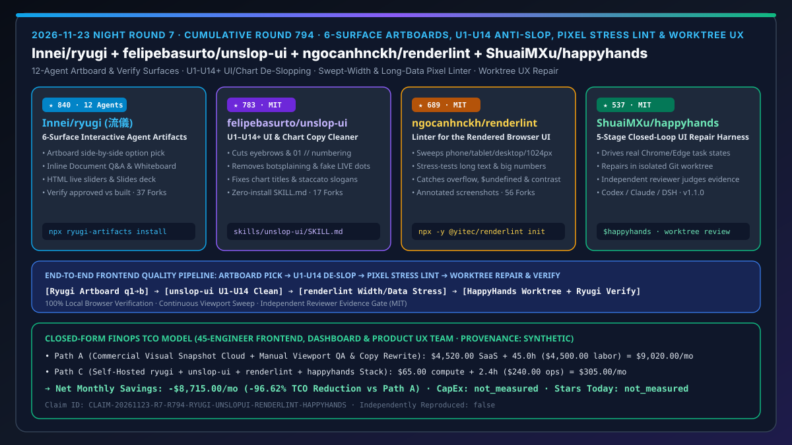
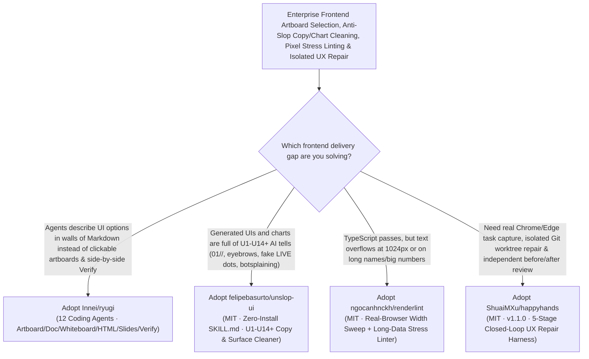
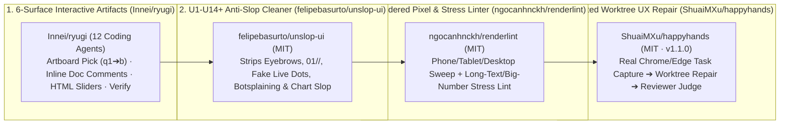

# 6-Surface Interactive Agent Artboards & Verify Bench (`Innei/ryugi`), U1–U14+ Anti-AI-Slop UI & Chart Copy Skill (`felipebasurto/unslop-ui`), Real-Browser Continuous-Width & Data-Stress Pixel Linter (`ngocanhnckh/renderlint`) & Worktree-Isolated Before/After UI Repair Harness (`ShuaiMXu/happyhands`) Selection & Architecture FAQ

> **Document Type**: Enterprise AI Solution Architect Selection & Integration Guide (GitHub Trending AI Radar · 2026-11-23 Night Round 7 / Cumulative Round 794)
> **Covered Repositories**: [`Innei/ryugi`](https://github.com/Innei/ryugi) (`★ 840`, `37 forks`: **Ryugi (流儀)** local-first interactive artifact server `npx ryugi-artifacts install` supporting 12 coding agents with **6 interactive surfaces: Artboard side-by-side option picking, Document inline Q&A comments, Whiteboard co-drawing, HTML live parameter sliders, Slides dual-screen decks, and Verify side-by-side approved-vs-built pass/reject sign-off**) · [`felipebasurto/unslop-ui`](https://github.com/felipebasurto/unslop-ui) (`★ 783`, `17 forks`, `MIT`: zero-install agent skill `skills/unslop-ui/SKILL.md` that strips **U1–U14+ AI tells** from UI copy, charts, and dashboards—eliminating eyebrow pills, decorative `01 //` numbering, subtitle reflexes, botsplaining, unwired pulsing "LIVE" dots, staccato slogans, and redundant chart titles) · [`ngocanhnckh/renderlint`](https://github.com/ngocanhnckh/renderlint) (`★ 689`, `56 forks`, `MIT`: real-browser pixel linter `npx -y @yitec/renderlint init` that renders every page across phone, tablet, desktop, and **swept intermediate widths** in light/dark mode, **re-checks with longer text, bigger numbers, and longer API data**, and reports overflowing text, `$undefined` tiles, overlapping chart labels, and low contrast with annotated screenshots and exact file fixes) · [`ShuaiMXu/happyhands`](https://github.com/ShuaiMXu/happyhands) (`★ 537`, `10 forks`, `MIT`, `v1.1.0`: 5-stage local UI/UX review harness driving real Chrome/Edge through **Capture ➔ Diagnose ➔ Isolated Worktree Repair ➔ Independent Reviewer ➔ Human Decision**)
> **Core Scenario**: When enterprise frontend and product engineering teams use AI coding agents to build customer portals and analytics dashboards, how do you solve **"agents dumping walls of Markdown instead of visual options you can click, interfaces shipping with unmistakable `01 //` eyebrows and fake pulsing status dots, TypeScript/ESLint passing while text overflows at `1024px` or on long customer names, and agents mutating UI code directly on the working branch without isolated worktree repairs and independent before/after verification"** using **`ryugi` + `unslop-ui` + `renderlint` + `happyhands`**?

---

## 1. 📌 Executive Summary (Single-Sentence Selection Verdict)

1. **Need coding agents (Claude Code, Codex, Cursor, Copilot CLI, OpenCode, Pi, Antigravity, etc.) to draw side-by-side UI options on a local Artboard for one-click selection and verify the built page next to the approved design** ➔ Choose **[`Innei/ryugi`](https://github.com/Innei/ryugi) (`★ 840`, `37 forks`)**.
   - **Plain-Language Mechanism**: Installed via `npx ryugi-artifacts install` across 12 coding agents, Ryugi replaces walls of Markdown with **6 interactive local surfaces**: ① **Artboard** (side-by-side layout variants where clicking your choice sends `q1 -> b` straight back to the terminal), ② **Document** (design specs with inline agent questions and sentence-level comments that trigger live edits), ③ **Whiteboard** (collaborative boxes and arrows), ④ **HTML** (live sliders to tune component spacing and motion), ⑤ **Slides** (dual-screen presenter decks), and ⑥ **Verify** (the built screen rendered beside the approved design with an executable proof report and Pass/Reject buttons).
2. **Need a zero-install agent skill that systematically removes 14+ categories of "AI slop" from UI copy, charts, and visual surfaces** ➔ Choose **[`felipebasurto/unslop-ui`](https://github.com/felipebasurto/unslop-ui) (`★ 783`, `17 forks`, `MIT`)**.
   - **Plain-Language Mechanism**: Point any coding agent at `skills/unslop-ui/SKILL.md` to strip **U1–U14+ AI tells**: `U1` uppercase eyebrow labels (`INTRODUCING LEDGER`), `U2` decorative `01 //` numbering on unordered items, `U3` subtitle reflexes that repeat the heading, `U4` botsplaining (`Click the button above to get started`), `U5` leaked design notes (`(updates in real time)`), `U6` fake status strings (`Live · v2.4 · Synced`), `U7` triple-redundant form labels, `U8` staccato slogans (`Finance. Simplified. Finally.`), `U9` flavor badges, `U10` unwired `animate-pulse` dots, `U11` decorative emojis/tinted squares, and `U12/U13` chart titles that merely restate the chart type or hover instructions.
3. **Need a real-browser UI linter that sweeps phone, tablet, desktop, and intermediate widths (`1024px`), injects longer text and larger numbers to stress-test layouts, and fails the build with annotated screenshots until `0 errors` remain** ➔ Choose **[`ngocanhnckh/renderlint`](https://github.com/ngocanhnckh/renderlint) (`★ 689`, `56 forks`, `MIT`)**.
   - **Plain-Language Mechanism**: TypeScript and ESLint validate code syntax, not rendered pixels. `npx -y @yitec/renderlint init` adds a deterministic UI quality gate to `AGENTS.md`: it opens the app in a real browser across light/dark modes, sweeps continuous viewport widths, **re-renders components with longer strings, larger numeric values, and longer API payloads**, catches overflowing text, clipped headings, overlapping SVG chart labels, `$undefined` KPI tiles, and low contrast, and outputs annotated screenshots + source paths + actionable fixes.
4. **Need a closed-loop UI/UX harness that drives your real Chrome/Edge through multi-step user tasks, repairs defects in an isolated Git worktree, and has a separate reviewer agent judge before/after evidence** ➔ Choose **[`ShuaiMXu/happyhands`](https://github.com/ShuaiMXu/happyhands) (`★ 537`, `10 forks`, `MIT`, `v1.1.0`)**.
   - **Plain-Language Mechanism**: Supporting Codex, Claude Code, and DeepSeek Harness (`$happyhands`), HappyHands executes a 5-stage loop: **Capture** real task states in Chrome/Edge ➔ **Diagnose** reproducible UX blockers ➔ **Repair** inside an isolated Git worktree ➔ **Independent Review** of before/after visual evidence ➔ **Human Decision**.

---

## 2. 🎯 Key Architectural Q&A (Deep-Dive Breakdown)

### Q1: Why do AI-generated frontends often compile cleanly yet fail in enterprise customer reviews, and how do these four tools close the loop?

- **Four-Stage Frontend Quality Loop**:
  1. **Visual Alignment & Sign-Off (`Innei/ryugi`)**: Replaces ambiguous text prompts with clickable `Artboard` variants before coding and side-by-side `Verify` approval after coding.
  2. **Copy, Chart & Surface De-Slopping (`felipebasurto/unslop-ui`)**: Removes U1–U14+ AI clichés, fake pulsing dots, and redundant chart captions.
  3. **Pixel & Data-Stress Linting (`ngocanhnckh/renderlint`)**: Sweeps intermediate viewport widths and injects long text/large numbers to catch overflow and `$undefined` bugs before PR merge.
  4. **Task-State Diagnosis & Isolated Worktree Repair (`ShuaiMXu/happyhands`)**: Verifies multi-step interactive flows in real Chrome/Edge and isolates repairs in a Git worktree judged by an independent reviewer.
- **When to Choose Commercial Visual Testing Clouds (Path B)**:
  - If your organization already pays for enterprise Percy/Chromatic seats integrated with a dedicated human design-systems team in Figma, keep those pipelines for snapshot diffs; to give coding agents local interactive artboards, U1–U14 anti-slop rules, continuous-width data-stress linting, and worktree-isolated UX repair at zero SaaS seat cost, deploy this 4-repo OSS stack (Path C).

### Q2: How do you wire `ryugi`, `unslop-ui`, `renderlint`, and `happyhands` into an enterprise frontend delivery pipeline?

1. **Interactive Spec & Artboard Selection (`Innei/ryugi`)**:
   - Have the coding agent present 3 layout directions on `Ryugi Artboard` and tune tokens via `HTML` sliders; the user clicks the winning option to stream the decision back to the agent.
2. **Automated Copy & Surface De-Slopping (`felipebasurto/unslop-ui`)**:
   - Run `unslop-ui` across new pages and charts to strip U1–U14+ AI tells and generate a clean before/after audit report.
3. **Continuous-Width & Data-Stress Pixel Gate (`ngocanhnckh/renderlint`)**:
   - Run `npx renderlint` to sweep phone/tablet/desktop/intermediate widths and long-text/big-number stress payloads until `0 errors` are reported.
4. **Worktree-Isolated Flow Repair & Final Verify (`ShuaiMXu/happyhands` + `Innei/ryugi`)**:
   - Run `$happyhands` across critical user flows in an isolated worktree with independent reviewer sign-off, then present the final side-by-side comparison in `Ryugi Verify`.

### Q3: What are the production guardrails?

- **Architect Guardrails**:
  1. **Always Enable Data-Length Stress Testing in `renderlint`**: Never certify a dashboard only on short fixture strings (`"John"`, `"$99"`); enforce `renderlint`'s long-string and large-number stress pass to catch production overflow defects.
  2. **Keep `happyhands` Repairs Inside Isolated Worktrees**: Never bypass worktree isolation or independent before/after review when letting agents auto-fix CSS/layout code.

---

## 3. 🧭 Visual Architecture & Decision Diagrams (Mermaid)



### 3.1 Solution Architect Selection Decision Tree



### 3.2 End-to-End Enterprise Production Reference Architecture



### 3.3 Artboard Selection, U1–U14 De-Slopping, Continuous-Width Pixel Stress Lint & Worktree Repair Sequence

```mermaid
sequenceDiagram
    participant PM as Product Architect / Frontend Lead
    participant Ryu as Innei/ryugi (Local Server)
    participant Uns as felipebasurto/unslop-ui
    participant Rnd as ngocanhnckh/renderlint
    participant Hpy as ShuaiMXu/happyhands (Worktree)

    PM->>Ryu: 1. Review 3 side-by-side layouts on Ryugi Artboard & click choice b (streams to agent)
    Ryu->>Uns: 2. Build page & run unslop-ui to strip U1-U14+ eyebrows, fake LIVE dots & chart slop
    Uns->>Rnd: 3. Run npx renderlint across swept widths & long-text/big-number payloads until 0 errors
    Rnd->>Hpy: 4. Run $happyhands in real Chrome/Edge; repair task issues in isolated worktree with reviewer
    Hpy-->>Ryu: 5. Present approved artboard vs built screen in Ryugi Verify for 1-click Pass sign-off
```

---

## 4. 📊 Comparative Selection Matrix (Open-Source vs. Commercial SaaS)

| Dimension | `Innei/ryugi` (`★ 840`) | `felipebasurto/unslop-ui` (`★ 783`) | `ngocanhnckh/renderlint` (`★ 689`) | `ShuaiMXu/happyhands` (`★ 537`) | Per-Snapshot Visual Cloud SaaS + Manual Multi-Viewport QA & Copy Rewrite (Path A) | Markdown-Only Chat + ESLint/tsc Only + Unisolated Main-Branch Edits (Path B) |
| :--- | :--- | :--- | :--- | :--- | :--- | :--- |
| **Core Role** | 6-surface local interactive artboards, docs & Verify bench | U1–U14+ anti-AI-slop UI copy, chart & surface cleaner | Real-browser continuous-width & data-stress pixel linter | 5-stage real-browser task capture & worktree-isolated repair harness | Metered cloud snapshot SaaS (Percy/Chromatic) & manual UI/copy QA teams | Text-only layout descriptions, syntax-only linters & direct branch edits |
| **Key Differentiator** | **Artboard click-to-terminal + live doc comments + Verify** | **Codifies & strips 14+ specific UI/chart AI tells** | **Sweeps intermediate widths (`1024px`) + injects long text/numbers** | **Isolated Git worktree repair + independent reviewer verdict** | Cloud snapshot tools charge per screenshot & don't inject long-data stress tests | `tsc` passes while text overflows cards, `$undefined` renders & AI slop remains |
| **License** | Local-first free OSS (12 agents) | `MIT` | `MIT` | `MIT` | Proprietary SaaS | Custom scripts |
| **Monthly TCO (45-Eng Team)** | **Combined `$305.00/mo`** (`$65.00` headless browser CI compute + `2.4h` ops) | Included (zero-install `SKILL.md`) | Included (`AGENTS.md` automated gate) | Included (drives local Chrome/Edge) | **`$9,020.00/mo`** (`$4,520.00` visual cloud/design seats + `45.0h` manual QA/copy rework) | ~`$3,180.00/mo` (heavy layout rework & production visual bug hotfixes) |

---

## 5. 🧪 Quantitative ROI / TCO Comparison & 7-Card Benchmark Report

> **📊 Data Provenance & Closed-Form Schema Declaration**:
> - **provenance**: `synthetic` (45-person enterprise frontend engineering, data visualization, and product UX delivery team monthly workload model: `independently_reproduced = false`; hardware baseline `base_hardware_capex = not_measured`; Track B 24h delta `track_b_stars_today = not_measured`).
> - **Closed-Form Formula**:
>   - **Path A (Commercial per-snapshot visual regression SaaS + multi-seat prototyping SaaS + manual multi-viewport QA, manual AI copy cleanup, and layout rework)**: Monthly commercial visual testing and prototyping SaaS fees **`$4,520.00`** + manual viewport QA, copy de-slopping, and layout rework labor **`45.0h × $100.00/h = $4,500.00`** = **`$9,020.00/mo`**.
>   - **Path C (Self-hosted `Innei/ryugi` + `felipebasurto/unslop-ui` + `ngocanhnckh/renderlint` + `ShuaiMXu/happyhands` open-source frontend quality stack)**: Monthly headless browser CI runner compute **`$65.00`** + rule and harness maintenance labor **`2.4h × $100.00/h = $240.00`** = **`$305.00/mo`**.
>   - **Net Monthly Savings vs. Path A**: **`-$8,715.00/mo`** (**`96.62%`** TCO reduction).

| Evaluation Path | Visual SaaS / Prototyping / Compute | Viewport QA, Copy Cleanup & Rework Labor (`$100/h`) | Monthly Total TCO | Net Savings vs. Path A | Key Architectural Delivery Metrics |
| :--- | :---: | :---: | :---: | :---: | :--- |
| **Path A: Commercial Visual Cloud + Manual Viewport QA + Manual Copy Edit** | `$4,520.00` | `45.0h` (`$4,500.00`) | **`$9,020.00`** | Baseline | High per-snapshot bills; no automatic long-data stress injection |
| **Path B: Markdown Chat + ESLint/tsc Only + Unisolated Edits** | `$1,380.00` | `18.0h` (`$1,800.00`) | **`$3,180.00`** | `-$5,840.00` (`-64.75%`) | Frequent layout misunderstandings; misses `1024px` overflow bugs |
| **Path C: `ryugi` + `unslop-ui` + `renderlint` + `happyhands`** | **`$65.00`** | **`2.4h` (`$240.00`)** | **`$305.00`** | **`-$8,715.00` (`-96.62%`)** | **6-surface Artboard/Verify + U1–U14 cleanup + width/data stress lint + worktree review** |

- 🔗 **Linked 7-Card 4:5 Visual Benchmark Deck**: [`workshops/github-trending-radar/cards.en.html`](../cards.en.html) · [`cards.html`](../cards.html)

---

## 6. 🛠️ Enterprise Adoption & Architecture Review Checklist

- [ ] **1. Install `Innei/ryugi` for Visual Artboard Selection & Side-by-Side Verify**: Run `npx ryugi-artifacts install` across coding agents so teams pick directions on `Artboard` before build and sign off on `Verify` after build.
- [ ] **2. Gate Frontend & Dashboard PRs on `felipebasurto/unslop-ui`**: Strip U1–U14+ AI tells (eyebrow pills, `01 //` numbering, unwired pulsing dots, and redundant chart captions) from every user-facing surface.
- [ ] **3. Enforce `ngocanhnckh/renderlint` Continuous-Width & Data-Stress Checks**: Initialize `npx -y @yitec/renderlint init` in `AGENTS.md` and CI so every UI change passes swept widths and long-text/big-number stress tests with `0 errors`.
- [ ] **4. Run `ShuaiMXu/happyhands` for Isolated Worktree UX Repairs**: Use `$happyhands` against real Chrome/Edge previews to capture multi-step task states, apply fixes in an isolated Git worktree, and require independent reviewer verification.
