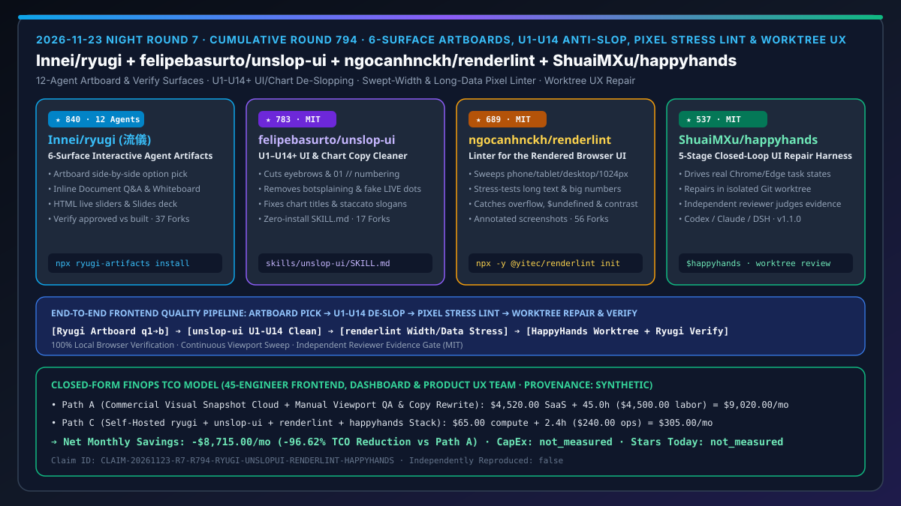
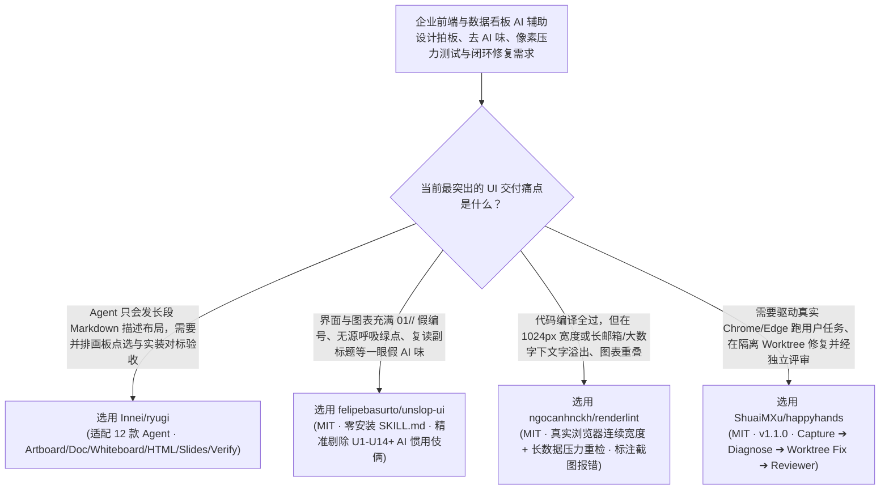
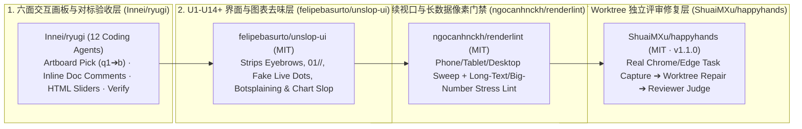
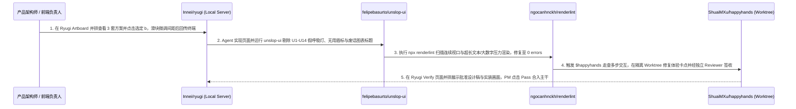

# 跨 12 款编码智能体的六合一交互式画板与验收工作台（`Innei/ryugi`）、清理 U1–U14+ AI 界面黑话与图表废话技能（`felipebasurto/unslop-ui`）、真实浏览器多宽度扫描与数据膨胀压力像素 Linter（`ngocanhnckh/renderlint`）与隔离 Worktree 前后证据独立评审 UI 自愈套件（`ShuaiMXu/happyhands`）选型与集成架构 FAQ

> **文档类型**：企业 AI 解决方案架构师（AI Solution Architect）选型决策指南（GitHub Trending AI 雷达 2026-11-23 Night Round 7 / 累计第 794 轮）
> **覆盖项目**：[`Innei/ryugi`](https://github.com/Innei/ryugi)（`★ 840`、`37 forks`：流儀 **Ryugi** 跨 Claude Code、Codex、Cursor、Copilot CLI 等 12 款编码 Agent 的本地交互式制品引擎 `npx ryugi-artifacts install`，提供 **Artboard 多方案并排点选、Document 行内问答批注、Whiteboard 共绘画布、HTML 实时滑块调参、Slides 双屏演示与 Verify 成品对标验收** 6 大工作面并实时回推终端会话）· [`felipebasurto/unslop-ui`](https://github.com/felipebasurto/unslop-ui)（`★ 783`、`17 forks`、`MIT`：零安装去除界面与图表“AI 塑料味”的规范化技能，精准剔除 **U1 眉标大写标签、U2 装饰性 `01 //` 编号、U3 复读机副标题、U4 机器人说教、U6 伪造 `Live · Synced` 状态栏、U8 顿挫口号、U10 假呼吸绿点与 U12/U13 废话图表标题** 等 14+ 类典型 AI 痕迹）· [`ngocanhnckh/renderlint`](https://github.com/ngocanhnckh/renderlint)（`★ 689`、`56 forks`、`MIT`：面向渲染后真实像素的浏览器级 UI Linter `npx -y @yitec/renderlint init`，自动在手机/平板/桌面及中间连续宽度扫描，并**注入更长文本、更大金额数字与更长 API 数据做压力重检**，揪出文本溢出、`$undefined` 指标卡、图表标签重叠与暗色模式对比度失效）· [`ShuaiMXu/happyhands`](https://github.com/ShuaiMXu/happyhands)（`★ 537`、`10 forks`、`MIT`、`v1.1.0`：驱动本机真实 Chrome/Edge 的五步闭环 UI 体验修复 Harness **Capture ➔ Diagnose ➔ Isolated Worktree Repair ➔ Independent Reviewer ➔ Decision**）
> **核心场景**：当企业前端与产品交付团队使用 AI Coding Agent 开发客户门户、数据看板与 SaaS 界面时，面对**“Agent 用大段 Markdown 空谈三种布局却无法直接点选拍板、生成的页面到处是 `01 //` 眉标与无意义呼吸绿点等一眼假 AI 味、TypeScript 编译全绿但一遇到长邮箱或 `1024px` 宽度就文字溢出破版、以及 Agent 直接在当前分支盲改 UI 缺乏隔离 Worktree 与独立评审比对”**四大痛点，如何构建一套**“六面交互拍板与对标验收（`ryugi`）+ 14 类 AI 文案/图表去味（`unslop-ui`）+ 连续宽度与长文本像素压力门禁（`renderlint`）+ 隔离 Worktree 独立评审修复（`happyhands`）”**的前端交付流水线？

---

## 一、📌 核心结论速览（选型一句话结论）

1. **想让 12 款主流编码 Agent 不再甩出几千字 Markdown 让人类脑补 UI，而是直接在本地打开 Artboard 并排画出 3 套真实方案供点选（`q1 -> b`），并在开发完成后打开 Verify 页面将“实装页面 vs 当初批准的设计稿”并排验收** ➔ 选 **[`Innei/ryugi`](https://github.com/Innei/ryugi)（`★ 840`，`37 forks`）**。
   - **通俗原理**：一行 `npx ryugi-artifacts install` 即可接入 Claude Code、Codex、Cursor、Copilot CLI、OpenCode、Pi、Antigravity 等 12 款工具。它定义了 **6 类本地优先交互页面**：① **Artboard**（多套设计方向并排展示，点选直接回传终端）；② **Document**（带行内提问的设计文档，支持逐句批注自动触发 Agent 修改并原地热更新）；③ **Whiteboard**（人机共绘框线图）；④ **HTML**（带真实滑块调校组件间距或动画阻尼）；⑤ **Slides**（带副屏提词器的演示文稿）；⑥ **Verify**（左侧已批准方案、右侧真实构建页面 + Agent 自证报告，一键 Pass 或 Reject）。
2. **想一键洗掉 AI 生成界面和 BI 图表里让人审美疲劳的 14+ 种“AI 惯用伎俩（AI Tells）”——如到处乱加的微字号大写眉标、`01 //` 假序号、不接后端的绿色呼吸圆点、以及写着“周活折线图 / 悬停查看详情”的废话图表标题** ➔ 选 **[`felipebasurto/unslop-ui`](https://github.com/felipebasurto/unslop-ui)（`★ 783`，`17 forks`，`MIT`）**。
   - **通俗原理**：零安装纯 `SKILL.md` 驱动，将 AI 界面的典型病灶提炼为 **U1–U14+ 确定性规则编号**：清除 `U1` 眉标胶囊（`INTRODUCING LEDGER`）、`U2` 无先后顺序却强加的 `01 //`、`U3` 把标题换个词再说一遍的副标题反射、`U4` 解释“点击上方按钮开始”的机器人说教、`U5` 泄露给用户的 `(powered by AI)` 备注、`U6` 写死的 `Live · v2.4 · Synced`、`U8` 三词顿挫口号（`Finance. Simplified. Finally.`）、`U10` 绑在静态数据旁的 `animate-pulse` 绿点、以及 `U12/U13` 把图表类型当标题的无效文字，并在结案时输出清晰的删改对照报告。
3. **想在 CI 与每次 UI 修改后启动真实浏览器，不仅测手机/平板/桌面三个固定断点，还自动扫描中间过渡宽度（如只在 `1024px` 截断的 Bug）并自动注入超长姓名/大额数字/异常 `$undefined` 数据做像素级压力测试** ➔ 选 **[`ngocanhnckh/renderlint`](https://github.com/ngocanhnckh/renderlint)（`★ 689`，`56 forks`，`MIT`）**。
   - **通俗原理**：TypeScript 与 ESLint 只能证明代码语法没报错，却看不见“长邮箱溢出卡片边界、SVG 图表坐标轴标签叠在一起、KPI 卡片显示 `$undefined`、灰底灰字看不清”。执行 `npx -y @yitec/renderlint init`，它会将 UI 质量门禁写入 `AGENTS.md`：每次改动后自动在真实浏览器遍历明暗主题与连续视口宽度，执行**长文本与大数据压力重渲染**，为每一处视觉缺陷生成**带红框标注的截图 + 源码文件定位 + 可执行修复指令**，直到 `0 errors` 才放行。
4. **想让编码 Agent 驱动本机已登录的真实 Chrome/Edge 走完完整用户任务状态机，抓出真正卡住操作流的体验问题，在隔离的 Git Worktree 中完成修复，并交由另一个独立 Reviewer 子代理对照修改前后证据严格打分** ➔ 选 **[`ShuaiMXu/happyhands`](https://github.com/ShuaiMXu/happyhands)（`★ 537`，`10 forks`，`MIT`）**。
   - **通俗原理**：区别于只看单张静态截图的工具，`happyhands`（支持 Codex、Claude Code 与 DSH）沿着一条真实用户任务路径连续抓取页面状态，只报告有可复现观测证据的缺陷；随后自动切出**独立 Git Worktree** 实施代码修复，并强制拉起一位**独立 Reviewer 角色**比对修复前后的真实渲染证据，确认通过后再交由人类拍板合入。

---

## 二、🎯 客户与架构师灵魂拷问 Q&A（深度架构拆解）

### Q1：为什么企业用 AI 写前端代码速度提升了 5 倍，但最终交付给客户时却经常被吐槽“一眼假、破版多、改起来乱”？这四个工具如何形成闭环？

- **前端 AI 交付的四道防线**：
  1. **设计对齐防线（写代码前与交工时）➔ `Innei/ryugi`**：用 `Artboard` 多方案可视化点选代替文字猜谜，用 `Verify` 并排比对批准稿与实装页。
  2. **文案与图表审美防线（消除 AI Slop）➔ `felipebasurto/unslop-ui`**：按 U1–U14+ 规则剥离假状态灯、无用眉标、三词口号与废话图表说明。
  3. **像素与动态数据压力防线（编译后渲染门禁）➔ `ngocanhnckh/renderlint`**：用连续宽度扫描 + 超长文本/大数字注入测试，拦截 `1024px` 破版与 `$undefined` 泄漏。
  4. **多步交互走查与隔离修复防线（独立评审）➔ `ShuaiMXu/happyhands`**：用真实 Chrome/Edge 跑任务流、隔离 Worktree 改码并由独立 Reviewer 复核前后截图。
- **何时直接选用商业设计/测试云平台（Path B）？**
  - 若团队拥有专职 UI 设计师全量维护 Figma 组件库且已采购 Percy / Chromatic 企业级云端视觉回归席位，可继续沿用商业流水线；若希望编码 Agent 在本地零云端席位费完成“多方案画板点选 + 去 AI 味 + 浏览器连续宽度与长数据压测 + 隔离 Worktree 自愈”，则采用本轮四合一开源栈（Path C）。

### Q2：典型企业级“Ryugi 方案拍板 ➔ Unslop-UI 去味 ➔ Renderlint 像素压力门禁 ➔ HappyHands 隔离自愈”架构怎么搭？

1. **交互式多方案探索与行内批注层（`Innei/ryugi`）**：
   - 架构师或产品经理下达需求，Agent 在本地 `Ryugi Artboard` 渲染 3 套布局并通过 `HTML` 滑块微调参数，人类点击选定方案。
2. **界面文案与图表去 AI 味清洗层（`felipebasurto/unslop-ui`）**：
   - 组件生成后自动加载 `skills/unslop-ui/SKILL.md`，清理 U1–U14+ 冗余装饰、假状态栏与废话图表标题。
3. **真实浏览器连续视口与数据膨胀门禁层（`ngocanhnckh/renderlint`）**：
   - 自动运行 `npx renderlint`，扫描手机/平板/桌面及中间宽度并注入超长字段，依据标注截图修完所有溢出与对比度报错直至 `0 errors`。
4. **任务流走查、隔离 Worktree 修复与 Verify 终审层（`ShuaiMXu/happyhands` + `Innei/ryugi`）**：
   - 运行 `$happyhands` 驱动真实 Chrome/Edge 走完业务流，在隔离 Worktree 修复交互阻塞并经独立 Reviewer 签字，最后在 `Ryugi Verify` 双栏页面由人类一键 `Pass`。

### Q3：这套架构的落地注意事项与红线是什么？

- **核心优势**：
  - **100% 本地优先运行**，无需将未发布的产品界面上传至外部视觉测试 SaaS，且天然兼容 Claude Code、Codex、Cursor 等全部主流编码 Agent。
- **架构师落地红线**：
  1. **动态数据膨胀测试不可跳过**：许多界面在 Mock 短名字（如 `"John"`、`"$99"`）下完美无缺，一上生产遇到长企业名或百万级金额就破版，必须启用 `renderlint` 的长文本与大数字重检机制。
  2. **修复动作强制隔离在独立 Worktree**：使用 `happyhands` 自动修 UI 时，必须保持其默认的隔离 Git Worktree 模式，防止未经独立 Reviewer 确认的样式改动污染主工作区。

---

## 三、🧭 直观可视化图解（Mermaid 决策树 + 集成架构 + 时序图）

### 3.1 架构师选型决策树

### 3.2 企业端到端生产集成参考架构图

### 3.3 画板点选、U1–U14 去味、浏览器长数据像素压测与 Worktree 独立评审时序图

---

## 四、📊 同类开源与商业云服务横向选型决策矩阵

| 对比维度 | `Innei/ryugi` (`★ 840`) | `felipebasurto/unslop-ui` (`★ 783`) | `ngocanhnckh/renderlint` (`★ 689`) | `ShuaiMXu/happyhands` (`★ 537`) | 商业云端视觉回归 SaaS (Percy/Chromatic) + 专职 UI 走查团队手工改稿 (Path A) | 纯终端 Markdown 盲聊 + 仅跑 ESLint/tsc + 主分支直接盲改 (Path B) |
| :--- | :--- | :--- | :--- | :--- | :--- | :--- |
| **核心能力定位** | 跨 12 款 Agent 的六面交互式画板、文档与对标验收台 | 剔除 U1–U14+ 界面/图表 AI 塑料味的零安装技能 | 真实浏览器连续宽度扫描与长数据压力像素 Linter | 真实浏览器状态抓取、隔离 Worktree 修复与独立评审 Harness | 按截图量计费的商业视觉测试云与高成本人工 UI 走查返工 | 无可视化画板的纯文字对话、看不见像素错误的静态编译检查 |
| **核心技术突破** | **Artboard 点选直通终端 + 行内批注热更 + Verify 双栏验收** | **精准定义并切除 14+ 类 UI 与图表 AI 惯用废话/假状态** | **扫描 `1024px` 等中间宽度 + 自动塞入长文本/大数字测溢出** | **五步闭环 + 隔离 Git Worktree 修复 + 独立 Reviewer 前后裁决** | 商业视觉回归云只对比快照差异，不会主动注入长文本测试破版 | `tsc` 全绿但线上文字出框、充满 `$undefined` 与一眼假的 `01 //` 眉标 |
| **开源协议** | 本地免费开源（12 Agent 适配） | `MIT` | `MIT` | `MIT` | 闭源商业 SaaS | 内部脚本 |
| **月度 TCO（45 人团队）** | **组合仅 `$305.00/月`**（`$65.00` 本地无头浏览器 CI 容器 + `2.4h` 维护） | 同左（零安装纯 `SKILL.md`） | 同左（内置 AGENTS.md 自动化门禁） | 同左（复用本机 Chrome/Edge 零云端费） | **`$9,020.00/月`**（`$4,520.00` 商业视觉测试云/设计协作席位 + `45.0h` 人工 UI 走查返工） | 约 `$3,180.00/月`（大量客户投诉破版与反复沟通布局返工工时） |

---

## 五、🧪 应用落地定量收益/TCO 对比与 7-Card 报告

> **📊 数据来源与闭式核算声明（Provenance & Closed-Form Schema）**：
> - **provenance**: `synthetic`（基于 45 人企业前端工程、数据可视化与产品体验交付团队月度工作负载模型：`independently_reproduced = false`；硬件采购基线 `base_hardware_capex = not_measured`；Track B 单日增量 `track_b_stars_today = not_measured`）。
> - **核算公式**：
>   - **Path A（采购按快照计费的商业云端视觉回归 SaaS + 商业多席位原型评审工具 + 前端与设计团队手工逐屏排查文本溢出、手动删改 AI 塑料味文案与多轮推翻重做布局）**：月度商业视觉测试与协作 SaaS 账单 **`$4,520.00`** + 人工多分辨率走查、文案去味与布局返工工时 **`45.0h × $100.00/h = $4,500.00`** = **`$9,020.00/月`**。
>   - **Path C（自建 `Innei/ryugi` + `felipebasurto/unslop-ui` + `ngocanhnckh/renderlint` + `ShuaiMXu/happyhands` 开源前端质量与交互交付栈）**：CI 浏览器渲染容器分摊开销 **`$65.00`** + 规则集与工作流维护人工 **`2.4h × $100.00/h = $240.00`** = **`$305.00/月`**。
>   - **净节省（Net Savings vs Path A）**：**`-$8,715.00/月`**（成本降低 **`96.62%`**）。

| 评估方案 | 视觉测试云 / 协作席位 / 容器成本 | UI 走查、去味与布局返工人工（`$100/h`） | 月度总 TCO | 相对 Path A 净节省 | 关键架构交付指标 |
| :--- | :---: | :---: | :---: | :---: | :--- |
| **Path A：商业视觉测试云 + 人工多端走查 + 手工改 AI 文案** | `$4,520.00` | `45.0h` (`$4,500.00`) | **`$9,020.00`** | Baseline | 快照按张计费昂贵；不会自动注入长文本/大数字测溢出 |
| **Path B：纯 Markdown 选方案 + 仅跑 ESLint/tsc + 主分支盲改** | `$1,380.00` | `18.0h` (`$1,800.00`) | **`$3,180.00`** | `-$5,840.00` (`-64.75%`) | 频繁选错布局返工；漏检 `1024px` 破版与 `$undefined` |
| **Path C：`ryugi` + `unslop-ui` + `renderlint` + `happyhands`** | **`$65.00`** | **`2.4h` (`$240.00`)** | **`$305.00`** | **`-$8,715.00` (`-96.62%`)** | **6 面画板点选/Verify + U1–U14 去味 + 连续宽度长数据压测 + Worktree 独立评审** |

- 🔗 **关联 7-Card 4:5 视觉评测报告**：[`workshops/github-trending-radar/cards.html`](../cards.html) · [`cards.en.html`](../cards.en.html)

---

## 六、🛠️ 企业引入与架构评审 Checklist

- [ ] **1. 安装 `Innei/ryugi` 建立“先画板点选、后 Verify 对标”交付规范**：通过 `npx ryugi-artifacts install` 接入团队编码 Agent，要求新页面开发前先在 `Artboard` 提供多方案点选，交工时在 `Verify` 完成批准稿与实装页同屏比对。
- [ ] **2. 将 `felipebasurto/unslop-ui` 设为所有前端与看板 PR 的文案/视觉清洗门禁**：强制扫描并剔除 U1–U14+ 典型 AI 痕迹（无用大写眉标、`01 //` 编号、无源 `Live` 绿点与废话图表标题）。
- [ ] **3. 在 `AGENTS.md` 与 CI 中初始化 `ngocanhnckh/renderlint`**：运行 `npx -y @yitec/renderlint init`，强制每次 UI 变更通过手机/平板/桌面连续宽度扫描及长文本/大数字膨胀压力测试（`0 errors`）。
- [ ] **4. 引入 `ShuaiMXu/happyhands` 执行关键用户路径隔离修复与独立评审**：针对核心转化漏斗与复杂表单，运行 `$happyhands` 在隔离 Git Worktree 中修复交互缺陷，并经独立 Reviewer 核验前后证据后再合入主分支。
