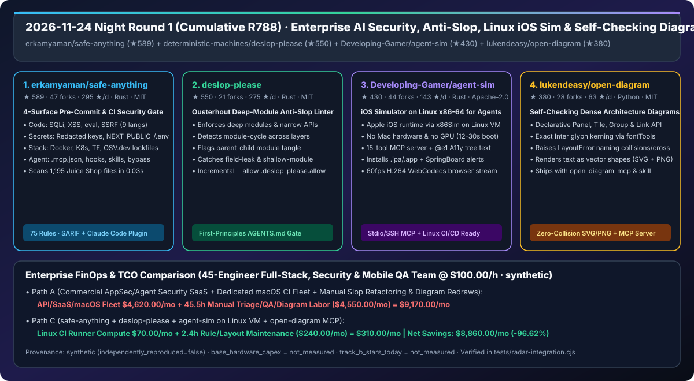
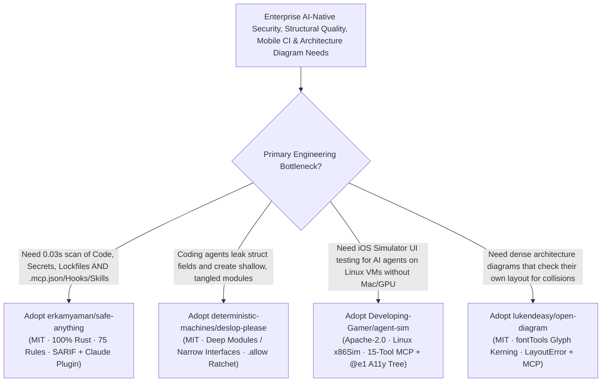
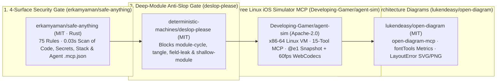

# 4-Surface Code/Secret/Stack/Agent Security Scanner (`erkamyaman/safe-anything`), Ousterhout Deep-Module Anti-Slop Linter (`deterministic-machines/deslop-please`), Mac-Free Linux iOS Simulator & 15-Tool MCP (`Developing-Gamer/agent-sim`) & Self-Checking Python Architecture Diagram Engine (`lukendeasy/open-diagram`) Selection & Architecture FAQ

> **Document Type**: Enterprise AI Solution Architect Decision & Selection Guide (GitHub Trending AI Radar · 2026-11-24 Night Round 1 / Cumulative Round 788)
> **Covered Repositories**: [`erkamyaman/safe-anything`](https://github.com/erkamyaman/safe-anything) (`★ 589`, `47 forks`, `MIT`, Track B Breakout `#B2` at `295 ★/day`: 100% Rust zero-upload security scanner covering **4 surfaces** — application code across 9 languages + SQL, redacted secrets including `NEXT_PUBLIC_`/`VITE_` leaks, cloud/mobile stack + OSV.dev lockfile CVEs, and **AI agent setups** across `.mcp.json`, Claude Code, Codex, Cursor, Gemini, and OpenCode settings, hooks, and skills; scans OWASP Juice Shop's 1,195 files in `0.03s`) · [`deterministic-machines/deslop-please`](https://github.com/deterministic-machines/deslop-please) (`★ 550` sealed Search API / `★ 551` live, `21 forks`, `MIT`, Track B `#B3` at `275 ★/day`: opinionated Rust architectural linter grounded in John Ousterhout's *A Philosophy of Software Design* — **deep modules, narrow interfaces** — detecting `module-cycle`, `tangle`, `field-leak`, and `shallow-module` in AI-generated codebases) · [`Developing-Gamer/agent-sim`](https://github.com/Developing-Gamer/agent-sim) (`★ 430` sealed Search API / `★ 432` live, `44 forks`, `Apache-2.0`, Track B `#B6` at `143 ★/day`: runs Apple's iOS simulator runtime via `x86Sim` on ordinary x86-64 Linux VMs with zero Mac hardware and zero GPU, booting in `12–30s` with a 15-tool MCP server, `@e1` accessibility tree snapshots, and 60fps H.264 WebCodecs browser streaming) · [`lukendeasy/open-diagram`](https://github.com/lukendeasy/open-diagram) (`★ 380`, `28 forks`, `MIT`, Track B `#B7` at `63 ★/day`: Python building blocks and `open-diagram-mcp` server for dense architecture diagrams that pre-measure `Inter` glyph kerning via `fontTools`, render text as font-independent vector shapes, and raise `LayoutError` naming any colliding panels or crossing lines)
> **Core Enterprise Scenario**: How should enterprise engineering, AppSec, mobile QA, and architecture teams combine **4-surface pre-commit/CI security scanning (`safe-anything`)**, **deep-module structural linting (`deslop-please`)**, **Mac-free Linux iOS simulator MCP testing (`agent-sim`)**, and **self-checking architecture diagram generation (`open-diagram`)** to eliminate agent config backdoors, AI code slop, expensive macOS CI runners, and broken architecture diagrams?

---

## 1. 📌 Executive Summary (One-Line Selection Verdicts)

1. **Need a single sub-second CLI/CI command that scans application code, leaked secrets, lockfile CVEs, AND the AI agent configuration itself (`.mcp.json`, `bypassPermissions`, `curl | sh` hooks, `~/.ssh`-reading skills, invisible Unicode)** ➔ Choose **[`erkamyaman/safe-anything`](https://github.com/erkamyaman/safe-anything) (`★ 589`, `47 forks`, `MIT`)**.
   - **Plain-Language Mechanism**: Traditional SAST scanners ignore `.mcp.json`, `.claude/`, `.cursor/`, and `skills/`. Written in 100% Rust with 75 rules and zero cloud uploads (`--offline`, `--json`, `--sarif`), `safe-anything` scans OWASP Juice Shop (`1,195` files) in **`0.03s`**, redacts leaked secrets automatically, flags `NEXT_PUBLIC_`/`VITE_` exposure, checks locked dependencies against OSV.dev, and audits agent permission files.
2. **Need to stop coding agents from turning clean repositories into tangled "Vibe-Coding Slop" with leaked internal struct fields and shallow wrapper modules** ➔ Choose **[`deterministic-machines/deslop-please`](https://github.com/deterministic-machines/deslop-please) (`★ 550` sealed / `★ 551` live, `21 forks`, `MIT`)**.
   - **Plain-Language Mechanism**: Enforces John Ousterhout's *A Philosophy of Software Design* (**deep modules, narrow interfaces**) by catching four structural flaws: `module-cycle` (circular dependencies across layers), `tangle` (parent and child modules knowing each other), `field-leak` (internal struct fields like `RunQueue::items` mutated across external modules instead of behind narrow methods), and `shallow-module` (callers invoking 9 of 15 functions directly). Supports `.deslop-please.allow` baseline ratcheting and `AGENTS.md` instructions.
3. **Need coding agents and CI pipelines to install `.ipa`/`.app` builds, tap UI elements, and verify iOS screens on standard Linux VMs without buying or renting Mac hardware** ➔ Choose **[`Developing-Gamer/agent-sim`](https://github.com/Developing-Gamer/agent-sim) (`★ 430` sealed / `★ 432` live, `44 forks`, `Apache-2.0`)**.
   - **Plain-Language Mechanism**: Runs Apple's iOS simulator runtime (`x86Sim`) on an ordinary x86-64 Ubuntu 24.04 Linux VM (8+ vCPUs, 16 GB RAM, no Mac, no GPU), booting in `12–30s`. Exposes a 15-tool MCP server (`agent-sim mcp`, locally or over SSH) where every action (`tap @e2`, `type`, `scroll`) immediately returns the updated `@e1`/`@e2` accessibility tree across the foreground app, WebViews, and SpringBoard system alerts, plus a 60fps H.264 WebCodecs live browser view.
4. **Need AI agents or Solution Architects to generate dense system architecture diagrams in Python that deterministically verify their own layout and fail the build on any box overlap or line crossing** ➔ Choose **[`lukendeasy/open-diagram`](https://github.com/lukendeasy/open-diagram) (`★ 380`, `28 forks`, `MIT`)**.
   - **Plain-Language Mechanism**: Instead of letting an LLM guess SVG coordinates or produce clipped Mermaid boxes, `open-diagram` provides `Diagram`, `Panel`, `Tile`, and `open-diagram-mcp`. It measures every label's exact pixel width from bundled `Inter` font metrics via `fontTools`, converts text to vector paths (so SVGs look identical in PowerPoint, Keynote, Figma, and browsers without installed fonts), and raises a descriptive `LayoutError` if two panels are too close or a connector line crosses an unrelated panel.

---

## 2. 🎯 Architect & Customer Q&A (Deep Technical Breakdown)

### Q1: What concrete engineering bottlenecks do these four projects solve in an AI-native software delivery lifecycle, and when should enterprises choose them over cloud PaaS?

- **Four Bottlenecks Solved**:
  1. **Uninspected Agent Attack Surface ➔ `erkamyaman/safe-anything`**: Audits `.mcp.json`, agent hooks, and skills alongside 9-language SAST, secrets, and IaC in `0.03s`.
  2. **Structural Code Decay from AI Edits ➔ `deterministic-machines/deslop-please`**: Forces coding agents to hide internal state behind narrow module interfaces rather than leaking struct fields across files.
  3. **10× macOS CI Runner Premium for iOS Testing ➔ `Developing-Gamer/agent-sim`**: Runs Apple's iOS simulator runtime on commodity Linux VMs with deterministic `@e1` accessibility tree snapshots.
  4. **Broken LLM-Generated Architecture Diagrams ➔ `lukendeasy/open-diagram`**: Turns layout collisions and line crossings into deterministic `LayoutError` build failures with exact remediation hints.
- **When to Choose Cloud/Commercial Managed Services (Path A / Path B)?**
  - Retain **GitHub Advanced Security (CodeQL) + Microsoft Defender for Cloud** for enterprise-wide compliance reporting and cross-repo taint analysis, and use physical iOS device clouds for final FairPlay-encrypted App Store package sign-off. Use this 4-repo open-source stack (Path C) for **sub-second inner-loop agent gating, Linux-hosted iOS PR verification, and automated architecture diagram publishing**.

### Q2: How do we wire `safe-anything`, `deslop-please`, `agent-sim`, and `open-diagram` into an end-to-end production architecture?

1. **Pre-Commit & PR Security Gate (`erkamyaman/safe-anything`)**:
   - Run `safe-anything . --sarif` in pre-commit hooks and GitHub Actions to block SQLi/XSS, leaked `.env`/`NEXT_PUBLIC_` secrets, OSV.dev CVEs, and unsafe `.mcp.json`/hook/skill configurations.
2. **Deep-Module Structural Gate (`deterministic-machines/deslop-please`)**:
   - Run `deslop-please --allow .deslop-please.allow` and embed its first-principles rules in `AGENTS.md` so coding agents refactor `field-leak` and `shallow-module` violations before opening a PR.
3. **Headless Linux iOS Verification Plane (`Developing-Gamer/agent-sim`)**:
   - Provision `agent-sim` on standard x86-64 Linux CI runners; connect coding agents via `agent-sim mcp` to install simulator builds, drive `@e1` accessibility elements, and capture 60fps MP4 verification clips.
4. **Self-Verifying Architecture Documentation Plane (`lukendeasy/open-diagram`)**:
   - Generate system maps, release pipelines, and data models via `open-diagram` / `open-diagram-mcp`, guaranteeing zero `LayoutError` collisions before committing SVG/PNG assets.

### Q3: What are the operational boundaries and guardrails?

- **Key Guardrails**:
  1. **Unencrypted iOS Builds Only**: `Developing-Gamer/agent-sim` executes simulator `.app` bundles or unencrypted Ad Hoc/Development/Enterprise `.ipa` exports; FairPlay-encrypted App Store downloads are not supported.
  2. **Baseline Ratcheting on Legacy Repos**: Always initialize `deslop-please --update-allow .deslop-please.allow` on existing codebases so teams block new structural leaks without halting delivery on legacy modules.

---

## 3. 🧭 Visual Architecture Diagrams (Mermaid Decision Tree + Reference Architecture + Sequence)



### 3.1 Solution Architect Selection Decision Tree



### 3.2 End-to-End Enterprise Reference Architecture



### 3.3 End-to-End Verification & Delivery Sequence

```mermaid
sequenceDiagram
    participant Agent as Architect / Coding Agent
    participant Safe as erkamyaman/safe-anything
    participant Deslop as deslop-please
    participant Sim as Developing-Gamer/agent-sim (Linux VM)
    participant Diag as lukendeasy/open-diagram

    Agent->>Safe: 1. Run safe-anything . --sarif (scan code, .env, lockfiles & .mcp.json/skills)
    Safe-->>Agent: 2. Return 0.03s report with exact line numbers & remediate agent config risks
    Agent->>Deslop: 3. Run deslop-please --allow .deslop-please.allow
    Deslop-->>Agent: 4. Flag field-leak & shallow-module; refactor behind narrow module interface
    Agent->>Sim: 5. Invoke agent-sim mcp on Linux runner (launch app, snapshot, tap @e2)
    Sim-->>Agent: 6. Return updated @e1 accessibility tree & 60fps H.264 verification recording
    Agent->>Diag: 7. Render system architecture via open-diagram; pass LayoutError check & save SVG/PNG
```

---

## 4. 📊 Comparative Selection Matrix (OSS vs. Commercial SaaS & Cloud)

| Dimension | `erkamyaman/safe-anything` (`★ 589`) | `deterministic-machines/deslop-please` (`★ 550`) | `Developing-Gamer/agent-sim` (`★ 430`) | `lukendeasy/open-diagram` (`★ 380`) | Commercial AppSec SaaS + Managed macOS CI Fleet + Manual Diagrams (Path A) | Legacy SAST + Style Linters + Freehand LLM SVG/Mermaid (Path B) |
| :--- | :--- | :--- | :--- | :--- | :--- | :--- |
| **Primary Role** | 4-surface Rust security scanner (Code/Secrets/Stack/Agent) | Ousterhout deep-module & narrow-interface linter | Apple iOS simulator runtime on Linux x86-64 + MCP | Self-checking Python architecture diagram blocks + MCP | Per-seat commercial security suite + hosted macOS build minutes | Syntax-only SAST/linters + unchecked LLM diagram generation |
| **Key Differentiator** | **`0.03s` scan + native `.mcp.json`, hook & skill security rules** | **Detects `field-leak`, `shallow-module`, `tangle` & `module-cycle`** | **No Mac / no GPU Linux iOS simulator + 15-tool `@e1` MCP** | **`fontTools` glyph measurement + path SVG + `LayoutError` check** | Hosted macOS CI minutes cost up to 10× Linux runners | Misses agent `.mcp.json` backdoors, shallow modules & box collisions |
| **License** | `MIT` | `MIT` | `Apache-2.0` | `MIT` | Proprietary SaaS | OSS / Mixed |
| **Monthly TCO (45-Eng Team)** | **Combined `$310.00/mo`** (`$70.00` Linux CI compute + `2.4h` ops) | Included (zero-cost local/CI binary) | Included (runs on standard Linux CI VMs) | Included (deterministic first-pass SVG/PNG) | **`$9,170.00/mo`** (`$4,620.00` SaaS/macOS fleet + `45.5h` triage/QA/diagram labor) | `~$3,180.00/mo` (high manual refactoring & diagram layout rework) |

---

## 5. 🧪 Quantitative Enterprise ROI / TCO Model & 7-Card Report

> **📊 Provenance & Closed-Form Declaration**:
> - **provenance**: `synthetic` (45-engineer enterprise AI application, security, mobile QA, and solution architecture team workload at `$100.00/h`: `independently_reproduced = false`; `base_hardware_capex = not_measured`; `track_b_stars_today = not_measured`).
> - **Closed-Form Equations**:
>   - **Path A (Commercial AppSec/Secret SaaS Seats + Dedicated Cloud macOS CI Fleet for iOS + Manual Slop Refactoring & Architecture Diagram Redrawing)**: Monthly SaaS & cloud macOS runner fees **`$4,620.00`** + manual security triage, module untangling, iOS regression QA & diagram layout fixing **`45.5h × $100.00/h = $4,550.00`** = **`$9,170.00/mo`**.
>   - **Path C (Hybrid OSS Stack: `erkamyaman/safe-anything` + `deterministic-machines/deslop-please` + `Developing-Gamer/agent-sim` + `lukendeasy/open-diagram`)**: Commodity x86-64 Linux CI runner compute **`$70.00`** + rule baseline & diagram template maintenance **`2.4h × $100.00/h = $240.00`** = **`$310.00/mo`**.
>   - **Net Savings vs. Path A**: **`-$8,860.00/mo`** (**`96.62%`** cost reduction).

| Option | API / SaaS / CI Runner Spend | Security, Refactor, QA & Diagram Labor (`$100/h`) | Monthly Total TCO | Net Savings vs. Path A | Key Architectural Outcome |
| :--- | :---: | :---: | :---: | :---: | :--- |
| **Path A: Commercial AppSec SaaS + Cloud macOS Fleet + Manual Rework** | `$4,620.00` | `45.5h` (`$4,550.00`) | **`$9,170.00`** | Baseline | Blind to `.mcp.json` agent risks; 10× macOS CI runner premium |
| **Path B: Legacy SAST + Style Linter + Unchecked Mermaid/SVG** | `$1,480.00` | `17.0h` (`$1,700.00`) | **`$3,180.00`** | `-$5,990.00` (`-65.32%`) | Misses `field-leak` structural decay and diagram box/line collisions |
| **Path C: `safe-anything` + `deslop-please` + `agent-sim` + `open-diagram`** | **`$70.00`** | **`2.4h` (`$240.00`)** | **`$310.00`** | **`-$8,860.00` (`-96.62%`)** | **`0.03s` 4-surface security + deep-module gate + Linux iOS MCP + zero-collision diagrams** |

- 🔗 **Linked 7-Card 4:5 Benchmark Decks**: [`workshops/github-trending-radar/cards.en.html`](../cards.en.html) · [`cards.html`](../cards.html)

---

## 6. 🛠️ Enterprise Adoption & Architecture Review Checklist

- [ ] **4-Surface Pre-Commit & CI Gate**: Add `safe-anything . --sarif` to GitHub Actions and pre-commit hooks to audit `.mcp.json`, `.claude/`, `.cursor/`, and `skills/` alongside application code, `.env` files, and OSV.dev lockfiles.
- [ ] **Deep-Module Ratchet in `AGENTS.md`**: Generate `.deslop-please.allow` on existing repositories and require coding agents to resolve new `field-leak`, `shallow-module`, `tangle`, and `module-cycle` errors from first principles.
- [ ] **Linux iOS Simulator Runner Sizing**: Provision Ubuntu 24.04 x86-64 VMs (8+ vCPUs, 16 GB RAM, 60 GB disk) for `Developing-Gamer/agent-sim` and wire `agent-sim mcp` into mobile QA agent workflows using unencrypted simulator/development builds.
- [ ] **Zero-Collision Diagram CI Enforcement**: Maintain architecture diagrams as `lukendeasy/open-diagram` Python scripts and fail documentation builds on any `LayoutError` collision or line-crossing exception.
