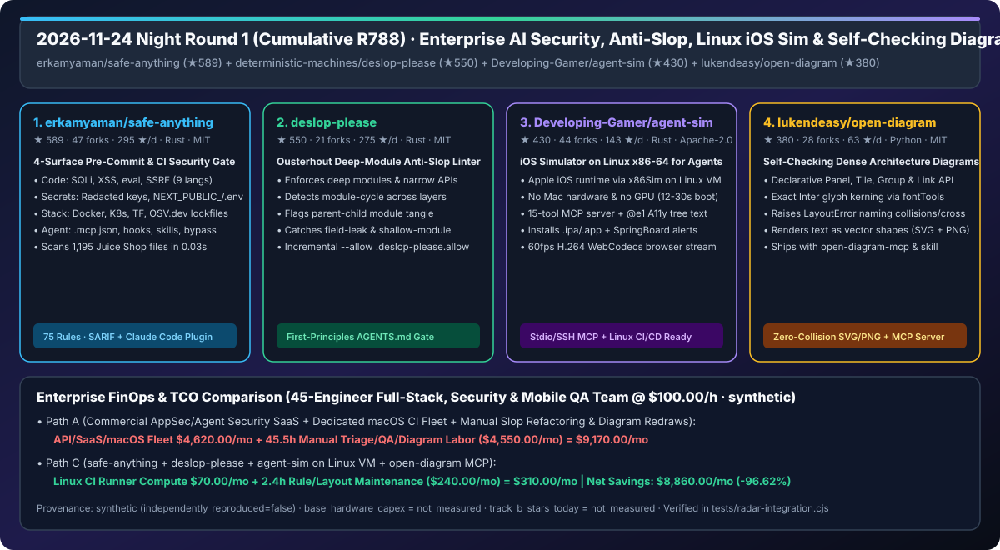
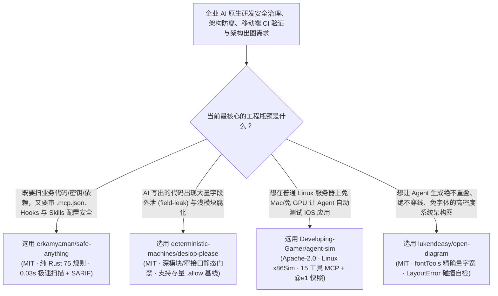
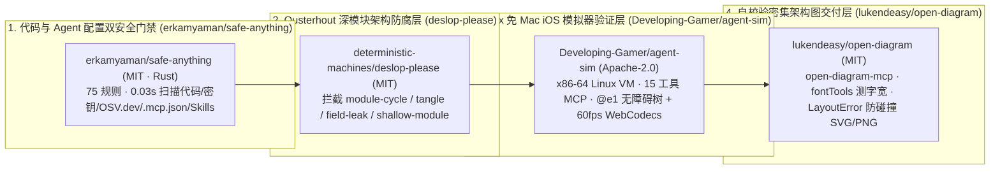
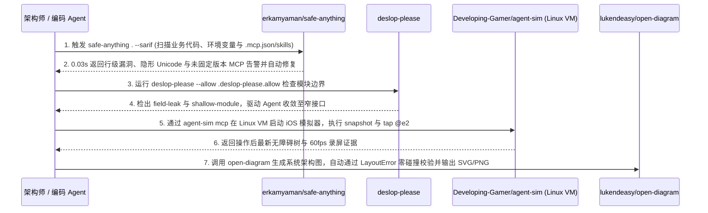

# 四维代码/密钥/依赖/Agent 配置全栈安全扫描门禁（`erkamyaman/safe-anything`）、基于 Ousterhout 深模块原则的反 AI Slop 结构化 Linter（`deterministic-machines/deslop-please`）、免 Mac/免 GPU 的 Linux 端 iOS 模拟器与 15 工具 MCP（`Developing-Gamer/agent-sim`）及自校验布局碰撞的 Python 密集架构图引擎与 MCP（`lukendeasy/open-diagram`）选型与集成架构 FAQ

> **文档类型**：企业 AI 解决方案架构师（AI Solution Architect）选型决策指南（GitHub Trending AI 雷达 2026-11-24 Night Round 1 / 累计第 788 轮）
> **覆盖项目**：[`erkamyaman/safe-anything`](https://github.com/erkamyaman/safe-anything)（`★ 589`、`47 forks`、`MIT`，赛道 B 新仓爆发速率榜 `#B2`（`295 ★/天`）：100% 纯 Rust 编写的零外传全栈安全扫描器，单条命令覆盖 **代码漏洞**（9 语言 + SQL 的 SQLi/XSS/SSRF/`eval`）、**泄露密钥**（自动脱敏输出并拦截 `NEXT_PUBLIC_`/`VITE_` 前端暴露）、**云与依赖栈**（Docker/K8s/Terraform + OSV.dev 锁文件 CVE）及 **AI Agent 自身配置**（`.mcp.json`、Claude Code/Codex/Cursor/Gemini/OpenCode 的 `bypassPermissions`、`curl | sh` 恶意 Hook、读取 `~/.ssh` 的恶意 Skill 与未固定版本的 MCP），实测在 `0.03s` 内扫完 OWASP Juice Shop 1,195 个文件检出 67 个问题）· [`deterministic-machines/deslop-please`](https://github.com/deterministic-machines/deslop-please)（`★ 550` [Search API 封存快照] / 实时 `★ 551`、`21 forks`、`MIT`，赛道 B `#B3`（`275 ★/天`）：遵循 John Ousterhout《软件设计哲学》**“深模块、窄接口（Deep Modules, Narrow Interfaces）”**原则的 Rust 架构质量门禁，专门拦截 AI 编码智能体高频制造的 `module-cycle`、`tangle`、`field-leak` 与 `shallow-module` 四大结构腐化）· [`Developing-Gamer/agent-sim`](https://github.com/Developing-Gamer/agent-sim)（`★ 430` [Search API 封存快照] / 实时 `★ 432`、`44 forks`、`Apache-2.0`，赛道 B `#B6`（`143 ★/天`）：无需 Mac 硬件、无需 GPU，直接在普通 x86-64 Ubuntu 24.04 Linux 虚拟机上运行 Apple iOS Simulator Runtime (`x86Sim`)，`12–30s` 冷启动，提供 15 个工具的标准 MCP Server 与 `@e1` 无障碍树快照，支持 60fps H.264 WebCodecs 浏览器实时画面流）· [`lukendeasy/open-diagram`](https://github.com/lukendeasy/open-diagram)（`★ 380`、`28 forks`、`MIT`，赛道 B `#B7`（`63 ★/天`）：专为人类架构师与 AI Agent 设计的自校验密集架构图 Python 构建块与 MCP Server (`open-diagram-mcp`)，通过 `fontTools` 精确测量捆绑 `Inter` 字体的字距字宽，将文字转为矢量轮廓路径，并在保存时自动检测面板间距不足或连线穿框、抛出指名道姓的 `LayoutError`）
> **核心场景**：当企业规模化引入 AI 编码智能体后，面临**“传统 SAST 根本不审 `.mcp.json`/Hooks/Skills 导致 Agent 权限后门裸奔、AI 写出的代码虽然单测能过但内部字段满天飞（`field-leak`）形成浅模块泥潭、Linux CI/CD 流水线跑 iOS 端 UI 验收被迫采购昂贵 Mac 物理集群、以及 AI 画出的架构图频繁出现文字出框和连线穿面板”**四大工程痛点时，如何用这四个高热度开源项目构建端到端研发治理、移动验证与架构交付底座？

---

## 一、📌 核心结论速览（选型一句话结论）

1. **想用一条命令在本地 Pre-commit 与 GitHub Actions CI 中同时扫清业务代码漏洞、前端暴露密钥、锁文件 CVE，以及最危险的 AI Agent 配置漏洞（如 `.mcp.json` 硬编码 Token、`bypassPermissions`、偷读 `~/.ssh` 的恶意 Skill）** ➔ 选 **[`erkamyaman/safe-anything`](https://github.com/erkamyaman/safe-anything)（`★ 589`，`47 forks`，`MIT`）**。
   - **通俗原理**：传统 SAST（Semgrep / SonarQube）只懂扫应用代码，对仓库里的 `.claude/`、`.cursor/`、`.mcp.json` 和 `skills/` 视而不见。`safe-anything` 采用 100% 纯 Rust 实现 75 条高信号规则，无需联网注册或上传代码（支持 `--offline`、JSON 与 GitHub Code Scanning `--sarif`），实测在 Apple M4 上仅需 **`0.03 秒`** 即可扫完 OWASP Juice Shop 的 `1,195` 个文件，精准定位行号、原因与修复方案，且自带 `.claude-plugin` 让 Agent 边写边自查。
2. **想根治 AI 编码智能体“为了省事把内部结构体字段设为 `pub` 到处直接读写、把模块拆得又浅又碎（Vibe-Coding Slop）”的架构腐化病** ➔ 选 **[`deterministic-machines/deslop-please`](https://github.com/deterministic-machines/deslop-please)（`★ 550` 封存值 / `★ 551` 实时，`21 forks`，`MIT`）**。
   - **通俗原理**：把斯坦福教授 John Ousterhout《软件设计哲学》的核心思想编译成确定性静态检查器。它不抓括号空格，专抓 4 类导致代码库失控的结构性坏味道：① **`module-cycle`**（跨模块循环依赖）；② **`tangle`**（父模块与子模块互相耦合）；③ **`field-leak`**（结构体内部字段如 `RunQueue::items` 被外部多个模块直接读写，而非收敛在 `push`/`pop` 窄接口后）；④ **`shallow-module`**（调用方被迫直接调用某模块 15 个函数中的 9 个，缺乏深模块抽象）。支持 `--update-allow .deslop-please.allow` 存量基线豁免与 `AGENTS.md` 第一性原理重构约束。
3. **想让编码 Agent 或 CI/CD 流水线在普通低成本 Linux 服务器上自动安装 `.ipa`、点按测试 iOS 应用并读取屏幕无障碍树，彻底摆脱昂贵的 Mac mini 托管机房** ➔ 选 **[`Developing-Gamer/agent-sim`](https://github.com/Developing-Gamer/agent-sim)（`★ 430` 封存值 / `★ 432` 实时，`44 forks`，`Apache-2.0`）**。
   - **通俗原理**：通过 `x86Sim` 在普通 x86-64 Ubuntu 24.04 Linux 虚拟机（8 核 / 16 GB 内存，零 Mac 硬件、零独立 GPU）上直接拉起 Apple 官方 iOS Simulator Runtime，仅需 `12–30 秒` 即可启动。通过 `claude mcp add agent-sim -- agent-sim mcp`（或跨 SSH 隧道）向 Agent 暴露 15 个工具（`snapshot`、`tap`、`type`、`scroll`、`install`、`launch` 等）；每次动作执行后自动返回包含前台 App、WebView 与 SpringBoard 系统弹窗的 `@e1`/`@e2` 文本无障碍树，无需每次重新调视觉多模态模型猜坐标，还能通过 `agent-sim serve` 在浏览器观看 60fps H.264 实时画面。
4. **想让 AI 架构师或编码 Agent 用几十行 Python 代码画出高密度企业系统架构图，且在生成 SVG/PNG 时由引擎自动检查文字出框、面板重叠与连线穿过面板并报错拦截** ➔ 选 **[`lukendeasy/open-diagram`](https://github.com/lukendeasy/open-diagram)（`★ 380`，`28 forks`，`MIT`）**。
   - **通俗原理**：手写 SVG 或让 LLM 盲猜坐标画架构图时，十有八九会出现文字截断、框压框或箭头直接穿过别的组件。`open-diagram` 提供 `Diagram`、`Panel`、`Tile`、`d.right_of`、`d.link` 声明式积木与 `open-diagram-mcp` 服务：在排版前先用 `fontTools` 按内置 `Inter` 字体真实字距（Kerning）算出每个标签精确像素宽度，把文字直接渲染为矢量曲线（导入 PowerPoint、Keynote、Figma 永不乱码缺字体），一旦发现两个面板间距小于最小阈值或连线穿过非目标面板，立即在 `save()` 时抛出指名道姓的 `LayoutError`（如 `'Storage' and 'Recommendations' are only 9 px apart (minimum 16)`），逼迫 Agent 在交付给客户前修正布局。

---

## 二、🎯 客户与架构师灵魂拷问 Q&A（深度架构拆解）

### Q1：在企业推进“Agent 原生研发流水线与架构交付标准化”时，这四个开源项目各自补齐了哪块关键拼图？何时选它们 vs 云厂商托管服务？

- **四大工程拼图**：
  1. **安全左移（Code + Agent 双审）➔ `erkamyaman/safe-anything`**：一次性封堵业务代码漏洞与 `.mcp.json`/Skill 供应链投毒。
  2. **架构防腐（Deep Modules 门禁）➔ `deterministic-machines/deslop-please`**：防止 AI 编码在多次迭代后把清晰的模块边界改得千疮百孔。
  3. **移动验收（Linux 免 Mac iOS 仿真）➔ `Developing-Gamer/agent-sim`**：让 Linux K8s/VM Runner 直接跑 iOS 端到端无障碍树交互回归。
  4. **架构出图（编译期防碰撞校验）➔ `lukendeasy/open-diagram`**：让架构文档与系统全景图实现“代码即图表、重叠即报错”。
- **何时直接用云厂商/商业托管方案（Path A / Path B）？**
  - 若企业需要覆盖全语言的深度污点追踪与合规报表归档，可在主干合并后保留 **GitHub Advanced Security (CodeQL) + Microsoft Defender for Cloud**；若需要 iOS App Store 最终 FairPlay 加密包真机压测，仍需在发版最后一步使用真机设备池。但在 **日常每次 PR / Agent 循环的秒级反馈阶段**，采用本轮四合一开源栈（Path C）可将安全扫描降至 `0.03s`、省去 90% 的云端 Mac 构建分钟费，并彻底杜绝架构图排版返工。

### Q2：典型企业级“代码与 Agent 安全门禁 (`safe-anything`) + 深模块防腐 (`deslop-please`) + Linux iOS 仿真 (`agent-sim`) + 自检架构图 (`open-diagram`)”生产架构怎么搭？

1. **开发者与编码 Agent 本地护栏层（`safe-anything` + `deslop-please`）**：
   - 在仓库 `AGENTS.md` 与 Git Pre-commit Hook 中同时挂载 `safe-anything .`（拦截高危代码漏洞、前端暴露环境变量及恶意 `.mcp.json`/Hooks/Skills）与 `deslop-please --allow .deslop-please.allow`（拦截新增 `field-leak`、`module-cycle`、`tangle` 与 `shallow-module`）。
2. **Linux CI/CD 与远程 iOS 交互测试层（`Developing-Gamer/agent-sim`）**：
   - 在企业内网 Ubuntu 24.04 Linux 构建机上部署 `agent-sim`，通过 `agent-sim mcp` 或 CLI 自动安装模拟器构建包（`.app` / 未加密 `.ipa`），由 Agent 基于 `@e1` 无障碍树快照自动走查登录、支付与深色模式流，并录制 MP4 留存证据。
3. **自校验架构资产持续生成层（`lukendeasy/open-diagram`）**：
   - 架构师与 Agent 通过 `open-diagram-mcp` 维护系统全景图、发布流水线图与数据流图脚本；CI 执行 Python 脚本生成矢量路径 SVG 与 PNG，任何面板碰撞或连线穿框均由 `LayoutError` 自动阻断并提示精确坐标修复建议。

### Q3：这套架构的局限性与生产落地红线是什么？

- **架构师落地红线**：
  1. **FairPlay 加密包边界**：`Developing-Gamer/agent-sim` 运行的是未加密的开发构建（Simulator `.app` 或 Ad Hoc / Development / Enterprise 未加密 `.ipa`），从 App Store 直接下载的 FairPlay DRM 加密包无法直接运行。
  2. **存量技术债渐进式收敛**：在老项目引入 `deterministic-machines/deslop-please` 时，切勿一次性强制清零数千条历史告警；应先执行 `deslop-please --update-allow .deslop-please.allow` 冻结存量基线，仅对增量 PR 实行零容忍。

---

## 三、🧭 直观可视化图解（Mermaid 决策树 + 集成架构 + 时序图）

### 3.1 架构师选型决策树

### 3.2 企业端到端生产集成参考架构图

### 3.3 全栈安全扫描、深模块重构、Linux iOS 交互回归与架构图自检时序图

---

## 四、📊 同类开源与商业云服务横向选型决策矩阵

| 对比维度 | `erkamyaman/safe-anything` (`★ 589`) | `deterministic-machines/deslop-please` (`★ 550`) | `Developing-Gamer/agent-sim` (`★ 430`) | `lukendeasy/open-diagram` (`★ 380`) | 商业 AppSec SaaS + 云端专用 Mac 构建池 + 手工调架构图 (Path A) | 传统单维 SAST + 常规格式 Linter + 盲写 Mermaid/SVG (Path B) |
| :--- | :--- | :--- | :--- | :--- | :--- | :--- |
| **核心能力定位** | 代码/密钥/依赖/Agent 配置四维 Rust 扫描器 | Ousterhout 深模块/窄接口结构化 Linter | 普通 Linux 虚拟机运行 iOS 模拟器与 MCP | 编译期自校验碰撞与穿线的 Python 架构图引擎 | 按席位计费的商业安全套件与高价托管 macOS 分钟包 | 仅扫普通代码语法、不管 Agent 配置与布局碰撞 |
| **核心技术突破** | **`0.03s` 极速扫描 + 专审 `.mcp.json`/Hooks/Skills 风险** | **精准量化 `field-leak`、`shallow-module`、`tangle` 与循环依赖** | **免 Mac/免 GPU 在 x86-64 Linux 跑 iOS + `@e1` 动作即时回显** | **`fontTools` 真实字宽测量 + 矢量路径免字体 + `LayoutError` 自检** | 商业云端 Mac Runner 按分钟计费昂贵（常为 Linux 的 10×） | 传统 Linter 放过浅模块腐化；LLM 裸画 SVG 频繁重叠穿框 |
| **开源协议** | `MIT` | `MIT` | `Apache-2.0` | `MIT` | 闭源商业 SaaS | 开源/混合 |
| **月度 TCO（45 人团队）** | **组合仅 `$310.00/月`**（`$70.00` Linux CI 算力 + `2.4h` 维护） | 同左（本地/CI 零许可费） | 同左（普通 Linux VM 替代高价 Mac 云主机） | 同左（一次生成零重叠 SVG/PNG） | **`$9,170.00/月`**（`$4,620.00` 商业安全席位/Mac 云构建 + `45.5h` 人工排障与改图） | 约 `$3,180.00/月`（大量架构腐化返工与图表手工对齐工时） |

---

## 五、🧪 应用落地定量收益/TCO 对比与 7-Card 报告

> **📊 数据来源与闭式核算声明（Provenance & Closed-Form Schema）**：
> - **provenance**: `synthetic`（基于 45 人企业全栈 AI 研发、应用安全、移动端 QA 与解决方案架构团队月度工作负载模型：`independently_reproduced = false`；硬件采购基线 `base_hardware_capex = not_measured`；Track B 单日增量 `track_b_stars_today = not_measured`）。
> - **核算公式**：
>   - **Path A（采购商业 AppSec/密钥扫描席位 + 租用昂贵云端 macOS CI 构建集群测试 iOS + 架构师手工重构 AI 浅模块代码债与手动拖拽修复架构图重叠）**：月度商业安全 SaaS 与云端 Mac 构建池费用 **`$4,620.00`** + 安全误报分拣、模块解耦、移动端回归与架构图手工排版人工 **`45.5h × $100.00/h = $4,550.00`** = **`$9,170.00/月`**。
>   - **Path C（自建 `erkamyaman/safe-anything` + `deterministic-machines/deslop-please` + `Developing-Gamer/agent-sim` + `lukendeasy/open-diagram` 开源研发治理与架构交付栈）**：标准 x86-64 Linux CI Runner 算力分摊开销 **`$70.00`** + 规则基线与图表模板维护人工 **`2.4h × $100.00/h = $240.00`** = **`$310.00/月`**。
>   - **净节省（Net Savings vs Path A）**：**`-$8,860.00/月`**（成本降低 **`96.62%`**）。

| 评估方案 | API / SaaS / 云构建成本 | 安全分拣、解耦、QA 与改图人工（`$100/h`） | 月度总 TCO | 相对 Path A 净节省 | 关键架构交付指标 |
| :--- | :---: | :---: | :---: | :---: | :--- |
| **Path A：商业安全 SaaS + 云端 Mac CI 集群 + 手工解耦与改图** | `$4,620.00` | `45.5h` (`$4,550.00`) | **`$9,170.00`** | Baseline | 传统 SAST 漏检 `.mcp.json` 风险；云端 Mac Runner 成本高昂 |
| **Path B：单维开源 SAST + 常规格式 Linter + 手写 Mermaid/SVG** | `$1,480.00` | `17.0h` (`$1,700.00`) | **`$3,180.00`** | `-$5,990.00` (`-65.32%`) | 无法拦截 `field-leak` 浅模块腐化；架构图缺乏 `LayoutError` 碰撞自检 |
| **Path C：`safe-anything` + `deslop-please` + `agent-sim` + `open-diagram`** | **`$70.00`** | **`2.4h` (`$240.00`)** | **`$310.00`** | **`-$8,860.00` (`-96.62%`)** | **`0.03s` 四维安全门禁 + 深模块防腐 + Linux 跑 iOS MCP + 零碰撞架构图** |

- 🔗 **关联 7-Card 4:5 视觉评测报告**：[`workshops/github-trending-radar/cards.html`](../cards.html) · [`cards.en.html`](../cards.en.html)

---

## 六、🛠️ 企业引入与架构评审 Checklist

- [ ] **Agent 配置安全必审门禁**：在 CI 中配置 `safe-anything . --sarif`，重点核查所有 `.mcp.json`、`.claude/`、`.cursor/` 与 `skills/` 目录是否存在硬编码密钥、`bypassPermissions`、`curl | sh` 钩子或未固定版本的第三方 MCP Server。
- [ ] **深模块存量基线冻结**：在存量 Rust/工程项目中执行 `deslop-please --update-allow .deslop-please.allow`，并将深模块第一性原理修复规则写入 `AGENTS.md`，严禁编码 Agent 通过机械搬移代码掩盖 `field-leak` 与 `shallow-module`。
- [ ] **Linux iOS 仿真网络与权限隔离**：在 Ubuntu 24.04 (8+ vCPU / 16GB RAM) CI 节点部署 `Developing-Gamer/agent-sim` 时，为 `agent-sim serve` 实时预览端口绑定受控内网访问令牌，并仅加载未加密的测试 `.app`/`.ipa` 构建产物。
- [ ] **架构图零碰撞 CI 校验**：将系统核心架构图纳入 `lukendeasy/open-diagram` 脚本管理，在文档构建流水线中强制要求 `d.save()` 零 `LayoutError` 通过，确保导出的 SVG/PNG 无任何面板重叠或连线穿框。
