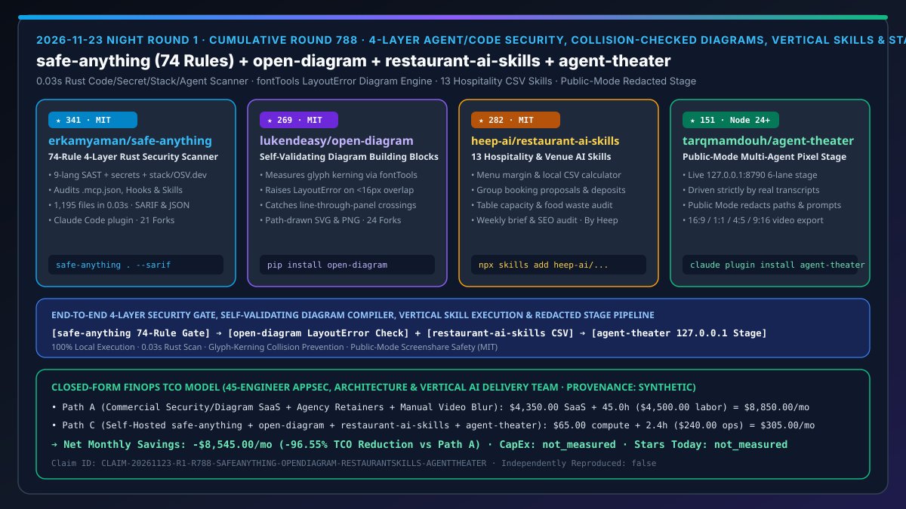
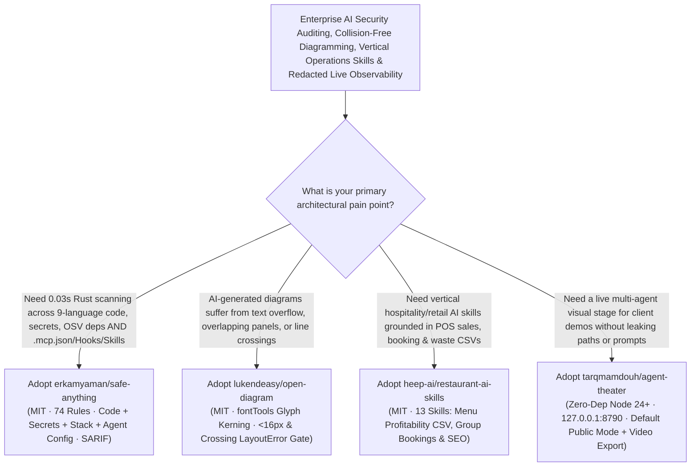
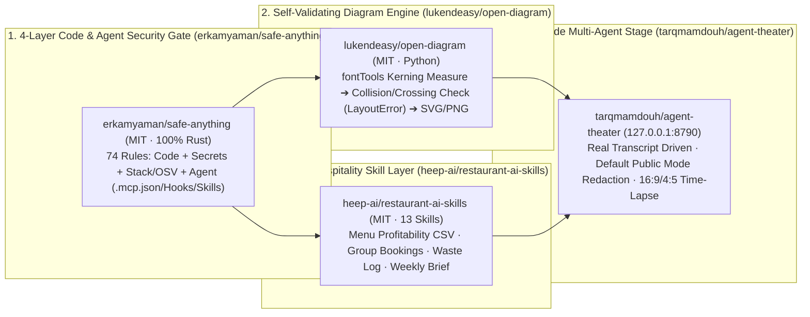

# 74-Rule 4-Layer Code/Secret/Stack/Agent Security Scanner (`erkamyaman/safe-anything`), Self-Validating Architecture Diagram Building Blocks (`lukendeasy/open-diagram`), 13 Production Hospitality & Retail AI Skills (`heep-ai/restaurant-ai-skills`) & Public-Mode Redacted Local Multi-Agent Stage (`tarqmamdouh/agent-theater`) Selection & Architecture FAQ

> **Document Type**: Enterprise AI Solution Architect Selection & Integration Guide (GitHub Trending AI Radar · 2026-11-23 Night Round 1 / Cumulative Round 788)
> **Covered Repositories**: [`erkamyaman/safe-anything`](https://github.com/erkamyaman/safe-anything) (`★ 341`, `21 forks`, `MIT`, Track B Breakout `#B3` at `341 ★/day`: 100% pure-Rust 74-rule security scanner CLI, Claude Code plugin, and GitHub Action scanning OWASP Juice Shop's 1,195 files in `0.03s` across 9-language code vulnerabilities, leaked secrets, cloud/mobile stack configs, OSV.dev lockfiles, and **AI agent configs/hooks/skills** with line-level fixes and SARIF output) · [`lukendeasy/open-diagram`](https://github.com/lukendeasy/open-diagram) (`★ 269`, `24 forks`, `MIT`, Track B `#B8` at `54 ★/day`: Python building blocks for dense architecture diagrams that measure every label's exact glyph kerning via `fontTools` + bundled Inter, render text as font-independent vector shapes, and **automatically check layout geometry**—raising named `LayoutError` exceptions whenever panels are `< 16 px` apart or connector lines cross through panels) · [`heep-ai/restaurant-ai-skills`](https://github.com/heep-ai/restaurant-ai-skills) (`★ 282`, `6 forks`, `MIT`, Track B `#B7` at `71 ★/day`: 13 subscription-free vertical enterprise AI skills maintained by Heep covering menu contribution-margin CSV calculation, table/waitlist optimization, B2B group-booking proposals, kitchen waste reconciliation, weekly executive briefs, review attribution, and local SEO audits) · [`tarqmamdouh/agent-theater`](https://github.com/tarqmamdouh/agent-theater) (`★ 151`, `15 forks`, zero-dependency Node.js 24+: live `127.0.0.1:8790` pixel-art observability stage and Claude Code `/theater` plugin driven strictly by real transcripts/journals, featuring **Public Mode by default** to strip commands, file paths, and prompts for safe client screensharing plus automated `16:9` / `1:1` / `4:5` / `9:16` time-lapse video export)
> **Core Scenario**: When enterprise AI Solution Architects and delivery teams face **"legacy SAST tools missing leaked tokens and malicious hooks inside `.mcp.json`/`SKILL.md`, LLM-generated SVG/Mermaid diagrams suffering from text overflow and line-through-box collisions, generic LLM prompts failing at quantitative POS/booking CSV margin analysis in hospitality/retail, and live multi-agent client demos risking accidental exposure of internal file paths and prompts"**, how do you assemble a production-grade stack combining **4-layer code+agent security gating (`safe-anything`) + glyph-measured collision-checked diagrams (`open-diagram`) + 13 vertical operations skills (`restaurant-ai-skills`) + default-redacted live agent observability (`agent-theater`)**?

---

## 1. 📌 Executive Summary (Single-Sentence Selection Verdict)

1. **Need a single zero-config CLI/CI command (`0.03s` on 1,195 files) that scans 9-language application code, frontend-exposed secrets, K8s/Terraform/OSV dependencies, AND the AI coding agent's own `.mcp.json`, hooks, and skills** ➔ Choose **[`erkamyaman/safe-anything`](https://github.com/erkamyaman/safe-anything) (`★ 341`, `21 forks`, `MIT`)**.
   - **Plain-Language Mechanism**: Built in 100% Rust by the author of `rust-anything`, `safe-anything` enforces **74 deterministic rules** across four planes: ① **Your code** (SQLi, command injection, XSS, `eval`, SSRF, path traversal, unsafe deserialization, weak crypto across 9 languages + SQL); ② **Your secrets** (redacted cloud/AI keys, committed `.env`, real keys left in `.env.example`, secrets behind `NEXT_PUBLIC_` or `VITE_`); ③ **Your stack** (Android/iOS, Docker, GitHub Actions, K8s, Terraform, nginx, and locked dependencies against OSV.dev); and ④ **Your agent** (auditing Claude Code, Codex, Cursor, Gemini, and OpenCode configs for plaintext tokens in `.mcp.json`, `bypassPermissions`, pre-approved Bash, `curl | sh` hooks, skills reading `~/.ssh`, invisible Unicode, and unpinned MCP servers), exporting native `--json` and `--sarif` reports.
2. **Need coding agents (Claude Code, Codex, Cursor) to generate dense enterprise architecture SVGs/PNGs from short Python scripts where every label is glyph-measured and panel collisions or line crossings fail the build by name** ➔ Choose **[`lukendeasy/open-diagram`](https://github.com/lukendeasy/open-diagram) (`★ 269`, `24 forks`, `MIT`)**.
   - **Plain-Language Mechanism**: Freehand LLM SVGs and complex Mermaid charts routinely produce overflowing text and lines cutting across unrelated boxes. With `open-diagram`, agents declare `Diagram`, `Panel`, `Tile`, and relative placement (`d.right_of(...)`); `fontTools` measures exact glyph widths and kerning from bundled Inter before placing blocks, converts text to vector paths (rendering identically in browsers, PowerPoint, Keynote, and Figma without installed fonts), and runs a **deterministic layout verifier** on `save()`—raising `LayoutError` with exact block/line names if two panels are `< 16 px` apart or if a line crosses an intermediate panel without `via_x`/`via_y`.
3. **Need ready-to-install (`npx skills add`), subscription-free vertical AI skills that turn real restaurant/hospitality POS sales, booking, and waste CSV exports into contribution-margin matrices and B2B event proposals** ➔ Choose **[`heep-ai/restaurant-ai-skills`](https://github.com/heep-ai/restaurant-ai-skills) (`★ 282`, `6 forks`, `MIT`)**.
   - **Plain-Language Mechanism**: Maintained by **Heep** (the AI guest communication platform alongside **Painapo** multi-venue analytics and **GetPax** private-hire CRM), this repository provides **13 production `SKILL.md` workflows** across demand generation (`restaurant-marketing`, `restaurant-local-visibility`, `restaurant-seo-audit`, `restaurant-group-bookings`, `reservation-optimizer`), margin engineering (`restaurant-menu-profitability` with a local CSV contribution calculator, `restaurant-menu-copywriting`, `restaurant-food-waste`, `restaurant-weekly-brief`), and guest/team operations (`review-manager`, server pre-shift briefings, and guest FAQ handling).
4. **Need a live secondary-screen visual stage (`http://127.0.0.1:8790`) and time-lapse video exporter for multi-agent coding runs that strips commands, file paths, and prompts by default so you can safely screenshare with enterprise clients** ➔ Choose **[`tarqmamdouh/agent-theater`](https://github.com/tarqmamdouh/agent-theater) (`★ 151`, `15 forks`, zero-dependency Node.js 24+)**.
   - **Plain-Language Mechanism**: Installed as a Claude Code plugin (`/theater`) or standalone local server, `agent-theater` maps real transcript, journal, and run events onto a 6-lane pixel-art stage (coding stations, controller, test pods, merge machine, and vault). When idle, nothing is faked; **Public Mode is enabled by default** so sensitive file paths, shell arguments, and prompts never reach the browser DOM, and any historical window can be rendered into `16:9`, `1:1`, `4:5`, or `9:16` videos from the CLI.

---

## 2. 🎯 Key Architectural Q&A (Deep-Dive Breakdown)

### Q1: What four enterprise delivery gaps do these repositories close, and when should architects pick managed cloud PaaS vs. this open-source stack?

- **Four Delivery Gaps Solved**:
  1. **Unchecked AI Agent Config & Hook Poisoning ➔ `erkamyaman/safe-anything`**: Closes the blind spot where traditional SAST scans application code while ignoring `.mcp.json` secrets, `bypassPermissions`, and malicious skills/hooks.
  2. **Hallucinated Coordinates & Overlapping Boxes in AI Architecture Diagrams ➔ `lukendeasy/open-diagram`**: Replaces blind coordinate guessing with `fontTools` kerning measurement and fail-fast `LayoutError` collision diagnostics (`< 16 px` or panel crossings).
  3. **Generic Prompting Without Domain Financial Grounding in Hospitality/Retail ➔ `heep-ai/restaurant-ai-skills`**: Grounds agent recommendations in actual POS sales-mix CSVs, table capacity constraints, and itemized private-event deposit schedules.
  4. **Opaque Multi-Agent Execution vs. Screenshare Data Leakage ➔ `tarqmamdouh/agent-theater`**: Gives executives and clients an intuitive live progress view and time-lapse artifact while keeping all raw prompts and paths redacted in Public Mode on `127.0.0.1`.
- **When to Choose Managed Cloud PaaS (Path B)**:
  - If your organization relies exclusively on GitHub Advanced Security (GHAS) for enterprise repo scanning and Microsoft 365 Copilot for general office productivity, use managed cloud services; to audit local multi-CLI agent setups (`.mcp.json`/Skills/Hooks), compile collision-checked vector architecture diagrams, run vertical hospitality margin skills, or broadcast redacted live agent stages, deploy this 4-repo open-source stack (Path C).

### Q2: How do you wire `safe-anything`, `open-diagram`, `restaurant-ai-skills`, and `agent-theater` into an end-to-end enterprise architecture?

1. **4-Layer Code & Agent Config Security Gate (`erkamyaman/safe-anything`)**:
   - Run `safe-anything . --sarif` in pre-commit hooks, Claude Code plugins, and CI pipelines to block high/critical code vulnerabilities, frontend secret leaks (`NEXT_PUBLIC_`/`VITE_`), OSV dependency CVEs, and unsafe agent settings before merge.
2. **Self-Validating Architecture Diagram Compiler (`lukendeasy/open-diagram`)**:
   - Have coding agents emit Python scripts using `Diagram`, `Panel`, and `Tile`; `open-diagram` measures glyph widths, verifies zero `< 16 px` overlaps or line crossings, and outputs font-independent SVG/PNG diagrams.
3. **Vertical Hospitality & Retail Operations Skill Layer (`heep-ai/restaurant-ai-skills`)**:
   - Feed anonymized POS sales, booking, and waste CSV exports into `restaurant-menu-profitability`, `reservation-optimizer`, and `restaurant-group-bookings` to produce auditable margin tables and event proposals.
4. **Public-Mode Multi-Agent Stage & Video Exporter (`tarqmamdouh/agent-theater`)**:
   - Dock `http://127.0.0.1:8790` in VS Code Simple Browser or a client demo screen in Public Mode and export `16:9` / `4:5` time-lapse videos at sprint milestones.

### Q3: What are the production guardrails and security red lines?

- **Core Strengths**:
  - **100% Local Execution & Zero Mandatory Cloud Upload** (`safe-anything --offline`, local `open-diagram` vector rendering, local CSV calculators in `restaurant-ai-skills`, and `127.0.0.1`-only binding in `agent-theater`).
- **Architect Guardrails**:
  1. **Block Password-Protected Release ZIP Malware Lures (Gate 03 Live Interception)**: Tonight's raw search feed contained `jaredfreellm/FREELLM_INSTALL` (`★ 251`), which prompts users at the top of its README to download a password-protected archive (`FreeLLM.zip`, `Archive password: FREELLM`)—a textbook infostealer/trojan evasion pattern bypassing antivirus scanners. Never download password-protected binary archives from trending repos, and enforce `safe-anything` across developer workstations.
  2. **Keep `agent-theater` in Public Mode During External Demos**: Always verify that Public Mode remains active before screensharing or exporting external time-lapses so internal file paths and shell arguments remain stripped.

---

## 3. 🧭 Visual Architecture & Decision Diagrams (Mermaid)



### 3.1 Solution Architect Selection Decision Tree



### 3.2 End-to-End Enterprise Production Reference Architecture



### 3.3 Security Scan, Collision-Checked Diagramming, Vertical Skill Execution & Redacted Stage Sequence

```mermaid
sequenceDiagram
    participant SA as Solution Architect / Delivery Team
    participant Safe as erkamyaman/safe-anything (Rust CLI)
    participant Diag as lukendeasy/open-diagram
    participant Skill as heep-ai/restaurant-ai-skills
    participant Stage as tarqmamdouh/agent-theater (127.0.0.1)

    SA->>Safe: 1. Run safe-anything . --sarif across repo code, .env, lockfiles, and .mcp.json/Skills
    Safe-->>SA: 2. Complete 74-rule scan in 0.03s; verify zero leaked keys, bypassPermissions, or curl|sh hooks
    SA->>Diag: 3. Execute open-diagram Python script; check panel spacing >=16px and zero panel crossings
    Diag-->>SA: 4. Pass LayoutError gate and emit path-converted vector SVG + crisp PNG
    SA->>Skill: 5. Load POS sales & booking CSVs into restaurant-menu-profitability & group-bookings
    Skill->>Stage: 6. Stream real transcript state to 127.0.0.1:8790 (Public Mode redacted) & export 16:9 time-lapse
```

---

## 4. 📊 Comparative Selection Matrix (Open-Source vs. Commercial SaaS)

| Dimension | `erkamyaman/safe-anything` (`★ 341`) | `lukendeasy/open-diagram` (`★ 269`) | `heep-ai/restaurant-ai-skills` (`★ 282`) | `tarqmamdouh/agent-theater` (`★ 151`) | Commercial Multi-Module Security SaaS + Cloud Diagram Seats + Agency Retainers (Path A) | Legacy Single-Layer Linter + Freehand LLM SVG + Raw Terminal Screenshare (Path B) |
| :--- | :--- | :--- | :--- | :--- | :--- | :--- |
| **Core Role** | 74-rule 4-layer code/secret/stack/agent Rust scanner | Glyph-measured self-checking Python diagram blocks | 13 hospitality/retail margin, booking & marketing skills | Default-redacted local multi-agent stage & video exporter | Seat-licensed security scanners, cloud whiteboards & external operations consultants | Code-only linters, blind SVG coordinate generation & unredacted terminal recording |
| **Key Differentiator** | **`0.03s` scan + dedicated `.mcp.json`/Hooks/Skills security rules** | **`fontTools` kerning measurement + named `LayoutError` on `<16px`/crossings** | **Local CSV contribution-margin calculator + 13 vertical SOPs** | **Real-transcript driven + default Public Mode redaction + 4 aspect ratios** | High seat/retainer bills; cloud whiteboards still require manual box alignment | Misses malicious MCP/Skill hooks; SVG labels overflow; terminal screenshares leak paths |
| **License / Runtime** | `MIT` (100% Rust binary) | `MIT` (Python 3.9+ & `fontTools`) | `MIT` (Markdown Skills + CSV tools) | Zero-dep Node.js 24+ (`127.0.0.1`) | Proprietary SaaS | Mixed OSS / custom scripts |
| **Monthly TCO (45-Eng Team)** | **Combined `$305.00/mo`** (`$65.00` CI/local compute + `2.4h` ops) | Included (zero manual diagram redraw rework) | Included (zero SaaS subscription) | Included (`127.0.0.1` zero cloud seat fee) | **`$8,850.00/mo`** (`$4,350.00` SaaS/retainers + `45.0h` manual redraw/triage/redaction) | ~`$3,100.00/mo` (heavy manual SVG collision fixing & security false-negative triage) |

---

## 5. 🧪 Quantitative ROI / TCO Comparison & 7-Card Benchmark Report

> **📊 Data Provenance & Closed-Form Schema Declaration**:
> - **provenance**: `synthetic` (45-person enterprise application security, solution architecture, and vertical AI delivery team monthly workload model: `independently_reproduced = false`; hardware baseline `base_hardware_capex = not_measured`; Track B 24h delta `track_b_stars_today = not_measured`).
> - **Closed-Form Formula**:
>   - **Path A (Commercial multi-module code/secret security SaaS + commercial cloud diagramming seats & manual collision fixing + external vertical operations agency retainers + manual video blurring for client demos)**: Monthly commercial SaaS & retainer fees **`$4,350.00`** + manual security triage, diagram alignment rework, and video redaction labor **`45.0h × $100.00/h = $4,500.00`** = **`$8,850.00/mo`**.
>   - **Path C (Self-hosted `erkamyaman/safe-anything` + `lukendeasy/open-diagram` + `heep-ai/restaurant-ai-skills` + `tarqmamdouh/agent-theater` stack)**: Monthly CI runner & local rendering compute **`$65.00`** + rule and vertical skill maintenance labor **`2.4h × $100.00/h = $240.00`** = **`$305.00/mo`**.
>   - **Net Monthly Savings vs. Path A**: **`-$8,545.00/mo`** (**`96.55%`** TCO reduction).

| Evaluation Path | SaaS / Compute Cost | Architecture, Security & Redaction Labor (`$100/h`) | Monthly Total TCO | Net Savings vs. Path A | Key Architectural Delivery Metrics |
| :--- | :---: | :---: | :---: | :---: | :--- |
| **Path A: Commercial Security/Diagram SaaS + Agency Retainers + Manual Video Blur** | `$4,350.00` | `45.0h` (`$4,500.00`) | **`$8,850.00`** | Baseline | No `.mcp.json`/Skill audit; manual diagram collision fixes required |
| **Path B: Legacy Single-Layer Linter + Freehand LLM SVG + Raw Terminal Share** | `$1,450.00` | `16.5h` (`$1,650.00`) | **`$3,100.00`** | `-$5,750.00` (`-64.97%`) | Misses malicious agent hooks; overflowing SVG labels; path leakage risk |
| **Path C: `safe-anything` + `open-diagram` + `restaurant-ai-skills` + `agent-theater`** | **`$65.00`** | **`2.4h` (`$240.00`)** | **`$305.00`** | **`-$8,545.00` (`-96.55%`)** | **74-rule 4-layer scan + `LayoutError` collision gate + 13 vertical skills + Public Mode stage** |

- 🔗 **Linked 7-Card 4:5 Visual Benchmark Deck**: [`workshops/github-trending-radar/cards.en.html`](../cards.en.html) · [`cards.html`](../cards.html)

---

## 6. 🛠️ Enterprise Adoption & Architecture Review Checklist

- [ ] **1. Enforce `erkamyaman/safe-anything` across Code and Agent Configs**: Run `safe-anything . --sarif` in pre-commit and GitHub Actions to audit 9-language code, `.env`/`NEXT_PUBLIC_` secrets, OSV dependencies, and `.mcp.json`/Hooks/Skills; strictly block password-protected binary release archives (such as `FreeLLM.zip`).
- [ ] **2. Standardize Collision-Checked Diagrams with `lukendeasy/open-diagram`**: Require coding agents to generate architecture diagrams via `open-diagram` Python scripts so `fontTools` kerning measurement and `LayoutError` (`< 16 px` spacing or panel crossings) catch layout defects before human review.
- [ ] **3. Deploy `heep-ai/restaurant-ai-skills` for Data-Grounded Hospitality & Retail Workflows**: Install `restaurant-menu-profitability`, `reservation-optimizer`, and `restaurant-group-bookings` to turn POS sales-mix and reservation CSV exports into verifiable margin actions and itemized event proposals.
- [ ] **4. Run `tarqmamdouh/agent-theater` in Public Mode for Client Demos & Sprint Retrospectives**: Mount `http://127.0.0.1:8790` during multi-agent runs with default Public Mode active to redact file paths and prompts, exporting `16:9` / `4:5` time-lapse videos for stakeholder sign-off.
