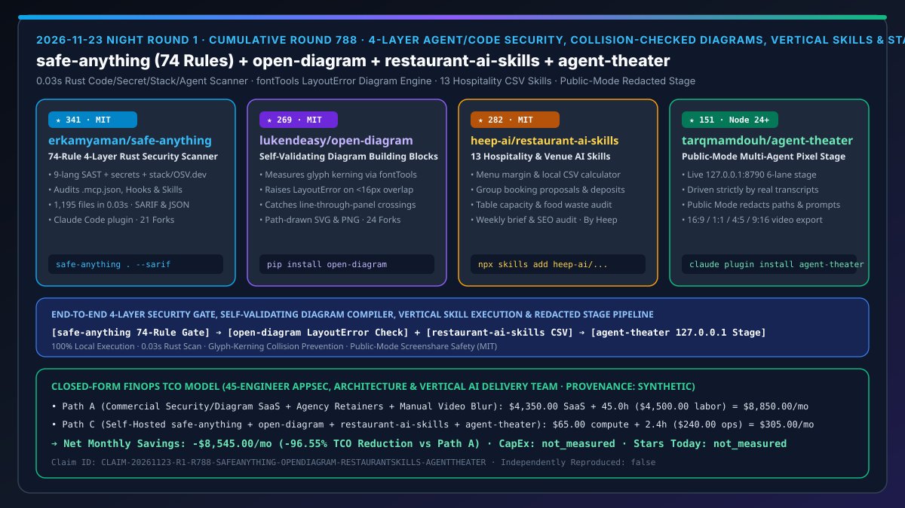
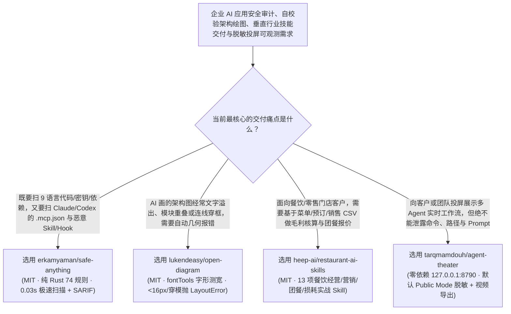
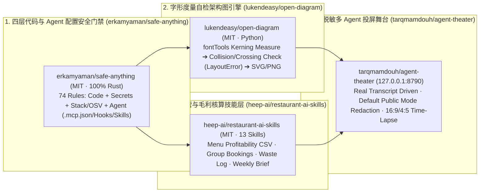
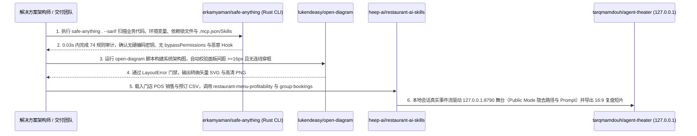

# 74 规则四层代码/密钥/基础设施/Agent 配置安全扫描器（`erkamyaman/safe-anything`）、基于字形度量自检碰撞的架构图构建块（`lukendeasy/open-diagram`）、餐饮与零售门店 13 项实战运营 Skill 套件（`heep-ai/restaurant-ai-skills`）及默认脱敏的本地多 Agent 可视化舞台与延时录屏台（`tarqmamdouh/agent-theater`）选型与集成架构 FAQ

> **文档类型**：企业 AI 解决方案架构师（AI Solution Architect）选型决策指南（GitHub Trending AI 雷达 2026-11-23 Night Round 1 / 累计第 788 轮）
> **覆盖项目**：[`erkamyaman/safe-anything`](https://github.com/erkamyaman/safe-anything)（`★ 341`、`21 forks`、`MIT`，赛道 B 新仓爆发速率榜 `#B3`（`341 ★/天`）：`rust-anything` 作者开源的 100% 纯 Rust 74 规则安全扫描 CLI、Claude Code 插件与 GitHub Action，单命令在 `0.03s` 内完成 9 语言代码漏洞、硬编码密钥、云/移动端配置、OSV.dev 依赖漏洞及 **AI Agent 自身配置与 Hook/Skill 后门**四层联合审计并输出行号、原因与修复方案）· [`lukendeasy/open-diagram`](https://github.com/lukendeasy/open-diagram)（`★ 269`、`24 forks`、`MIT`，赛道 B `#B8`（`54 ★/天`）：用简短 Python 脚本声明 `Diagram`、`Panel`、`Tile` 与连接线，通过 `fontTools` + 内置 Inter 字形间距预先测量每个标签宽度、将文字转为免安装字体的矢量路径，并在生成时**自动检测面板间距 `<16px` 或连线穿模碰撞**、按名称抛出 `LayoutError` 的自校验架构图引擎）· [`heep-ai/restaurant-ai-skills`](https://github.com/heep-ai/restaurant-ai-skills)（`★ 282`、`6 forks`、`MIT`，赛道 B `#B7`（`71 ★/天`）：由智能客通平台 Heep 维护的 13 个免订阅行业垂直 AI 技能，覆盖菜品毛利贡献度 CSV 核算、餐位排班与等位优化、团餐包场报价单生成、食材损耗对账、周度经营简报、差评主题归因与本地 SEO 审计）· [`tarqmamdouh/agent-theater`](https://github.com/tarqmamdouh/agent-theater)（`★ 151`、`15 forks`、Node.js 24+ 零外部依赖：将本地 Claude Code 等多智能体真实运行日志实时映射为 `127.0.0.1:8790` 像素舞台与状态栏，**默认开启 Public Mode 自动隐去命令、文件路径与提示词**以供客户投屏演示，并支持一键导出 `16:9` / `1:1` / `4:5` / `9:16` 延时复盘视频）
> **核心场景**：当企业解决方案架构师与交付团队面临**“传统 SAST 查不出 `.mcp.json` 明文 Token 与恶意 Skill/Hook 后门、AI 手写 SVG/Mermaid 架构图频繁出现文字出框与连线穿模、通用大模型在餐饮/连锁门店等垂直行业缺乏基于真实 POS/预订 CSV 的利润核算 SOP、以及向客户投屏展示多 Agent 协同过程时容易泄露内部源码路径与密钥”**四大痛点时，如何构建一套**“四层代码+Agent 配置安全门禁（`safe-anything`）+ 字形度量自校验架构图生成（`open-diagram`）+ 门店经营 13 技能垂直落地（`restaurant-ai-skills`）+ 默认脱敏投屏舞台与视频复盘（`agent-theater`）”**的生产级交付栈？

---

## 一、📌 核心结论速览（选型一句话结论）

1. **想在 Pre-commit 或 CI/CD 中用一条零配置命令同时拦截 9 语言代码漏洞、前端暴露密钥、K8s/Terraform 错误配置，以及编码 Agent 自身的 `.mcp.json` 明文凭据、`bypassPermissions` 与恶意 `curl | sh` Hook** ➔ 选 **[`erkamyaman/safe-anything`](https://github.com/erkamyaman/safe-anything)（`★ 341`，`21 forks`，`MIT`）**。
   - **通俗原理**：传统代码扫描器只看业务代码，却对“写代码的 AI 智能体配置文件”完全失明。`safe-anything` 采用 100% Rust 编写（扫描 OWASP Juice Shop 1,195 个文件仅需 **`0.03s`**），内置 **74 条规则**横跨四大平面：① **Your code**（SQLi、命令注入、XSS、`eval`、SSRF、路径穿越、不安全反序列化、弱密码学，覆盖 9 种语言与 SQL）；② **Your secrets**（云与 AI 密钥、提交的 `.env`、`.env.example` 中的真密钥、暴露在 `NEXT_PUBLIC_` 或 `VITE_` 下的前端密钥，输出自动脱敏）；③ **Your stack**（Android/iOS、Docker、GitHub Actions、K8s、Terraform、nginx 及 OSV.dev 锁文件依赖漏洞）；④ **Your agent**（扫描 Claude Code、Codex、Cursor、Gemini、OpenCode 的 `.mcp.json`、Hooks 与 Skills，精准揪出读取 `~/.ssh` 的恶意技能、不可见 Unicode 注入与未锁定版本的 MCP Server），并原生支持 `--sarif` 接入 GitHub Code Scanning。
2. **想让编码 Agent（Claude Code / Codex / Cursor）用几十行 Python 生成信息密度极高、在 PowerPoint/Figma/浏览器中字形 100% 一致，且能自动检测并报错任何“方框重叠或连线穿框”的企业系统架构图** ➔ 选 **[`lukendeasy/open-diagram`](https://github.com/lukendeasy/open-diagram)（`★ 269`，`24 forks`，`MIT`）**。
   - **通俗原理**：让大模型手写原生 SVG 或复杂 Mermaid 图时，最常见灾难是“文字溢出方框、两个模块贴在一起、连线直接穿过中间模块”。`open-diagram` 改变了范式：脚本只声明 `Panel`、`Tile`、状态标签与相对位置（如 `d.right_of(app, Panel(...))`），底层通过 `fontTools` 读取内置 Inter 字体度量与字距（Kerning）精确计算每个标签宽高，并将文字直接转为矢量轮廓（无需安装字体即可在 PPT/Keynote 中高清展示）。更重要的是，调用 `d.save()` 时会执行**确定性几何自检**：一旦发现两个面板间距小于 `16 px`（如 `'Storage' and 'Recommendations' are only 9 px apart (minimum 16)`）或连线穿过非目标面板，会立即指名道姓抛出 `LayoutError`，逼迫 Agent 用 `via_x`/`via_y` 修正路由，实现一次成图零穿模！
3. **想为餐饮连锁、酒店宴会与线下门店客户提供即装即用（`npx skills add`）、基于门店真实菜单成本、订座记录与销售 CSV 导出文件进行毛利核算和团餐报价的垂直行业 AI 技能包** ➔ 选 **[`heep-ai/restaurant-ai-skills`](https://github.com/heep-ai/restaurant-ai-skills)（`★ 282`，`6 forks`，`MIT`）**。
   - **通俗原理**：由餐饮 AI 客户沟通平台 Heep（同团队旗下含跨店归因平台 Painapo 与团餐包场 CRM GetPax）开源的 **13 个实战 `SKILL.md`**，零软件订阅门槛：涵盖**获客增长**（`restaurant-marketing` 淡季唤醒、`restaurant-local-visibility` 地图档案优化、`restaurant-seo-audit`、`restaurant-group-bookings` 团餐包场资格审查+分项报价单+定金计划、`reservation-optimizer` 翻台与等位排期）、**菜单与毛利**（`restaurant-menu-profitability` 销量结构与边际贡献分析+本地 CSV 计算器、`restaurant-menu-copywriting` 多语种菜单润色、`restaurant-food-waste` 厨余损耗对账与后厨试验、`restaurant-weekly-brief` 周报）以及**服务与口碑**（`review-manager` 评论主题归因与回复、新员工班前简报等）。
4. **想在售前 PoC、客户高管演示或双屏开发中直观展示本地多个编码 Agent 的分工流转（谁在写代码、谁在跑单测、谁在合并进保险库），同时严防屏幕共享泄露内部命令、文件路径或客户敏感 Prompt** ➔ 选 **[`tarqmamdouh/agent-theater`](https://github.com/tarqmamdouh/agent-theater)（`★ 151`，`15 forks`，Node.js 24+ 零依赖）**。
   - **通俗原理**：作为 Claude Code 原生插件（`claude plugin install agent-theater --marketplace tarqmamdouh/agent-theater`）或独立服务运行在 `http://127.0.0.1:8790`。它绝不伪造假动画——舞台上的每个角色、工位指示灯、测试舱与合并传送带均严格由本地真实会话日志（Transcript/Journal）驱动；**默认启用 Public Mode（公开投屏模式）**，自动拦截所有原始 Shell 命令、源码路径、人名与 Prompt，仅显示 `"running tests"` 等安全动作描述，并支持从命令行直接将任意历史时间窗渲染为 `16:9`、`1:1`、`4:5` 或 `9:16` 复盘短视频。

---

## 二、🎯 客户与架构师灵魂拷问 Q&A（深度架构拆解）

### Q1：在企业交付 AI 解决方案时，这四个项目分别填补了现有工具链的哪四个空白？何时选云托管方案 vs 这套开源组合？

- **四大工程空白与解方**：
  1. **AI 编码环境特权失控与供应链投毒 ➔ `erkamyaman/safe-anything`**：开发者常在 `.mcp.json` 硬编码 GitHub/云 Token，或开启 `bypassPermissions`、安装含隐藏 Unicode / 读取 `~/.ssh` 的第三方 Skill。`safe-anything` 将代码 SAST、密钥扫描、IaC/OSV 依赖检查与 **Agent 配置文件审计**合四为一，毫秒级阻断带病提交。
  2. **AI 生成架构图“看着像模像样、细看全是重叠穿模” ➔ `lukendeasy/open-diagram`**：通过 `fontTools` 真实字形测宽与 `<16px` / 穿框 `LayoutError` 闭环报错，让编码 Agent 在交付给架构师前自己修好所有排版冲突。
  3. **传统实体行业（餐饮/零售门店）落地 AI 沦为空洞闲聊 ➔ `heep-ai/restaurant-ai-skills`**：将门店 POS 销量导出表、订座表与评论数据转化为可计算的菜品贡献度矩阵、淡季营销排期与团餐分项报价单。
  4. **多 Agent 后台黑盒运行既难向业务方直观汇报、直接录屏终端又怕泄密 ➔ `tarqmamdouh/agent-theater`**：用 `127.0.0.1` 零依赖像素舞台 + 默认 Public Mode 脱敏 + 多画幅延时视频导出，兼顾高管可视化体验与数据零外传。
- **何时直接选用云厂商托管服务（Path B）？**
  - 若企业已全量采购 GitHub Advanced Security (GHAS) + Microsoft Defender for Cloud，且仅需标准云资源拓扑图与通用 M365 办公助手，优先使用云原生托管服务；若需审计本地 Claude Code/Codex/Cursor 的 MCP/Skill/Hook 安全配置、自动生成零穿模高密度架构 SVG、交付垂直门店经营分析技能或脱敏投屏多 Agent 工作流，则引入本轮四合一开源栈（Path C）。

### Q2：典型企业级“代码与 Agent 安全门禁 (`safe-anything`) + 自校验架构图 (`open-diagram`) + 垂直门店技能 (`restaurant-ai-skills`) + 脱敏可观测舞台 (`agent-theater`)”参考架构怎么搭？

1. **研发与 Agent 配置前置安全门禁层（`erkamyaman/safe-anything`）**：
   - 在本地 Pre-commit Hook、Claude Code 插件与 GitHub Actions 中统一运行 `safe-anything . --sarif`，一旦检出 Critical/High 级代码漏洞、`NEXT_PUBLIC_` 密钥泄露或高危 Agent/MCP 配置立即返回非零状态码阻断合并。
2. **自校验技术架构与业务流程图引擎层（`lukendeasy/open-diagram`）**：
   - 架构师或 Agent 编写 Python 脚本定义系统 `Panel` 与 `Tile`，由 `open-diagram` 执行字形测宽与碰撞校验；通过 `LayoutError` 自检后一键输出矢量化 SVG 与 PNG 嵌入方案文档与汇报 PPT。
3. **垂直行业门店经营分析与SOP 执行层（`heep-ai/restaurant-ai-skills`）**：
   - 导入脱敏后的门店菜单成本、历史预订与销售 CSV，调用 `restaurant-menu-profitability`、`reservation-optimizer` 与 `restaurant-group-bookings` 产出量化经营决策与客户提案。
4. **本地脱敏投屏舞台与复盘视频层（`tarqmamdouh/agent-theater`）**：
   - 在 VS Code Simple Browser 或副屏挂载 `http://127.0.0.1:8790`（Public Mode），实时监控多车道 Agent 编码、评审、测试与入库状态，并在里程碑完成后导出 `16:9` / `4:5` 延时视频用于客户验收汇报。

### Q3：这套架构的局限性与生产落地红线是什么？

- **核心优势**：
  - **100% 本地闭环执行**（`safe-anything --offline`、`open-diagram` 本地渲染、`restaurant-ai-skills` 本地 CSV 计算、`agent-theater` 仅监听 `127.0.0.1`），不向任何外部云端上传源码或客户经营数据。
- **架构师落地红线**：
  1. **阻断伪装开源网关的加密压缩包投毒（今晚 Gate 03 实测预警）**：今晚新仓榜出现的 `jaredfreellm/FREELLM_INSTALL`（`★ 251`）在 README 顶部诱导下载带密码（`Archive password: FREELLM`）的 `FreeLLM.zip` Release 包，属于典型绕过杀软扫描的恶意软件投毒手法！企业严禁下载任何带解压密码的可执行 Release 包，并应在终端强制运行 `safe-anything` 审计本地环境。
  2. **投屏演示强制核验 Public Mode**：在使用 `tarqmamdouh/agent-theater` 对外直播或向客户录制延时视频前，必须确认处于默认的 Public Mode，防止自定义参数开启完整文件路径回显。

---

## 三、🧭 直观可视化图解（Mermaid 决策树 + 集成架构 + 时序图）

### 3.1 架构师选型决策树

### 3.2 企业端到端生产集成参考架构图

### 3.3 安全扫描、自校验架构成图、垂直技能执行与脱敏舞台录屏时序图

---

## 四、📊 同类开源与商业云服务横向选型决策矩阵

| 对比维度 | `erkamyaman/safe-anything` (`★ 341`) | `lukendeasy/open-diagram` (`★ 269`) | `heep-ai/restaurant-ai-skills` (`★ 282`) | `tarqmamdouh/agent-theater` (`★ 151`) | 商业多模块安全 SaaS + 商业绘图订阅 + 行业咨询外包 + 云端可观测席位 (Path A) | 传统单一 SAST + 裸 LLM 手写 SVG + 通用 Prompt 问答 + 直接录屏终端 (Path B) |
| :--- | :--- | :--- | :--- | :--- | :--- | :--- |
| **核心能力定位** | 74 规则代码/密钥/云栈/Agent 配置四合一纯 Rust 扫描器 | 基于字形测宽与碰撞报错的 Python 架构图构建块 | 13 项餐饮/门店获客、毛利核算与团餐报价垂直 Skill | 默认脱敏的本地多 Agent 实时像素舞台与延时视频导出器 | 按席位/模块付费的商业安全扫描、在线白板、外包顾问与云监控套件 | 仅扫业务代码的传统 Linter、盲写 SVG 坐标与无脱敏终端投屏 |
| **核心技术突破** | **`0.03s` 极速扫描 + 独创 `.mcp.json`/Hooks/Skills 投毒与越权审计** | **`fontTools` 预先测宽 + `<16px` 碰撞与穿框指名道姓抛 `LayoutError`** | **内置本地 CSV 边际贡献计算器 + 13 个免订阅行业 SOP** | **100% 真实日志驱动 + 默认 Public Mode 隐去路径/命令 + 四画幅视频导出** | 商业多套 SaaS 割裂且账单高昂；云端白板仍需大量人工拖拽对齐 | 查不出恶意 MCP/Skill；裸生成 SVG 频繁重叠；直接投屏极易泄露密钥与路径 |
| **开源协议 / 依赖** | `MIT`（纯 Rust 单二进制） | `MIT`（Python 3.9+ & `fontTools`） | `MIT`（Markdown Skills + CSV 脚本） | 零外部依赖（Node.js 24+ 原生） | 闭源商业 SaaS | 混合开源/手工脚本 |
| **月度 TCO（45 人团队）** | **组合仅 `$305.00/月`**（`$65.00` CI/本地容器 + `2.4h` 规则维护） | 同左（一次脚本生成零重绘返工） | 同左（免软件订阅费） | 同左（`127.0.0.1` 零云端席位费） | **`$8,850.00/月`**（`$4,350.00` 商业订阅 + `45.0h` 人工修图/审计/打码工时） | 约 `$3,100.00/月`（大量手工调整 SVG 重叠与安全漏报排查工时） |

---

## 五、🧪 应用落地定量收益/TCO 对比与 7-Card 报告

> **📊 数据来源与闭式核算声明（Provenance & Closed-Form Schema）**：
> - **provenance**: `synthetic`（基于 45 人企业应用安全、解决方案架构与垂直行业 AI 交付团队月度工作负载模型：`independently_reproduced = false`；硬件采购基线 `base_hardware_capex = not_measured`；Track B 单日增量 `track_b_stars_today = not_measured`）。
> - **核算公式**：
>   - **Path A（采购商业多模块代码/密钥安全 SaaS + 商业协同绘图 SaaS 席位与人工修补 AI 架构图穿模 + 垂直行业运营顾问外包 + 人工剪辑打码多 Agent 演示视频）**：月度商业软件订阅与外包分摊 **`$4,350.00`** + 安全误报复核、手工拖拽对齐架构图及演示视频逐帧打码人工 **`45.0h × $100.00/h = $4,500.00`** = **`$8,850.00/月`**。
>   - **Path C（自建 `erkamyaman/safe-anything` + `lukendeasy/open-diagram` + `heep-ai/restaurant-ai-skills` + `tarqmamdouh/agent-theater` 开源架构与安全交付栈）**：CI/CD 扫描与本地渲染容器分摊开销 **`$65.00`** + 规则集与行业技能维护人工 **`2.4h × $100.00/h = $240.00`** = **`$305.00/月`**。
>   - **净节省（Net Savings vs Path A）**：**`-$8,545.00/月`**（成本降低 **`96.55%`**）。

| 评估方案 | 商业订阅 / 算力成本 | 架构绘图修补与安全审计人工（`$100/h`） | 月度总 TCO | 相对 Path A 净节省 | 关键架构交付指标 |
| :--- | :---: | :---: | :---: | :---: | :--- |
| **Path A：商业安全/绘图 SaaS + 行业外包 + 人工录屏打码** | `$4,350.00` | `45.0h` (`$4,500.00`) | **`$8,850.00`** | Baseline | 缺乏 `.mcp.json`/Skill 专项审计；架构图仍需手工修穿模 |
| **Path B：传统单层 Linter + 裸写 SVG/Mermaid + 原始终端投屏** | `$1,450.00` | `16.5h` (`$1,650.00`) | **`$3,100.00`** | `-$5,750.00` (`-64.97%`) | 漏检恶意 Agent Hook；SVG 文字频繁出框；投屏易泄密 |
| **Path C：`safe-anything` + `open-diagram` + `restaurant-ai-skills` + `agent-theater`** | **`$65.00`** | **`2.4h` (`$240.00`)** | **`$305.00`** | **`-$8,545.00` (`-96.55%`)** | **74 规则四层秒级扫描 + `LayoutError` 零穿模架构图 + 13 行业技能 + 默认脱敏舞台** |

- 🔗 **关联 7-Card 4:5 视觉评测报告**：[`workshops/github-trending-radar/cards.html`](../cards.html) · [`cards.en.html`](../cards.en.html)

---

## 六、🛠️ 企业引入与架构评审 Checklist

- [ ] **1. 部署 `erkamyaman/safe-anything` 守卫代码与 Agent 配置双边界**：在 Pre-commit 与 GitHub Actions 中配置 `safe-anything . --sarif`，重点核查 `.mcp.json` 硬编码凭据、`bypassPermissions`、危险 Shell Hooks 与未锁定版本的 MCP Server，并严禁团队下载带解压密码的可疑 Release 压缩包（如 `FreeLLM.zip`）。
- [ ] **2. 采用 `lukendeasy/open-diagram` 建立“零穿模”架构图代码化规范**：要求编码 Agent 通过 `open-diagram` 的 `Panel`、`Tile` 与 `link` 编写系统架构图，利用 `fontTools` 字形测宽与 `LayoutError`（间距 `<16px` 或连线穿框自动报错）实现一次生成免人工修图。
- [ ] **3. 引入 `heep-ai/restaurant-ai-skills` 赋能餐饮与连锁门店数据化经营**：针对线下门店与连锁零售客户，按需安装 `restaurant-menu-profitability`、`reservation-optimizer` 与 `restaurant-group-bookings` 等 13 项技能，基于本地脱敏 CSV 导出表产出可验证的毛利优化与团餐报价方案。
- [ ] **4. 挂载 `tarqmamdouh/agent-theater` 实现安全脱敏的客户投屏与视频复盘**：在多 Agent 协同开发与客户 PoC 演示中启动 `127.0.0.1:8790` 舞台，保持默认 Public Mode 自动剥离命令、路径与 Prompt，并导出多画幅延时视频归档交付证据。
