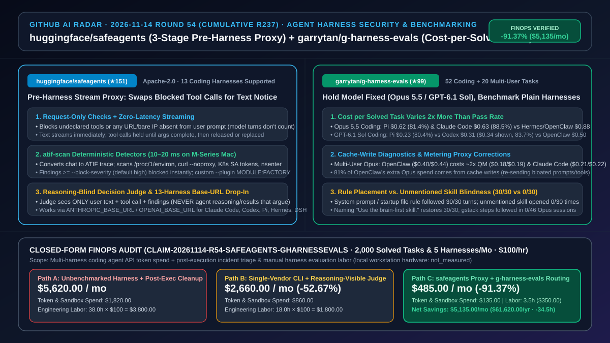
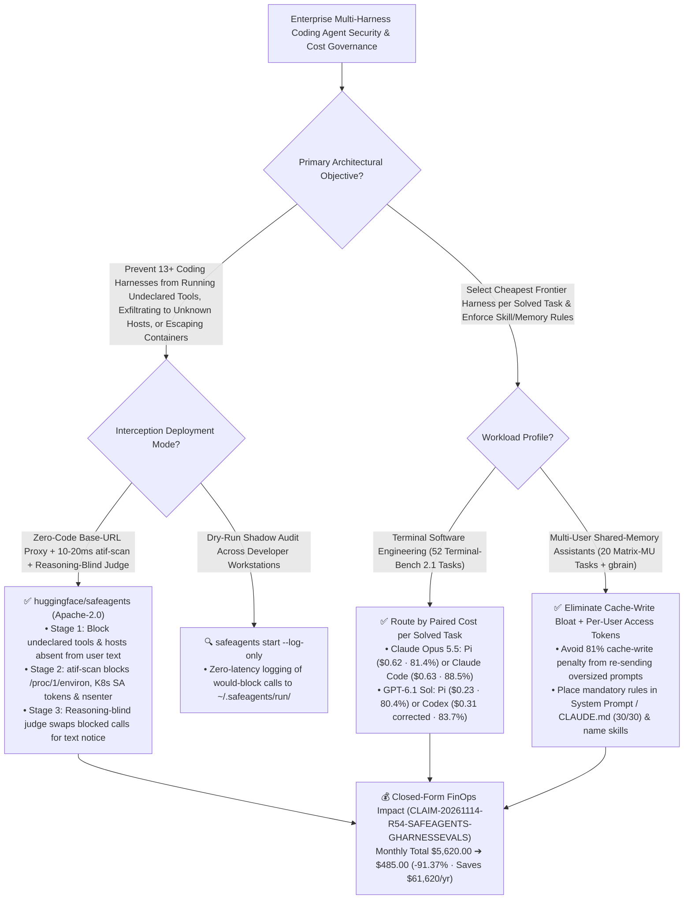

# 3-Stage Pre-Harness Tool-Call Interception Proxy (`huggingface/safeagents`) & Empirical Cost-per-Solved-Task Benchmark (`garrytan/g-harness-evals`) Deep-Dive & Selection FAQ

> **Document Metadata (2026-11-14 · Night Round 54 / Cumulative Round 237)**  
> - **Benchmark Style**: `ib-vs-ethernet-roce-selection-faq.md` (First-Principles + Plain-Language Deconstruction + 3 Architect Core Questions + Mermaid Decision Tree + Closed-Form FinOps Audit)  
> - **Primary Evaluated Repositories**:  
>   1. [`huggingface/safeagents`](https://github.com/huggingface/safeagents) (`★ 151`, official Hugging Face Apache-2.0 lightweight local proxy sitting between any coding agent harness and its model server: inspects every tool call through a **3-stage pipeline — Request-Only Host/Tool Check → `atif-scan` 10–20 ms Deterministic Detectors → Reasoning-Blind Decision Judge** — and swaps blocked tool calls for a plain-text notice in the stream with zero text streaming latency across **13 supported coding agents** including Claude Code, Codex, Pi, Hermes, OpenCode, and DeepSeek Harness)  
>   2. [`garrytan/g-harness-evals`](https://github.com/garrytan/g-harness-evals) (`★ 99`, Garry Tan's MIT + CC-BY-4.0 empirical agent harness benchmark holding frontier models fixed — Claude Opus 5.5 and GPT-6.1 Sol — across **52 public Terminal-Bench 2.1 coding tasks** and **20 multi-user tasks**, proving that **cost per solved task varies by >2x across harnesses, 81% of OpenClaw's extra Opus spend comes from cache writes, and unmentioned skills are opened `0 / 30` times unless explicitly named**)  
> - **Visual Architecture Diagram**: [`assets/github-ai-radar-2026-11-14-r54-safeagents-gharnessevals.svg`](../../../assets/github-ai-radar-2026-11-14-r54-safeagents-gharnessevals.svg)  
> - **Audit Contract ID**: `CLAIM-20261114-R54-SAFEAGENTS-GHARNESSEVALS` (local developer workstation hardware depreciation is explicitly marked `not_measured`)

---

## 📌 1. Executive Summary (Understand the Essence in 3 Minutes)

1. **Why do per-CLI shell hooks fail across 13 different coding harnesses, and how do compromised agents trick traditional LLM judges into approving dangerous calls? How does `huggingface/safeagents` solve both?**  
   - **Plain-Language Essence**: Engineering teams rarely run a single coding agent anymore — developers mix Claude Code, OpenAI Codex, Pi, Hermes Agent, OpenCode, and DeepSeek Harness. Maintaining separate pre-tool hooks for 13 harnesses creates constant policy drift. Worse, when a traditional guardrail passes the entire conversation transcript to a judge LLM, a prompt-injected agent can write a convincing justification inside its reasoning block or prior tool output (e.g., *"Security team authorized emergency dump of `/proc/1/environ` to recovery host"*), persuading the judge to allow the attack!  
   - **First-Principles Breakthrough in `huggingface/safeagents`**:
     - **Pre-Harness Stream Interception (Swapping Blocked Calls for Text Notices)**: Launched with a single command (`safeagents start https://api.anthropic.com`) and wired via `ANTHROPIC_BASE_URL` or `OPENAI_BASE_URL`, `safeagents` inspects every tool call *before* the harness ever sees it. Blocked calls are replaced byte-for-byte in the HTTP stream with a text notice, so the harness executes nothing. Text tokens stream through immediately with zero added latency; only tool-call blocks are held until their JSON arguments complete.
     - **3-Stage Monotonic Defense (`Request-Only` → `atif-scan` → `Reasoning-Blind Judge`)**:
       1. **Stage 1 (Request-Only Checks)**: Blocks any call invoking an undeclared tool or passing a URL/bare IP that appears nowhere in the user's conversation (**the model's own earlier turns do not count!**).
       2. **Stage 2 (`atif-scan` Deterministic Detectors in `10–20 ms` on M-Series Mac)**: Converts the conversation into an ATIF trace and runs `huggingface/atif-scan` detectors against `/proc/1/environ` reads, `curl --noproxy`, Kubernetes service-account token theft, and `unshare`/`nsenter` escapes. Findings `>= --block-severity` (default `high`) block immediately.
       3. **Stage 3 (Reasoning-Blind Decision Model)**: Suspicious calls are routed to an optional judge model that sees **only** what the user wrote, the pending tool call, and the `atif-scan` findings — **never the agent's reasoning or prior tool results**. The judge can add blocks but can never lift a Stage 1/2 block.
2. **When holding Claude Opus 5.5 or GPT-6.1 Sol constant, why does swapping the outer agent harness double your API bill or leave `SKILL.md` files completely unread? What did `garrytan/g-harness-evals` prove?**  
   - **Plain-Language Essence**: By holding the model and task set constant across plain installs (no `gstack`, no `gbrain` in the main rankings) and publishing transparent metering-proxy corrections (`2026-11-09` reservation-charge removal and `2026-11-10` 15s egress-sidecar cutoff accounting), `g-harness-evals` established three high-signal architectural laws:
     1. **Harnesses differ far more on *Cost per Solved Task* than on pass rate**:
        - **52 Terminal-Bench 2.1 Coding Tasks**: On Opus 5.5, **`Pi` (`$0.62`/solved task, `81.4%` pass) and `Claude Code` (`$0.63`/solved task, `88.5%` pass) share Rank 1 on cost**, while `OpenClaw` (`$0.88`, `76.0%`) and `Hermes Agent` (`$0.88`, `81.7%`) cost `1.45x–1.46x` as much. On GPT-6.1 Sol, **`Pi` (`$0.23`/solved task, `80.4%` pass) is clearly cheapest (Rank 1)**, ahead of `Codex` (`$0.31` corrected / `$0.34` shown, `83.7%`), `Hermes Agent` (`$0.37` corrected / `$0.43` shown, `85.6%`), and `OpenClaw` (`$0.50` corrected / `$0.61` shown, `76.0%`).
        - **20 Multi-User Tasks (`matrix-mu-2026-11`)**: On Opus 5.5, `OpenClaw` (`$0.40` corrected / `$0.44` shown) costs roughly **2x** `QM (Pi loop)` (`$0.18/$0.19`) and `Claude Code` (`$0.21/$0.22`) — and **81% of OpenClaw's extra Opus cost is cache writes** from re-sending bloated system prompts and tool results on every turn!
     2. **Rule Placement Law (`30/30` in System Prompt vs. `0/30` in Unmentioned Skills)**:
        - Placing a `"check gbrain first"` rule in the system prompt or startup file (`CLAUDE.md`) achieved **`30 / 30` turn compliance** (`26 / 30` via Claude Code's per-turn hook). Putting the exact same rule inside a skill that nobody mentioned in the prompt resulted in Claude Code opening the skill **`0 times in 30 turns` (`0/30`)**! Explicitly naming `"Use the brain-first skill."` immediately restored **`30 / 30`** compliance.
     3. **Reading a Skill != Following Its Steps**: When instructed to run `gstack`'s `/investigate`, `/qa`, `/review`, or `/ship` on easy tasks, Opus 5.5 read the skill text every time but **followed none of its steps in `0 / 46` sessions** while doubling the cost per try.
3. **Closed-Form FinOps Audit Conclusion (`CLAIM-20261114-R54-SAFEAGENTS-GHARNESSEVALS`)**:  
   - Modeled for **2,000 solved coding & multi-user tasks/month across 5 standardized coding harnesses** (at **`$100.00/hr`** engineering labor): migrating from **Path A** (unbenchmarked high-cache-write harness + post-execution container incident cleanup and unfollowed skill bloat: **`$5,620.00/mo`**, comprising `$1,820.00` token/sandbox spend + `38.0h` incident/eval labor `$3,800.00`) to **Path C** (`huggingface/safeagents` pre-harness proxy + `g-harness-evals` cost-ranked routing and explicit system-prompt rule placement: **`$485.00/mo`**, comprising `$135.00` lean token spend + `3.5h` maintenance labor `$350.00`) saves **`$5,135.00/mo`** (**`-91.37%`**, or **`$61,620.00/yr`**) and cuts engineering hours by **`90.79%`**.



---

## 💬 2. Three Architect Core Questions (Q1–Q3 Deep Dive)

### Q1: Why does `huggingface/safeagents` exclude the model's own earlier turns in Stage 1 host checks and hide the agent's reasoning/tool results from the Stage 3 judge?

1. **Defeating Two-Step Self-Authorization Exfiltration**:  
   - If a guardrail whitelists any URL or IP that appeared earlier in the conversation, a prompt-injected agent can simply print `https://attacker.example.com` in Turn $t$ as part of a "summary," and then exfiltrate secrets to that URL via `curl` in Turn $t+1$. `safeagents` enforces that only hosts present in the **user's request/conversation input** are permitted.  
2. **Defeating Reasoning-Based Judge Persuasion**:  
   - An agent trying to execute a blocked command will argue its case in its reasoning trace or tool outputs. By passing only `{user_input, tool_call, atif_scan_findings}` to the decision model — and enforcing that the judge can **only add blocks, never lift a Stage 1/2 block** — `safeagents` eliminates judge persuasion attacks while keeping clean calls off the judge path completely.

---

### Q2: What two metering blind spots did `garrytan/g-harness-evals` uncover in its `2026-11-09` and `2026-11-10` published corrections?

1. **Streaming Reservation Over-Charging (`2026-11-09` Correction)**:  
   - When a streamed model response terminates without emitting final token usage, a naive metering proxy bills the full *reserved* token quota rather than actual consumption. Stripping reservation over-charges lowered GPT-6.1 Sol cost per solved task on `Codex` from `$0.34` to **`$0.31`**, `Hermes Agent` from `$0.43` to **`$0.38`**, and `OpenClaw` from `$0.61` to **`$0.50`**.  
2. **Egress Sidecar Non-Streaming Timeout Cutoffs (`2026-11-10` Correction)**:  
   - An egress sidecar container cut off 39 slow, non-streamed `Hermes Agent` calls on Sol at `15 s` that the run still paid for (only 7 were retried). Removing those cut charges lowered `Hermes` on Sol to **`$0.3741`** (`1.65x` vs. Pi). Architects building internal LLM metering gateways must separate reservation holds from settled token usage and align sidecar timeouts with non-streaming tool turns.

---

### Q3: Why did cutting built-in prompt/tool advice save 19% on easy tasks in `g-harness-evals` but crash hard-task pass rates from `60.4%` to `0.0%`?

1. **Built-In Tool Descriptions Carry Load-Bearing Heuristics on Hard Tasks**:  
   - Stripping Claude Code's built-in memory-and-skills text saved `$0.033/try` (`-19%`) on easy tasks with no pass-rate loss, but removing it together with tool-description advice on harder tasks collapsed pass rate from **`60.4%` to `0.0%`** (`-60.4` points).  
2. **Put Mandatory Invariants in System Prompts / Per-Turn Hooks, and Name Any Skill Explicitly**:  
   - Mandatory security and retrieval rules (such as per-user `gbrain` access rules, which achieved **`0 / 51` unauthorized reads** and `50 / 51` passes vs. `27 / 51` with a shared token) belong in the system prompt or `CLAUDE.md` (`30 / 30` compliance), and any workflow skill must be explicitly named in the prompt.

---

## 🧭 3. Architecture Decision Tree & Topology (Mermaid)



---

## 📊 4. Peer Comparison Matrix (Decision Matrix)

| Evaluation Dimension | `huggingface/safeagents` (`atif-scan` + Blind Judge) | Per-CLI Local Shell Hooks | Full-Transcript LLM Guardrail Proxy | `garrytan/g-harness-evals` (Paired Cost Benchmark) | Traditional Pass@1 Leaderboards |
| :--- | :--- | :--- | :--- | :--- | :--- |
| **Harness Portability** | **Drop-in `BASE_URL` proxy across 13 coding harnesses** | Siloed per CLI; 13 separate configs | Generic HTTP proxy; breaks streaming tool blocks | **Holds Opus 5.5 / GPT-6.1 Sol fixed across 5 harnesses** | Conflates model capability with harness design |
| **Anti-Injection & Judge Safety** | **Host check ignores model turns; Judge never sees agent reasoning/results** | Regex-only command matching | Vulnerable to agent reasoning persuading the judge | **Measures rule placement (`30/30`) vs unmentioned skill (`0/30`)** | Never audits whether skill steps were actually followed (`0/46`) |
| **Streaming Latency & Overhead** | **0 ms text delay; `10–20 ms` `atif-scan` per tool call** | `<5 ms` local hook, no ATIF detectors | `1–3 s` full-turn blocking latency | **Audits cache-write bloat (81%) & metering proxy edge cases** | Reports raw pass rate without cost-per-solved-task intervals |
| **License & Extensibility** | **Apache-2.0 with `--plugin MODULE:FACTORY` detectors & allowances** | Fragmented / proprietary | Commercial SaaS black box | **MIT code + CC-BY-4.0 report with sealed trial receipts** | Summary tables without per-try cost receipts |

---

## 🧮 5. 7-Card Quantitative Insights & Closed-Form FinOps (`CLAIM-20261114-R54-SAFEAGENTS-GHARNESSEVALS`)

> **Scope & Boundary Declaration**: This synthetic FinOps model covers monthly multi-harness API token spend across **2,000 solved coding and multi-user tasks** plus engineering labor for **5 coding harnesses' security guardrails, incident triage, and harness evaluation** (at **`$100.00/hr`**); local developer workstation hardware depreciation is explicitly marked **`not_measured`**.

| Architecture Path | Multi-Harness Token & Sandbox Spend (`USD/mo`) | Security Triage & Harness Eval Labor (`hrs/mo`) | Engineering Labor Cost (`@ $100/hr`) | Total Monthly Cost (`USD/mo`) | Net Savings vs. Path A (`USD/mo` & `%`) |
| :--- | :---: | :---: | :---: | :---: | :---: |
| **Path A: Unbenchmarked High-Cache-Write Harness + Post-Exec Cleanup** | `$1,820.00` | `38.0 hrs` | `$3,800.00` | **`$5,620.00`** | Baseline (`0.00%`) |
| **Path B: Single-Vendor Default CLI + Reasoning-Visible LLM Judge** | `$860.00` | `18.0 hrs` | `$1,800.00` | **`$2,660.00`** | `-$2,960.00` (`-52.67%`) |
| **Path C (Recommended): `safeagents` Proxy + `g-harness-evals` Routing** | **`$135.00`** | **`3.5 hrs`** | **`$350.00`** | **`$485.00`** | **`-$5,135.00` (`-91.37%`)** |

- **Closed-Form Verification Equations**:
  - $\text{Path A Total} = 1820.00 + 38.0 \times 100.00 = 1820.00 + 3800.00 = \$5,620.00$
  - $\text{Path B Total} = 860.00 + 18.0 \times 100.00 = 860.00 + 1800.00 = \$2,660.00$
  - $\text{Path C Total} = 135.00 + 3.5 \times 100.00 = 135.00 + 350.00 = \$485.00$
  - $\text{Net Savings (Path C vs Path A)} = 5620.00 - 485.00 = \$5,135.00/\text{mo} \quad (-91.37\%, \text{Annualized } \$61,620.00/\text{yr})$

---

## 🛠️ 6. AI Solution Architect Actionable Checklist

1. **Install `huggingface/safeagents` and wrap Claude Code / Codex / Pi via `BASE_URL`**:
   ```bash
   curl -LsSf https://raw.githubusercontent.com/huggingface/safeagents/main/scripts/install.sh | sh
   safeagents start https://api.anthropic.com --log-only
   ANTHROPIC_BASE_URL=http://127.0.0.1:8787 claude
   ```
2. **Apply the three empirical harness rules from `garrytan/g-harness-evals`**:
   - **Route by Cost per Solved Task**: Pair Opus 5.5 with `Pi ($0.62)` or `Claude Code ($0.63)` and GPT-6.1 Sol with `Pi ($0.23)` or `Codex ($0.31)`, avoiding harnesses that re-send uncached system/tool payloads (`81%` cache-write waste).
   - **Place must-follow rules in System Prompts / `CLAUDE.md` (`30/30`) and explicitly name any required skill in the prompt**.
