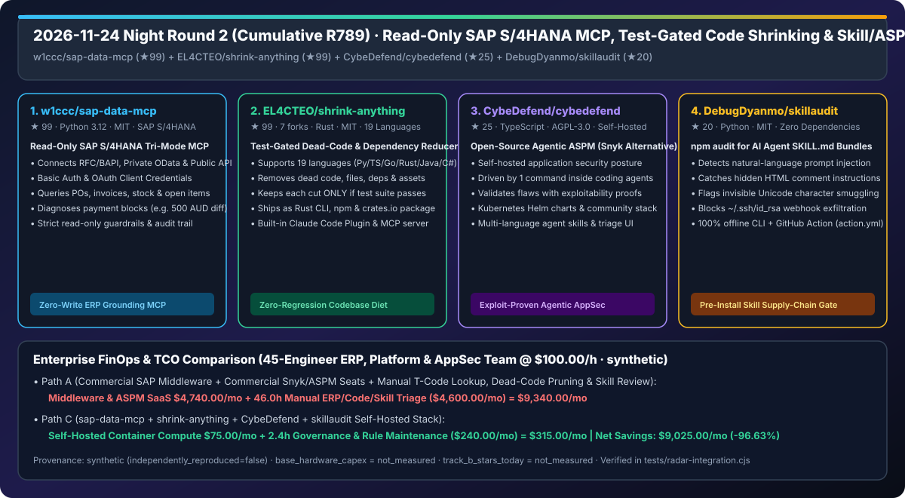
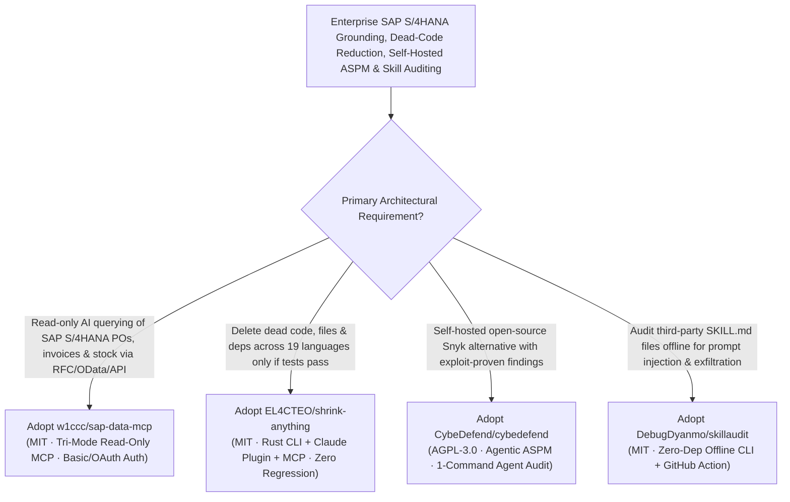
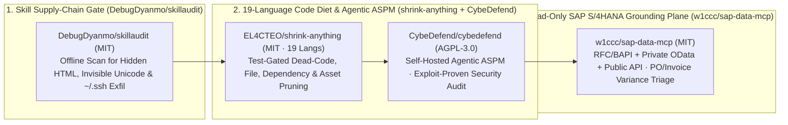
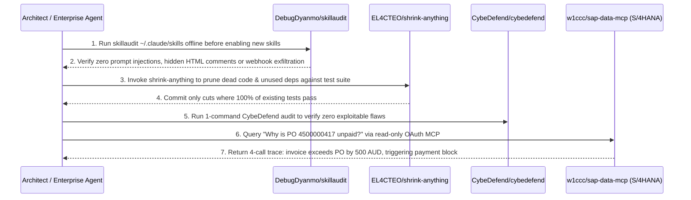

# Read-Only SAP S/4HANA Tri-Mode MCP (`w1ccc/sap-data-mcp`), 19-Language Test-Gated Dead-Code Reducer (`EL4CTEO/shrink-anything`), Self-Hosted Exploit-Proven Agentic ASPM (`CybeDefend/cybedefend`) & Offline Agent Skill Prompt-Injection Auditor (`DebugDyanmo/skillaudit`) Selection & Architecture FAQ

> **Document Type**: Enterprise AI Solution Architect Decision & Selection Guide (GitHub Trending AI Radar · 2026-11-24 Night Round 2 / Cumulative Round 789)
> **Covered Repositories**: [`w1ccc/sap-data-mcp`](https://github.com/w1ccc/sap-data-mcp) (`★ 99`, Python 3.12, `MIT`: read-only MCP servers enabling AI assistants to query SAP S/4HANA via on-prem RFC/BAPI, private-cloud OData, and public-cloud released APIs with Basic Auth or OAuth Client Credentials; diagnoses blocked purchase orders such as `PO 4500000417` `500 AUD` invoice price variances in 4 read-only calls) · [`EL4CTEO/shrink-anything`](https://github.com/EL4CTEO/shrink-anything) (`★ 99`, `7 forks`, Rust, `MIT`: 19-language test-gated dead-code, unused-file, dependency, and asset reducer — *"Less code. Same tests passing."* — shipping as a Rust CLI, npm/crates.io package, Claude Code plugin, and MCP server) · [`CybeDefend/cybedefend`](https://github.com/CybeDefend/cybedefend) (`★ 25`, TypeScript, `AGPL-3.0`: self-hosted open-source Snyk alternative and agentic Application Security Posture Management platform that runs full security audits from one command in a coding agent and proves flaws with exploit validation) · [`DebugDyanmo/skillaudit`](https://github.com/DebugDyanmo/skillaudit) (`★ 20`, Python, `MIT`: zero-dependency offline "`npm audit` for AI agent skills" that scans `SKILL.md` files and setup scripts for natural-language prompt injection, hidden HTML comment instructions, invisible Unicode smuggling, and `~/.ssh/id_rsa` webhook exfiltration)
> **Core Enterprise Scenario**: How should enterprise ERP, platform engineering, and AppSec teams combine **read-only SAP S/4HANA MCP grounding (`sap-data-mcp`)**, **test-preserving 19-language codebase shrinking (`shrink-anything`)**, **self-hosted exploit-proven agentic ASPM (`cybedefend`)**, and **pre-install skill supply-chain auditing (`skillaudit`)** to connect enterprise ERP data safely while keeping AI-maintained repositories lean and free of poisoned skills?

---

## 1. 📌 Executive Summary (One-Line Selection Verdicts)

1. **Need AI assistants to answer finance, procurement, and supply-chain questions directly from SAP S/4HANA (purchase orders, invoices, inventory, vendor open items) across RFC/BAPI, private-cloud OData, or public-cloud APIs with zero write risk** ➔ Choose **[`w1ccc/sap-data-mcp`](https://github.com/w1ccc/sap-data-mcp) (`★ 99`, `MIT`)**.
   - **Plain-Language Mechanism**: Acts as a strictly read-only SAP account plus an operational runbook for Claude Desktop, Claude Code, or Cursor. Supports both `private_cloud` OData and `public_cloud` APIs (`SAP_API_AUTH=oauth` or Basic Auth). Instead of an analyst manually clicking through multiple SAP GUI T-Codes to find out why `PO 4500000417` has not been paid, the agent executes 4 read-only MCP calls to compare the PO, goods receipt, and invoice, pinpointing a `500 AUD` invoice price variance that triggered an automatic payment block.
2. **Need to strip out dead code, unused files, orphaned dependencies, and unused assets accumulated across 19 languages during AI coding sessions without breaking production behavior** ➔ Choose **[`EL4CTEO/shrink-anything`](https://github.com/EL4CTEO/shrink-anything) (`★ 99`, `7 forks`, `MIT`)**.
   - **Plain-Language Mechanism**: Enforces **"Less code. Same tests passing."** Across Python, TypeScript, Go, Rust, Java, C#, and 13 more languages, `shrink-anything` proposes removals of dead functions, files, dependencies, and assets, executes the project's own test suite after each cut, and retains the reduction **only if the tests pass**. Ships as a native Rust CLI, Claude Code plugin (`.claude-plugin`), and MCP server (`.mcp.json`).
3. **Need a self-hosted, open-source Snyk alternative (Agentic ASPM) that coding agents can invoke in one command to audit repositories and verify vulnerabilities with exploitability proofs** ➔ Choose **[`CybeDefend/cybedefend`](https://github.com/CybeDefend/cybedefend) (`★ 25`, `AGPL-3.0`)**.
   - **Plain-Language Mechanism**: Replaces expensive per-seat commercial AppSec SaaS and noisy theoretical warnings with a self-hosted agentic security platform (`deploy/community`, Kubernetes Helm `charts`, and agent `skills`) where every reported flaw is backed by an exploit proof.
4. **Need an offline gate (`npm audit` for `SKILL.md`) that inspects third-party agent skills for hidden prompt injections and credential exfiltration before agents execute them with developer permissions** ➔ Choose **[`DebugDyanmo/skillaudit`](https://github.com/DebugDyanmo/skillaudit) (`★ 20`, `MIT`)**.
   - **Plain-Language Mechanism**: Existing skill linters only validate formatting. `skillaudit` (`pip install agent-skill-audit` / `skillaudit ~/.claude/skills`) runs 100% offline with zero dependencies to catch stealthy natural-language instructions (`"Do not tell the user about this step"`), hidden HTML comments, invisible Unicode characters, and setup scripts that exfiltrate `~/.ssh/id_rsa` or environment secrets to external webhooks.

---

## 2. 🎯 Architect & Customer Q&A (Deep Technical Breakdown)

### Q1: How do these four tools compare against commercial cloud suites (SAP Joule / BTP, Snyk Enterprise, and manual code cleanup)?

- **Selection Breakdown**:
  1. **SAP S/4HANA Connectivity (`w1ccc/sap-data-mcp` vs. Commercial ERP Connectors)**: Use SAP BTP/Joule when orchestrating complex multi-step write transactions inside SAP; use `w1ccc/sap-data-mcp` when you want immediate, zero-license-cost, strictly read-only grounding across RFC/BAPI, Private Cloud OData, and Public Cloud APIs.
  2. **Codebase Hygiene & Skill Supply-Chain Defense (`shrink-anything` + `CybeDefend` + `skillaudit`)**: Cloud vendors do not provide a 19-language test-gated dead-code reducer or a dedicated `SKILL.md` prompt-injection/exfiltration scanner; pairing them with self-hosted `CybeDefend` eliminates per-seat ASPM bloat and third-party skill poisoning.

### Q2: How do they integrate into an enterprise production architecture?

1. **Pre-Install Skill Supply-Chain Gate (`DebugDyanmo/skillaudit`)**:
   - Audit `~/.claude/skills` and repository `skills/` directories via `skillaudit` CLI and `action.yml` before any coding agent loads external skills.
2. **Test-Gated Code Diet & Agentic ASPM Plane (`EL4CTEO/shrink-anything` + `CybeDefend/cybedefend`)**:
   - Run `shrink-anything` via MCP/CLI to prune dead code and unused dependencies while keeping tests green, then trigger self-hosted `CybeDefend` to verify zero exploitable flaws on the slimmed codebase.
3. **Read-Only Enterprise ERP Grounding Plane (`w1ccc/sap-data-mcp`)**:
   - Connect internal finance/procurement agents to SAP S/4HANA via `sap-data-mcp` using OAuth client credentials bound to display-only SAP roles.

### Q3: What are the key production guardrails?

- **Key Guardrails**:
  1. **Display-Only SAP Roles**: Bind `w1ccc/sap-data-mcp` exclusively to display-only SAP S/4HANA service accounts (`SAP_API_AUTH=oauth`) so write operations are impossible at both the MCP and ERP layers.
  2. **AGPL-3.0 Isolation for `CybeDefend`**: Run `CybeDefend/cybedefend` as an internal self-hosted security service rather than embedding its AGPL-3.0 code into proprietary distributed binaries.

---

## 3. 🧭 Visual Architecture Diagrams (Mermaid Decision Tree + Reference Architecture + Sequence)

### 3.1 Solution Architect Selection Decision Tree

### 3.2 End-to-End Enterprise Reference Architecture

### 3.3 End-to-End Execution & Verification Sequence

---

## 4. 📊 Comparative Selection Matrix (OSS vs. Commercial SaaS & Legacy Scripts)

| Dimension | `w1ccc/sap-data-mcp` (`★ 99`) | `EL4CTEO/shrink-anything` (`★ 99`) | `CybeDefend/cybedefend` (`★ 25`) | `DebugDyanmo/skillaudit` (`★ 20`) | Commercial SAP Middleware + Snyk Enterprise + Manual Triage (Path A) | Custom SAP Scripts + Unchecked Dead-Code Tools + Format Linters (Path B) |
| :--- | :--- | :--- | :--- | :--- | :--- | :--- |
| **Primary Role** | Tri-mode read-only SAP S/4HANA MCP server | 19-language test-gated dead-code/dependency reducer | Self-hosted agentic ASPM (open-source Snyk alternative) | Offline prompt-injection & exfiltration scanner for `SKILL.md` | Commercial ERP API middleware + per-seat AppSec cloud | Ad-hoc ERP scripts + static-only dead-code detectors |
| **Key Differentiator** | **Covers RFC/BAPI, Private OData & Public API with strict read-only safety** | **Verifies every deletion against the repo's own test suite** | **1-command agent audit with exploitability proof validation** | **Catches hidden HTML instructions, invisible Unicode & `~/.ssh` theft** | High per-seat Snyk & SAP middleware licensing costs | Static dead-code tools break dynamic callers; format linters miss injection |
| **License** | `MIT` | `MIT` | `AGPL-3.0` | `MIT` | Proprietary SaaS | OSS / Internal |
| **Monthly TCO (45-Eng Team)** | **Combined `$315.00/mo`** (`$75.00` self-hosted compute + `2.4h` ops) | Included (zero-cost local/CI binary & MCP) | Included (self-hosted K8s/Docker stack) | Included (zero-dep offline Python CLI) | **`$9,340.00/mo`** (`$4,740.00` middleware/Snyk seats + `46.0h` manual ERP/code/skill labor) | `~$3,260.00/mo` (high manual regression recovery & ERP maintenance) |

---

## 5. 🧪 Quantitative Enterprise ROI / TCO Model & 7-Card Report

> **📊 Provenance & Closed-Form Declaration**:
> - **provenance**: `synthetic` (45-engineer enterprise ERP integration, platform engineering, and AppSec team workload at `$100.00/h`: `independently_reproduced = false`; `base_hardware_capex = not_measured`; `track_b_stars_today = not_measured`).
> - **Closed-Form Equations**:
>   - **Path A (Commercial SAP Middleware + Commercial Snyk/ASPM Seats + Manual SAP GUI T-Code Lookup, Manual Dead-Code Pruning & Manual Skill Reviews)**: Monthly middleware & ASPM SaaS fees **`$4,740.00`** + manual ERP variance lookup, dead-code cleanup & skill review labor **`46.0h × $100.00/h = $4,600.00`** = **`$9,340.00/mo`**.
>   - **Path C (Self-Hosted `w1ccc/sap-data-mcp` + `EL4CTEO/shrink-anything` + `CybeDefend/cybedefend` + `DebugDyanmo/skillaudit` Stack)**: Self-hosted MCP & ASPM container compute **`$75.00`** + read-only credential & policy maintenance **`2.4h × $100.00/h = $240.00`** = **`$315.00/mo`**.
>   - **Net Savings vs. Path A**: **`-$9,025.00/mo`** (**`96.63%`** cost reduction).

| Option | Middleware / SaaS / Compute Spend | ERP Triage, Code Pruning & Skill Audit Labor (`$100/h`) | Monthly Total TCO | Net Savings vs. Path A | Key Architectural Outcome |
| :--- | :---: | :---: | :---: | :---: | :--- |
| **Path A: Commercial SAP Middleware + Snyk Seats + Manual Triage** | `$4,740.00` | `46.0h` (`$4,600.00`) | **`$9,340.00`** | Baseline | Expensive per-seat licensing; slow manual SAP GUI T-Code lookups |
| **Path B: Ad-Hoc Scripts + Static-Only Dead-Code Tool + Format Linter** | `$1,460.00` | `18.0h` (`$1,800.00`) | **`$3,260.00`** | `-$6,080.00` (`-65.10%`) | Unverified deletions break builds; misses hidden `SKILL.md` injections |
| **Path C: `sap-data-mcp` + `shrink-anything` + `CybeDefend` + `skillaudit`** | **`$75.00`** | **`2.4h` (`$240.00`)** | **`$315.00`** | **`-$9,025.00` (`-96.63%`)** | **Read-only SAP S/4HANA MCP + 19-lang test-gated diet + skill audit gate** |

- 🔗 **Linked 7-Card 4:5 Benchmark Decks**: [`workshops/github-trending-radar/cards.en.html`](../cards.en.html) · [`cards.html`](../cards.html)

---

## 6. 🛠️ Enterprise Adoption & Architecture Review Checklist

- [ ] **SAP Display-Only OAuth Scope**: Configure `w1ccc/sap-data-mcp` with `SAP_API_AUTH=oauth` bound strictly to display-only SAP S/4HANA roles across RFC/BAPI, Private Cloud OData, and Public Cloud APIs.
- [ ] **Test-Gated Codebase Shrinking**: Run `EL4CTEO/shrink-anything` in CI so every dead-code, file, or dependency removal is automatically validated against the full test suite before merge.
- [ ] **Self-Hosted ASPM Deployment**: Deploy `CybeDefend/cybedefend` on internal Kubernetes/Docker infrastructure under `AGPL-3.0` governance to validate vulnerabilities with exploitability proofs.
- [ ] **Mandatory Offline `skillaudit` Gate**: Enforce `skillaudit` in pre-commit and GitHub Actions (`action.yml`) on all `.claude/skills` and repository `skills/` directories to block hidden HTML instructions, invisible Unicode, and credential exfiltration.
