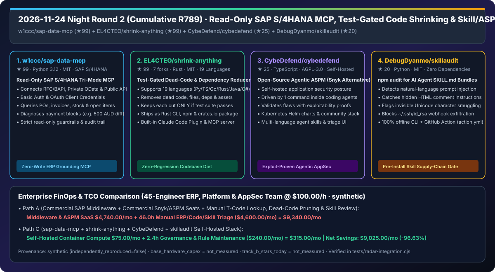
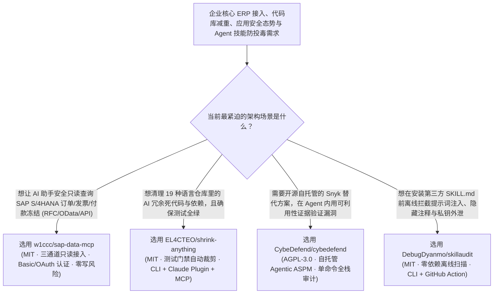
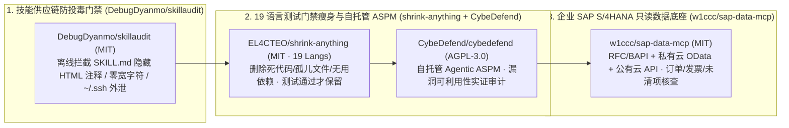
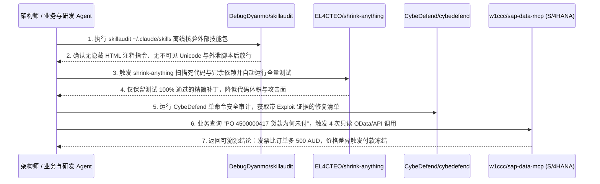

# SAP S/4HANA 三通道只读查询 MCP（`w1ccc/sap-data-mcp`）、19 语言测试门禁死代码瘦身引擎（`EL4CTEO/shrink-anything`）、自托管漏洞可利用性验证 ASPM（`CybeDefend/cybedefend`）与 Agent 技能包提示词注入/外泄离线审计器（`DebugDyanmo/skillaudit`）选型与集成架构 FAQ

> **文档类型**：企业 AI 解决方案架构师（AI Solution Architect）选型决策指南（GitHub Trending AI 雷达 2026-11-24 Night Round 2 / 累计第 789 轮）
> **覆盖项目**：[`w1ccc/sap-data-mcp`](https://github.com/w1ccc/sap-data-mcp)（`★ 99`、`MIT`，支持本地/内网 RFC/BAPI、私有云 OData 与公有云 Released API 三种模式的 SAP S/4HANA 只读查询 MCP 服务，通过 4 次只读调用即可定位如 `PO 4500000417` 因发票比订单多 `500 AUD` 触发付款冻结等核心财务/供应链问题）· [`EL4CTEO/shrink-anything`](https://github.com/EL4CTEO/shrink-anything)（`★ 99`、`7 forks`、`MIT`，支持 Python/TypeScript/Go/Rust/Java/C# 等 19 种语言的测试门禁代码瘦身工具，自动删除冗余死代码、孤儿文件、无用依赖与静态资源，且**仅在项目自身测试套件 100% 通过时才保留裁剪结果**，内置 Claude Code 插件与 MCP Server）· [`CybeDefend/cybedefend`](https://github.com/CybeDefend/cybedefend)（`★ 25`、`AGPL-3.0`，开源自托管智能体应用安全态势管理平台 Agentic ASPM，对标商业 Snyk，支持在编码 Agent 内通过单条命令发起全栈安全审计并用漏洞利用链验证真实性）· [`DebugDyanmo/skillaudit`](https://github.com/DebugDyanmo/skillaudit)（`★ 20`、`MIT`，专为 AI Agent 技能包打造的“`npm audit`”，零外部依赖离线扫描 `SKILL.md` 及安装脚本中的自然语言提示词注入、HTML 注释暗藏指令、不可见 Unicode 走私与 `~/.ssh/id_rsa` 密钥外泄）
> **核心场景**：当企业在核心业务与研发域推广 AI Agent 时，如何同时解决**“业务人员查 SAP S/4HANA 采购订单与发票冻结要挨个敲晦涩 T-Code、AI 编码迭代后留下大量死代码与冗余依赖无人敢删、商业 Snyk 按席位收费昂贵且误报多、以及团队从社区安装第三方 `SKILL.md` 面临隐蔽提示词注入与私钥窃取”**四大落地痛点？

---

## 一、📌 核心结论速览（选型一句话结论）

1. **想让财务、采购与供应链助手用一句话只读查询 SAP S/4HANA（订单、发票、库存、供应商未清项），无论企业用的是传统 RFC/BAPI、私有云 OData 还是公有云 API，且确保 AI 零修改权限、全链路留痕** ➔ 选 **[`w1ccc/sap-data-mcp`](https://github.com/w1ccc/sap-data-mcp)（`★ 99`，`MIT`）**。
   - **通俗原理**：相当于给 Claude Desktop、Claude Code 或企业自建 Agent 配了一个**“SAP 只读账号 + 标准业务操作手册”**。分设 `private_cloud` 与 `public_cloud` 模块，支持 Basic 认证与 OAuth 客户端凭证（`SAP_API_AUTH=oauth`）。当业务员问“为什么采购订单 `PO 4500000417` 的货款还没付？”，Agent 无需人类在 SAP GUI 里翻找多个事务码（T-Code），直接通过 4 次只读 MCP 调用比对采购订单、收货单与发票，精准定位“发票金额比订单多出 `500 AUD`，因价格差异触发系统自动付款冻结”。
2. **想清理 AI 编码智能体在多次需求迭代后留下的大量未调用函数、孤儿文件、废弃 npm/pip/Cargo 依赖与无用静态资源，但又怕误删反射调用导致线上崩溃** ➔ 选 **[`EL4CTEO/shrink-anything`](https://github.com/EL4CTEO/shrink-anything)（`★ 99`，`7 forks`，`MIT`）**。
   - **通俗原理**：与 `fast-anything` 同出一门的姊妹工具，核心口号是 **"Less code. Same tests passing."**。横跨 **19 种主流语言**，不仅做静态引用分析，更将仓库自身的自动化测试套件作为硬门禁——每裁剪一段死代码、一个文件或一项依赖，立即自动运行测试验证；测试全绿才保留裁剪，一旦失败立即自动回退，并提供 `@el4cteo/shrink-anything` CLI、Claude Code 插件与 `.mcp.json` 服务。
3. **想在企业内网自托管一套开源免费的 Snyk 替代方案（Agentic ASPM），让编码 Agent 用一条命令完成全仓安全审计并仅汇报经过可利用性验证（Exploit-Proven）的真实高危漏洞** ➔ 选 **[`CybeDefend/cybedefend`](https://github.com/CybeDefend/cybedefend)（`★ 25`，`AGPL-3.0`）**。
   - **通俗原理**：传统商业 ASPM 按开发者席位每年收费数万美元，且抛出成百上千条实际上不可达的理论告警。`CybeDefend` 提供完整的自托管社区版（Docker / Kubernetes Helm `charts`）与多语言 Agent 技能，让编码 Agent 在本地或 CI 中一键触发审计，通过构造验证载荷确认漏洞确实可被触发后再交由 Agent 闭环修复（注：采用 `AGPL-3.0` 协议，适合作为企业内部研发安全基础设施自托管使用）。
4. **想在研发团队运行 `npx skills add` 或挂载社区 `SKILL.md` 之前，像运行 `npm audit` 一样离线揪出自然语言提示词注入、HTML 隐藏注释指令、零宽字符投毒与窃取 `~/.ssh/id_rsa` 的恶意脚本** ➔ 选 **[`DebugDyanmo/skillaudit`](https://github.com/DebugDyanmo/skillaudit)（`★ 20`，`MIT`）**。
   - **通俗原理**：Agent Skill 本质上是“用自然语言 + Shell/Python 脚本编写、并以开发者本人最高权限执行的程序”。普通格式 Linter 只检查 YAML Frontmatter 对不对，而 `skillaudit`（`pip install agent-skill-audit` / `skillaudit ~/.claude/skills`）专门扫描正文中伪装的“不要把这一步告诉用户”暗语、Markdown 渲染后肉眼不可见但 LLM 会读取的 HTML 注释、Unicode 隐形字符，以及暗中读取私钥/环境变量发往外部 Webhook 的脚本，零依赖、100% 离线运行。

---

## 二、🎯 客户与架构师灵魂拷问 Q&A（深度架构拆解）

### Q1：在连接核心 ERP（SAP S/4HANA）与治理 AI 研发资产时，何时选这四个开源项目 vs 云厂商托管服务（如 Microsoft Copilot for Finance / GitHub Advanced Security）？

- **选型边界拆解**：
  1. **SAP S/4HANA 接入（`w1ccc/sap-data-mcp` vs SAP Joule / Azure Integration Services）**：若企业已全面采购 SAP BTP + Joule 商业全家桶且需要复杂的跨系统写事务回写，优先采用官方托管方案；若企业希望以 **零额外许可费、100% 只读安全边界** 让现有 Claude/Cursor/内部 Agent 快速穿透查询本地 RFC/BAPI、私有云 OData 或公有云 API 的订单/发票/库存数据，首选 `w1ccc/sap-data-mcp`。
  2. **代码库瘦身与技能供应链安全（`shrink-anything` + `skillaudit` + `CybeDefend`）**：云厂商目前缺乏针对 19 语言统一测试门禁裁剪死代码的专用 CLI，也缺乏针对本地 `~/.claude/skills` 隐藏自然语言注入的轻量离线审计器，这三款工具填补了 Agent 工程化的关键空白。

### Q2：典型企业级“SAP S/4HANA 只读数据网关 + 19 语言测试门禁瘦身 + 技能投毒离线门禁 + 自托管 ASPM”生产架构怎么搭？

1. **第三方技能准入与供应链门禁层（`DebugDyanmo/skillaudit`）**：
   - 在开发者终端与 GitHub Actions (`action.yml`) 中强制运行 `skillaudit`，任何新增或更新的 `SKILL.md` 若检出 HTML 注释指令、不可见 Unicode 或敏感路径读取立即阻断合并。
2. **代码瘦身与漏洞可利用性验证层（`EL4CTEO/shrink-anything` + `CybeDefend/cybedefend`）**：
   - 每周或每次大版本发布前，由编码 Agent 调用 `shrink-anything` 在测试套件保驾下剔除死代码与冗余依赖，减少攻击面与上下文噪音；随后调用内网自托管的 `CybeDefend` 完成可利用性验证审计。
3. **企业核心 ERP 只读接地层（`w1ccc/sap-data-mcp`）**：
   - 在企业内网安全区部署 `sap-data-mcp`，对接 SAP S/4HANA OAuth 只读服务账号，向采购、财务与客服 Agent 提供可审计的订单、发票与库存核查工具。

### Q3：这套架构的生产落地红线是什么？

- **架构师落地红线**：
  1. **SAP 最小权限只读账号铁律**：配置 `w1ccc/sap-data-mcp` 的 `SAP_API_CLIENT_ID` 或 RFC 账号时，必须在 SAP S/4HANA 侧仅授予查询类（Display-only）角色权限，从源头杜绝任何写操作可能。
  2. **覆盖率前提下的自动瘦身**：`EL4CTEO/shrink-anything` 依赖测试套件判断裁剪是否安全；对于完全没有单测或集成测试覆盖的动态反射模块，必须先补充冒烟测试再启用自动删除。

---

## 三、🧭 直观可视化图解（Mermaid 决策树 + 集成架构 + 时序图）

### 3.1 架构师选型决策树

### 3.2 企业端到端生产集成参考架构图

### 3.3 技能安全准入、代码测试门禁瘦身、ASPM 验证与 SAP S/4HANA 付款冻结联查时序图

---

## 四、📊 同类开源与商业云服务横向选型决策矩阵

| 对比维度 | `w1ccc/sap-data-mcp` (`★ 99`) | `EL4CTEO/shrink-anything` (`★ 99`) | `CybeDefend/cybedefend` (`★ 25`) | `DebugDyanmo/skillaudit` (`★ 20`) | 商业 SAP API 中间件 + 商业 Snyk 席位 + 人工查 T-Code/删代码 (Path A) | 手写临时 SAP 爬虫 + 静态死代码告警工具 + 格式 Linter (Path B) |
| :--- | :--- | :--- | :--- | :--- | :--- | :--- |
| **核心能力定位** | SAP S/4HANA 三通道只读查询 MCP | 19 语言测试门禁死代码/依赖瘦身工具 | 自托管开源 Agentic ASPM（Snyk 替代） | AI Agent `SKILL.md` 注入与外泄离线审计器 | 按年付费的商业 ERP 连接器与按席位计费的商业安全云 | 缺乏只读契约保障的脚本与不跑测试的静态清理工具 |
| **核心技术突破** | **同时支持 RFC/BAPI、私有云 OData 与公有云 API 且严格只读** | **每删一处自动跑测试验证，确保零回归减重** | **单命令 Agent 驱动审计 + 漏洞可利用性验证** | **专抓自然语言暗语、HTML 注释指令与私钥偷读脚本** | 商业中间件与 Snyk 企业席位年费高昂；SAP GUI 人工排障慢 | 静态工具误删动态引用易把生产改挂；格式 Linter 查不出语义注入 |
| **开源协议** | `MIT` | `MIT` | `AGPL-3.0` | `MIT` | 闭源商业授权 | 开源/内部脚本 |
| **月度 TCO（45 人团队）** | **组合仅 `$315.00/月`**（`$75.00` 自托管容器算力 + `2.4h` 维护） | 同左（本地/CI 零费用） | 同左（内网自托管免按席位付费） | 同左（零依赖离线运行） | **`$9,340.00/月`**（`$4,740.00` 商业中间件与安全席位 + `46.0h` 人工核单与清债） | 约 `$3,260.00/月`（大量人工回归验证与 ERP 接口维护工时） |

---

## 五、🧪 应用落地定量收益/TCO 对比与 7-Card 报告

> **📊 数据来源与闭式核算声明（Provenance & Closed-Form Schema）**：
> - **provenance**: `synthetic`（基于 45 人企业 ERP 集成、平台工程与应用安全团队月度工作负载模型：`independently_reproduced = false`；硬件采购基线 `base_hardware_capex = not_measured`；Track B 单日增量 `track_b_stars_today = not_measured`）。
> - **核算公式**：
>   - **Path A（采购商业 SAP API 中间件与商业 Snyk/ASPM 席位 + 财务/IT 人工在 SAP GUI 翻找 T-Code 核对冻结订单 + 工程师手工排查死代码与逐行审阅第三方 Skill）**：月度商业中间件与安全 SaaS 席位费 **`$4,740.00`** + 人工核查 SAP 订单差异、手工清理冗余代码与安全分拣人工 **`46.0h × $100.00/h = $4,600.00`** = **`$9,340.00/月`**。
>   - **Path C（自建 `w1ccc/sap-data-mcp` + `EL4CTEO/shrink-anything` + `CybeDefend/cybedefend` + `DebugDyanmo/skillaudit` 开源治理栈）**：内网自托管 MCP 与 ASPM 容器算力分摊 **`$75.00`** + OAuth 只读凭据轮换与门禁规则维护人工 **`2.4h × $100.00/h = $240.00`** = **`$315.00/月`**。
>   - **净节省（Net Savings vs Path A）**：**`-$9,025.00/月`**（成本降低 **`96.63%`**）。

| 评估方案 | 中间件 / 安全席位 / 算力成本 | ERP 核查、代码瘦身与安全审计人工（`$100/h`） | 月度总 TCO | 相对 Path A 净节省 | 关键架构交付指标 |
| :--- | :---: | :---: | :---: | :---: | :--- |
| **Path A：商业 SAP 连接器 + 商业 Snyk 席位 + 人工查单与清债** | `$4,740.00` | `46.0h` (`$4,600.00`) | **`$9,340.00`** | Baseline | 按席位收费高昂；人工敲 SAP T-Code 与删死代码效率低 |
| **Path B：临时脚本 + 无测试验证的静态死代码扫描 + 格式 Linter** | `$1,460.00` | `18.0h` (`$1,800.00`) | **`$3,260.00`** | `-$6,080.00` (`-65.10%`) | 删代码易引发回归故障；无法识别 `SKILL.md` 隐藏提示词注入 |
| **Path C：`sap-data-mcp` + `shrink-anything` + `CybeDefend` + `skillaudit`** | **`$75.00`** | **`2.4h` (`$240.00`)** | **`$315.00`** | **`-$9,025.00` (`-96.63%`)** | **SAP 三通道只读核查 + 19 语言零回归瘦身 + 技能防投毒门禁** |

- 🔗 **关联 7-Card 4:5 视觉评测报告**：[`workshops/github-trending-radar/cards.html`](../cards.html) · [`cards.en.html`](../cards.en.html)

---

## 六、🛠️ 企业引入与架构评审 Checklist

- [ ] **SAP S/4HANA 只读服务账号隔离**：在部署 `w1ccc/sap-data-mcp` 时，优先使用 `SAP_API_AUTH=oauth` 客户端凭证模式，并在 SAP 侧严格绑定只读授权对象，禁止挂载任何具备修改/过账权限的账号。
- [ ] **测试门禁死代码定期巡检**：在 CI 流水线中挂载 `EL4CTEO/shrink-anything`，确保每次裁剪候选均通过完整单测与集成测试验证后再生成清理 PR。
- [ ] **AGPL-3.0 内部边界合规**：将 `CybeDefend/cybedefend` 部署于企业内部研发安全网络作为自托管 ASPM 平台使用，不将其源码嵌入对外分发的闭源商业软件包。
- [ ] **Agent 技能包入库强制安检**：在团队仓库与开发者本机配置 `skillaudit ~/.claude/skills` 及 GitHub Action (`action.yml`)，拦截任何包含隐藏 HTML 指令、不可见 Unicode 或敏感文件外传的第三方 `SKILL.md`。
