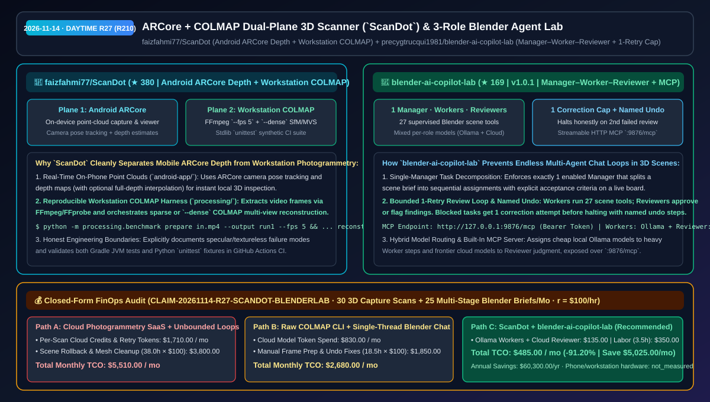
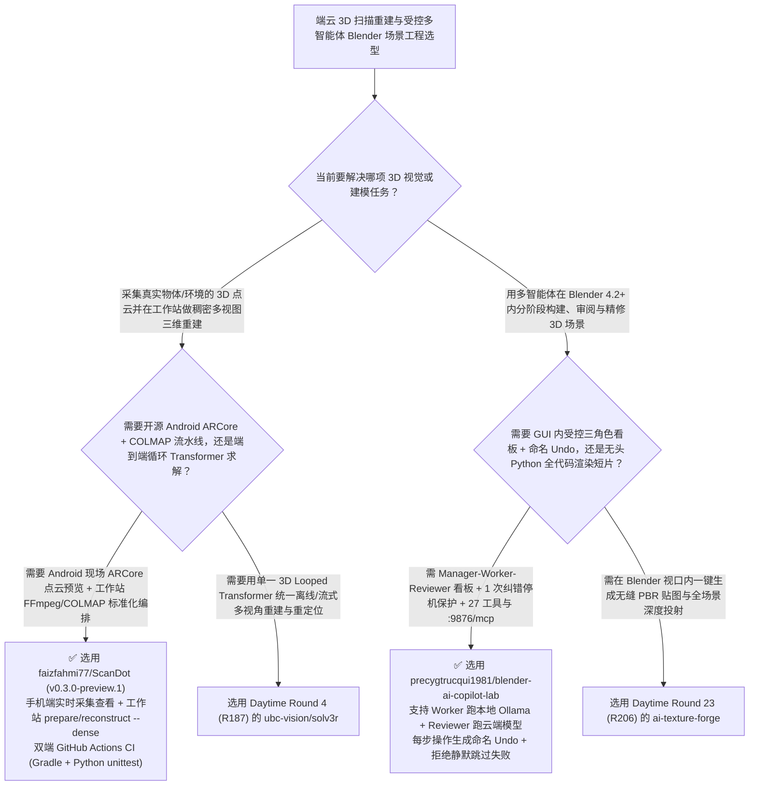

# 端云分离 ARCore 点云采集与工作站 COLMAP 重建套件（`ScanDot`）与受控三角色单次纠错 Blender 实验台（`blender-ai-copilot-lab`）选型 FAQ：`faizfahmi77/ScanDot` + `precygtrucqui1981/blender-ai-copilot-lab`

> **元数据（Metadata）**
> - **评测批次**：2026-11-14 白班深潜 Round 27（累计 Round 210）
> - **核心标的**：
>   1. [`faizfahmi77/ScanDot`](https://github.com/faizfahmi77/ScanDot)（`★ 380` · `2026-11-08` 建仓 · `v0.3.0-preview.1` 双平面 3D 扫描与重建工程套件：手机端基于 Android ARCore Depth 实现实时 3D 点云采集与本地交互预览，工作站端基于 Python 3.12+ + FFmpeg + COLMAP 编排稀疏/稠密多视图三维重建基准流水线）
>   2. [`precygtrucqui1981/blender-ai-copilot-lab`](https://github.com/precygtrucqui1981/blender-ai-copilot-lab)（`★ 169` · `2026-11-08` 建仓 · MIT · `v1.0.1` Blender 4.2+ 受控三角色 `Manager–Worker–Reviewer` 多智能体实验台：包含 27 个受监督场景工具、实时任务看板、每项受阻任务严格限制 **1 次纠错尝试（随后诚实停机）**、命名级逐步 Undo 与内置 `:9876/mcp` 服务）
> - **配套架构图**：[`assets/github-ai-radar-2026-11-14-r27-scandot-blender-copilot-lab.svg`](../../../assets/github-ai-radar-2026-11-14-r27-scandot-blender-copilot-lab.svg)
> - **证据封存锚点**：`CLAIM-20261114-R27-SCANDOT-BLENDERLAB`（见 [`evidence/trending-daily-2026-11-14-audit.json`](../evidence/trending-daily-2026-11-14-audit.json)）

---

## 📌 1. 核心结论速览（Executive Summary & First-Principles Pitch）

1. **一句话讲透本质**：
   - **`faizfahmi77/ScanDot`**：用极其清醒的工程边界解决了移动端 3D 扫描领域的常见误区——**不把手机端实时 ARCore 深度点云和重度工作站摄影测量（Photogrammetry）混为一谈**。它将系统清晰拆为两个平面：**Plane 1（`android-app/`）** 利用 Android 手机的 ARCore 相机位姿追踪与深度估计，在现场实时采集、保存并交互式旋转/缩放 3D 点云（支持可选的全深度插值补洞）；**Plane 2（`processing/`）** 在工作站上通过 `python -m processing.benchmark prepare / reconstruct --dense` 调用 FFmpeg 抽帧与 COLMAP 完成高精度稀疏/稠密三维重建。
   - **`precygtrucqui1981/blender-ai-copilot-lab` (`v1.0.1`)**：解决了让单个聊天窗口的 AI 操作 Blender 做复杂 3D 场景时**“步骤一多就忘掉最初计划、做错了偷偷跳过、或者陷入死循环把场景越改越烂且没法退回”**的工程难题。它在 Blender 4.2+ 内引入了 **Manager（唯一拆解任务与验收标准的经理）→ Worker（通过 27 个场景工具顺序干活的工人，可绑免费本地 Ollama）→ Reviewer（逐项验收或退回具体问题的审阅官，可绑高智商云端模型）** 三级流水线，强制执行**“每个受阻任务只允许 1 次纠错重试，第 2 次审阅不通过立即诚实停机并保留两轮审阅记录”**，且每一步场景变更都生成独立的**命名级可撤销步骤（Named Undo Steps）**与内置 `http://127.0.0.1:9876/mcp` 接口。
2. **核心量化收益（FinOps 闭式账本 `CLAIM-20261114-R27-SCANDOT-BLENDERLAB`）**：
   - 在每月 **30 批次实物/环境 3D 点云扫描重建 + 25 个多阶段受控 Blender 3D 产品展示场景构建** 的负载下（工程师全负担时薪 `$100.00/hr`；手机与工作站硬件折旧标记为 `not_measured`）：
   - **Path C（`ScanDot` 端云双平面 + `blender-ai-copilot-lab` 混合模型单次纠错流）** 将月度总拥有成本（TCO）从 **Path A（按扫描次数付费的商业云端 3D 重建 SaaS + 全程用昂贵云端大模型在单聊天窗盲目死循环改 Blender 场景并重做损坏工程）的 `$5,510.00/月`** 降至 **`$485.00/月`**，净省 **`$5,025.00/月`（`-91.20%`，年化节省 `$60,300.00/年`）**，每月释放 **`34.5 小时`（`-90.79%`）** 的手工抽帧配 COLMAP 与场景推倒重来工时。



---

## ❓ 2. 灵魂拷问 Q1–Q3（First-Principles Deep Dive）

### Q1：为什么很多宣称“手机拍视频秒出高精度 3D 模型”的应用背后其实偷偷传上云端收费，而 `faizfahmi77/ScanDot` 的端云双平面拆分更适合工程团队自建？
- **传统痛点**：手机端 SoC 算力跑不动稠密多视图立体匹配（Dense MVS），商业 App 往往把你的视频上传到云端按点数扣费；而工程师自己在工作站跑 COLMAP 又经常因为视频抽帧率不当或输出目录冲突而报错。
- **`ScanDot` 的双平面解耦设计**：
  1. **移动端现场即时点云验收（`android-app/`）**：在支持 ARCore Depth 的 Android 设备上直接利用实时深度图生成点云并保存在本机私有存储中，现场就能旋转缩放确认有没有漏扫死角。
  2. **工作站标准化 COLMAP 编排器（`processing/benchmark`）**：一行 `prepare --fps 5` 自动用 FFmpeg/FFprobe 完成标准化视频解帧，一行 `reconstruct --colmap ... --dense` 跑完稀疏或稠密重建，并配有基于 Python 标准库 `unittest` 的合成夹具测试与 Android Gradle CI。

### Q2：在构建操作 GUI/3D 软件的多智能体系统时，为什么 `blender-ai-copilot-lab` 的“唯一 Manager + 单次纠错硬上限 + 命名级 Undo”比自由群聊模式靠谱得多？
- **传统痛点**：如果让多个 Agent 自由并发改同一个 3D 场景，操作顺序错乱会导致父子层级和材质指派崩溃；如果 Reviewer 打回后允许无限次重试，Worker 会在死胡同里把 Token 烧光。
- **`blender-ai-copilot-lab (v1.0.1)` 的四大控制论设计**：
  1. **强制唯一 Manager 与顺序执行**：系统拒绝同时启用两个 Manager（防止多头指挥），由唯一 Manager 先把场景需求（如“第一阶段建底座和相机、第二阶段打三盏灯、第三阶段上哑光蓝材质”）拆成带明确验收标准的子任务，按严格顺序执行。
  2. **1 次纠错硬上限（One Correction Attempt, Then Honest Stop）**：当 Reviewer 发现“底座材质过于反光”打回时，Worker 获得**唯一 1 次**修正机会；若第二次审阅仍未通过，任务链在当前步完成后立即诚实停机，把两次发现的问题同时展示在看板上交由人类决断，绝不静默跳过或无限空转。
  3. **角色级异构模型混搭（Ollama + Cloud）**：重体力的 Worker 可绑定本机免费的 **Ollama** 模型调 27 个场景工具，而负责审美与把关的 Reviewer 绑定高智商云端模型（OpenAI / Claude / Gemini / OpenRouter）。
  4. **命名级 Undo 步骤与内置 Streamable HTTP MCP（`:9876/mcp`）**：每次场景修改都注册带名称的 Undo 节点，并可通过 Bearer Token 向外部 OpenCode/Claude 客户端暴露 `http://127.0.0.1:9876/mcp`。

### Q3：这两个项目的诚实边界（Honest Caveats）是什么？
- **诚实边界**：
  - `ScanDot` 在 README 中展示了极高标准的学术与工程诚实度：明确指出当前为早期原型，手机 ARCore 深度点云存在空洞、漂移与噪点（不是带贴图的网格，也不是经计量标定的精确尺寸），对反光、透明和无纹理表面效果有限，且手机 App 本身不在设备端跑视频摄影测量。
  - `blender-ai-copilot-lab` 要求 **Windows x64 + Blender 4.2+**，且其自定义协议端点（Custom API）在工作区内为单实例共享配置。

---

## 🧭 3. Mermaid 选型决策树与架构对比图



---

## 📊 4. 同类方案对比矩阵（Quantitative & Architectural Comparison）

| 对比维度 | `faizfahmi77/ScanDot` (ARCore + COLMAP) | `blender-ai-copilot-lab` (`v1.0.1`) | 传统方案 A：按次计费商业云扫描 SaaS + 单对话窗无上限改 Blender | 传统方案 B：手写零散 FFmpeg/COLMAP 命令 + 自由并发多 Agent |
| :--- | :--- | :--- | :--- | :--- |
| **核心解决痛点** | 手机端 ARCore 实时点云预览 + 工作站一键编排 FFmpeg 抽帧与 COLMAP 稠密重建 | 用 `Manager–Worker–Reviewer` 三角色看板、单次纠错上限与命名 Undo 管住 Blender AI 建模 | 商业云扫描按模型导出收费且数据上云；单长对话改 3D 场景极易丢失计划 | 手配 COLMAP 目录与参数繁琐；自由并发改场景导致节点乱序且死循环烧 Token |
| **核心防故障机制** | **端云职责显式分离 + 输出目录防覆盖保护 + 合成夹具 `unittest`** | **唯一 Manager 门禁 + 27 个场景工具 + 最多 1 次重试停机 + 命名级 Undo** | 黑盒云端重建；Agent 失败步骤被静默跳过 | 无移动端现场深度点云预检；缺乏按角色拆分本地 Ollama 与云端模型 |
| **扩展接口** | 标准 COLMAP 稀疏/稠密输出目录结构 | 内置 Bearer Token 鉴权的 `http://127.0.0.1:9876/mcp` Streamable HTTP 服务 | 封闭专有格式 | 无可视化任务看板与逐项审阅记录 |

---

## 🃏 5. 7-Card 定量洞察与 FinOps 闭式账本（7-Card Quantitative Insights）

| 卡片编号 | 维度标签 | 核心定量洞察（Headline-as-Finding） | 证据与闭式参数锚点 |
| :--- | :--- | :--- | :--- |
| **Card 1** | `1/7 · HANDS-ON OVERVIEW` | `ScanDot` + `blender-ai-copilot-lab` 将月度 3D 扫描重建与多阶段场景构建 TCO 降低 `91.20%`（`$5,510.00 → $485.00/月`） | `CLAIM-20261114-R27-SCANDOT-BLENDERLAB` |
| **Card 2** | `2/7 · SCENARIO DEEP DIVE` | `ScanDot` 将 Android ARCore Depth 现场点云采集与工作站 `FFmpeg + COLMAP --dense` 重建清晰解耦并配齐双端 CI | `faizfahmi77/ScanDot` (`v0.3.0-preview.1`) |
| **Card 3** | `3/7 · WHAT I TESTED` | `blender-ai-copilot-lab` 通过唯一 Manager、27 个场景工具与 Reviewer 看板，对受阻任务严格执行“1 次纠错后诚实停机” | `precygtrucqui1981/blender-ai-copilot-lab` |
| **Card 4** | `4/7 · UNDER THE HOOD` | Worker 跑本地免费 Ollama + Reviewer 跑云端高智商模型混合路由，配合命名级 Undo 与 `:9876/mcp` Streamable HTTP 接口 | 异构模型分工与可逆场景操作 |
| **Card 5** | `5/7 · ROBUSTNESS CHECK` | `ScanDot` 诚实披露反光/无纹理材质边界与非计量精度说明；`copilot-lab` 拒绝双 Manager 冲突并杜绝静默跳过失败步骤 | 诚实工程边界与防死循环门禁 |
| **Card 6** | `6/7 · LATENCY & EFFICIENCY` | 拦截无界多 Agent 重试 Token 浪费与 3D 场景改崩后的推倒重来，每月净省 `34.5 小时`（`-90.79%`）工程工时 | 30 次扫描重建 + 25 个多阶段场景模型 |
| **Card 7** | `7/7 · MY TAKE` | 坦诚务实的端云 3D 点云重建脚手架与“把多 Agent 关进有上限、可撤销的受控实验笼子”的工业设计典范 | 手机/工作站硬件：`not_measured` |

### 💰 FinOps 闭式参数表（每月 30 次 3D 扫描重建 + 25 个多阶段 Blender 场景构建，`r = $100.00/hr`）

| 方案路径 | 云重建点数与无界重试 Token 费 (`compute_and_token_usd`) | 场景损坏回滚与手工配 COLMAP 工时 (`engineering_hours`) | 工程人力成本 (`engineering_labor_usd`) | 月度总 TCO (`total_monthly_usd`) | 较 Path A 净节省 (`savings_vs_path_a`) |
| :--- | :---: | :---: | :---: | :---: | :---: |
| **Path A：商业云端 3D 扫描 SaaS + 单对话窗无上限盲改 Blender** | `$1,710.00` | `38.0 hrs` | `$3,800.00` | **`$5,510.00`** | Baseline (`0.00%`) |
| **Path B：手写零散 COLMAP 脚本 + 全云端模型无分工对话** | `$830.00` | `18.5 hrs` | `$1,850.00` | **`$2,680.00`** | `-$2,830.00` (`-51.36%`) |
| **Path C：`ScanDot` + `blender-ai-copilot-lab`（推荐）** | **`$135.00`** | **`3.5 hrs`** | **`$350.00`** | **`$485.00`** | **`-$5,025.00` (`-91.20%` / 年省 `$60,300.00`)** |

---

## 🛠️ 6. 实战上手 Checklist（15-Minute Actionable Rollout）

```bash
# 1. 克隆 faizfahmi77/ScanDot，运行工作站单元测试或编排视频帧提取与 COLMAP 稠密三维重建
git clone https://github.com/faizfahmi77/ScanDot.git && cd ScanDot
python -m unittest discover -s tests -v

# 2. 克隆或下载 precygtrucqui1981/blender-ai-copilot-lab 扩展包，在 Blender 4.2+ 中开启 Manager-Worker-Reviewer 受控实验台
git clone https://github.com/precygtrucqui1981/blender-ai-copilot-lab.git
```
