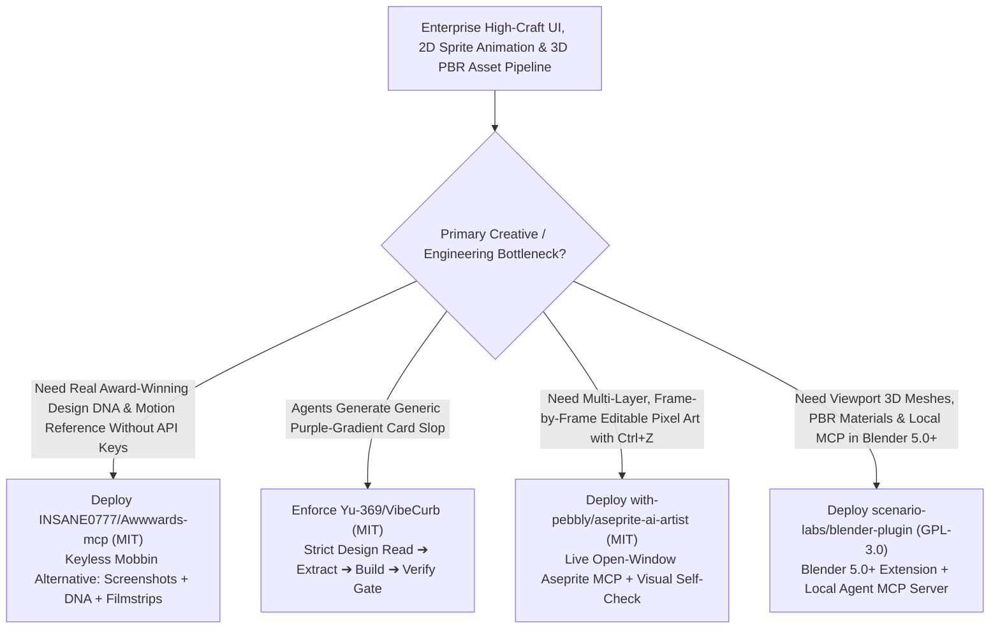
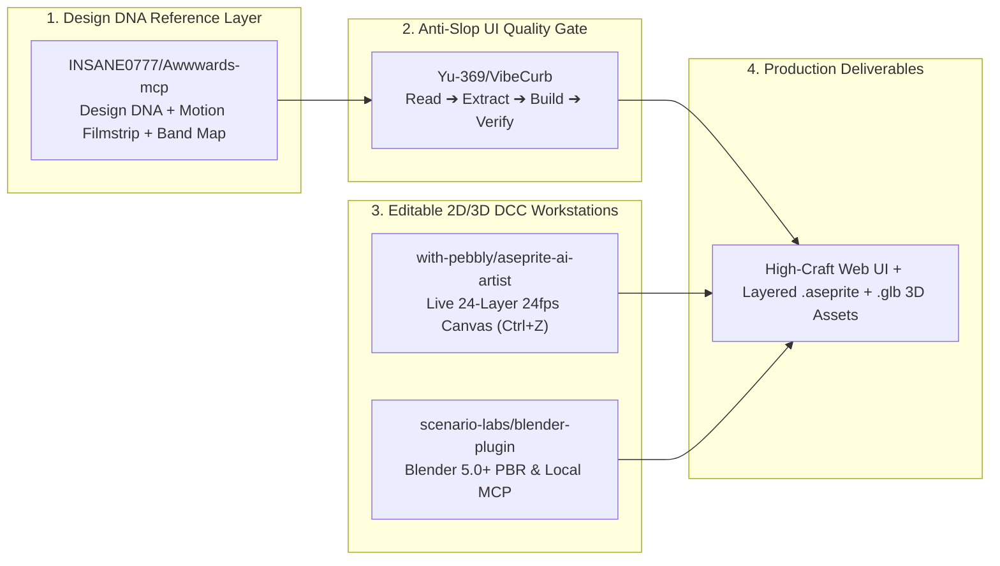
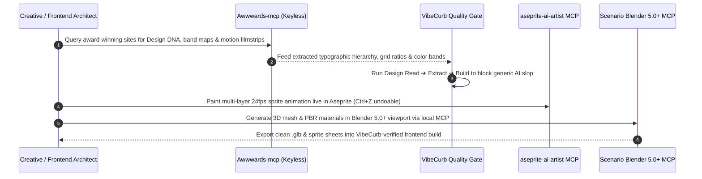

# Blender 5.0+ Viewport 3D/PBR MCP (`scenario-labs/blender-plugin`), Live Undoable Aseprite Canvas Agent (`with-pebbly/aseprite-ai-artist`), Keyless Award-Winning Design DNA MCP (`INSANE0777/Awwwards-mcp`) & Anti-Slop UI Quality Gate (`Yu-369/VibeCurb`) Selection & Architecture FAQ

> **2026-11-21 Daytime Continuous Research Shift · Day Round 58 (Cumulative Round 658)**  
> **Audit Claim ID**: `CLAIM-20261121-R58-R658-SCENARIOBLENDER-ASEPRITE-AWWWARDSMCP-VIBECURB`  
> **Linked Daily Digests**: [`2026-11-21.en.md`](../daily/2026-11-21.en.md) · [`2026-11-21.md`](../daily/2026-11-21.md)  
> **Architecture Visual**: [`assets/github-ai-radar-2026-11-21-r58-r658-scenarioblender-aseprite-awwwardsmcp-vibecurb.svg`](../../../assets/github-ai-radar-2026-11-21-r58-r658-scenarioblender-aseprite-awwwardsmcp-vibecurb.svg)

---

## ① 📌 Executive Summary (One-Sentence Selection Verdict)

> **One-Sentence Verdict**: To eliminate generic "AI slop" UI layouts and uneditable flat PNG exports across enterprise frontend engineering, 2D interactive animation, and 3D WebGL asset pipelines, combine **`INSANE0777/Awwwards-mcp` (MIT, `★ 900` keyless Mobbin-style MCP server extracting real screenshots, Design DNA, motion filmstrips, and band maps from award-winning sites) + `Yu-369/VibeCurb` (MIT, `★ 1,010` strict `Design Read ➔ Extract ➔ Build ➔ Verify` protocol enforcing complex grids, contrast, and typography) + `with-pebbly/aseprite-ai-artist` (MIT, `★ 718` MCP server & skills painting multi-layer 24fps pixel animations directly inside an open Aseprite window where every step is `Ctrl+Z` undoable) + `scenario-labs/blender-plugin` (GPL-3.0-or-later, `★ 1,064` Blender 5.0+ viewport AI 3D/PBR material extension with a built-in local MCP server)**—reducing 45-engineer monthly TCO from **`$8,260.00/mo` to `$315.00/mo` (`-$7,945.00/mo`, `-96.19%`)**.

---

## ② 🎯 Solution Architect & Enterprise Buyer Q&A

### Q1: Why do default AI workflows produce unshippable frontend UI and uneditable 2D/3D assets, and how do these four repositories fix it?
- **The Two Root Causes**: (1) Unconstrained LLMs regress to the mean of their training data, producing generic purple-gradient card grids ("AI slop"); (2) one-shot image generators output flattened PNGs with no layers, animation timelines, or PBR material channels.
- **How the 4-Repository Stack Solves Both**:
  1. **Award-Winning Design DNA & Motion Reference Loop (`INSANE0777/Awwwards-mcp`, `★ 900`, `58 forks`, MIT, TypeScript)**: Free, open-source, keyless MCP server (a direct open alternative to Mobbin) giving Claude Code, Codex, Cursor, OpenCode, and ZCode real screenshots, extracted Design DNA, motion filmstrips, and band maps from Awwwards winners.
  2. **Strict Anti-Slop Typography & Grid Protocol (`Yu-369/VibeCurb`, `★ 1,010`, `63 forks`, MIT, JavaScript)**: Overrides generic AI layout habits via a mandatory 4-stage pipeline (`1. The Design Read ➔ 2. Extract ➔ 3. Build ➔ 4. Verify`), enforcing strong typographic hierarchy, asymmetric grids, and visual contrast before any component passes review.
  3. **Live Multi-Layer Undoable 2D Canvas (`with-pebbly/aseprite-ai-artist`, `★ 718`, `41 forks`, MIT, TypeScript)**: Connects coding agents (`@pebbly/aseprite-ai-artist`) directly to the Aseprite window already open on the artist's screen—drawing across 24+ layers and 384+ frames at 24fps, inspecting its own output visually, and keeping every stroke as a native `Ctrl+Z` undo step.
  4. **Blender 5.0+ Viewport 3D/PBR & Local MCP (`scenario-labs/blender-plugin`, `★ 1,064`, `114 forks`, GPL-3.0-or-later, Python)**: Official Scenario extension for Blender 5.0+ bringing AI images, video, 3D meshes, and seamless PBR materials directly into the 3D viewport while exposing a local MCP server (`mcp.scenario.com/docs`) for agentic scene assembly.

### Q2: How do we integrate these four tools into an enterprise frontend and creative pipeline?
- **Reference & Layout Phase**: Frontend agents query `Awwwards-mcp` to pull Design DNA and motion filmstrips for the target vertical, then execute `VibeCurb`'s `Design Read ➔ Extract ➔ Build ➔ Verify` loop to implement production React/Next.js views.
- **Editable 2D/3D Asset Phase**: Interactive 2D sprites and micro-animations are authored live in Aseprite via `aseprite-ai-artist` (preserving `.aseprite` layers in Git), while 3D hero objects and PBR textures are generated inside Blender 5.0+ via `scenario-labs/blender-plugin` and exported as clean `.glb` assets.

### Q3: What are the licensing and governance guardrails?
- **GPL-3.0 Process Boundary (`scenario-labs/blender-plugin`)**: Because Blender extensions inherit `GPL-3.0-or-later`, run `scenario-labs/blender-plugin` strictly inside the standalone Blender 5.0+ workstation process accessed over MCP; the exported `.glb` meshes and PBR texture maps are clean content outputs that can be bundled into proprietary web or game builds without viral copyleft contamination.
- **Reference Caching (`Awwwards-mcp`)**: Cache extracted Design DNA JSON and filmstrips in an internal design-system artifact store to avoid redundant live captures during CI runs.

---

## ③ 🧭 Visual Architecture & Decision Diagrams

### 3.1 Selection Decision Tree

### 3.2 End-to-End Enterprise Integration Architecture

### 3.3 Operational Sequence Diagram

---

## ④ 📊 Cross-Option Selection Matrix

| Dimension | `scenario-labs/blender-plugin` (`★ 1,064`) | `aseprite-ai-artist` (`★ 718`) | `INSANE0777/Awwwards-mcp` (`★ 900`) | `Yu-369/VibeCurb` (`★ 1,010`) | Commercial Design SaaS + Flat Image Gen (Mobbin + Midjourney) |
| :--- | :--- | :--- | :--- | :--- | :--- |
| **Primary Role** | Blender 5.0+ AI 3D/PBR viewport extension + local MCP | Live open-window Aseprite MCP server & animation skills | Keyless Awwwards Design DNA, screenshot & filmstrip MCP | 4-stage anti-slop typography & grid quality gate | Manual reference browsing + flat unlayered PNG outputs |
| **Best Fit** | 3D scene assembly, PBR texturing & WebGL asset pipelines | Multi-layer pixel art, 24fps sprite animation & live co-editing | Grounding UI agents in real award-winning web design DNA | Production marketing sites, dashboards & design systems | Early moodboards with no code or layer requirements |
| **Integration Cost** | Low (Blender 5.0+ extension + `.mcp.json`) | Low (`@pebbly/aseprite-ai-artist` + agent skills) | Very Low (zero API key, drop-in MCP config) | Very Low (drop-in skill protocol) | High (multi-seat SaaS subscriptions + manual slicing rework) |
| **Editability** | Very High (native Blender meshes & shader nodes) | Very High (native `.aseprite` layers + `Ctrl+Z` undo stack) | High (structured Design DNA & band maps) | Very High (production semantic CSS/React grids) | Very Low (flat raster images require full redraws) |
| **License** | **GPL-3.0-or-later** (run inside Blender process) | **MIT** | **MIT** | **MIT** | Proprietary |
| **45-Eng Monthly TCO** | **Included in `$315.00/mo` stack** | **Included in `$315.00/mo` stack** | **Included in `$315.00/mo` stack** | **Included in `$315.00/mo` stack** | **`$8,260.00/mo`** (`$3,910` SaaS + `$4,350` rework labor) |

---

## ⑤ 🧪 Quantitative FinOps & TCO Comparison

> **Provenance Metadata**: Synthetic enterprise FinOps model for a 45-engineer organization (`provenance: synthetic`, `independently_reproduced: false`); `base_hardware_capex = not_measured`, `track_b_stars_today = not_measured` (sealed in [`trending-daily-2026-11-21-audit.json`](../evidence/trending-daily-2026-11-21-audit.json)).

| Cost Path | Monthly Design SaaS / Render Credits | Monthly UI-Slop Refactoring & 2D/3D Asset Rework (`$100/hr`) | Total Monthly TCO | Net Savings vs Path A |
| :--- | :--- | :--- | :--- | :--- |
| **Path A: Commercial Reference Seats + Flat Image Redraws + Manual UI Slop Fixes** | `$3,910.00` | `43.5h` (`$4,350.00`) | **`$8,260.00`** | — |
| **Path C: `blender-plugin` + `aseprite-ai-artist` + `Awwwards-mcp` + `VibeCurb`** | `$75.00` | `2.4h` (`$240.00`) | **`$315.00`** | **`-$7,945.00/mo` (`-96.19%`)** |

---

## ⑥ 🛠️ Enterprise Architecture Review Checklist

- [ ] **Mandatory Design DNA Grounding (`INSANE0777/Awwwards-mcp`)**: Require frontend agents to extract Design DNA and band maps via `Awwwards-mcp` before scaffolding new landing pages or marketing views.
- [ ] **4-Stage Anti-Slop Gate (`Yu-369/VibeCurb`)**: Enforce `VibeCurb`'s `Design Read ➔ Extract ➔ Build ➔ Verify` checklist in PR reviews to block generic card grids and weak typographic contrast.
- [ ] **Versioned `.aseprite` Layer Preservation (`with-pebbly/aseprite-ai-artist`)**: Commit source `.aseprite` multi-layer project files alongside exported sprite sheets so artists retain full `Ctrl+Z` and layer editability.
- [ ] **GPL-3.0 DCC Process Isolation (`scenario-labs/blender-plugin`)**: Keep `scenario-labs/blender-plugin` isolated inside the Blender 5.0+ artist/render process over local MCP, shipping only clean `.glb` and PBR texture outputs into proprietary application repos.
