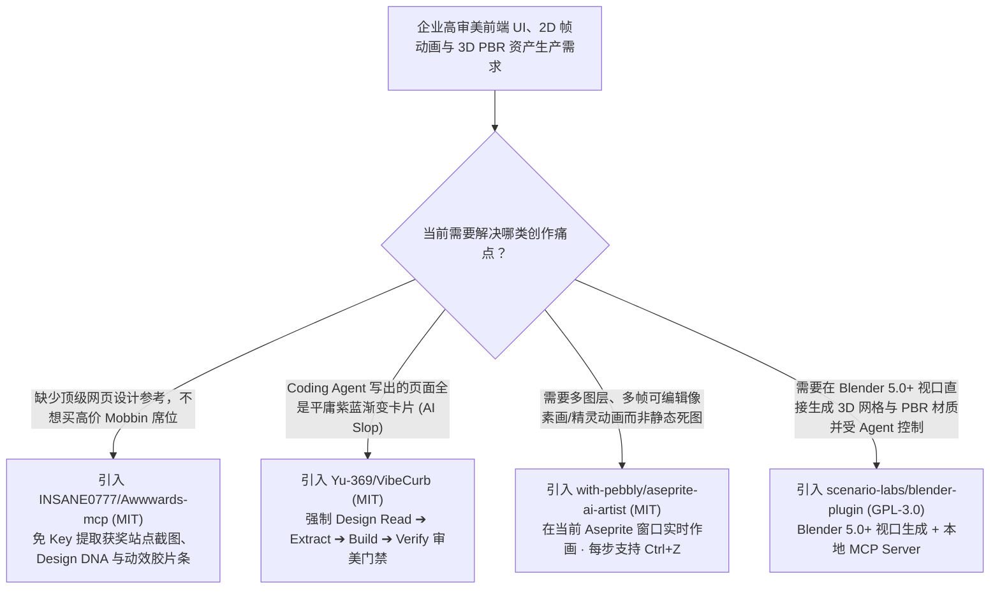
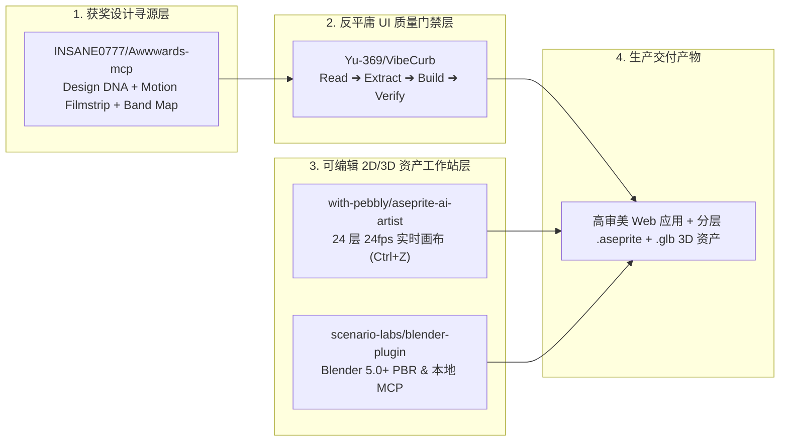
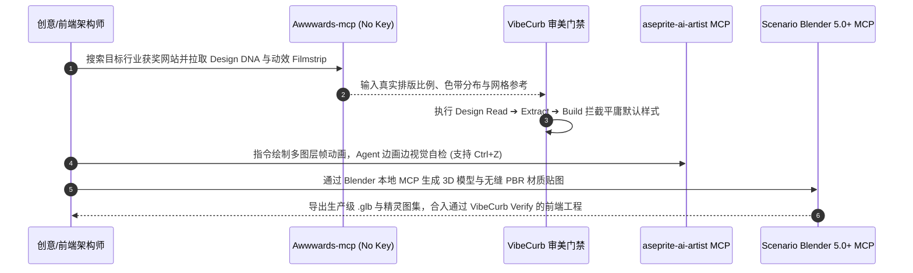

# Blender 5.0+ 视口 3D/PBR 生成与本地 MCP（`scenario-labs/blender-plugin`）、Aseprite 实时可撤销像素画与动画智能体（`with-pebbly/aseprite-ai-artist`）、免 Key 获奖网站设计 DNA 提取服务（`INSANE0777/Awwwards-mcp`）与前端反平庸审美门禁（`Yu-369/VibeCurb`）架构选型与落地 FAQ

> **2026-11-21 白天持续研究班次 · Day Round 58（累计 Round 658）**  
> **审计凭据**：`CLAIM-20261121-R58-R658-SCENARIOBLENDER-ASEPRITE-AWWWARDSMCP-VIBECURB`  
> **关联日刊**：[`2026-11-21.md`](../daily/2026-11-21.md) · [`2026-11-21.en.md`](../daily/2026-11-21.en.md)  
> **可视化架构图**：[`assets/github-ai-radar-2026-11-21-r58-r658-scenarioblender-aseprite-awwwardsmcp-vibecurb.svg`](../../../assets/github-ai-radar-2026-11-21-r58-r658-scenarioblender-aseprite-awwwardsmcp-vibecurb.svg)

---

## ① 📌 核心结论速览（选型一句话结论）

> **一句话选型结论**：在企业品牌官网、交互式产品发布页、数字孪生 3D 资产与游戏/互动 2D 精灵动画生产中，若直接让 Coding Agent 自由发挥，往往会生成千篇一律的紫蓝渐变卡片“AI 塑料感页面（AI Slop）”或无法二次编辑的死图；推荐采用 **“`INSANE0777/Awwwards-mcp`（MIT，`★ 900` 免 API Key 的开源 Mobbin 替代方案，实时检索 Awwwards 获奖网站截图、提取 Design DNA、动效胶片条与版式分布）+ `Yu-369/VibeCurb`（MIT，`★ 1,010` 强制执行 `Design Read ➔ Extract ➔ Build ➔ Verify` 的高对比网格与字体排版门禁协议）+ `with-pebbly/aseprite-ai-artist`（MIT，`★ 718` 直接在已打开的 Aseprite 窗口中分层作画、逐帧动画且每一步支持 `Ctrl+Z` 的 MCP Server）+ `scenario-labs/blender-plugin`（GPL-3.0-or-later，`★ 1,064` 面向 Blender 5.0+ 视口的 AI 图像/视频/3D/PBR 材质插件与本地 MCP 服务）”**。在 45 人研发与创意工程团队基准下，可将月度总拥有成本（TCO）从 **`$8,260.00/月`** 降至 **`$315.00/月`**（净省 **`$7,945.00/月`**，降幅 **`-96.19%`**）。

---

## ② 🎯 客户与架构师灵魂拷问 Q&A

### Q1：为什么企业用 AI 生成前端 UI、2D 动效与 3D 资产总是“一眼假、不可改”？这四个开源项目如何从根源上解决？
- **两大核心病因**：① 大模型默认收敛到全网训练数据的“均值（Mean）”，不加审美与参考约束就会产出平庸的通用栅格；② 传统文生图输出的是扁平 PNG，设计师无法分图层微调或按 `Ctrl+Z` 回退。
- **四层协同突破**：
  1. **真实获奖设计 DNA 检索层 —— `INSANE0777/Awwwards-mcp`（`★ 900`，`58 forks`，MIT，TypeScript）**：完全免费、无需 API Key 的开源 MCP Server（Mobbin 开源平替）。让 Claude Code、Codex、Cursor、OpenCode、ZCode 在写代码前先搜索 Awwwards 获奖站点，抓取真实多视口截图、提取色彩/字体/留白 **Design DNA**、录制滚动动效胶片条（Motion Filmstrip）与横向色带分布图（Band Map）。
  2. **反 AI 塑料感强制审美门禁层 —— `Yu-369/VibeCurb`（`★ 1,010`，`63 forks`，MIT，JavaScript）**：用严格的四步协议（`1. The Design Read ➔ 2. Extract ➔ 3. Build ➔ 4. Verify`）覆盖大模型的平庸默认倾向，强制执行复杂非对称网格、高对比层次与专业字体排印质量门禁。
  3. **可实时 `Ctrl+Z` 的分层 2D 像素与帧动画层 —— `with-pebbly/aseprite-ai-artist`（`★ 718`，`41 forks`，MIT，TypeScript）**：不是在后台偷偷生成一张死板的 PNG，而是通过 MCP Server（`@pebbly/aseprite-ai-artist`）直接在设计师**当前打开的 Aseprite 窗口**中逐像素、分图层（如 24 层、384 帧 24fps）作画并自我视觉检视（Look at its work），每一步操作都是原生的 `Ctrl+Z` 可撤销历史。
  4. **Blender 5.0+ 视口内 3D/PBR 材质与本地 MCP 层 —— `scenario-labs/blender-plugin`（`★ 1,064`，`114 forks`，GPL-3.0-or-later，Python）**：将 Scenario 的 AI 贴图、视频、3D 网格与 PBR 材质生成直接嵌入 Blender 5.0+ 视口，并暴露本地 MCP Server，让 Agent 直接在真实 3D 场景中绑定 PBR 材质球与调整相机灯光。

### Q2：如何将这四个工具串联进企业前端与数字创意生产流水线？
- **Step 1（视觉寻源与 DNA 提取）**：前端 Agent 调用 `Awwwards-mcp` 检索同品类获奖站点的版式、色带分布（Band Map）与滚动动效序列。
- **Step 2（审美协议锁定与 UI 构建）**：加载 `VibeCurb` 技能包对提取的参考图进行 `Design Read`，生成网格与排版规范并完成前端组件编码与自动视觉校验。
- **Step 3（2D/3D 可编辑资产内嵌生产）**：页面所需的交互精灵动画由 Agent 通过 `aseprite-ai-artist` 在 Aseprite 中分层绘制导出；WebGL/Three.js 所需的 3D 模型与 PBR 贴图由 Agent 通过 `scenario-labs/blender-plugin` 的本地 MCP 在 Blender 5.0+ 中生成并导出标准 `.glb`。

### Q3：架构师在引入这套工具时有哪些合规与工程边界？
- **GPL-3.0 进程隔离边界（`scenario-labs/blender-plugin`）**：由于 Blender 本身采用 GPL 协议，`scenario-labs/blender-plugin` 遵循 `GPL-3.0-or-later`。企业必须将其作为设计师工作站或渲染节点上的**独立 Blender 插件进程**通过 MCP Socket 调用，其导出的 `.glb` / `.fbx` / `.png` 3D 资产属于工具产出物，可安全用于闭源商业前端与游戏项目，但严禁将插件 Python 源码静态编译进闭源商业宿主。
- **实时抓取频率控制（`Awwwards-mcp`）**：在团队内部共享使用 `Awwwards-mcp` 时，建议将常用的行业标杆站点 Design DNA 与 Filmstrip 缓存至内部设计资产库，避免 CI 高频重复抓取外部站点。

---

## ③ 🧭 直观可视化图解（Mermaid 选型决策树 + 企业集成架构 + 业务流时序图）

### 3.1 选型决策树

### 3.2 企业集成参考架构图

### 3.3 业务流时序图

---

## ④ 📊 同类开源与商业云服务横向选型决策矩阵

| 维度 | `scenario-labs/blender-plugin` (`★ 1,064`) | `aseprite-ai-artist` (`★ 718`) | `INSANE0777/Awwwards-mcp` (`★ 900`) | `Yu-369/VibeCurb` (`★ 1,010`) | 商业设计参考库 + 黑盒文生图 SaaS (Mobbin + Midjourney) |
| :--- | :--- | :--- | :--- | :--- | :--- |
| **核心定位** | Blender 5.0+ 视口 AI 3D/PBR 插件 + 本地 MCP | 在已打开 Aseprite 窗口中实时分层作画/动画的 MCP | 免 Key 提取 Awwwards 获奖设计 DNA 与动效的 MCP | 根治 AI Slop 的四步严格排版与网格审美门禁技能包 | 人工翻看截图库 + 导出无图层扁平图片 |
| **适用场景** | 3D 场景搭建、PBR 材质生成与 WebGL 资产生产 | 游戏精灵动画、品牌互动像素插画与多图层精细微调 | 前端 Agent 自动获取顶级网页布局、配色与滚动动效参考 | 企业官网、营销落地页与高品味控制台 UI 研发 | 纯概念草图发散（无需工程化落地） |
| **集成成本** | 低（Blender 5.0+ 扩展 + `.mcp.json`） | 低（`npm i @pebbly/aseprite-ai-artist` + Skills） | 极低（零 API Key，一行命令接入主流 Coding Agent） | 极低（轻量技能协议直接挂载至 Agent） | 高（按人头采购多种设计 SaaS + 大量人工切图返工） |
| **可编辑性** | 极高（原生 Blender 节点与网格） | 极高（原生 `.aseprite` 分层文件 + 逐帧 `Ctrl+Z`） | 高（结构化 Design DNA 与色带分布数据） | 极高（直接产出生产级语义化前端代码） | 极低（扁平位图难以二次分层修改） |
| **开源许可** | **GPL-3.0-or-later**（作为独立 DCC 工具运行） | **MIT** | **MIT** | **MIT** | 商业专有 |
| **45 人团队月均 TCO** | **包含于 `$315.00/月` 联合栈** | **包含于 `$315.00/月` 联合栈** | **包含于 `$315.00/月` 联合栈** | **包含于 `$315.00/月` 联合栈** | **`$8,260.00/月`**（`$3,910` 席位 + `$4,350` 人工返工） |

---

## ⑤ 🧪 应用落地定量收益 / TCO 对比与 7-Card 报告锚点

> **数据来源说明（Provenance Metadata）**：以下 TCO 模型为面向 45 人规模前端与创意工程组织的合成架构测算（`provenance: synthetic`, `independently_reproduced: false`）；硬件资本开支 `base_hardware_capex = not_measured`，单日热榜增量 `track_b_stars_today = not_measured`（审计账本锚定于 [`trending-daily-2026-11-21-audit.json`](../evidence/trending-daily-2026-11-21-audit.json)）。

| 成本路径 | 月度设计 SaaS / API 算力费 | 人工推翻 AI 塑料感 UI 与手动扣图/调材质工时 (`$100/h`) | 月度总成本 (Total Monthly TCO) | 相对 Path A 净节省 |
| :--- | :--- | :--- | :--- | :--- |
| **Path A：商业设计参考库席位 + 扁平文生图手工重绘分帧 + UI 返工** | `$3,910.00` | `43.5h` (`$4,350.00`) | **`$8,260.00`** | — |
| **Path C：`blender-plugin` + `aseprite-ai-artist` + `Awwwards-mcp` + `VibeCurb`** | `$75.00` | `2.4h` (`$240.00`) | **`$315.00`** | **`-$7,945.00/月` (`-96.19%`)** |

---

## ⑥ 🛠️ 企业引入与架构评审 Checklist

- [ ] **前端任务前置 Design DNA 注入（`INSANE0777/Awwwards-mcp`）**：规定所有新建品牌页或产品落地页任务，必须先由 Agent 调用 `Awwwards-mcp` 拉取至少 2 个标杆站点的 Design DNA 与 Band Map，严禁零参考盲写样式。
- [ ] **VibeCurb 四步验证门禁（`Yu-369/VibeCurb`）**：在前端 Agent 工作流中强制开启 `Design Read ➔ Extract ➔ Build ➔ Verify` 协议，自动拦截千篇一律的默认居中三栏卡片与低对比度排版。
- [ ] **2D 资产分层与撤销栈保留（`with-pebbly/aseprite-ai-artist`）**：要求所有动态精灵资产通过 `aseprite-ai-artist` 保留完整的 `.aseprite` 原始图层（Layers）与帧标签（Tags）入库，禁止只提交扁平导出图。
- [ ] **Blender GPL-3.0 插件边界合规（`scenario-labs/blender-plugin`）**：确保 `scenario-labs/blender-plugin` 仅安装在设计师或渲染工作站的 Blender 5.0+ 实例中通过本地 MCP 通信，向生产工程仅交付导出的标准 `.glb`/PBR 纹理资产。
