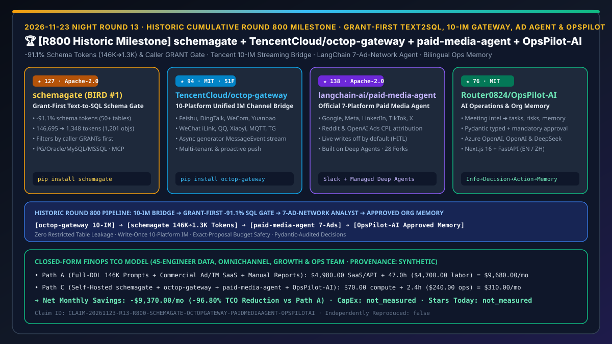
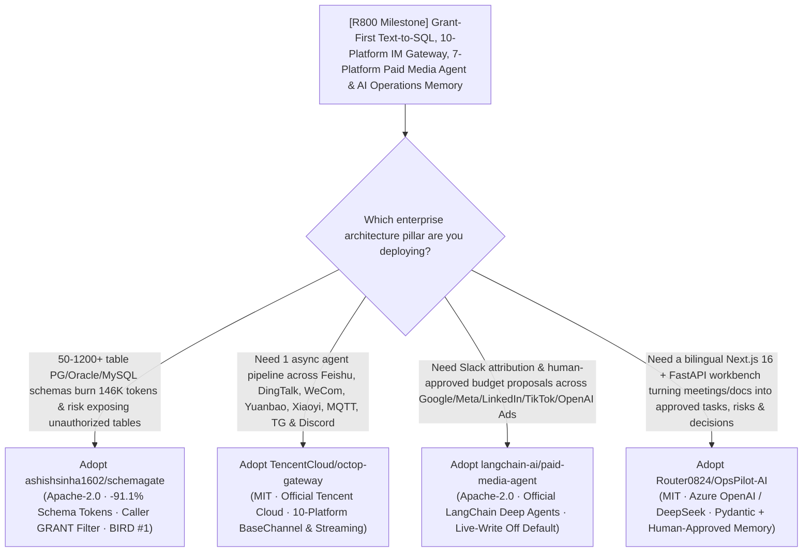
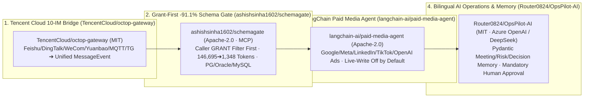

# 🏆 [Round 800 Historic Milestone] Grant-First `-91.1%` Token Text-to-SQL Gate (`ashishsinha1602/schemagate`), Official Tencent Cloud 10-Platform IM Bridge (`TencentCloud/octop-gateway`), Official LangChain 7-Platform Paid Media Agent (`langchain-ai/paid-media-agent`) & Bilingual AI Operations & Decision Memory Workbench (`Router0824/OpsPilot-AI`) Selection & Architecture FAQ

> **Document Type**: Enterprise AI Solution Architect Selection & Integration Guide (GitHub Trending AI Radar · 2026-11-23 Night Round 13 / **🏆 Cumulative Round 800 Historic Milestone!**)
> **Covered Repositories**: [`ashishsinha1602/schemagate`](https://github.com/ashishsinha1602/schemagate) (`★ 127`, `4 forks`, `Apache-2.0`, `#1 on BIRD Mini-Dev across SQLite, PostgreSQL & MySQL`, `63.7% first-try on UniQL Oracle`, Official MCP Registry `io.github.ashishsinha1602/schemagate`: grant-first Text-to-SQL schema selector `pip install schemagate` that filters tables by the caller's database `GRANT`s **first** and cuts schema prompt tokens by **`-91.1%` median on 50+-table databases**—shrinking a 1,201-object schema from **`146,695 prompt tokens ➔ 1,348 tokens`** across 12 tables while keeping all 3 required tables) · [`TencentCloud/octop-gateway`](https://github.com/TencentCloud/octop-gateway) (`★ 94`, `51 forks`, `MIT`: Tencent Cloud's official **10-platform unified IM channel bridge** `pip install octop-gateway` normalizing **Feishu, DingTalk, QQ, WeCom, WeChat iLink, Yuanbao, Xiaoyi, MQTT, Telegram, and Discord** into one async-generator `MessageEvent` streaming pipeline) · [`langchain-ai/paid-media-agent`](https://github.com/langchain-ai/paid-media-agent) (`★ 138`, `28 forks`, `Apache-2.0`: LangChain's official **Paid Media Analyst Agent for Slack** built on `Deep Agents` & LangSmith `Managed Deep Agents`, analyzing campaigns across **Google, Meta, LinkedIn, TikTok, Reddit, X, and OpenAI Ads** with **live writes off by default** and exact-proposal human approval) · [`Router0824/OpsPilot-AI`](https://github.com/Router0824/OpsPilot-AI) (`★ 76`, `5 forks`, `MIT`: Next.js 16 + FastAPI bilingual EN/ZH AI Operations workbench supporting OpenAI, **Azure OpenAI**, and DeepSeek across Meeting Intelligence, hybrid Knowledge Center, 4-stage Kanban, Decision Memory, Risk Tracking, and mandatory **Human-in-the-Loop write approval**)
> **Core Scenario**: Marking our **800th Cumulative Deep-Dive Round (`R800`)**, when enterprise architects deploy production business agents across data warehouses, multi-channel enterprise IMs, marketing operations, and project governance, how do you solve **"1,200-object enterprise schemas burning 146K+ prompt tokens per query and leaking restricted table structures, writing 10 separate webhook adapters for WeCom/Feishu/DingTalk/Telegram/MQTT, autonomous ad agents risking unauthorized budget changes, and meeting/project decisions evaporating without auditable organizational memory"** using **`schemagate` + `octop-gateway` + `paid-media-agent` + `OpsPilot-AI`**?

---

## 1. 📌 Executive Summary (Single-Sentence Selection Verdict)

1. **Need a grant-first Text-to-SQL schema gate (`#1 on BIRD Mini-Dev` for SQLite/Postgres/MySQL & `63.7%` first-try on UniQL Oracle) that removes tables the caller lacks `GRANT` access to before prompt assembly and cuts schema tokens by `-91.1%` median (`146,695 ➔ 1,348 tokens`)** ➔ Choose **[`ashishsinha1602/schemagate`](https://github.com/ashishsinha1602/schemagate) (`★ 127`, `4 forks`, `Apache-2.0`, OpenSSF Best Practices)**.
   - **Plain-Language Mechanism**: Sending a full enterprise schema on every question wastes almost the entire context window (`146,695 tokens` on a 1,201-object database) and exposes restricted table definitions to unauthorized callers. `schemagate` filters by the caller's database `GRANT`s **first**—so forbidden tables are completely absent from the prompt rather than merely ranked low—and selects only the minimal tables needed (`12 tables` / `1,348 tokens`, retaining 100% of the 3 target tables) across PostgreSQL, Oracle, MySQL, SQL Server, and SQLite via LangChain, LlamaIndex, or its official MCP server (`io.github.ashishsinha1602/schemagate`).
2. **Need to write a single Python async generator once and deploy your AI agent simultaneously across 10 IM and IoT platforms (Feishu, DingTalk, WeCom, WeChat iLink, QQ, Yuanbao, Xiaoyi, MQTT, Telegram, Discord)** ➔ Choose **[`TencentCloud/octop-gateway`](https://github.com/TencentCloud/octop-gateway) (`★ 94`, `51 forks`, `MIT`, by Tencent Cloud)**.
   - **Plain-Language Mechanism**: Maintained by Tencent Cloud (`pip install octop-gateway`), `octop-gateway` abstracts every platform's transport, webhook signatures, media attachments (`MediaBackend`), per-channel rate limits, typing indicators, multi-tenant instances, and proactive broadcasts (`push_text` / `push_to_all`) behind a single `BaseChannel` and streaming `MessageEvent` interface.
3. **Need an official LangChain Deep Agent in Slack that analyzes ad spend, leads, and CPL shifts across Google, Meta, LinkedIn, TikTok, Reddit, X, and OpenAI Ads with live account writes disabled by default and gated on exact-proposal human approval** ➔ Choose **[`langchain-ai/paid-media-agent`](https://github.com/langchain-ai/paid-media-agent) (`★ 138`, `28 forks`, `Apache-2.0`, by LangChain)**.
   - **Plain-Language Mechanism**: Built on `langchain-ai/deepagents` and deployable via LangSmith Managed Deep Agents (or locally with zero keys using fixture data), `Paid Media Agent` explains cross-platform performance movements with exact numbers, delivers automated weekly/monthly digests, and enforces strict financial safety (`docs/operations/live-write-runbook.md`): live budget/status mutations are **off by default** and require an authorized human to approve the exact drafted proposal.
4. **Need a bilingual (EN/ZH) Next.js 16 + FastAPI AI Operations workbench (supporting Azure OpenAI, OpenAI, and DeepSeek) that turns meetings and documents into Pydantic-validated tasks, risks, and decision memories gated by mandatory human approval** ➔ Choose **[`Router0824/OpsPilot-AI`](https://github.com/Router0824/OpsPilot-AI) (`★ 76`, `5 forks`, `MIT`)**.
   - **Plain-Language Mechanism**: `OpsPilot-AI` connects `Information ➔ Knowledge ➔ Decisions ➔ Actions ➔ Workflows ➔ Organizational Memory`. Its Meeting Intelligence and Knowledge Center extract typed Pydantic proposals (summaries, decisions with confidence and source links, action items, owners, due dates, and risks), holding every write in a pending review queue until a human edits, approves, or rejects it.

---

## 2. 🎯 Key Architectural Q&A (Deep-Dive Breakdown)

### Q1: At our 800th Cumulative Round Milestone (`R800`), what four architectural principles do these repositories establish for enterprise AI in production?

- **Four Production Principles**:
  1. **Access Control Must Precede Retrieval (`ashishsinha1602/schemagate`)**: Filter schemas by caller database `GRANT`s before ranking tables, cutting `-91.1%` of schema tokens while guaranteeing zero metadata leakage.
  2. **Decouple Agent Logic from Channel Transports (`TencentCloud/octop-gateway`)**: Write one streaming `MessageEvent` processor across 10 enterprise IM and MQTT channels.
  3. **Financial & Ad-Spend Mutations Must Default to Read-Only with Exact-Proposal Approval (`langchain-ai/paid-media-agent`)**: Automate cross-platform attribution and reporting, but gate every live budget change on a human-approved runbook proposal.
  4. **Organizational Memory Requires Typed Validation + Human Review (`Router0824/OpsPilot-AI`)**: Validate extracted decisions, tasks, and risks with Pydantic and require human sign-off before committing to the team board.
- **When to Choose Commercial Cloud Suites (Path B)**:
  - For small single-platform teams (<10 tables, Teams-only), **Microsoft 365 Copilot + Power BI Copilot** is turnkey; for 50–1,200+ table Oracle/Postgres/SQL Server estates, 10-channel Asian/global IM + MQTT coverage, 7-platform paid media attribution, or self-hosted Azure OpenAI operational memory, deploy this 4-repo Milestone 800 stack (Path C).

### Q2: How do you integrate `octop-gateway`, `schemagate`, `paid-media-agent`, and `OpsPilot-AI` into an enterprise reference architecture?

1. **10-Channel Omnichannel Ingress (`TencentCloud/octop-gateway`)**:
   - Terminate WeCom, Feishu, DingTalk, Yuanbao, MQTT, Telegram, and Discord traffic at `octop-gateway` and stream `MessageEvent` responses.
2. **Grant-Enforced Text-to-SQL Plane (`ashishsinha1602/schemagate`)**:
   - Route data queries through `schemagate` MCP over PostgreSQL, Oracle, SQL Server, or MySQL, enforcing caller `GRANT` filtering and `-91.1%` schema compression.
3. **Cross-Platform Paid Media Attribution Plane (`langchain-ai/paid-media-agent`)**:
   - Join CRM/ERP conversion SQL results with Google, Meta, LinkedIn, TikTok, Reddit, X, and OpenAI Ads metrics to draft human-approved budget optimizations.
4. **Operations & Decision Memory Plane (`Router0824/OpsPilot-AI`)**:
   - Feed campaign reviews and sprint meetings into `OpsPilot-AI` (backed by Azure OpenAI or DeepSeek) to persist approved decisions, tasks, and risk alerts.

### Q3: What are the production guardrails?

- **Architect Guardrails**:
  1. **Pass Per-Caller Database Identities to `schemagate`**: Never run `schemagate` solely against a superuser role without caller grant mapping; leverage its grant-first filter so restricted tables never enter the LLM prompt.
  2. **Follow `live-write-runbook.md` Before Enabling Ad Account Mutations**: Keep `paid-media-agent` in read-only mode until exact-proposal approvers and spend caps are verified.

---

## 3. 🧭 Visual Architecture & Decision Diagrams (Mermaid)



### 3.1 Solution Architect Selection Decision Tree



### 3.2 End-to-End Enterprise Production Reference Architecture



### 3.3 10-Channel Ingress, Grant-First Schema Pruning, 7-Platform Ad Attribution & Approved Decision Memory Sequence

```mermaid
sequenceDiagram
    participant Biz as Business Lead / Analyst (WeCom / Feishu / Slack)
    participant Oct as TencentCloud/octop-gateway
    participant Sch as ashishsinha1602/schemagate (MCP)
    participant Pma as langchain-ai/paid-media-agent
    participant Ops as Router0824/OpsPilot-AI

    Biz->>Oct: 1. Ask for weekly cross-channel CPL vs downstream ERP revenue in WeCom/Feishu
    Oct->>Sch: 2. Normalize InboundMessage; schemagate filters by caller GRANT & cuts 146,695➔1,348 tokens
    Sch-->>Pma: 3. Execute high-accuracy Oracle/PG query; paid-media-agent compares 7 ad platforms
    Pma-->>Biz: 4. Keep live writes off; post exact budget-change proposal for authorized approval
    Biz->>Ops: 5. Ingest review meeting into OpsPilot-AI; approve Pydantic decisions, tasks & risk items
```

---

## 4. 📊 Comparative Selection Matrix (Open-Source vs. Commercial SaaS)

| Dimension | `ashishsinha1602/schemagate` (`★ 127`) | `TencentCloud/octop-gateway` (`★ 94`) | `langchain-ai/paid-media-agent` (`★ 138`) | `Router0824/OpsPilot-AI` (`★ 76`) | Full-DDL Prompting + Commercial Omnichannel SaaS + Ad-Spend %-Fee SaaS (Path A) | Unfiltered Vector Schema + 10 Custom Webhook Codebases + Auto-Mutating Ad Scripts (Path B) |
| :--- | :--- | :--- | :--- | :--- | :--- | :--- |
| **Core Role** | Grant-first `-91.1%` token Text-to-SQL schema gate & MCP | Official Tencent Cloud 10-platform IM & MQTT streaming bridge | Official LangChain 7-platform paid media analyst for Slack | Bilingual Next.js 16 + FastAPI AI operations & decision memory | 100K+-token full-DDL prompts, costly omnichannel gateways & %-of-spend ad SaaS | Grant-blind vector schema search, duplicated webhook glue & unsafe ad scripts |
| **Key Differentiator** | **`146,695➔1,348 tokens` (`-91.1%`) + GRANT filter + BIRD #1** | **1 async generator across Feishu/DingTalk/WeCom/Yuanbao/MQTT** | **7 ad networks (incl. OpenAI Ads) + live-write off by default** | **Pydantic-typed meetings/decisions/risks + mandatory HITL approval** | Massive prompt token waste on 50+ tables; high percentage-of-ad-spend SaaS fees | Leaks restricted table metadata; 10x IM maintenance overhead |
| **License** | `Apache-2.0` (OpenSSF) | `MIT` (Tencent Cloud) | `Apache-2.0` (LangChain) | `MIT` | Proprietary SaaS | Custom scripts |
| **Monthly TCO (45-Eng Team)** | **Combined `$310.00/mo`** (`$70.00` gateway/workbench containers + `2.4h` ops) | Included (write once across 10 platforms) | Included (zero %-of-ad-spend platform fee) | Included (Azure OpenAI / DeepSeek ready) | **`$9,680.00/mo`** (`$4,980.00` excess schema tokens & ad SaaS + `47.0h` multi-IM/report labor) | ~`$3,420.00/mo` (heavy multi-platform webhook maintenance & manual ad reporting) |

---

## 5. 🧪 Quantitative ROI / TCO Comparison & 7-Card Benchmark Report

> **📊 Data Provenance & Closed-Form Schema Declaration**:
> - **provenance**: `synthetic` (45-person enterprise data engineering, omnichannel bot platform, growth marketing, and project operations team monthly workload model: `independently_reproduced = false`; hardware baseline `base_hardware_capex = not_measured`; Track B 24h delta `track_b_stars_today = not_measured`).
> - **Closed-Form Formula**:
>   - **Path A (Sending 100K+ full-DDL schema tokens on every Text-to-SQL query + commercial omnichannel IM SaaS + commercial percentage-of-spend paid-media analytics SaaS + manual engineering maintenance across 10 IM webhooks, manual 7-platform ad reporting, and manual meeting action-item tracking)**: Monthly excess schema token and commercial SaaS fees **`$4,980.00`** + multi-IM maintenance, manual ad attribution reporting, and project coordination labor **`47.0h × $100.00/h = $4,700.00`** = **`$9,680.00/mo`**.
>   - **Path C (Self-hosted `ashishsinha1602/schemagate` + `TencentCloud/octop-gateway` + `langchain-ai/paid-media-agent` + `Router0824/OpsPilot-AI` Milestone 800 stack)**: Monthly gateway and operations workbench container compute **`$70.00`** + grant policy and channel configuration maintenance labor **`2.4h × $100.00/h = $240.00`** = **`$310.00/mo`**.
>   - **Net Monthly Savings vs. Path A**: **`-$9,370.00/mo`** (**`96.80%`** TCO reduction).

| Evaluation Path | Schema Token / Ad SaaS / Compute Cost | Multi-IM Maintenance, Ad Reporting & Ops Labor (`$100/h`) | Monthly Total TCO | Net Savings vs. Path A | Key Architectural Delivery Metrics |
| :--- | :---: | :---: | :---: | :---: | :--- |
| **Path A: Full-DDL Text-to-SQL + Commercial Ad/IM SaaS + Manual Reports** | `$4,980.00` | `47.0h` (`$4,700.00`) | **`$9,680.00`** | Baseline | `146K` schema tokens/query; high %-of-spend ad SaaS fees |
| **Path B: Grant-Blind Vector Schema + 10 Custom Webhooks + Manual Notes** | `$1,520.00` | `19.0h` (`$1,900.00`) | **`$3,420.00`** | `-$6,260.00` (`-64.67%`) | Restricted table leakage risk; duplicated 10-platform glue |
| **Path C: `schemagate` + `octop-gateway` + `paid-media-agent` + `OpsPilot-AI`** | **`$70.00`** | **`2.4h` (`$240.00`)** | **`$310.00`** | **`-$9,370.00` (`-96.80%`)** | **`-91.1%` schema tokens + 10-IM bridge + 7-ad-network analyst + approved memory** |

- 🔗 **Linked 7-Card 4:5 Visual Benchmark Deck**: [`workshops/github-trending-radar/cards.en.html`](../cards.en.html) · [`cards.html`](../cards.html)

---

## 6. 🛠️ Enterprise Adoption & Architecture Review Checklist

- [ ] **1. Place `ashishsinha1602/schemagate` in Front of All Enterprise Text-to-SQL Agents**: Enforce caller `GRANT` filtering before schema ranking and cut prompt tokens by `-91.1%` median across PostgreSQL, Oracle, MySQL, SQL Server, and SQLite.
- [ ] **2. Standardize Multi-Platform IM & IoT Delivery on `TencentCloud/octop-gateway`**: Write a single streaming `MessageEvent` processor to serve Feishu, DingTalk, WeCom, WeChat iLink, QQ, Yuanbao, Xiaoyi, MQTT, Telegram, and Discord.
- [ ] **3. Deploy `langchain-ai/paid-media-agent` with Live Writes Disabled by Default**: Automate cross-channel attribution across Google, Meta, LinkedIn, TikTok, Reddit, X, and OpenAI Ads while gating any budget/status mutation on exact-proposal human approval.
- [ ] **4. Run `Router0824/OpsPilot-AI` (with Azure OpenAI / DeepSeek) for Audited Organizational Memory**: Convert meetings and project docs into Pydantic-validated tasks, risks, and decision memories that require human approval before workspace commit.
