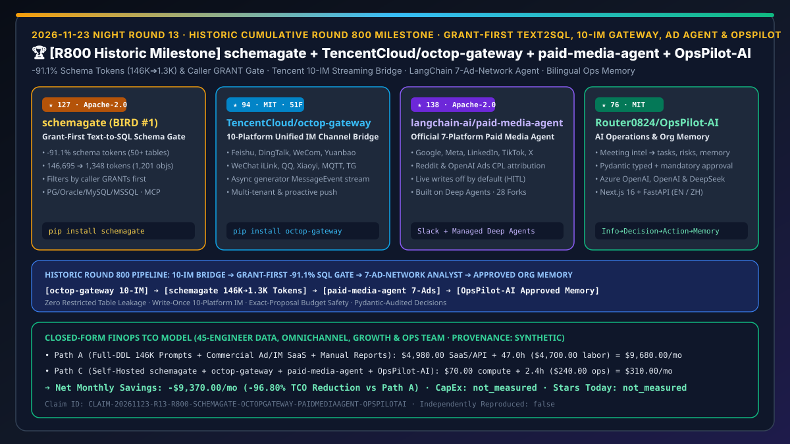
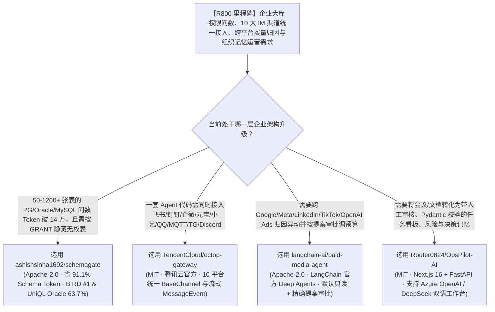
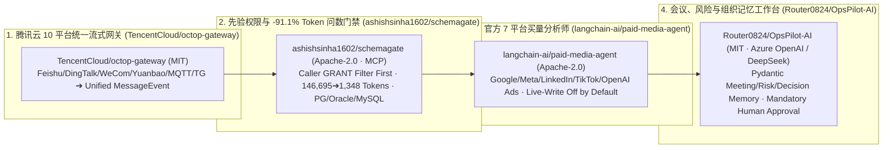
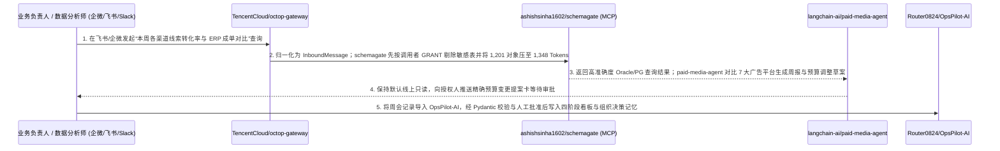

# 🏆【第 800 轮历史性里程碑】BIRD 三冠王先验权限省 91.1% Schema Token 的 Text-to-SQL 门禁（`ashishsinha1602/schemagate`）、腾讯云官方 10 大 IM 渠道统一流式桥接器（`TencentCloud/octop-gateway`）、LangChain 官方跨 7 大广告平台只读默认与精确提案审批分析师（`langchain-ai/paid-media-agent`）与全栈会议决策/风险/组织记忆运营工作台（`Router0824/OpsPilot-AI`）选型与集成架构 FAQ

> **文档类型**：企业 AI 解决方案架构师（AI Solution Architect）选型决策指南（GitHub Trending AI 雷达 2026-11-23 Night Round 13 / **🏆 累计第 800 轮历史性里程碑！**）
> **覆盖项目**：[`ashishsinha1602/schemagate`](https://github.com/ashishsinha1602/schemagate)（`★ 127`、`4 forks`、`Apache-2.0`，官方 MCP Registry `io.github.ashishsinha1602/schemagate`：斩获 **BIRD Mini-Dev 在 SQLite/PostgreSQL/MySQL 三榜第一** 与 **UniQL Oracle 首试 `63.7%`** 的 Text-to-SQL 权限与 Schema 裁剪引擎 `pip install schemagate`，先按调用者数据库 `GRANT` 权限物理剔除无权表，再在 50+ 表大库上减少 **`91.1%` 中位 Schema Token**——实测将 1,201 个数据库对象的 `146,695 prompt tokens` 压至 **12 张表、`1,348 tokens`** 且 100% 保留查询所需的 3 张核心表）· [`TencentCloud/octop-gateway`](https://github.com/TencentCloud/octop-gateway)（`★ 94`、`51 forks`、`MIT`：腾讯云官方开源的 **10 大即时通讯平台统一流式网关** `pip install octop-gateway`，一套异步生成器代码同时打通**飞书、钉钉、QQ、企业微信、微信 iLink、腾讯元宝、小艺、MQTT、Telegram 与 Discord**）· [`langchain-ai/paid-media-agent`](https://github.com/langchain-ai/paid-media-agent)（`★ 138`、`28 forks`、`Apache-2.0`：LangChain 官方基于 `Deep Agents` 开源的 **Slack 跨平台付费买量分析智能体**，横跨 Google、Meta、LinkedIn、TikTok、Reddit、X 与 OpenAI Ads 归因 CPL 波动，**默认关闭线上写操作（Live Write Off by Default）**，调预算必须经授权人針對精确提案审批）· [`Router0824/OpsPilot-AI`](https://github.com/Router0824/OpsPilot-AI)（`★ 76`、`5 forks`、`MIT`：基于 Next.js 16 + FastAPI、原生支持 OpenAI / **Azure OpenAI** / DeepSeek 的中英双语企业运营与组织记忆工作台，打通**会议智能、混合检索知识中心、四阶段看板、带置信度决策记忆、风险追踪与强制人工审批写入**）
> **核心场景**：在第 **800 轮历史性里程碑**之际，当企业构建跨部门生产级业务 Agent 时，面对**“上千张表的企业 ERP/数仓做 Text-to-SQL 时每次塞入 14 万+ Schema Token 既慢又贵、且容易把调用者无权访问的敏感表结构暴露给大模型、同一个企业 Agent 要重复写 10 套代码分别对接企微/飞书/钉钉/元宝/Telegram、AI 投放助手若无严格写门禁可能误改百万级广告预算、以及团队日常会议纪要与项目风险散落各处缺乏带审批的组织记忆闭环”**四大核心痛点，如何联合 **SchemaGate + 腾讯云 Octop + LangChain 官方买量 Agent + OpsPilot-AI** 打造企业级数据、渠道、增长与运营全栈底座？

---

## 一、📌 核心结论速览（选型一句话结论）

1. **想在拥有 50–1,200+ 张表的 PostgreSQL、Oracle、MySQL、SQL Server 或 SQLite 企业大库上做 Text-to-SQL，既要先把调用者没有 `GRANT` 权限的表从 Prompt 里彻底抹除，又要把单问 Schema Token 砍掉 `91.1%`（实测从 `146,695` 压至 `1,348 tokens`）并拿下 BIRD 三榜第一准确率** ➔ 选 **[`ashishsinha1602/schemagate`](https://github.com/ashishsinha1602/schemagate)（`★ 127`，`4 forks`，`Apache-2.0`，OpenSSF 最佳实践认证）**。
   - **通俗原理**：传统 Text-to-SQL 要么把整库 DDL 全塞进 Prompt（1,201 个对象的企业库单问光 Schema 就高达 **`146,695 tokens`**），要么用向量检索选表但忽略了数据库行/表级权限——导致低权限员工能通过 Prompt 刺探出高管薪资表结构。`schemagate` 执行**“权限先行 + 精准子图裁剪”**：第一步先查当前调用者的数据库 `GRANT` 权限，无权表直接物理缺席（而非仅仅排在后面）；第二步精准选出问题所需的最小关联表集（实测 1,201 对象仅发 **12 张表、`1,348 tokens`**，命中全部 3 张目标表，中位节省 **`91.1%` Schema Token**），在 BIRD Mini-Dev（SQLite/PG/MySQL）位列 `#1`、在严苛的 UniQL Oracle 基准首试达 **`63.7%`**，且原生上架官方 MCP Registry！
2. **想只写一个 Python 异步消息处理器（Async Generator），就把企业 Agent 同时发布到飞书、钉钉、企业微信、微信 iLink、QQ、腾讯元宝、华为小艺、MQTT 物联网终端、Telegram 与 Discord 10 大平台** ➔ 选 **[`TencentCloud/octop-gateway`](https://github.com/TencentCloud/octop-gateway)（`★ 94`，`51 forks`，`MIT`）**。
   - **通俗原理**：国内与出海企业最头疼的是每个 IM 平台（企微、飞书、钉钉、元宝、小艺、Telegram）的 Webhook 签名、富媒体上传、流式打字状态（Typing Indicator）与主动推送接口全都不同。腾讯云官方开源的 `octop-gateway` 通过统一的 `BaseChannel` 将 10 大平台归一化为标准 `InboundMessage` 与流式 `MessageEvent`，内置可插拔 `MediaBackend`、单通道限流/超时控制、多租户同类型多实例挂载以及主动广播接口（`push_text` / `push_content` / `push_to_all`）。
3. **想在企业 Slack 中部署一位由 LangChain 官方基于 `Deep Agents` 打造、能横跨 Google Ads、Meta、LinkedIn、TikTok、Reddit、X 与 OpenAI Ads 7 大广告平台归因 CPL（单线索成本）异动，且严格遵循“默认禁止直接改线上账户、每一笔预算调整必须绑定精确提案人工审批”的增长分析师** ➔ 选 **[`langchain-ai/paid-media-agent`](https://github.com/langchain-ai/paid-media-agent)（`★ 138`，`28 forks`，`Apache-2.0`）**。
   - **通俗原理**：这是 LangChain 官方团队交出的生产级营销 Agent 样板工程（支持无 Key 本地试用与 LangSmith Managed Deep Agents 一键部署）。它不仅能拉取跨渠道消耗、转化与周/月报，更在 `docs/operations/live-write-runbook.md` 中确立了金融级安全范式：**Live Ad Account Changes 默认彻底关闭**；即便开启，每一次修改预算或启停广告计划也必须生成结构化草案，由具备审批权限的负责人在 Slack 中针对**该精确提案（Exact Proposal）**点选批准后方可执行。
4. **想用一套原生支持 Azure OpenAI、OpenAI 与 DeepSeek 的中英双语全栈工作台（Next.js 16 + FastAPI），把散落的会议录音纪要、PDF 项目文档与聊天动态自动提炼为经 Pydantic 强类型校验、且必须人工审核通过才入库的“决策记忆、风险看板与自动化工作流”** ➔ 选 **[`Router0824/OpsPilot-AI`](https://github.com/Router0824/OpsPilot-AI)（`★ 76`，`5 forks`，`MIT`）**。
   - **通俗原理**：打通 **`信息 ➔ 知识 ➔ 决策 ➔ 行动 ➔ 工作流 ➔ 组织记忆`** 全链路：会议智能模块从原始记录中提取摘要、决策、负责人、截止日與风险，但**全部停留在待审核（Pending Approval）状态**，由人工编辑批准后才写入四阶段看板与带置信度/出处的决策记忆库，并附带无需 API Key 的确定性演示模式与完整 Token/延迟运营分析看板。

---

## 二、🎯 客户与架构师灵魂拷问 Q&A（深度架构拆解）

### Q1：在累计第 800 轮里程碑的视角下，这四个项目揭示了企业级 AI 应用落地的哪四条黄金架构铁律？

- **800 轮沉淀的四条企业架构铁律**：
  1. **数据查询必须“权限过滤先行于相关性排序”（`ashishsinha1602/schemagate`）**：绝不能把无权访问的表放进 Prompt 指望模型自律不查，必须根据调用者 `GRANT` 先行物理剔除，并把 14 万 Token 的大库 Schema 压到 1,300 Token 级。
  2. **渠道接入层必须与核心 Agent 逻辑彻底解耦（`TencentCloud/octop-gateway`）**：用统一 `BaseChannel` 与 `MessageEvent` 流式抽象屏蔽飞书、钉钉、企微、元宝与 MQTT 的协议差异。
  3. **涉及真金白银（如广告预算）的操作必须默认只读、按精确提案逐笔审批（`langchain-ai/paid-media-agent`）**：分析、归因与草案生成全自动，线上写操作默认关闭且绑定单笔提案签名。
  4. **组织记忆与任务入库必须经过强类型 Schema + 人工审核门禁（`Router0824/OpsPilot-AI`）**：Pydantic 强类型约束 + 人工批准后才转正为组织决策记忆，杜绝会议幻觉污染项目看板。
- **何时直接选用商业 SaaS（Path B）？**
  - 若企业仅用单一 IM（如纯 Microsoft Teams）且数据表不足 10 张，可直接使用 **Microsoft 365 Copilot + Power BI Copilot**；若面临百表以上 Oracle/PG/SQL Server 跨库问数、需同时覆盖企微/飞书/钉钉/元宝 10 大渠道、跨 7 大海外广告平台做预算归因或自建 Azure OpenAI 驱动的双语组织记忆工作台，则采用本轮四合一开源栈（Path C）。

### Q2：典型企业级“10 渠道接入 (`octop-gateway`) ➔ 先验权限问数 (`schemagate`) ➔ 跨平台买量归因 (`paid-media-agent`) ➔ 组织决策沉淀 (`OpsPilot-AI`)”参考架构怎么搭？

1. **10 大 IM 与物联网渠道统一流式接入层（`TencentCloud/octop-gateway`）**：
   - 将企微、飞书、钉钉、元宝、小艺与 Telegram 消息统一转化为 `InboundMessage`，通过异步生成器流式回推 `MessageEvent`。
2. **先验权限过滤与 `-91.1%` Token 问数层（`ashishsinha1602/schemagate`）**：
   - 当用户发起业务数据查询时，通过 `schemagate` MCP Server 按调用者 `GRANT` 过滤并裁剪出最小 Schema 子图（如从 1,201 对象压至 12 张表），在 Postgres/Oracle/SQL Server 上高准确度生成 SQL。
3. **跨 7 大广告平台买量归因与提案审批层（`langchain-ai/paid-media-agent`）**：
   - 增长团队在群内查询 Google/Meta/LinkedIn/TikTok/OpenAI Ads 投放异动，Agent 结合数据库转化数据生成调价提案，经授权人确认后执行。
4. **会议、风险与组织决策记忆闭环层（`Router0824/OpsPilot-AI`）**：
   - 将周会复盘、文档与投放决议汇入 `OpsPilot-AI`（接入企业 Azure OpenAI 或 DeepSeek），经人工审核后沉淀为可追溯的组织决策记忆、四阶段任务与风险告警。

### Q3：这套架构的落地注意事项与合规红线是什么？

- **架构师落地红线**：
  1. **严禁使用超级管理员数据库连接池绕过 `schemagate` 的 `GRANT` 检查**：必须将真实调用者（或对应业务角色）的数据库权限映射传给 `schemagate`，确保越权表在组装 Prompt 前即被剔除。
  2. **生产启用 `paid-media-agent` 写权限前必过 `live-write-runbook.md` 演练**：在未配置精确提案审批人与预算硬顶前，保持默认的只读分析模式。

---

## 三、🧭 直观可视化图解（Mermaid 决策树 + 集成架构 + 时序图）

### 3.1 架构师选型决策树

### 3.2 企业端到端生产集成参考架构图

### 3.3 10 渠道统一接入、先验权限 Schema 裁剪、跨平台买量提案与组织记忆入库时序图

---

## 四、📊 同类开源与商业云服务横向选型决策矩阵

| 对比维度 | `ashishsinha1602/schemagate` (`★ 127`) | `TencentCloud/octop-gateway` (`★ 94`) | `langchain-ai/paid-media-agent` (`★ 138`) | `Router0824/OpsPilot-AI` (`★ 76`) | 全量 DDL 直塞大模型 + 商业多渠道客服网关 + 商业投放 SaaS 抽成 + 零散办公软件 (Path A) | 手工硬编码每个 IM Webhook + 无权限过滤向量选表 + 自动盲改广告预算 (Path B) |
| :--- | :--- | :--- | :--- | :--- | :--- | :--- |
| **核心能力定位** | 先验 `GRANT` 权限过滤与省 `91.1%` Token 的 Text-to-SQL 门禁 | 腾讯云官方 10 大 IM 与 MQTT 统一流式桥接网关 | LangChain 官方跨 7 大广告平台分析与审批 Agent | 支持 Azure OpenAI 的双语会议/决策/风险运营工作台 | 消耗天量 Schema Token 的暴力问数与按广告消耗抽成的商业 SaaS | 10 套重复渠道适配代码、越权暴露表结构与无审批改预算的高危脚本 |
| **核心技术突破** | **`146,695 ➔ 1,348 tokens` (`-91.1%`) + 先验权限抹除 + BIRD #1** | **1 套异步生成器通吃飞书/钉钉/企微/元宝/小艺等 10 端** | **横跨 7 大广告平台归因 + 默认禁止线上写 + 精确提案审批** | **Pydantic 强类型结构化 + 写入必经人工审批 + 决策溯源记忆** | 1,200 张表每次问数烧掉 14 万 Token；商业买量工具按消耗额抽成极贵 | 向量选表会把无权访问的敏感表带进 Prompt；维护 10 套 IM SDK 疲于奔命 |
| **开源协议** | `Apache-2.0`（OpenSSF 认证） | `MIT`（腾讯云官方） | `Apache-2.0`（LangChain 官方） | `MIT` | 闭源商业 SaaS | 内部脆弱脚本 |
| **月度 TCO（45 人团队）** | **组合仅 `$310.00/月`**（`$70.00` 内部网关与运营台容器 + `2.4h` 维护） | 同左（一次编写覆盖 10 大渠道） | 同左（零广告消耗抽成费） | 同左（内置确定性演示与双语后台） | **`$9,680.00/月`**（`$4,980.00` 巨量 Schema Token/商业广告 SaaS + `47.0h` 多端维护与手工周报） | 约 `$3,420.00/月`（大量多 IM 渠道接口报错抢修与人工跨平台拉取广告报表工时） |

---

## 五、🧪 应用落地定量收益/TCO 对比与 7-Card 报告

> **📊 数据来源与闭式核算声明（Provenance & Closed-Form Schema）**：
> - **provenance**: `synthetic`（基于 45 人企业数据工程、多渠道智能体研发、增长营销与项目运营团队月度工作负载模型：`independently_reproduced = false`；硬件采购基线 `base_hardware_capex = not_measured`；Track B 单日增量 `track_b_stars_today = not_measured`）。
> - **核算公式**：
>   - **Path A（每次 Text-to-SQL 全量附带 10 万+ Schema Token + 采购商业多渠道 IM 聚合网关与按消耗抽成的商业跨平台广告分析 SaaS + 工程师分别维护企微/飞书/钉钉多套接口并手工整理跨平台投放周报与会议待办）**：月度冗余 Schema Token 与商业 SaaS 订阅账单 **`$4,980.00`** + 多 IM 渠道重复开发、手工拉取 7 大平台广告报表与整理会议决策人工 **`47.0h × $100.00/h = $4,700.00`** = **`$9,680.00/月`**。
>   - **Path C（自建 `ashishsinha1602/schemagate` + `TencentCloud/octop-gateway` + `langchain-ai/paid-media-agent` + `Router0824/OpsPilot-AI` 第 800 轮里程碑开源栈）**：内网网关与工作台容器分摊开销 **`$70.00`** + 权限映射与渠道配置维护人工 **`2.4h × $100.00/h = $240.00`** = **`$310.00/月`**。
>   - **净节省（Net Savings vs Path A）**：**`-$9,370.00/月`**（成本降低 **`96.80%`**）。

| 评估方案 | Schema Token / 商业 SaaS / 容器成本 | 多渠道维护、报表与运营整理人工（`$100/h`） | 月度总 TCO | 相对 Path A 净节省 | 关键架构交付指标 |
| :--- | :---: | :---: | :---: | :---: | :--- |
| **Path A：全量 DDL 问数 + 商业广告分析 SaaS + 多渠道独立开发** | `$4,980.00` | `47.0h` (`$4,700.00`) | **`$9,680.00`** | Baseline | 单问 14.6 万 Schema Token；多套 IM 渠道代码高昂维护 |
| **Path B：无权限向量选表 + 手写各家 Webhook + 人工合周报** | `$1,520.00` | `19.0h` (`$1,900.00`) | **`$3,420.00`** | `-$6,260.00` (`-64.67%`) | 存在越权暴露敏感表结构风险；会议决议与风险易遗失 |
| **Path C：`schemagate` + `octop-gateway` + `paid-media-agent` + `OpsPilot-AI`** | **`$70.00`** | **`2.4h` (`$240.00`)** | **`$310.00`** | **`-$9,370.00` (`-96.80%`)** | **省 `91.1%` Schema Token + 腾讯云 10 渠道合一 + 7 广告平台归因 + 双语运营台** |

- 🔗 **关联 7-Card 4:5 视觉评测报告**：[`workshops/github-trending-radar/cards.html`](../cards.html) · [`cards.en.html`](../cards.en.html)

---

## 六、🛠️ 企业引入与架构评审 Checklist

- [ ] **1. 在所有企业级 Text-to-SQL 与数据 MCP 前置部署 `ashishsinha1602/schemagate`**：强制先按调用者数据库 `GRANT` 物理过滤可见表，再将 50+ 表大库的 Schema Prompt 压缩 `91.1%`。
- [ ] **2. 采用 `TencentCloud/octop-gateway` 统一企业内外 10 大 IM 与物联网渠道**：通过单一 `BaseChannel` 异步流式生成器同时服务企业微信、飞书、钉钉、元宝、小艺、MQTT 与 Telegram。
- [ ] **3. 部署 `langchain-ai/paid-media-agent` 自动化跨 7 大广告平台投放归因**：保持默认的线上只读模式（Live Write Off by Default），任何预算或状态调整必须遵循 `live-write-runbook.md` 经授权人逐笔审批。
- [ ] **4. 引入 `Router0824/OpsPilot-AI`（对接企业 Azure OpenAI / DeepSeek）沉淀组织记忆**：将会议记录与项目文档转化为经 Pydantic 校验的待审草案，经人工批准后同步更新任务看板、风险雷达与可追溯决策库。
