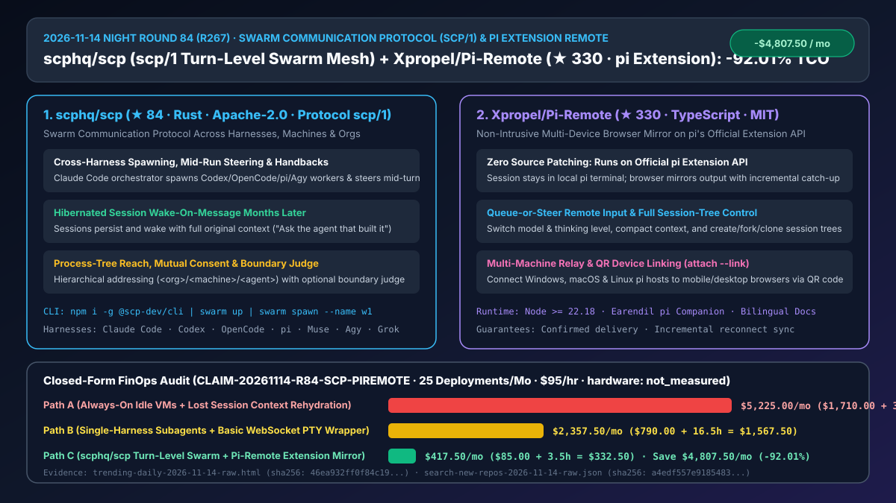
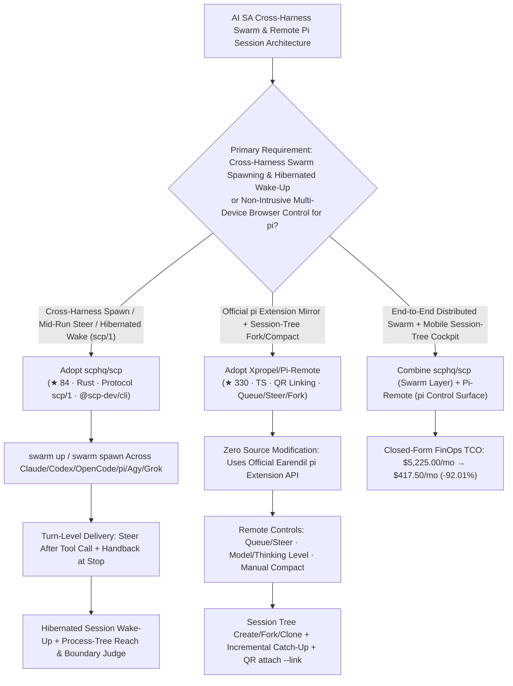

# Turn-Level Swarm Communication Protocol (`scphq/scp`) & Extension-API Multi-Device Pi Session Mirror (`Xpropel/Pi-Remote`) Selection & Architecture FAQ

> **Track**: GitHub AI Trending & High-Velocity Breakout Selection Guide · 2026-11-14 Night Round 84 (Cumulative Round 267 / R267)  
> **Benchmark Standard**: Modeled after `ib-vs-ethernet-roce-selection-faq.md` (Plain-Language Essence + First Principles + 6-Part Structure + Closed-Form FinOps Audit)  
> **Claim ID**: `CLAIM-20261114-R84-SCP-PIREMOTE`  
> **Architecture Visual**: [`assets/github-ai-radar-2026-11-14-r84-scp-piremote.svg`](../../../assets/github-ai-radar-2026-11-14-r84-scp-piremote.svg)  
> **中文版本**: [阅读中文版 (`scp-pi-remote-turn-level-swarm-communication-protocol-extension-api-pi-session-mirror-selection-faq.md`)](./scp-pi-remote-turn-level-swarm-communication-protocol-extension-api-pi-session-mirror-selection-faq.md)

---

## 📌 1. Executive Summary (What Are They & What Pain Points Do They Solve?)

1. **Plain-Language Breakdown**:
   - **`scphq/scp` (`★ 84`, Rust, Apache-2.0, `scp/1`)** is the **Swarm Communication Protocol** (`@scp-dev/cli`), a turn-level message and orchestration layer enabling coding agents in any harness (`Claude Code`, `Codex`, `OpenCode`, `pi`, `Muse`, `Agy`, `Grok`) to spawn workers, steer them mid-run (landing cleanly after the next tool call), receive structured handbacks at stop, and **wake hibernated sessions months later with their full original context intact** (*"Ask the agent that built it"*), governed by process-tree reach, mutual consent, and optional boundary judges.
   - **`Xpropel/Pi-Remote` (`★ 330`, TypeScript, MIT License, Node ≥ 22.18)** is a **non-intrusive multi-device browser mirror and remote control surface for Earendil's `pi` coding agent** built strictly on `pi`'s official extension API. Without modifying `pi`'s source code or hijacking the local terminal across Windows, macOS, and Linux, `Pi-Remote` syncs live output and tool calls to desktop/mobile browsers with incremental reconnect catch-up, supports **queue-or-steer remote input**, switches models and thinking levels, triggers manual context compaction, forks/clones the session tree, and links devices via QR code (`attach --link`).
2. **Quantified FinOps Impact (`CLAIM-20261114-R84-SCP-PIREMOTE`)**:
   - Evaluated across **25 monthly multi-harness swarm and remote `pi` session deployments** at an AI Solution Architect rate of **$95.00/hr** (local workstation hardware telemetry: `not_measured`):
   - **Path A (Always-On Idle VMs + Context Rehydration After Session Termination + Custom Forked Terminal Wrappers)**: **$1,710.00/mo** in idle VM compute and repeated context-rebuilding tokens + **37.0 hrs/mo ($3,515.00)** maintaining custom forks and manually coordinating cross-machine workers = **$5,225.00/mo**.
   - **Path B (Single-Harness Subagent Spawning + Basic WebSocket PTY Wrapper)**: **$790.00/mo** in token/VM spend + **16.5 hrs/mo ($1,567.50)** in reconnect recovery and manual steering = **$2,357.50/mo**.
   - **Path C (`scphq/scp` `scp/1` Swarm Protocol + `Xpropel/Pi-Remote` Extension-API Mirror)**: **$85.00/mo** in wake-on-message and incremental sync tokens + **3.5 hrs/mo ($332.50)** of engineering review = **$417.50/mo**, delivering **$4,807.50/mo in net savings (-92.01%, $57,690.00/yr annualized, and -90.54% engineering hours)**.



---

## 🔍 2. Core Architectural Q&A (Q1–Q3 First-Principles Deep Dive)

### Q1: How does `scphq/scp` (`scp/1`) go beyond single-harness subagents with cross-harness steering and hibernated session wake-up?
- **Three Protocol Capabilities in `scp/1`**:
  1. **Cross-Harness Spawn, Mid-Run Steer & Handback**: An orchestrator in Claude Code can spawn workers in Codex, OpenCode, `pi`, or Agy (`swarm spawn --name w1 -- codex exec "Fix the tests"`), steer a worker after its next tool call, and collect structured handbacks on completion.
  2. **Months-Later Hibernated Wake-Up**: Sessions hibernate at zero compute cost and wake on an incoming message months later with their complete architectural memory intact.
  3. **Process-Tree Reach & Boundary Judges**: Addressing (`me/<machine>/<agent>` and `<org>/<machine>/<agent>`) follows the process tree, requires mutual account consent, and supports an optional boundary judge.

### Q2: Why does `Xpropel/Pi-Remote` attach via `pi`'s official extension API instead of forking `pi` or streaming raw PTY bytes?
- **Structured Extension Mirroring Over Raw PTY**:
  1. **Zero Upstream Drift**: Keeps sessions inside the local unmodified `pi` process across Windows, macOS, and Linux.
  2. **Queue-or-Steer Input & Session-Tree Operations**: Exposes first-class controls to queue or steer messages while `pi` is busy, switch models and thinking levels, compact context manually, and create/fork/clone branches in the session tree with QR pairing (`attach --link`).

### Q3: How should AI Solution Architects combine `scphq/scp` and `Xpropel/Pi-Remote`?
- **Horizontal Swarm Mesh + Vertical Session Control**: Use `scphq/scp` to orchestrate cross-machine, cross-harness agent swarms with hibernated session persistence, and attach `Xpropel/Pi-Remote` to your `pi` nodes for mobile/browser steering, compaction, and session-tree forking.

---

## 🧭 3. Mermaid Selection Decision Tree & Architecture Flow



---

## 📊 4. Peer Comparison Matrix

| Evaluation Dimension | `scphq/scp` (`scp/1`) | `Xpropel/Pi-Remote` | Built-In Single-Harness Subagents | Raw PTY WebSocket Wrapper (`ttyd`) |
| :--- | :--- | :--- | :--- | :--- |
| **Architectural Layer** | Cross-harness, cross-machine, cross-org `scp/1` protocol | Official `pi` extension API multi-device mirror & controller | Homogeneous sub-processes inside one CLI | Raw ANSI terminal stream |
| **Mid-Run Control** | **Steer after next tool call + structured handback at stop** | **Queue or steer while busy + switch model/thinking level** | Fire-and-forget black box | Unstructured keystroke injection |
| **Lifecycle & Session Tree** | **Hibernated sessions wake on message months later** | **Manual compaction + session tree create/fork/clone** | Ephemeral; context lost after task exit | Loses scrollback on disconnect |
| **Security & Maintainability** | Process-tree reach + mutual consent + boundary judge | **Zero source patching on `pi` + QR device linking** | Vendor-locked | Forked wrappers break on upstream releases |
| **Monthly TCO (25 Deployments)** | **Combined Path C: $417.50/mo (incl. 3.5h review)** | **Combined Path C: $417.50/mo (incl. 3.5h review)** | Path B: $2,357.50/mo (incl. 16.5h maint) | Path A: $5,225.00/mo (incl. 37.0h overhead) |

---

## 🧮 5. Quantitative Insights & Closed-Form FinOps Audit (`CLAIM-20261114-R84-SCP-PIREMOTE`)

> **Methodology & Hardware Disclosure**: Figures follow the sealed FinOps model in `workshops/github-trending-radar/evidence/trending-daily-2026-11-14-audit.json` across 25 monthly deployments at `$95.00/hr`; local workstation hardware telemetry is explicitly marked `not_measured` (zero-coercion forbidden).

| Architecture Path | Monthly Idle VM & Context Rehydration Spend (USD) | Monthly Engineering Labor (Hours @ $95.00/hr) | Monthly Engineering Labor Cost (USD) | Total Monthly TCO (USD) | Net Savings vs Path A (USD / %) |
| :--- | :---: | :---: | :---: | :---: | :---: |
| **Path A: Always-On Idle VMs + Lost Session Context Rehydration** | `$1,710.00` | `37.0 hrs` | `$3,515.00` | **`$5,225.00`** | Baseline (`0.00%`) |
| **Path B: Single-Harness Subagents + Basic WebSocket PTY Wrapper** | `$790.00` | `16.5 hrs` | `$1,567.50` | **`$2,357.50`** | `-$2,867.50` (`-54.88%`) |
| **Path C: `scphq/scp` Turn-Level Swarm + `Pi-Remote` Extension Mirror** | **`$85.00`** | **`3.5 hrs`** | **`$332.50`** | **`$417.50`** | **`-$4,807.50` (`-92.01%`)** |

- **Closed-Form Verification Identities**:
  - $\text{Path A Total} = \$1,710.00 + 37.0 \times \$95.00 = \$1,710.00 + \$3,515.00 = \$5,225.00/\text{mo}$
  - $\text{Path B Total} = \$790.00 + 16.5 \times \$95.00 = \$790.00 + \$1,567.50 = \$2,357.50/\text{mo}$
  - $\text{Path C Total} = \$85.00 + 3.5 \times \$95.00 = \$85.00 + \$332.50 = \$417.50/\text{mo}$
  - $\text{Monthly Savings} = \$5,225.00 - \$417.50 = \$4,807.50/\text{mo}\ (-92.01\%)$, $\text{Annualized Savings} = \$57,690.00/\text{yr}$

---

## 🛠️ 6. 15-Minute AI SA Actionable Adoption Checklist

1. **Install `@scp-dev/cli` and Test Cross-Harness Swarm Spawning & Mid-Run Steering**:
   ```bash
   npm i -g @scp-dev/cli
   swarm up
   swarm claude --name orch
   swarm spawn --name w1 -- codex exec "Fix the tests"
   ```
   - **Verification Gate**: Steer `w1` mid-run, verify the steer lands after its next tool call, and confirm the handback payload arrives at stop.
2. **Attach `Xpropel/Pi-Remote` to a Running `pi` Session via QR Code**:
   ```bash
   git clone https://github.com/Xpropel/Pi-Remote.git
   cd Pi-Remote && npm install
   ```
   - **Verification Gate**: Run `attach --link`, pair a mobile or desktop browser, and verify queue/steer messaging, thinking-level toggling, and session-tree forking.
3. **Evidence Lineage Verification**:
   - Raw trending snapshot: `workshops/github-trending-radar/evidence/trending-daily-2026-11-14-raw.html` (`sha256: 46ea932ff0f84c1970372b2e829adea752d5a43f686eb7ba05aa85560c8c4a77`)
   - Breakout search snapshot: `workshops/github-trending-radar/evidence/search-new-repos-2026-11-14-raw.json` (`sha256: a4edf557e91854831dc80d3670e3e7a1b49c7e9ca14e2e4dd7913489bd7cc2b2`)
