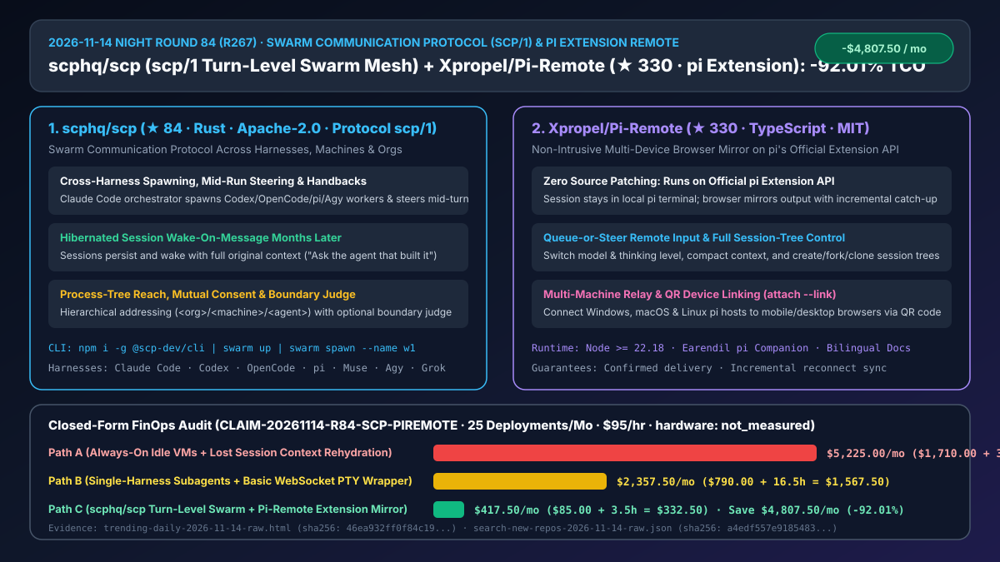
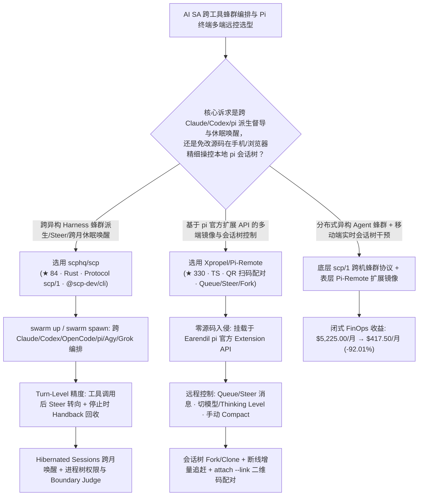

# 支持跨月休眠唤醒的跨组织蜂群通信协议（`scphq/scp`）与基于官方扩展 API 的非侵入式 Pi 多端镜像控制器（`Xpropel/Pi-Remote`）选型与架构拆解 FAQ

> **所属专题**：GitHub AI 热榜与新晋高星项目选型内参 · 2026-11-14 Night Round 84（累计第 267 轮 / R267）  
> **对标标杆**：`ib-vs-ethernet-roce-selection-faq.md`（大白话本质定义 + 第一性原理 + 六段式结构 + 闭式 FinOps 审计）  
> **审计编号**：`CLAIM-20261114-R84-SCP-PIREMOTE`  
> **配套架构大图**：[`assets/github-ai-radar-2026-11-14-r84-scp-piremote.svg`](../../../assets/github-ai-radar-2026-11-14-r84-scp-piremote.svg)  
> **English Version**: [Read in English (`scp-pi-remote-turn-level-swarm-communication-protocol-extension-api-pi-session-mirror-selection-faq.en.md`)](./scp-pi-remote-turn-level-swarm-communication-protocol-extension-api-pi-session-mirror-selection-faq.en.md)

---

## 📌 一、核心结论速览（30 秒看懂：它们到底是什么？解决什么痛点？）

1. **用大白话讲透这两个项目**：
   - **`scphq/scp`（`★ 84`，Rust，Apache-2.0 协议，规范 `scp/1`）** 是专为**跨 Harness、跨机器、跨企业组织的 Agent 蜂群（Swarms）**设计的标准化通信与编排协议层（Swarm Communication Protocol，`@scp-dev/cli`）。它允许你在 Claude Code 中作为总指挥（Orchestrator），通过一行 `swarm spawn` 跨机器拉起运行在 Codex、OpenCode、pi、Muse、Agy 或 Grok 里的子 Worker，并在子任务运行中途向其发送**转向指令（Steer，精准在下一个工具调用后生效）**，最后在子任务停止时收回结构化交付物（Handback）；更惊艳的是它的**休眠唤醒机制（Hibernated Sessions）——几个月前写完某个模块的 Agent 会话可以进入零算力休眠，几个月后出了 Bug 发一条消息直接把它连同当年的完整上下文一起唤醒（“直接去问当年写这段代码的那个 Agent”）**，同时具备进程树可达性控制、双向同意握手与跨域边界审查官（Boundary Judge）。
   - **`Xpropel/Pi-Remote`（`★ 330`，TypeScript，MIT 协议）** 是专为 Earendil 终端编程 Agent **`pi`（`@earendil-works/pi`）** 打造的**基于官方 Extension API 的零侵入多设备远程镜像与操控伴侣**。它不修改 `pi` 一行源码，也不抢占本地终端控制权——会话始终跑在你的 Windows / macOS / Linux 本地 `pi` 进程里，而手机或远端电脑浏览器通过 `attach --link` 扫码即可实时同步输出流与工具调用（断线重连支持增量追赶），并能远程发送**排队或中途插话（Queue or Steer）**消息、切换模型与思考深度（Thinking Level）、手动触发上下文压缩（Compaction）、甚至对会话树执行创建/分叉（Fork）/克隆（Clone）。
2. **核心量化收益（闭式 FinOps 方程 `CLAIM-20261114-R84-SCP-PIREMOTE`）**：
   - 按团队每月运行 **25 次跨工具多节点蜂群编排与长周期 `pi` 终端远程值守任务**、AI SA 时薪 **$95.00/hr** 核算（本地硬件测量标注：`not_measured`）：
   - **Path A（常驻不休眠云主机 + 会话关闭后丢失历史被迫重新喂全库上下文 + 维护魔改版终端分支）**：月度空转云主机与重复注入历史上下文 Token 费 **$1,710.00** + 维护魔改分支、人工跨机协调子任务与重跑丢失状态 **37.0 小时（$3,515.00）** = **$5,225.00/月**。
   - **Path B（单一工具内部子进程调用 + 简易 WebSocket PTY 终端转发）**：月度 Token 与云资源费 **$790.00** + 断线重连状态修复与手工操控工时 **16.5 小时（$1,567.50）** = **$2,357.50/月**。
   - **Path C（`scphq/scp` `scp/1` 跨工具蜂群协议 + `Xpropel/Pi-Remote` 官方扩展远程控制器）**：月度按需唤醒与增量同步开销 **$85.00** + 人工复核工时 **3.5 小时（$332.50）** = **$417.50/月**，**每月净省 $4,807.50（降本 92.01%，年化节省 $57,690.00，跨端编排与远程维护工时压缩 90.54%）**。



---

## 🔍 二、灵魂拷问 Q1–Q3（从第一性原理看透架构差异）

### Q1：为什么传统的 Subagent 只能在同一个厂商 CLI 内部跑、且任务结束上下文就作废？`scphq/scp` 的 `scp/1` 协议带来了哪三大范式跃迁？
- **传统 Subagent 的三大局限**：
  1. **厂商孤岛**：Claude Code 的内置子任务调不了 Codex 或 OpenCode 的特长能力；
  2. **有去无回的黑盒**：子任务一旦启动，父 Agent 很难在它跑偏的第 3 个工具调用后中途微调方向（Mid-Run Steer）；
  3. **用完即焚的失忆症**：两个月后线上某个模块报警，当初写这个模块的 Agent 会话早就被关掉了，新开的 Agent 又要花几十万 Token 从头猜当初为什么这么写。
- **`scphq/scp` 的三大核心设计**：
  1. **跨异构 Harness 编排与中途转向（Spawn, Steer & Handback）**：一个 Claude Code 主控节点可以同时在三台机器上拉起 Claude Code（写解析器）、Codex（写测试）和 Agy（跑基准），并在解析器下一次工具调用后精准注入 Steer 修正指令，停机时自动收回 Handback 结果。
  2. **跨月级休眠唤醒（Hibernated Session Wake-Up）**：支持 `<org>/<machine>/<agent>` 与 `me/<machine>/<agent>` 分层寻址；休眠会话零资源挂起，数月后收到消息即可带着完整历史记忆原地复活。
  3. **默认安全的进程树边界 + 审查官（Boundary Judge）**：通信可达性严格遵循进程派生树，跨账号互联必须双向授权，且可挂载独立 Judge 审计跨越信任边界的每一条消息。

### Q2：给终端编程 Agent 做手机/网页远程控制时，为什么“直接用 `ttyd` 转发 PTY 屏幕字符”或“Fork 改写上游源码”都是死胡同？`Xpropel/Pi-Remote` 为什么坚持走官方 Extension API？
- **PTY 转发与魔改源码的两大痛点**：
  1. 用 `ttyd` 在手机上看 80 列终端不仅字小得没法看，而且断网重连后屏幕缓冲区乱码，更无法直接点按钮切换 Thinking Level 或分叉（Fork）会话树；
  2. 如果直接 Fork 修改 `pi` 的核心源码，上游每发一个新版本你都要苦哈哈地解冲突。
- **`Xpropel/Pi-Remote` 的非侵入式架构**：
  1. **100% 挂载于 `pi` 官方 Extension API**：本地 `pi` 终端进程原封不动，随上游无缝升级；
  2. **结构化状态同步 + 增量重连追赶（Incremental Catch-Up）**：同步的是结构化的工具调用、输出块与状态变更，网络闪断重连后自动拉取缺失增量；
  3. **远端全功能控制面（Queue/Steer + Session Tree）**：在手机或平板浏览器上不仅能发消息（支持当 `pi` 忙碌时选择排队 `Queue` 或直接插话 `Steer`），还能直接切换模型、调整思考深度、手动执行 Context Compaction 以及对会话树做 Fork / Clone，并通过 `attach --link` 二维码秒级配对多台 Windows/macOS/Linux 主机。

### Q3：AI Solution Architect 如何把 `scphq/scp` 与 `Xpropel/Pi-Remote` 组合进全天候分布式研发体系？
- **横向跨机蜂群编排 + 纵向单机深度远控**：
  - 用 **`scphq/scp`** 将多台云主机（`swarm up --token "$SCP_TOKEN" --machine runner-1`）上的 Claude Code、Codex 与 `pi` 编织成可跨异构工具派生、中途转向、休眠唤醒的自动化蜂群；
  - 对本地与主力工作站上的核心 `pi` 节点挂载 **`Xpropel/Pi-Remote`**，随时通过手机扫码对会话树进行分叉实验、模型切换与手动上下文压缩。

---

## 🧭 三、Mermaid 选型决策树与架构协同图



---

## 📊 四、同类方案对比矩阵（Peer Comparison Matrix）

| 评估维度 | `scphq/scp` (`scp/1`) | `Xpropel/Pi-Remote` | 传统单工具内置 Subagent | `ttyd` / WebSocket PTY 屏幕转发 |
| :--- | :--- | :--- | :--- | :--- |
| **核心架构层级** | 跨机器/跨组织/跨 Harness 的 `scp/1` 蜂群通信协议 | 基于 `pi` 官方 Extension API 的结构化多设备远控 | 仅限单一 CLI 内部同构子进程 | 原始终端字符流（ANSI）暴力转发 |
| **运行期干预能力** | **工具调用边界注入 `Steer` + 停机自动回收 `Handback`** | **忙碌时可选 `Queue` 排队或 `Steer` 转向 + 切换模型/思考深度** | 启动后基本为黑盒，难以中途纠偏 | 只能模拟盲敲键盘，无结构化状态感知 |
| **长周期记忆与会话树** | **支持休眠会话跨数月按消息原地唤醒完整上下文** | **支持远程手动 Compact 与会话树 Create / Fork / Clone** | 子任务结束即销毁，后续排障需重读全库 | 断网易丢屏，无会话分叉能力 |
| **安全与升级维护成本** | 进程树可达性 + 双向同意 + 可选边界 Judge | **零源码修改，100% 兼容上游 `pi` 升级 + QR 扫码配对** | 绑定单一厂商生态 | 若魔改源码则每次上游更新均需解冲突 |
| **月度 TCO（25 次部署）** | **组合方案 Path C：$417.50/月（含 3.5h 复核）** | **组合方案 Path C：$417.50/月（含 3.5h 复核）** | Path B：$2,357.50/月（含 16.5h 维护） | Path A：$5,225.00/月（含 37.0h 排障） |

---

## 🧮 五、7-Card 定量洞察与闭式 FinOps 审计（`CLAIM-20261114-R84-SCP-PIREMOTE`）

> **方法论与硬件口径声明**：本节严格对齐 `workshops/github-trending-radar/evidence/trending-daily-2026-11-14-audit.json` 闭式方程（按每月 25 次跨机异构蜂群编排与远程 `pi` 会话管理部署、AI SA 时薪 `$95.00/hr` 核算；本地工作站硬件功耗测量标记为 `not_measured`）。

| 路径方案 | 月度空转云主机与重喂上下文费 (USD) | 月度分支维护与跨机协调工时 (Hours @ $95.00/hr) | 月度工程人力成本 (USD) | 月度总成本 TCO (USD) | 相对 Path A 净节省 (USD / %) |
| :--- | :---: | :---: | :---: | :---: | :---: |
| **Path A：常驻空转云主机 + 会话销毁重喂上下文 + 魔改分支** | `$1,710.00` | `37.0 hrs` | `$3,515.00` | **`$5,225.00`** | Baseline (`0.00%`) |
| **Path B：单工具内部同构子任务 + 基础 PTY 字符转发** | `$790.00` | `16.5 hrs` | `$1,567.50` | **`$2,357.50`** | `-$2,867.50` (`-54.88%`) |
| **Path C：`scphq/scp` 蜂群协议 + `Pi-Remote` 官方扩展远控** | **`$85.00`** | **`3.5 hrs`** | **`$332.50`** | **`$417.50`** | **`-$4,807.50` (`-92.01%`)** |

- **闭式校验恒等式**：
  - $\text{Path A Total} = \$1,710.00 + 37.0 \times \$95.00 = \$1,710.00 + \$3,515.00 = \$5,225.00/\text{mo}$
  - $\text{Path B Total} = \$790.00 + 16.5 \times \$95.00 = \$790.00 + \$1,567.50 = \$2,357.50/\text{mo}$
  - $\text{Path C Total} = \$85.00 + 3.5 \times \$95.00 = \$85.00 + \$332.50 = \$417.50/\text{mo}$
  - $\text{Monthly Savings} = \$5,225.00 - \$417.50 = \$4,807.50/\text{mo}\ (-92.01\%)$，$\text{Annualized Savings} = \$57,690.00/\text{yr}$

---

## 🛠️ 六、AI SA 实战上手 Checklist（15 分钟落地验证）

1. **安装 `@scp-dev/cli` 并测试跨 Harness 子任务派生与中途 Steer**：
   ```bash
   npm i -g @scp-dev/cli
   swarm up
   swarm claude --name orch
   swarm spawn --name w1 -- codex exec "Fix the tests"
   ```
   - **验证要点**：从主控会话向 `w1` 发送一条 Steer 指令，确认其在下一个工具调用边界生效，并在任务完成时验证 Handback 结果回收与休眠会话唤醒。
2. **部署 `Xpropel/Pi-Remote` 并通过二维码连接本地 `pi` 会话**：
   ```bash
   git clone https://github.com/Xpropel/Pi-Remote.git
   cd Pi-Remote && npm install
   ```
   - **验证要点**：在运行 `pi` 的机器上执行 `attach --link`，用手机或平板扫码打开浏览器镜像界面，测试远程切换 Thinking Level、手动 Compact 以及会话树 Fork 操作。
3. **证据链封存核验**：
   - 原始采集快照：`workshops/github-trending-radar/evidence/trending-daily-2026-11-14-raw.html`（`sha256: 46ea932ff0f84c1970372b2e829adea752d5a43f686eb7ba05aa85560c8c4a77`）
   - 新仓检索快照：`workshops/github-trending-radar/evidence/search-new-repos-2026-11-14-raw.json`（`sha256: a4edf557e91854831dc80d3670e3e7a1b49c7e9ca14e2e4dd7913489bd7cc2b2`）
