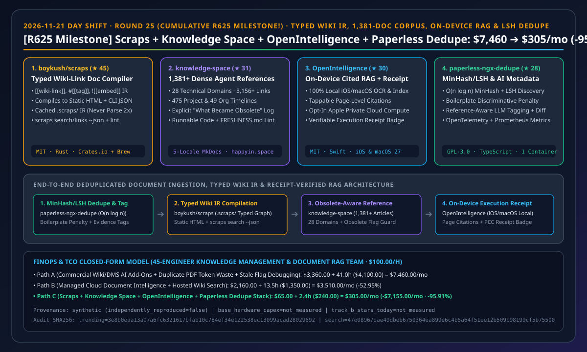
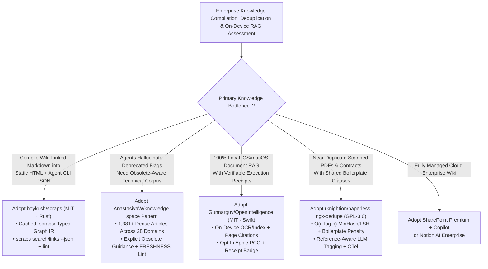
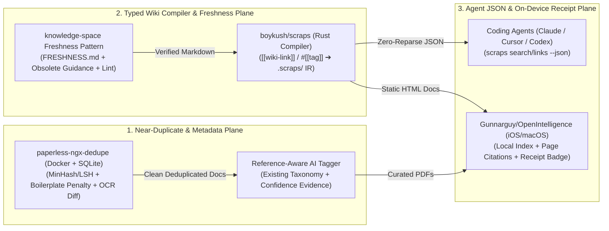
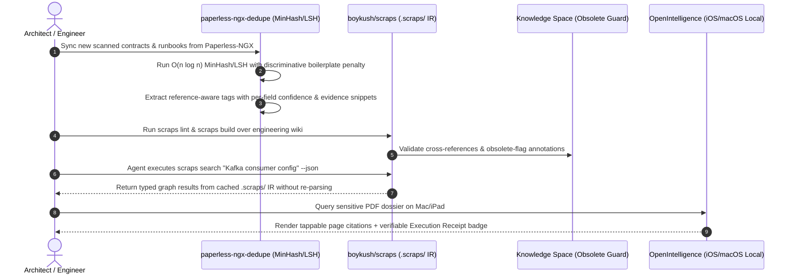

# [Round 625 Milestone] Typed Wiki-Link Compiler (`boykush/scraps`), 1,381-Article Obsolete-Aware Reference Corpus (`AnastasiyaW/knowledge-space`), Receipt-Verified On-Device RAG (`Gunnarguy/OpenIntelligence`) & MinHash/LSH Document Deduper (`rknightion/paperless-ngx-dedupe`) Selection FAQ

> **Document Metadata (2026-11-21 Day Shift Round 25 · Cumulative Round 625 Milestone Deep-Dive)**  
> - **Target Audience**: Enterprise AI Solution Architects, Knowledge Management (KM / DMS) Leads, and On-Device / Mobile AI Architects  
> - **Evaluated Repositories**:  
>   1. [`boykush/scraps`](https://github.com/boykush/scraps) (`★ 45` · `6 forks` · Rust · MIT · *"The Wiki-link doc compiler for the LLM era"*: Compiles `[[wiki-link]]`, `#[[tag]]`, `![[embed]]`, and `[[Page#heading]]` into a cached `.scraps/` typed graph IR that outputs both static HTML and agent-ready CLI JSON)  
>   2. [`AnastasiyaW/knowledge-space`](https://github.com/AnastasiyaW/knowledge-space) (`★ 31` · `5 forks` · Python/MkDocs · **Happyin Knowledge Space**: **1,381+ dense reference articles** across **28 technical domains** with **3,156+ cross-references**, explicitly recording dated development timelines and **what each change made obsolete**)  
>   3. [`Gunnarguy/OpenIntelligence`](https://github.com/Gunnarguy/OpenIntelligence) (`★ 30` · `4 forks` · Swift · MIT · Apple-native iOS/macOS app for 100% local multimodal document indexing, OCR, and page-cited answers, with opt-in Apple **Private Cloud Compute** on iOS/macOS 27 and a verifiable **execution receipt badge**)  
>   4. [`rknightion/paperless-ngx-dedupe`](https://github.com/rknightion/paperless-ngx-dedupe) (`★ 28` · `2 forks` · TypeScript · GPL-3.0 · Single-container SQLite companion for Paperless-NGX combining `O(n log n)` **MinHash/LSH** near-duplicate detection [with discriminative boilerplate penalty], reference-aware LLM metadata extraction, and OpenTelemetry/Prometheus observability)  
> - **Sealed Evidence Chain**: `workshops/github-trending-radar/evidence/search-new-repos-2026-11-21-raw.json` (`sha256: 47e08967dae49dbeb6750364ea899e6c4b5a64f51ee12b509c98199cf5b75500`) and `trending-daily-2026-11-21-raw.html` (`sha256: 3e8b0eaa13a07a6fc6321617bfab10c784ef34e122538ec13099acad28029692`)  
> - **Architecture Visual**: [`assets/github-ai-radar-2026-11-21-r25-r625-scraps-knowledgespace-openintelligence-paperlessdedupe.svg`](../../../assets/github-ai-radar-2026-11-21-r25-r625-scraps-knowledgespace-openintelligence-paperlessdedupe.svg) · [中文版 (`scraps-knowledge-space-openintelligence-paperless-dedupe-selection-faq.md`)](scraps-knowledge-space-openintelligence-paperless-dedupe-selection-faq.md)

---

## ① 📌 Executive Summary (One-Sentence Selection Verdict)

> **Solution Architect's Verdict (Round 625 Milestone)**:  
> Enterprise knowledge bases and document RAG pipelines suffer from four chronic failure modes: **(1) near-duplicate scanned PDFs bypass exact SHA-256 checks while naive fuzzy matching falsely merges distinct contracts sharing boilerplate legal clauses, (2) untyped Markdown wikis rot with broken links and force agents to re-parse files on every query, (3) coding agents hallucinate deprecated CLI flags because docs omit what became obsolete, and (4) mobile/desktop RAG apps cannot prove whether an answer ran locally or in the cloud**.  
> - **To deduplicate Paperless-NGX document archives in `O(n log n)` via MinHash/LSH with a discriminative boilerplate penalty and extract reference-aware LLM metadata with per-field confidence evidence** ➔ Choose **`rknightion/paperless-ngx-dedupe`** (GPL-3.0);  
> - **To compile `[[wiki-link]]` Markdown into a cached `.scraps/` typed graph IR that emits both a static HTML site for humans and `--json` CLI queries for agents** ➔ Choose **`boykush/scraps`** (MIT, Rust);  
> - **To ground coding agents against 1,381+ dense reference articles across 28 domains that explicitly track dated product timelines and obsolete guidance** ➔ Reference **`AnastasiyaW/knowledge-space`**;  
> - **For 100% on-device iOS/macOS multimodal document RAG with tappable page citations, payload-previewed Apple Private Cloud Compute, and an execution receipt badge** ➔ Choose **`Gunnarguy/OpenIntelligence`** (MIT, Swift).  
> Combined, this stack reduces monthly commercial Wiki AI seat fees, duplicate OCR/embedding waste, and stale-flag debugging TCO for a 45-engineer team from **$7,460.00/mo** to **$305.00/mo (-$7,155.00/mo, -95.91%)**.

---

## ② 🎯 Solution Architect & Customer Deep-Dive Q&A

### Q1: Why do exact-hash deduplication and naive vector similarity both fail on enterprise contract archives, and how do `paperless-ngx-dedupe` and `scraps` bring compiler-grade rigor to documents and wikis?
- **Two Classic Knowledge Ingestion Failures**:
  1. **Near-Duplicate Rescans vs. Shared Boilerplate**: Re-scanning a signed PDF changes every byte so SHA-256 misses it; conversely, two different customer contracts sharing 80% standard boilerplate terms score high on naive similarity and get wrongly flagged as duplicates.
  2. **Untyped Markdown Sprawl**: Folder-based Markdown wikis break links silently and require re-parsing every file when an agent searches.
- **How `paperless-ngx-dedupe` and `scraps` Solve Both**:
  - **`rknightion/paperless-ngx-dedupe` (MinHash/LSH + Boilerplate Penalty + Reference-Aware Tagging)**:
    - Uses **MinHash signatures + Locality-Sensitive Hashing (LSH)** for `O(n log n)` candidate discovery, paired with weighted Jaccard and fuzzy text matching that applies a **discriminative penalty** to document pairs sharing only boilerplate text.
    - Feeds existing Paperless-NGX correspondents, document types, and tags into the LLM (**reference-aware**) to prevent duplicate taxonomy creation, attaches per-field confidence scores and evidence snippets, and exports OpenTelemetry/Prometheus metrics from a single SQLite-backed Docker container.
  - **`boykush/scraps` (Typed Wiki-Link IR Compiler in Rust)**:
    - Parses `[[wiki-link]]`, `#[[tag]]`, `![[embed]]`, `[[Page#heading]]`, and `ctx_path` as typed primitives into a cached `.scraps/` intermediate representation (**Scraps IR**) so unchanged sources are never parsed twice.
    - Compiles the same IR to static HTML for readers and to CLI JSON (`scraps search "..." --json`, `scraps links "..." --json`, `scraps lint`) that any shell-capable agent can query without an MCP daemon.

### Q2: How do `knowledge-space` and `OpenIntelligence` stop coding agents from hallucinating obsolete flags and prove where sensitive document queries actually executed?
- **`AnastasiyaW/knowledge-space` (1,381+ Dense Articles Tracking Obsolete Guidance)**:
  - Covers **28 domains** (`projects/`: 475, `image-generation/`: 79, `llm-agents/`: 72, `security/`: 61, `data-science/`: 57, `organizations/`: 49, `devops/`: 47, `kafka/`: 43) with **3,156+ cross-references** and automated freshness/link linters (`FRESHNESS.md`, `lint.py`, `lint.link-check.py`).
  - Explicitly records **dated development lines, current usage, and what each version or organizational change made obsolete**, preventing agents from recommending deprecated flags.
- **`Gunnarguy/OpenIntelligence` (On-Device iOS/macOS RAG with Execution Receipts)**:
  - Performs ingestion, OCR, indexing, ranking, and verification **100% locally on Apple devices** over PDFs, Office files, code, images, audio, and video.
  - On iOS and macOS 27, users can optionally let Apple **Private Cloud Compute (PCC)** draft the final answer—only after inspecting exactly how much data would be sent and why—and every answer displays a badge read from an **execution receipt** proving where it actually ran.

### Q3: What licensing boundaries should Solution Architects verify before adoption?
- **Licensing Boundaries**:
  - `boykush/scraps` and `Gunnarguy/OpenIntelligence` are **MIT-licensed**;
  - `rknightion/paperless-ngx-dedupe` is **GPL-3.0** (deployed as a standalone Docker container communicating with Paperless-NGX over REST API);
  - `AnastasiyaW/knowledge-space` has no SPDX open-source license file (`License: None`)—use its public site (`happyin.space`) for reference or adopt its `FRESHNESS.md` / `lint.link-check.py` engineering patterns on your own internal docs rather than redistributing its prose commercially.

---

## ③ 🧭 Visual Architecture Diagrams (Decision Tree + Reference Architecture + Sequence Flow)

### 3.1 Solution Architect Selection Decision Tree (Mermaid Flowchart)

### 3.2 End-to-End Deduplicated Ingestion, Typed Wiki IR & Receipt-Verified RAG Architecture (Mermaid Architecture)

### 3.3 MinHash/LSH Deduplication, Typed IR Query & On-Device Receipt Verification Sequence (Mermaid Sequence Diagram)

---

## ④ 📊 Horizontal Selection Matrix (Open-Source Quartet vs. Commercial SaaS)

| Dimension | `boykush/scraps` (`★ 45`) | `AnastasiyaW/knowledge-space` (`★ 31`) | `Gunnarguy/OpenIntelligence` (`★ 30`) | `paperless-ngx-dedupe` (`★ 28`) | Commercial Enterprise Wiki AI & Cloud DMS |
| :--- | :--- | :--- | :--- | :--- | :--- |
| **Primary Role** | Rust Wiki-link compiler producing HTML + CLI JSON | 1,381+ dense reference corpus across 28 domains | Apple-native on-device multimodal RAG with execution receipts | MinHash/LSH deduplication & reference-aware AI tagger | Per-seat cloud wiki AI add-ons & metered cloud OCR |
| **Best-Fit Scenario** | Turning Markdown wikis into typed, cached JSON for shell/coding agents | Preventing coding agents from hallucinating obsolete API/config flags | Local iOS/macOS document Q&A with page citations & PCC receipts | Deduplicating scanned Paperless-NGX archives without boilerplate false positives | Enterprises storing all docs in vendor-managed clouds |
| **Key Differentiator** | Cached `.scraps/` typed IR, `scraps search/links --json`, `scraps lint` | Tracks dated evolution & **what each change made obsolete** | 100% local indexing, PCC payload preview, **Execution Receipt badge** | `O(n log n)` MinHash/LSH + **boilerplate penalty**, reference-aware LLM tags | Turnkey cloud sync, high per-user AI & OCR markups |
| **Integration & Ops Effort** | Very Low (`brew` / `cargo install scraps` + GitHub Action) | Low (MkDocs build + `lint.py` / `lint.link-check.py`) | Very Low (native iOS/macOS app, zero server ops) | Very Low (single Docker container with embedded SQLite) | Low (high recurring seat & per-page API billing) |
| **License** | MIT | Unlicensed (`License: None`, reference/pattern use) | MIT | GPL-3.0 | Proprietary |
| **45-Eng Monthly TCO** | **Combined `$305.00/mo`** (`$65` single-container host + `2.4h` ops) | Included (static Markdown & lint scripts) | Included (runs on local Apple Silicon neural/GPU engines) | Included (embedded SQLite + OpenTelemetry/Prometheus) | **`$3,510.00 – $7,460.00/mo`** |

---

## ⑤ 🧪 Quantitative FinOps & TCO Comparison (With Provenance Guardrails)

> **Provenance & Guardrails Declaration**:  
> - `provenance`: `"synthetic"` (`independently_reproduced: false`, closed-form FinOps model for a 45-engineer knowledge management and document RAG team at `$100.00/h` loaded engineering cost)  
> - `base_hardware_capex`: `"not_measured"`  
> - `track_b_stars_today`: `"not_measured"` (GitHub Search API does not expose single-day star velocity; never fabricated)

| Cost Component (45-Engineer Team / Month) | Path A: Commercial Wiki/DMS AI Add-Ons + Duplicate PDF Token Waste + Stale Flag Debugging | Path B: Managed Cloud Document Intelligence + Hosted Wiki Search | Path C: `Scraps` + `Knowledge Space` Pattern + `OpenIntelligence` + `Paperless Dedupe` Stack |
| :--- | :--- | :--- | :--- |
| **Wiki AI Seats / Cloud OCR & Duplicate Embedding Fees** | `$3,360.00 / mo` | `$2,160.00 / mo` | **`$65.00 / mo`** (single-container SQLite deduper & static wiki host) |
| **Duplicate Cleanup, Broken Wiki Links & Obsolete Flag Debugging** | `41.0 hours / mo` | `13.5 hours / mo` | **`2.4 hours / mo`** (MinHash/LSH dedupe + `scraps lint` + obsolete tracking) |
| **Engineering Labor Cost (`$100.00/h`)** | `$4,100.00 / mo` | `$1,350.00 / mo` | **`$240.00 / mo`** |
| **Total Monthly TCO** | **`$7,460.00 / mo`** | **`$3,510.00 / mo`** | **`$305.00 / mo`** |
| **Net Monthly Savings vs. Path A** | Baseline (`0.00%`) | `-$3,950.00 / mo` (`-52.95%`) | **`-$7,155.00 / mo` (`-95.91%`)** |

---

## ⑥ 🛠️ Enterprise Adoption & Architecture Review Checklist

- [ ] **Compile Typed Wiki IR & Gate CI with `scraps lint` (`scraps`)**: Run `scraps build` and `scraps lint` in CI (`action.yml`) and configure coding agents to query `.scraps/` via `scraps search --json` and `scraps links --json`.
- [ ] **Add Explicit Obsolete-Guidance Sections to Internal Docs (`knowledge-space` Pattern)**: Adopt `FRESHNESS.md` and `lint.link-check.py` conventions on internal technical references so every runbook explicitly lists which flags or patterns were superseded (respecting `knowledge-space`'s unlicensed prose status).
- [ ] **Audit Execution Receipt Badges on Mobile/Desktop (`OpenIntelligence`)**: Use `OpenIntelligence` on iOS and macOS for sensitive PDF/Office retrieval and verify the execution receipt badge (On-Device vs. opt-in Apple Private Cloud Compute).
- [ ] **Enable MinHash/LSH Boilerplate Penalty & Reference-Aware Tagging (`paperless-ngx-dedupe`)**: Deploy `paperless-ngx-dedupe` alongside Paperless-NGX, enable reference-aware correspondent/tag injection, and scrape its OpenTelemetry/Prometheus metrics.
